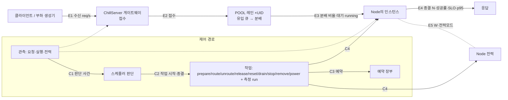

# CHILL Dashboard 구현 설계

## 1. 구현 경계와 결정

[Dashboard SRS](../../spec/dashboard/SRS.md)를 구현 기준으로 사용한다.
제어와 측정 의미는 [시스템 명세](../../spec/README.md)를 따른다.
이 문서는 웹 구현 구조, ChillServer 조회의 재사용과 ChillServer가 추가로 제공할 조회, 전체 수용 검증을 정한다.

- 템플릿은 공식 `shadcn-ui/ui`의 `templates/next-app`과 `dashboard-01` 블록을 사용한다.
- 웹 모듈은 저장소 루트의 `chill-dashboard/`에 두고 독립적으로 빌드하고 배포한다.
- Next.js App Router, React, TypeScript, Tailwind CSS와 shadcn/ui를 사용한다.
- 화면은 컴포넌트 조합으로 구성한다. HTTP는 Next.js Route Handler가, 라이브 WebSocket은 standalone 앞단의 Node `ws` 중계가 고정 ChillServer API로 전달한다(3, 4절).
- 인증, 검증, 변경 선언, 작업 진행, 판단, 통계와 Evidence는 ChillServer와 그 뒤의 CHILL 구성요소가 결정한다. Dashboard는 그 결과를 표시한다.
- Dashboard는 모든 워크로드와 모델에 같은 화면 규칙을 적용한다. 입력과 결과 화면은 전처리기 계약의 필드 이름, 형식과 크기로 구성한다.
- 자동제어는 서버의 워크로드별 현재 설정을 표시한다. 꺼짐을 절감이나 SLO 충족으로 표현하지 않는다. 프로파일의 `loaded`는 운영 판단 반영으로 표시한다.
- 전체 기능의 완료 기준은 SRS의 전체 요구사항과 수용 시나리오다.

### 1.1 현재 개발 범위

2026-10-25 T5/T6 설계 기준은 **4.3~4.5절(라이브 계약 v1), 6.1절(정보 구조),
7.1~7.2절(상태와 재생), 10.1절의 T5/T6 검사**다. 아래 기존 API 연결 현황과
9.2절의 U/G 작업 이력은 구현 증거이며, 새 라이브 기능이 구현됐다는 뜻은 아니다.
SCH-37, DB-INT-07~08, DB-NFR-07, DB-FR-35~49를 이 절들에서 추적한다.

| ChillServer 준비 상태 | 웹 개발 범위 |
|---|---|
| 관리 API 제공 | 모델, 전처리기, 데이터셋과 워크로드 관리, 단일 추론, POOL의 제공 필드와 요청 관측을 실제 응답에 연결한다. |
| 인증된 Console 조회 제공 | System, Inventory, bounded Run 목록, 검증된 Evidence Passport, 봉인된 campaign result와 읽기 전용 preflight를 실제 응답에 연결한다. |
| 스케줄러 조회 제공 | 운영 판단, 실제 구성, 유지안과 후보의 예상 SLO 및 J, 명시적 구간의 부하와 채택 프로파일을 독립 화면에 연결한다. |
| 설정 조회와 적용 제공 | 모든 SchedulerSettings 필드를 현재 값에서 편집하고 변경 전후, 행위자와 Runtime 적용 결과를 확인한다. |
| 스케줄러 기록과 운영 전력 제공 | 현재와 과거 동작, 판단 A/B, 설정 변경과 개별 노드 전력 기록, `GET /observations/power`의 전체 및 활성 POOL 에너지를 연결한다. |
| 측정 요청 제공 | 측정 목록, 단계형 측정 요청, 프로파일 채택과 해제, 측정 삭제를 연결한다. |
| ChillServer 조회 대기 | 측정 결과의 실제 backend와 실행 장치, DeviceClass별 측정 가능 여부, 전환 비용 원본은 5.3절의 셸 설계로 둔다. 허용 자원과 유지보수, 실험 실행, 영역 간 변경 feed, 동작별 에너지 귀속과 수동 취소 및 재시도는 5.4절의 계약으로 둔다. |

지원하지 않는 측정 종류의 일반 `연결 준비 중` 페이지는 제거한다(DB-FR-49).
지원하는 API만 명시적으로 연결하고, 데이터 없음과 기능 미지원은 해당 영역에서 구분한다.
화면의 개발 상태를 CHILL의 실제 운영 상태로 표시하지 않는다.
2026-10-30 API 누락 보완의 **설계만** 6.5절과
[구현 계획](../../plans/2026-10-30-dashboard-api-coverage.md)에 추가했다(DB-FR-53~55).
동작 비용·분배 점유시간 목록/단건 및 용량 행은 서버와 relay에 이미 있으며 화면은 미연결이다.
이 설계는 아래 T5/T6 이력과 별도이며 구현 완료나 실클러스터 검증을 뜻하지 않는다.
전체 SRS의 기능 수용은 각 ChillServer 조회를 연결한 뒤 실제 흐름으로 검증한다.

기존 `/scheduler`, `/scheduler/candidates`, `/scheduler/load`의 판단, 후보와 부하 표시는
라이브 무대와 선택 근거 패널로 합친다(6.1절). 상세는 선택한 사건의 응답을 고정하고,
새 판단이 들어와도 현재 `scheduler/state`로 덮지 않는다.
load 응답의 arrivals는 ChillServer가 생략하므로 UID와 원래 구간으로 전체 적용 정의의
요청 관측에 연결한다. 요청 상세는 CHILL 배정과 nativeProgress의 실제 실행 관측을 구분한다.
`/configuration`은 duration 네 필드, Serving 메모리, 반복 비교와 탐색 상한,
seed 및 제어요소 boolean 아홉 필드를 편집한다. 정밀 정수는 문자열로 유지하며
ms를 정확한 ns로 변환한다. 저장 검토는 현재 설정을 재조회하고 입력을 유지한 채
최신 값과 비교한다. 전체 객체의 마지막 적용값이 현재 설정이 되며 버전 조건과
영향 예측은 ChillServer 조회 대기다. appliedAt은 설정 저장과 Runtime 적용 시각이다.
응답이 불명확하면 현재 값과 제한된 최근 기록을 조회한 뒤 명시적으로 다시 제출한다.
`/scheduler/history`의 종류 필터와 `/scheduler/power`의 노드 필터는 현재 가져온
페이지에 적용한다. 제출된 원래 from/to를 cursor 이동에 복사하고 입력 draft는
별도로 유지한다. 선택 기록은 같은 구간의 append offset에 limit=1로 복원하며
종류, at, 대상과 action의 노드 및 시작 시각이 모두 같은 사건만 같은 기록으로 복원한다.
A/B 비교는 각 판단의 입력 구간과 미래 horizon을 구분하고 UID와 고정 정의별
ChillServer whole-window cohort를 조회한다. 백분위, 총에너지와 실험 점수는 ChillServer 값을 그대로 표시한다.
동작은 제공된 단계와 before/actual을 표시하며 같은 ID라도 시작이 다르면 별개의 동작으로 표시한다.
전력 상세는 단일 기록 모달의 W 시계열과 meter, scope, source, coverage와 실패를 표시한다.
표본 시각은 collector 수신 시각이며 값 없음과 0 J는 별개다. 내보내기는 선택 기록
또는 현재 페이지의 출처, 구간과 모집단을 명시한다.


## 2. 최신 조사와 Git 템플릿

### 2.1 선정 근거

조사 기준일은 **2026-10-07 UTC**다. 사용률, 제품 기본값과 Git 저장소 규모를 함께 비교했다.
저장소의 용도가 서로 다르므로 별 수는 채택 규모의 참고값으로 사용한다.

| 항목 | 확인한 근거 | 선택에 반영한 내용 |
|---|---|---|
| 언어 | [GitHub Octoverse](https://github.blog/news-insights/octoverse/octoverse-a-new-developer-joins-github-every-second-as-ai-leads-typescript-to-1/)는 2025년 8월 TypeScript가 GitHub 최다 사용 언어가 됐다고 보고한다. | 웹 코드는 TypeScript를 사용한다. |
| 웹 생태계 | [Stack Overflow 2026](https://survey.stackoverflow.co/2026/technology/data/web-framework)의 전체 응답자 기준 React 41.5%, Next.js 20.6%다. | 보편적인 React 생태계와 Next.js를 사용한다. |
| 바이브코딩 기본값 | [v0](https://v0.app/docs/design-systems-2)의 기본 starter는 Next.js, shadcn/ui, Tailwind다. [Lovable](https://docs.lovable.dev/introduction/faq)의 신규 앱은 2026년 5월 13일부터 TanStack Start를 사용한다. | 공식 shadcn 템플릿을 선택한다. 도구별 기본 framework의 차이는 유지한다. |
| 아키텍처 | [React의 앱 생성 지침](https://react.dev/learn/creating-a-react-app)은 framework 사용을 권장하고 Next.js의 Node 및 Docker 자체 호스팅을 안내한다. [Next.js BFF](https://nextjs.org/docs/app/guides/backend-for-frontend)는 Route Handler 중계를 제공한다. | 하나의 웹서비스에 화면과 얇은 BFF를 둔다. |
| 디자인 패턴 | [Thinking in React](https://react.dev/learn/thinking-in-react)는 컴포넌트 계층, 단방향 데이터 흐름과 최소 상태를 사용한다. | 기능별 화면, props 조합, 서버 상태와 폼 상태의 분리를 사용한다. |

| Git 후보 | 조사 시 별 수 | 검토 결과 |
|---|---:|---|
| [shadcn-ui/ui](https://github.com/shadcn-ui/ui) ([GitHub API](https://api.github.com/repos/shadcn-ui/ui)) | 125,216 | MIT. 공식 Next 앱 템플릿과 [대시보드 블록](https://ui.shadcn.com/blocks)을 선택한다. |
| [satnaing/shadcn-admin](https://github.com/satnaing/shadcn-admin) ([GitHub API](https://api.github.com/repos/satnaing/shadcn-admin)) | 15,617 | MIT. React와 Vite 기반 관리 화면의 대안이다. |
| [Kiranism/next-shadcn-dashboard-starter](https://github.com/Kiranism/next-shadcn-dashboard-starter) ([GitHub API](https://api.github.com/repos/Kiranism/next-shadcn-dashboard-starter)) | 7,104 | MIT. Clerk 조직과 billing, Sentry, 전역 상태와 명령 팔레트 등의 제품 구성이 포함된다. |

CHILL이 필요한 화면 컴포넌트와 API 중계를 갖는 공식 기반을 선택한다.
인증은 기존 Kubernetes identity를, 업무 동작은 ChillServer 공통 API를 사용한다.

### 2.2 고정 Git 출처와 재사용

실제 shallow clone으로 다음 commit의 소스와 라이선스를 확인했다.

- 저장소: `https://github.com/shadcn-ui/ui.git`
- 고정 commit: `e8c3143b1cd191280befcd6c9538284bb43399a8`
- 앱 원본: [templates/next-app](https://github.com/shadcn-ui/ui/tree/e8c3143b1cd191280befcd6c9538284bb43399a8/templates/next-app)
- 화면 원본: [dashboard-01](https://github.com/shadcn-ui/ui/tree/e8c3143b1cd191280befcd6c9538284bb43399a8/apps/v4/registry/new-york-v4/blocks/dashboard-01)
- 라이선스: [MIT 원문](https://github.com/shadcn-ui/ui/blob/e8c3143b1cd191280befcd6c9538284bb43399a8/LICENSE.md). 복사한 코드에 저작권과 허가 문구를 보존한다. CHILL 저장소의 라이선스는 기존 정책을 유지한다.

구현 시작 시 해당 commit을 checkout하고 앱 템플릿, 선택한 블록과 그 블록이 참조하는
UI, hook 및 util만 모듈로 가져온다. import 경로를 모듈 내부 경로로 정리하고
출처, commit, 복사 범위를 모듈 README와 MIT 고지에 기록한다.

재사용 대상은 Sidebar, Header, Card, Table, Chart, Dialog, Tabs, Select, 입력과 상태 표시다.
원본 `data.json`, 예제 매출과 desktop/mobile 시계열, 예제 계정과 행 재정렬은 제거한다.
한국어 문서 언어를 사용한다. 글꼴은 한글을 포함한 Asta Sans를 `next/font`로 빌드 때 받아
자체 정적 자산으로 제공하므로 브라우저는 같은 origin에서 글꼴을 받는다.

### 2.3 라이브러리와 버전

[원본 package.json](https://github.com/shadcn-ui/ui/blob/e8c3143b1cd191280befcd6c9538284bb43399a8/templates/next-app/package.json)의
Next `16.3.6`, React 및 React DOM `19.3.0`, TypeScript `^5`, Tailwind `^4`를 초기 기준으로 유지한다.
조사 시 npm 최신값은 [Next 16.4.0](https://registry.npmjs.org/next/latest),
[TypeScript 7.0.2](https://registry.npmjs.org/typescript/latest)였다.
pnpm은 [원본 toolchain](https://github.com/shadcn-ui/ui/blob/e8c3143b1cd191280befcd6c9538284bb43399a8/package.json)의 `10.33.4`를 사용한다.
구현에서 호환성을 확인한 정확한 의존성을 lockfile에 고정한다.
런타임은 [Node.js 24.21.0 LTS](https://nodejs.org/en/about/previous-releases)를 사용한다.

| 역할 | 선택 | 사용 범위 |
|---|---|---|
| UI와 스타일 | shadcn/ui, Radix, Tailwind와 실제 복사한 UI의 util 및 아이콘 의존성 | 원본 접근성 primitive와 반응형 화면을 재사용한다. |
| 표 | 원본 블록의 TanStack Table v9 | 행 링크, 정렬과 API pagination 상태를 연결한다. 복사한 v9 API를 기준으로 한다. |
| 그래프 | 원본 블록의 Recharts 3.8.0 | API가 제공한 분포와 시계열을 그린다. 관측 누락은 null과 공백으로 표시한다. |
| 서버 상태 | [TanStack Query 5.104.1](https://registry.npmjs.org/@tanstack%2Freact-query/latest), native `fetch` | cache, 제한된 polling, 요청 취소와 변경 중 상태를 사용한다. |
| 폼과 로컬 상태 | native HTML, React `useState`, URL search parameters | 업무 입력과 서버 필드 오류를 연결한다. 도메인 검증은 ChillServer에서 수행한다. |
| 날짜와 시간 | `Intl.DateTimeFormat`, `Date`, 원본 RFC3339Nano 문자열 | 표시와 조회 구간 변환을 수행하고 원본 정밀도를 보존한다. |
| WebSocket | Go `github.com/coder/websocket v1.8.13`, Node `ws 8.18.3`, 브라우저 native `WebSocket` | T5 서버와 standalone 앞단이 직접 사용하며 `go.sum`과 `pnpm-lock.yaml`에 고정한다. 프로토콜 프레이밍은 라이브러리에 맡긴다. |

의존성은 `next-app`과 복사한 UI의 실제 import를 기준으로 설치한다.
표는 API의 구체적인 TypeScript 타입을 사용하고, 목록의 각 행은 상세와 작업으로 바로 이동한다.

## 3. 모듈과 실행 구조

현재 웹 모듈의 실행 구조다. 같은 CHILL Helm release의 별도 Deployment로 배포한다.

```text
브라우저: 화면, 폼, 메모리 인증정보, Query cache
    → HTTPS chill-dashboard: Next.js 화면과 /api/chill Route Handler
    → HTTPS ChillServer 공통 관리 진입점
        → Serving의 Model, 전처리기, 데이터셋과 Workload 관리, 요청 관측 기록, 스케줄러와 측정 요청
        → Console query 및 검증된 Evidence 조회
        → 자원 관리, 설정과 전환의 해당 CHILL 구성요소
```

현재 모듈 배치는 다음과 같다.

```text
chill-dashboard/
  app/                     화면 route, layout와 api/chill/[...path]/route.ts
  components/ui/           선택한 공식 UI 코드
  features/                기능별 화면
  lib/                     구체적인 API 타입, fetch, 코드 문장 표와 표시 함수
  public/                  자체 정적 자산
  package.json             독립 dev, build, start, lint, typecheck
  pnpm-lock.yaml           검증한 의존성 고정
```

App Router의 layout은 shell과 안전한 웹 설정을 전달한다. 인증된 데이터는 client 화면에서
같은 origin의 BFF를 호출해 조회한다. 서버 데이터는 Query cache에, 작성 중 입력은 폼에,
대상과 필터 및 구간은 URL에 둔다.

공통 HTTPS ChillServer는 `cmd/chill-server`에서 조립한다. 기존 Serving handler를 유지하고
Console 조회는 요청별 사용자 인증 및 SAR 후 고정 private Console origin으로 중계한다.
Console의 기존 Evidence Store binding, retained loader 및 production preflight resolver를 재사용한다.
`--dashboard-url`은 API와 health 경로 외의 화면, 정적 자산과 BFF를 private Dashboard로
중계한다. 공개 HTTPS ChillServer → Dashboard BFF → HTTPS ChillServer `/api/v1`의 경로는 서로 분리된다.
Standalone Console과 CLI는 기존 query 및 검증 계약을 유지한다. ingress controller가
없는 클러스터에서도 ChillServer의 HTTPS NodePort로 Dashboard에 접근할 수 있다.

T5 실행 구조는 HTTP 경로를 유지하고 다음 한 경로만 추가한다.

```text
브라우저 WSS /api/live --첫 auth--> Node ws 앞단(공개 :3000)
  --Authorization: Bearer--> 고정 HTTPS ChillServer GET /api/v1/live
Node 앞단 --일반 HTTP--> 수정하지 않은 .next/standalone/server.js(127.0.0.1:3001)
```

`next.config.ts`의 standalone 출력을 그대로 쓴다. 새 `server/live-proxy.mjs`가 내부
`server.js`를 자식으로 실행하며 Next를 직접 import하는 custom server는 만들지 않는다.
`build/docker/dashboard.Dockerfile:10-19`의 현재 `node server.js`를 앞단 실행으로 바꾸고
standalone 추적에 포함되지 않는 앞단 파일과 `ws` runtime도 복사한다. 외부 Service는
3000만 노출하고 내부 3001은 loopback에만 bind한다. 시작 실패와 SIGTERM은 두 프로세스를
함께 종료한다. Node 24.21.0/pnpm 10.33.4를 유지하고 `engines`도 Node 24로 맞춘다.
공개 ChillServer를 경유할 때 `cmd/chill-server/http_routes.go:composeChillServer`의
Dashboard reverse proxy가 `/api/live` Upgrade와 원래 Origin/Host를 보존해야 한다.

패키지 허용 범위는 [아키텍처 규칙](../../../.go-arch-lint.yml)을 따른다.
Serving과 Console의 handler 연결은 `cmd/**`의 조립 권한을 사용한다.
웹은 ChillServer API를 호출한다. Kubernetes, firstfloor, S3와 Node 동작은 ChillServer 뒤의 CHILL 구성요소가 수행한다.

## 4. 인증과 API 중계

### 4.1 기존 신원 전달

기존 Kubernetes bearer token을 인증 화면에서 입력받아 탭의 메모리에 둔다.
토큰 발급과 갱신은 클러스터의 기존 인증 절차를 사용한다.
브라우저는 `Authorization: Bearer`로 같은 origin의 BFF를 호출하고 BFF는 원본 토큰을
ChillServer에 전달한다. ChillServer가 TokenReview와 대상 및 HTTP 동작의 SubjectAccessReview를 수행한다.

새로고침하면 토큰을 다시 입력한다. 대상과 작업 URL은 유지해 인증 후 실제 상태를 조회한다.
로그아웃과 토큰 변경 때 진행 조회와 변경을 취소하고 cache를 비운 뒤 새 native QueryClient로 교체하며 민감한 폼을 remount한다. 이전 신원의 늦은 continuation은 이전 cache에서 끝난다.
토큰의 취급 범위는 탭 메모리와 TLS 요청의 Authorization header다.

현재 [Authorizer](../../../internal/serving/kube/authorizer.go)는 TokenReview로 검증한
username과 UID의 private `Principal`을 반환하고 SAR를 수행한다. handler와 manager는 그
검증된 신원만 변경 작업과 관리 관측 기록에 남긴다.

- 인증 누락, 거부 또는 무효 token은 401, 실제 SAR 거부는 403이다.
- review 통신 실패, API 권한 오류와 SAR evaluation 오류는 503이며 변경은 거부된다.
- SAR의 non-resource path는 외부 HTTP path에 `/chill`을 붙인다. 이 접두사로 Kubernetes 기본
  `system:discovery`의 `/api/*` 읽기 권한과 CHILL 자료 권한을 분리한다.

Console reader의 Kubernetes client는 서버 identity로 동작한다. 따라서 공통 진입점의
정확한 verb와 path SAR가 실제 사용자 권한 경계다. namespace와 대상이 포함된 경로 및
내보내기 동작에 권한을 부여하고, ClusterRole binding은 클러스터 관리자가 관리한다.
Console private leg는 서버 identity만 사용한다. 공개 API mount는 정확한 인증 경계를 거친다.

### 4.2 얇은 BFF 계약

- 중계 대상은 서버 전용 고정 `CHILL_BASE_URL` HTTPS origin 하나와 `NODE_EXTRA_CA_CERTS`로 정한다. 코드와 설정에서 이 origin을 ChillServer로 부른다.
- 허용한 method와 path를 `/api/chill/v1/...`에서 `/api/v1/...`로 연결한다. native Node HTTPS가 CA와 hostname을 검증하고 redirect는 받은 상태 그대로 반환한다.
- `Authorization`, `If-Match`, `Content-Type`, 추론 timeout과 필요한 CHILL 식별자 header만 전달한다.
- HTTP 상태, 완전한 bounded 응답 본문, 요청 ID와 Workload UID를 보존한다. 요청과 응답은 각각 8 MiB, 응답 header는 16 KiB로 제한하며 완료된 본문만 성공으로 반환한다.
- 인증된 fetch와 응답에 `no-store`를 적용하고 사용자별 데이터는 해당 탭의 Query cache에서 관리한다.
- 조회, 변경과 추론의 timeout 및 body 한도를 웹 설정으로 제한한다. 추론 timeout은 ChillServer 허용 범위와 사용자가 선택한 값을 따른다.
- 변경, 측정과 추론의 응답 미수신은 결과 미확인으로 표시한다. BFF 연결 오류와 timeout은 별도 Dashboard 오류 코드로 표시한다.
- API의 202는 접수로 표시한다. 재제출은 원본 상태 조회와 사용자 확인을 거쳐 수행한다.

변경 재전송은 사용자 확인 후 수행한다. 오류의 API code, 대상, field와 이유를 보존한다.
외부 문자열은 React의 텍스트 렌더링을 사용한다. 원본 JSON도 텍스트로 표시하고
자료 내보내기는 복사본에서 credential 필드를 제거하며 원본 객체는 그대로 둔다.

스케줄러의 int64 seed, uint64 메모리와 duration은 native JSON reviver의 원문과
JSON.rawJSON으로 정확하게 유지한다. 지원 브라우저에서만 설정을 저장한다.
원본 보기와 내보내기는 같은 직렬화를 사용하고 기존 credential 제거를 유지한다.
조회는 serving-manager의 정확한 세 scheduler GET 경로를 사용한다.
설정 PUT은 unbound scheduler-editor ClusterRole과 serving namespace의 같은 이름
Role을 관리자가 선택한 계정에 각각 binding한다. Role은 설정된 ConfigMap 하나의
update만 허용한다. 사용자 변경 권한은 관리자가 binding한 계정에만 부여된다.

### 4.3 라이브 채널 메시지 계약 v1

**최종본은 이 절이다.** 운영 계획의 2절 초안을 아래 의미로 고정한다.
대상: SCH-37, DB-INT-07~08, DB-NFR-07. 브라우저 endpoint는 `/api/live`,
상류는 `GET /api/v1/live`다. JSON 텍스트 프레임만 사용한다.

서버 메시지 공통 필드는 `{type,seq,at}`다. `seq`는 0 이상의 JS safe integer,
`at`은 원본 RFC3339Nano UTC다. `hello`/`snapshot`은 현재 head의 checkpoint를
알리는 제어 메시지이고 새 순번을 만들지 않는다. `delta`/`event`/`metrics`/`heartbeat`는
한 hub에서 전역 순번을 1씩 증가시킨다. `hello.at`은 송신 시각이고, `snapshot.at`은
해당 head의 원본 발행 시각이다(0일 때 hub 생성 시각). 원본 관측 시각은 DTO에 별도로 둔다.

| type | 공통 필드 외 payload | 발행 |
|---|---|---|
| `hello` | `protocol:"chill-live/1"`, `serverAt`, `retainFrom`(재개 가능한 최소 seq, 빈 버퍼면 head+1) | 상류 인증 성공 후 한 번 |
| `snapshot` | `workloads`, `nodes`, `instances`, `routing`, `decision`, `actions`, `reservations` 전체 | 최초 접속, 재동기화 |
| `delta` | snapshot 키의 부분집합; `removed?:{instances?:[id],actions?:[actionKey]}` | 상태 변화 |
| `event` | `kind:"decision"`와 `decision`, `kind:"action"`와 `action`, 또는 `kind:"cluster"`와 `cluster` | 판단, 작업 시작·종결, 기록된 Pod·observer issue 사건 |
| `metrics` | `bucketAt`(UTC 초 시작), `workloads:{uid:Metric}`, `nodes:{uid:{watts:number|null,observedAt:string|null}}`, `pool:{wholeWatts:number|null,activeWatts:number|null}`, `gaps?:[{from,to,scope,reason}]` | 매초, 같은 버킷 수정 시 전체 대체 |
| `heartbeat` | `serverAt` | 5초 |

snapshot의 작은 DTO는 다음과 같다. 아래 `?`는 생략 가능, `null`은 확인할 값 없음이다.

- `workloads[]:{uid,name,model,definitionID:string|null,slo:{percentile,targetLatencyNanos},autonomous,admission,pending,readiness:{ready,reason,observedAt}}`. `pending`은 배정 전 유입 큐 길이(runtime `WorkloadState.Pending`).
  적용 정의가 있으면 그 이름/모델/SLO를, 아직 없으면 등록 정의를 표시하고 definitionID는
  null, admission/readiness.ready는 false다. 동일 이름의 새 UID와 합치지 않는다.
- `nodes[]:{uid,name,powerMode,ready,measurement,reasons?,observedAt}`. 전력 W는 `metrics` 프레임에만 있다.
- `instances[]:{id,node:{uid,name},ownerWorkloadUID,profileID,ready,stopped,routable:{uid:boolean},running:{uid:number},waiting:{uid:number},observedAt}`.
  단일 `workloadUID`와 binding 수로 추정한 `state`는 없다. 준비(`ready`), 배분 가능 여부(`routable`),
  실제 배분(`routing`), native 실행(`running`)과 작업(`actions`)은 독립 사실이다.
  `waiting`은 배정 뒤 native queued/deferred이며 `AssignedUnknown`을 포함하지 않는다.
- `routing:{workloadUID:{instanceID:weight}}`는 실제 배분이다. 선언과 목표는 근거 REST에서
  별도로 읽는다. `decision:null|{at,state,reason}`에서 큰 후보·프로파일은 제외한다.
  판단 identity는 원본 RFC3339Nano `decision.at`이다. `SchedulerDecision`에 없는 id 필드를
  새 원본 식별자로 가정하지 않는다. 근거 조회는 3장의 `decision.at` 구간 조회다(6.1절).
- `reservations[]:{owner,nodes:[{uid,name}],workloadUIDs:[uid],podUIDs:[uid],instances:[id],reason}`는
  판단 snapshot의 `SchedulerReservation`(`internal/serving/scheduler.go`)에서 `target`·`routeOnly`를 뺀 것이다.
  reason 미제공은 `"미확인"`이며, 빈 배열이 예약 해제를 나타낸다. 작업 종결로 해제를 추정하지 않는다.
- `actions[]:{id,kind,node:{uid,name},workloadUID,status,startedAt,completedAt?,expectedSeconds:number|null,expectedSource:{costID,reference,statistic:"mean",trialCount}|null}`.
  identity인 `actionKey`는 JSON 튜플 `[id,node.uid,startedAt]`이다. 이벤트의 `action`에는
  `phase:"started|completed|failed"`와 작은 `result?:{status,error?}`가 추가된다.
  `starting/running`만 진행 중이며 `complete/failed/partial`은 종결이다(`OperationResult.Status`,
  `internal/serving/kube/operations.go:344-348`). `partial`은 `phase:"failed"`로 보내되 원본 status를 유지한다. 예상 시간·출처는
  [T4 관측 설계](../serving/observability-split.md)를 따른다.
- `cluster:{kind:"pod"|"issue",at,event,pod?:{namespace?,name?,uid,node?,phase?,ready?:string},source?,reason?,previousReason?}`.
  원본 `ClusterObservation`의 작은 projection이다. Pod의 ready는 원본 condition 문자열이며 boolean으로 재판정하지 않는다.
  `event.kind="cluster"`는 기록 성공 뒤에만 발행하고, 상태 변화가 없으면 앞에 빈 delta를 붙이지 않는다.

한 runtime capture의 `workloads/instances/routing/removed`와 한 판단의
`workloads/nodes/reservations/decision`은 각각 한 delta다. 동일 상태의 재발행과 동일 판단·작업 callback은 생략한다.
runtime workload readiness의 읽기 시각만 바뀐 것은 상태 변화로 세지 않는다.
- `Metric:{received,completed,failed,withinSLO,latencySamples,p50ms:number|null,p95ms:number|null,p99ms:number|null}`.
  모든 count는 0 이상의 정수다. 관측 가능한 각 UID는 무유입 초에도 0 count로 보내고,
  계측 불가 구간은 0을 만들지 않고 `gaps`로 보낸다. 의미와 분모는 4.4절을 따른다.

S2 서버 선행 수정은 위 DTO를 투영한다(`internal/serving/live/types.go`, `cmd/chill-server/live.go`).
`decision.recordRef`, `instances[].workloadUID/state`, `nodes[].targetPowerMode/watts`는 제거됐다.
이는 코드 계약이며 승인 배포·실제 WebSocket 수용 완료를 뜻하지 않는다.

`delta.instances/actions`는 identity별 **행 전체 upsert** 후 `removed`를 적용한다.
`workloads/nodes/routing/reservations`는 키가 있으면 해당 컬렉션 **전체 대체**이며 생략은 유지,
빈 배열/맵은 비우기다. `decision:null`은 판단 제거다. 삭제된 정의는 현재 목록에서
사라져도 시간축의 정의 사전에는 남긴다. `event`는 사건 이력이며 현재 상태의 권위는
snapshot/delta다. 생산자는 상태 변화가 있으면 관련 delta 뒤 event를 발행하며, cluster 사건은 event만 발행한다.

클라이언트 메시지는 아래 둘뿐이다. auth에는 seq가 없다.

```json
{"type":"auth","token":"<bearer>"}
{"type":"resume","from":123,"at":"2026-10-25T12:00:00.123456789Z"}
```

`auth`는 브라우저→앞단에서만 소비하며 상류로 그대로 보내지 않는다.
`resume.from=0`은 새 baseline 요청이고 `at`을 생략한다. 나머지는 마지막 적용한
checkpoint의 원본 `at`을 함께 보낸다. seq가 서버 재시작 후 우연히 같아도 다른 이력을
재개하지 않도록 보관된 `(seq,at)`가 일치할 때만 재개한다. 초안의 `from` 단독 메시지는
최종 v1에서는 `from=0` 외에 허용하지 않는다. 별도 epoch나 영속 seq 저장소는 만들지 않는다.

#### D3 인증과 연결 수명

1. 앞단은 정확한 `/api/live` Upgrade, 동일 Origin을 확인한다. 기준은 배포한 공개
   `CHILL_PUBLIC_ORIGIN`이며 미설정 시 검증한 HTTPS Host다. 임의 forwarded 헤더는
   신뢰하지 않는다. query(토큰 포함), subprotocol, 누락·다른 Origin은 거부한다.
2. Upgrade 뒤 5초 안에 16 KiB 이하 첫 텍스트 `auth`를 받는다. 기존
   `lib/relay.ts:174-179`의 bounded Bearer 형식을 재사용한다. 토큰은 탭/연결 메모리만
   사용하며 URL, cookie, 영속 저장소, 오류 본문과 로그에 넣지 않는다.
3. 그 뒤에만 TLS/hostname/CA를 검증하는 고정 `CHILL_BASE_URL`의 `/api/v1/live`로
   연결하며 `Authorization: Bearer <token>`으로 변환한다. redirect와 임의 origin,
   cookie 및 전달된 신원 헤더는 허용하지 않는다.
4. ChillServer는 Upgrade **전에** 기존 TokenReview와 `get /chill/api/v1/live` SAR를
   모두 통과시킨다. 통과 전에는 hello를 포함해 **데이터 프레임 0개**다. 실패는
   HTTP 401/403/503이고 앞단은 각각 4401/4403/1013으로 즉시 닫는다. 대기 초과·잘못된
   첫 메시지는 4401, 인증 뒤 잘못된 계약은 1002다. 4401/4403은 자동 재시도하지 않는다.
5. 앞단은 auth 뒤 일찍 온 resume 한 건만 상류 handshake 동안 보관한다. 상류 성공 후
   hello→resume 처리→snapshot 또는 재개 메시지 순서로 보내며 snapshot 앞에 delta가
   끼지 않도록 hub의 head 캡처와 구독 등록을 한 잠금에서 한다.
6. `internal/serving/httpapi/handler.go:ServeHTTP`의 일반 요청 timeout과
   ResponseController deadline 설정(현재 :113-136)에 들어가기 **전** 정확한 live
   경로만 분기한다. 인증/handshake는 10초, 연결 후 소켓별 write는 5초로 제한하되
   일반 HTTP 요청 제한으로 연결 전체를 종료하지 않는다. 기존 HTTP 경로는 그대로다.
   양 끝 종료, 사용자 변경, 로그아웃과 서버 shutdown에서 구독·타이머·두 소켓을 해제한다.

RBAC는 `charts/chill/templates/serving_entrypoint_rbac.yaml:243-250`의 caller grant에
정확한 `nonResourceURLs:["/chill/api/v1/live"], verbs:[get]`을 추가한다.
전역 feed는 전체 scheduler/workload 관측을 보는 권한이다. 제한된 단일 workload 권한을
전역 feed 권한으로 넓히거나 서버 ServiceAccount로 사용자를 대체하지 않는다.

### 4.4 발행 지점과 1초 집계

아래 표는 2026-10-25 발행 경계 조사다. 2026-10-28 T5는 해당 callback을
`cmd/chill-server/live.go`와 `internal/serving/live`에 연결했으며, 보존 WIP를 통째로 복원하지 않았다.

| 데이터 흐름 | 읽은 현재 코드 위치 | 구현 연결점 |
|---|---|---|
| 판단·실제 snapshot | `internal/serving/kube/scheduler.go:SchedulerController.Tick`(:286-295), `cmd/chill-server/scheduler_service.go:recordDecision`(:358-362), config 연결 :253 | 기존 OnDecision을 재사용해 판단과 **같은 capture의 snapshot**을 기록한 뒤 작은 delta/event를 발행한다. 콜백 인자로 snapshot을 함께 넘겨 State 재조회와 시점 혼합을 없앤다. |
| 작업 시작·종결 | `kube/scheduler.go:SchedulerController.launch`(:874-916), `scheduler_service.go:recordAction`(:364-381) | OnAction의 OperationResult를 그대로 projection한다. 완료 콜백은 state.Results 갱신보다 앞이므로 그 안에서 State를 다시 읽지 않는다. 실제 준비·배분은 결과 actual과 runtime 관측으로 갱신한다. |
| 수신·응답 종결·실행 단계 | `internal/serving/observation_log.go:ObservationLog.RequestEvent`(:585-625), `RequestClosed/closeRowLocked`(:653-681), `runtime.go:Instances/instancesLocked`(:1028-1066) | RequestEvent 반영 성공 뒤 집계 callback을 호출한다. 재시도 가능한 final append나 native supplement를 새 요청 완료로 세지 않는다. native running 상태는 같은 callback에서 작은 상태에 반영하고 초당 delta로 묶는다. |
| 전력 표본 도착 | `internal/metricobserver/observer.go:Observer.sample`(:193-218), `scheduler_service.go:restartPower`(:398-428) | 기존 ReadMetrics 성공 결과를 감싸는 Source adapter에서 node UID와 collector 수신 시각으로 집계한다. 기존 Observe 완료까지 기다리거나 새 수집 루프를 만들지 않는다. 실패 표본은 값 없음으로 전달한다. |

조립은 `cmd/chill-server/server.go`와 `scheduler_service.go`에 둔다.
`internal/serving/live` hub/집계기와 `httpapi/live.go`를 연결한다. callback은 짧은
메모리 갱신만 하고 소켓·REST·S3를 기다리지 않는다. 기록 오류 처리와 물리 작업의 기존
실패 계약은 유지한다. 주기 작업은 집계/변경 상태 flush와 heartbeat뿐이고 서버 REST polling은 없다.

- 버킷은 UTC `[bucketAt,bucketAt+1s)`다. `received`는 `receivedAt` 사건률이고,
  나머지는 **response_finished.At(응답 종결 시각)**으로 선택한 같은 요청 집단이다.
  `completed`는 outcome=`completed`인 성공 수, `failed`는 timeout·취소·거절·오류·전달
  실패 등 나머지 종결 수다. native `finished`나 `ExecutionComplete`만으로 성공을 만들지 않는다.
- `N=completed+failed`, 성공률=`completed/N`, SLO 안=`withinSLO/N`,
  SLO 밖=`(completed-withinSLO)/N`, 실패=`failed/N`다. `received`로 나누지 않는다.
  `withinSLO`는 각 요청에 적용된 SLO와 종단 지연으로 판정한다. 미완료는 종결 집단에
  넣지 않고 대기 상태로 구분한다. `N=0`이면 비율·분위수는 null이지 0%가 아니다.
- p50/p95/p99는 같은 종결 집단의 유효 종단 지연(실패 포함)을 서버에서 계산한다.
  지연 없음은 제외하고 `latencySamples`와 상세의 포함 조건을 표시한다. 요청별 SLO/정의
  변경은 definitionID를 보존한다. 단계/장기 cohort 성공률은 별도 T4 REST 결과이며
  이 초별 종결 집단과 섞지 않는다.
- 완료된 초를 매초 발행하고 늦은 callback은 최근 10초까지만 원 버킷에 누적 보정한
  **전체 버킷**을 재발행한다. 같은 bucketAt 수신은 더하지 않고 대체한다. 그보다 늦으면
  `gaps`에 원 구간·scope·보정 불가 이유를 표시하고 보존된 REST 관측으로 채운다.
  원시 요청은 채널에 싣지 않는다.
- 노드 W는 해당 초에 도착한 실제 표본의 산술평균이며 이전 W를 복사하지 않는다.
  전체/활성 POOL은 각각 전체 meter 노드/실제 활성 소속 노드를 UID별 한 번씩 합친다.
  해당 범위의 필수 표본이 하나라도 없거나 소속을 모르면 합계는 null이다. J와 단계
  에너지는 서버의 coverage 검증 적분 REST를 사용하며 W 표본을 브라우저에서 합산하지 않는다.

### 4.5 seq 버퍼, 재동기화와 느린 수신자

- 초기 상한은 hub 최근 **600메시지/8 MiB 중 먼저 도달한 것**, 연결당 큐
  **602메시지/2 MiB**, 단일 프레임 **1 MiB**다. 600메시지는 10분 보장과 다르다.
  상한 밖 snapshot은 성공으로 잘라 보내지 않고 1009로 닫아 크기 초과를 알린다.
- auth 직후 브라우저는 resume을 보낸다. 첫 접속/from=0, `(from,at)` 불일치,
  보관 범위 밖 또는 미래 seq이면 현재 snapshot을 보낸다. 유효하면 `seq>from`을
  순서대로 재전송하고 이어서 새 발행을 받는다. 재개 결정 전 데이터는 보내지 않는다.
- 브라우저는 hello.seq를 마지막 적용 seq로 올리지 않는다. baseline 이후 중복
  seq는 버리고 `last+1`을 넘는 메시지는 적용하지 않은 채 재동기화한다. snapshot은
  새 baseline으로 받아들이되 잃은 시간 구간을 보존한다. heartbeat는 연결 생존이지
  새로운 요청·전력 관측이 아니다.
- 큐 초과는 오래된 metrics부터 버린다. **빠진 seq 이후의 delta/event보다 앞에**
  head snapshot barrier를 넣고, 누락 지표·사건 시간은 공백 처리한다. 상태 메시지도
  공간이 없으면 pending 큐를 snapshot 하나로 바꾼다. socket write가 계속 막히거나
  Node `bufferedAmount`가 2 MiB를 넘으면 1013으로 닫고 재연결/resume한다.
  어떤 경우에도 scheduler/서빙 producer를 느린 브라우저가 막지 않는다.
- 재연결은 0.5초부터 최대 30초 지수 backoff+jitter다. baseline 수신 후만 정상
  연결로 전환한다. 401/403 계열은 자동 재연결 대신 신원/권한 수정을 요구한다.

보존 WIP는 저장소 밖 `preserved-work-20261025/live-server/{tracked.patch,untracked.tgz}`와
`live-stage/{tracked.patch,untracked.tgz}`다(ops/pools-deploy 아래). hub·metrics의
비차단 발행, 완료 시각 집계/10초 보정, `live-proxy.mjs`의 별도 앞단, Query reducer만
재사용 근거로 삼는다. 즉시 snapshot 후 resume의 경합, 컬렉션 대체/upsert 혼용,
불완전 노드 합계, ready를 처리로 읽는 표시 및 gap을 숨기는 부분은 최종 계약에 맞춰 바꾼다.


## 5. ChillServer 조회와 추가 계약

### 5.1 현재 재사용 가능한 표면

아래 준비 상태의 근거는 소스의 HTTP 등록과 조회 구현이다.
Serving 경로는 [현재 handler](../../../internal/serving/httpapi/handler.go),
Console 경로는 [현재 read handler](../../../internal/operatorconsole/readapi/handler.go)를 기준으로 한다.
relay 허용 목록은 `chill-dashboard/lib/relay.ts:47-104`다.

| method와 `/api/v1` 하위 경로 | 현재 제공 범위 | 웹 연결과 필요한 보완 |
|---|---|---|
| `GET, POST /models`, `GET, PUT, DELETE /models/{id}` | ModelSpec 조회와 변경, 버전 전제조건 및 참조 보호. 실행 경로는 `firstfloor`와 산출물 형식별 backend만 통과한다(`internal/modelcatalog/catalog.go:107-123`). | 등록 폼과 영향 확인에 재사용한다. 실행 방식 선택지는 같은 규칙을 따른다(U2). |
| `GET, POST /preprocessors`, `GET, PUT, DELETE /preprocessors/{id}`, 같은 형태의 `/datasets` | 전처리기의 `input.fields`와 `output.fields` 계약, 데이터셋 필드, 참조 보호 | 단계형 등록과 계약 결론 문장, 입력과 결과 화면의 필드 원본이다. |
| `GET, POST /workloads`, `GET, PUT, DELETE /workloads/{id}` | desired, appliedDefinition, supportedInputs, admission, readiness와 사유, operation | 정의, 실제 준비와 접수 및 작업을 구분한다. 준비 사유는 6.4절의 문장으로 표시한다. |
| `POST /workloads/{id}/infer` | 단일 원시 표본 입력(Preprocessor 입력 필드의 base64 `BYTES`), 실제 응답과 요청 identity | 단일 추론에 재사용한다. |
| `GET /pools`, `GET /pools/{id}` | 실제 Node와 Workload identity, 인스턴스, 준비 및 대기와 실행 수 | 자원, 모델 경로와 전력모드 및 활성 범위의 실제 관측을 추가한다. |
| `GET /observations/workloads/{uid}` | 구간, 정의 및 outcome 필터, cursor, 전체 선택 구간 cohort와 raw 이벤트 | SLO 초과, 분포, 집계 설정과 archive 조회 계약을 보완한다. |
| `GET /namespaces/{namespace}/profiling-runs/{name}/evidence-passport` | 검증된 Run 계보와 제한된 Evidence 요약. `measurement.runtime`은 family, version, provider, architecture를 담는다(`internal/operatorconsole/evidence_passport_view.go:66-83`). | 공통 HTTPS 경계에 인증을 적용해 재사용한다. |
| `GET /namespaces/{namespace}/batch-energy-optimizations/{name}/result` | 캠페인의 봉인된 결과 | 진행 상세와 구분해 재사용한다. |
| `POST /namespaces/{namespace}/batch-energy-optimizations/preflight` | 입력을 해석하고 `resolves`, `reason`, `plan`을 반환하는 읽기 전용 요청 | 측정 요청의 검토 단계와 `/measurements/check`에 사용한다. 캠페인 접수는 별도 POST로 수행한다. |
| `GET, POST /namespaces/{namespace}/batch-energy-optimizations`, `DELETE .../{name}` | 측정 목록, `dryRun=All` 검증과 접수, `uid`와 `If-Match`의 영구 삭제 | 측정 목록, 요청과 삭제에 재사용한다. |
| `GET /scheduler`, `GET /scheduler/settings`, `GET /scheduler/state`, `PUT /scheduler/settings` | 현재 설정, 실제 snapshot과 판단, 동작과 결과, 전체 설정 적용 및 행위자 관측 기록 | 고정 BFF 경로에 연결한다. 버전 조건과 dry-run 계약은 ChillServer 조회 대기다. |
| `GET, POST /scheduler/profiles`, `DELETE /scheduler/profiles/{namespace}/{name}` | 채택 프로파일과 조건, 채택 결과와 `configVersion` | 측정 화면의 채택과 해제, `/scheduler/profiles` 목록에 재사용한다. |
| `GET /namespaces/{namespace}/operation-cost-measurements[/{name}]`, 같은 형태의 `dispatch-occupancy-measurements` | `{items:MeasurementProjection[]}` 또는 단건 안전한 projection. 원본 spec 전체가 아니다. | relay GET 허용됨. 6.5절의 두 측정 화면으로 연결한다. |
| `GET /scheduler/capacity` | `{rows:CapacityRow[]}`. 자동제어 워크로드가 필요로 하는 행과 입력, κ 및 탐색 판정 | relay GET 허용됨, query 없음. 6.5절 용량 근거 화면과 현재 settings 대조에 연결한다. |
| `GET /observations/load` | 명시적 구간의 수신, 접수, 배정과 완료 사건 수 및 사건률 | from/to를 필수로 전달한다. 완료는 수신 cohort와 별개의 사건 집계다. |
| `GET /observations/scheduler` | 판단, snapshot, 설정 변경, action과 전력 관측의 보관 중인 append-order 페이지 | from/to, bounded limit와 cursor를 사용한다. 응답은 페이지 항목과 nextCursor로 구성된다. relay는 이 경로와 `GET /scheduler`, `/scheduler/state`, `/scheduler/profiles`를 ChillServer `view=compact`로 읽고, 화면 파싱 전에 공유된 `profile`과 `completionMeasurement` `$ref`를 응답 dictionary로 복원해 full 응답과 같은 값을 쓴다. 응답 상한은 그대로다. |
| `GET /observations/power` | 명시적 구간의 전체 및 활성 POOL joules와 평균 W, 노드별 값, `complete`, `reasons`, 로컬 보존보다 앞선 구간의 `gapUntil`(`internal/serving/httpapi/power.go:10-32`) | `/scheduler/power`의 실행 그룹 전체 전력에 연결했다(`chill-dashboard/features/scheduler.tsx:251-267`). |
| `GET /systems`, `GET /inventory` | ChillSystem의 condition과 이유, DeviceClass와 typed 전력모드 actuator, Node | System, Inventory와 Run 목록은 아래 query handler에서 제공한다. |

System, Inventory와 Run 목록은 기존
[System query](../../../internal/operatorconsole/kube/system_query.go),
[Inventory query](../../../internal/operatorconsole/kube/inventory_query.go),
[Run query](../../../internal/operatorconsole/kube/profiling_runs_query.go)를 재사용하는
[HTTP query handler](../../../internal/operatorconsole/readapi/queries.go)에서 제공한다.
`limit` 1..200, `offset` 0..1,000,000과 bounded `q`를 검증한다.
Run의 `condition=Type=True|False|Unknown`은 원본 condition 필터다.
Inventory는 각 원본의 resourceVersion과 개별 조회 시각을 유지하는 조회 projection이다.

### 5.2 SRS 변경분의 조회 현황

SRS `25f7edd`의 변경 항목이 쓰는 조회다. 모두 ChillServer에 이미 있으며, 소비 상태와 반영 단위(9.2절)를 표시한다.

| 조회 항목 | ChillServer 제공 위치 | 현재 Dashboard 소비 | 반영 |
|---|---|---|---|
| `decision.policy` | `GET /scheduler`, `/scheduler/state`, `/observations/scheduler`의 decision: 작업 이력, 후보 key, 판단 구간, 전환 kernel(`internal/serving/scheduler.go:234-249`, `internal/serving/scheduler_policy.go:17-28`) | 소비 전. 판단 원본 보기에 그대로 포함된다(`lib/read-types.ts:49`). | SRS 변경분에 해당 요구가 없으므로 원본 보기로 유지한다. |
| typed actuator | `GET /inventory`의 `classes[].powerModes[].actuator`: `kind`가 `Fixed`, `JetsonNVPModel`(`jetsonNVPModel.id`), `NvidiaLockedGPUClock`(`nvidiaLockedGPUClock.minMHz`, `maxMHz`, `mode`)(`api/v1alpha1/deviceclass_types.go:34-94`, `internal/operatorconsole/inventory_view.go:26-52`) | 소비 중, 타입은 `unknown`이고 원본 JSON으로 표시(`lib/read-types.ts:6`, `features/resources.tsx:24-39`). 측정 요청은 모드 이름만 표시(`features/measurement-request.tsx:107,312-313`). | U0 타입, U3 화면 |
| profile condition | `GET /scheduler`, `/scheduler/profiles`의 `profile.condition`(CurvePlanSpec: 모델 산출물, runtime, 전처리 산출물, `activeProtocol.dataset`)(`internal/serving/types.go:137-150`, `internal/profiling/derivation/curve_plan.go:74-126`) | 소비 중, 타입은 `unknown`이고 원본 JSON으로 표시(`lib/read-types.ts:39`, `features/scheduler.tsx:50-51`) | U0 타입, U4 화면 |
| preflight result | `POST .../batch-energy-optimizations/preflight`의 `resolves`, `reason`, `plan`(`internal/operatorconsole/batch_energy_optimization_preflight_view.go:31-39`) | `/measurements/check`에서 원본 JSON으로 소비(`features/read-pages.tsx:137-169`). 측정 요청 화면은 `dryRun=All`만 사용. | U0 타입, U3 화면 |
| operation `staticRouting`, `sourceConfigRV` | scheduler state와 기록의 `results[].operation`(`internal/serving/kube/operations.go:66-77`). 실제 반영은 `results[].actual.routing`, `status`, `error`, `progress`(`internal/serving/kube/static_routing.go:36-97`) | 소비 전. 동작 이름만 표시하고 두 필드는 원본에 남는다(`features/scheduler-transitions.tsx:50-62`, `lib/read-types.ts:50-51`). | U0 타입, U4 화면 |
| readiness reasons | `GET /workloads`의 준비 상태와 사유: `Preparing`, `Changing`, `AppliedDefinitionUnavailable`, `RestartDrain`, `RestartUnconfirmed`, `InstanceStopped`, `NodeDrained`, `NoCurrentReadiness`, `ConditionChangedBeforeDrain` 등(`internal/serving/kube/workload_view.go:45-77`, `internal/serving/runtime.go:117-128,488-530,701-715`). `GET /systems`의 구성요소 condition 이유(`internal/operator/system/status.go:17-45`) | 일부만 문장. 나머지 CamelCase 값은 "확인이 필요해요"로 합쳐진다(`components/read-region.tsx:33-50`). 서비스 화면의 결론과 다음 할 일은 사유별 분기로 직접 쓴다(`features/management.tsx:411-412`). | U1 표, U2 서비스 화면, U5 개요 |
| error codes | Serving `{code, field, message}`: `IncompatibleDataset`, `AppliedSnapshotUnavailable`, `AppliedStateUnconfirmed`, `EntrypointRestarted`, `BackendError`, `PreprocessFailed`, `SLODeadlineDrop`, `RequestCanceled` 등(`internal/serving/kube/manager.go:340-341,418-426`, `internal/serving/firstfloor/client.go:206-212`, `internal/serving/runtime.go:282-285`). Console `{code}`: `*Unavailable`, `*ProjectionFailed`, `BatchEnergyOptimizationPreflightRequestInvalid`(`internal/operatorconsole/readapi/queries.go:94-108,125-135,169-181`, `internal/operatorconsole/readapi/handler.go:54-119`) | HTTP 상태별 문장과 일부 code만 처리(`components/read-region.tsx:27-32,68`, `features/management.tsx:325-347`) | U1 표, U2 관리와 추론 오류 |
| measurement outcomes | campaign `status.outcome`: `MinimumFound/LocalMinimum`, `MinimumFound/SearchSpaceExhausted`(`internal/profiling/campaign/controller/curve_deriver.go:22-24`). 실패 이유: `TransitionFailed`, `RetryLimitExhausted`, 재시도 중인 `CurvePlanResolutionFailed`(`internal/profiling/campaign/controller/reconciler.go:27-29,108-113`) | 접두사 없는 결과 두 개와 실패 두 개만 문장(`features/measurement-plans.tsx:23-34`) | U1 표, U3 화면 |
| `/systems` | `GET /systems`(`internal/operatorconsole/readapi/queries.go:87-117`), relay 허용(`lib/relay.ts:59`) | 화면 소비 전 | U5 |
| 운영 전력 집계 | `GET /observations/power`(`internal/serving/httpapi/power.go:10-32`) | 소비 중(`features/scheduler.tsx:251-267`) | 유지 |
| runtime 계열과 backend | `GET /models`의 실행 경로. ChillServer 검증은 family `firstfloor`, ONNX는 `ort-cpu`와 `ort-cuda`, RKNN은 `rknnlite`(대상 `rk3588`, 선언 batch 크기, FP32 rank-3 입력 하나)를 통과시킨다(`internal/modelcatalog/catalog.go:107-123`). | 편집기가 검증 밖의 family 선택지를 제공하고 backend를 원본 코드로 표시(`features/management.tsx:170-173`) | U2 |
| 측정의 runtime, backend와 provider | Evidence Passport `measurement.runtime`은 family, version, provider, architecture를 제공한다(`internal/operatorconsole/evidence_passport_view.go:66-83`). 검증된 원본의 backend는 `RuntimeResult.Backend`(`internal/profiling/run/evidence.go:35`)에 있고 Passport 투영은 G2의 선행 조건이다. backend 표시는 이 검증된 값만 근거로 삼는다(Run의 `candidate.executionPath`는 사용자가 정한 이름이다). | provider 세 개만 이름으로 표시(`features/read-pages.tsx:178,190-194`) | U1 표, U3 화면(제공 필드), G2(backend와 장치) |
| 전처리기 계약 | `GET /preprocessors`와 workload `appliedDefinition.preprocessor`의 `input`, `output` 필드(`chill-dashboard/lib/domain.ts:19-21,34`) | 샘플 필드 이름표가 계약 이름을 바꿔 표시(`features/management.tsx:50-52`, `features/inference.tsx:20-21,127,191`) | U2 |

### 5.3 ChillServer가 제공할 조회 (셸 설계)

SRS 8절의 "ChillServer가 제공할 조회"는 아래 셋이다. 각 기능은 route와 빈 상태를 이 문서에 설계해 두고,
해당 조회가 ChillServer에 생긴 뒤 9.2절의 G 단위로 구현한다. 그때 DB-INT-05에 따라 해당 기능만
활성화하고, 다른 조회 결과와 기능별 지원 여부는 각 영역의 독립 Query로 계속 표시한다.

| SRS | ChillServer가 제공할 조회 | 설계한 화면 | 조회 결과가 비었을 때 |
|---|---|---|---|
| DB-FR-13 | 측정 결과마다 실제 backend와 실행 장치. 기존 Evidence Passport의 `EvidencePassportRuntime`(`internal/operatorconsole/evidence_passport_view.go:66-83`)에 검증된 `RuntimeResult.Backend`(`internal/profiling/run/evidence.go:35`)와 firstfloor 장치 필드를 함께 투영한다. 장치 근거 값은 firstfloor `RuntimeMetadata`의 `device`, `providers`, `gpuUUID`, `rknn`이다(`internal/firstfloor/types.go:136-155`). | `/measurements/profiling-runs/[namespace]/[name]`의 `실행 backend`와 `실행 장치` 행. 응답의 backend, provider, device를 직접 쉬운 말(예: CPU에서 ONNX 실행, CUDA GPU, NPU)로 표시하고 원본은 원본 보기에 둔다. | backend나 장치 기록이 빈 측정은 "이 측정에는 실행 backend와 장치 기록이 비어 있어요"를 보인다. |
| DB-FR-30 | 실행 경로 × DeviceClass 호환 판정 `Compatible`, `Incompatible`, `Unknown`과 사유 코드(`internal/modelcompat/types.go:10-37`). 현재 Inventory는 선언만 반환하고 판정은 `internal/modelcompat` 내부에 있다(`internal/operatorconsole/inventory_view.go:70-72`). | `/workloads/[name]/coverage`: 실행 경로별 DeviceClass 측정 가능 여부와 사유. 서비스 화면의 `측정 가능 범위` 행에서 들어간다. 측정 요청의 장비 단계는 고를 수 없는 장비에 같은 사유를 표시한다. | 판정이 빈 서비스는 "아직 판정한 장비가 없어요"를 보인다. |
| DB-FR-32 | PowerModeTransitionCost 원본: 출발과 도착 전력모드, 방향별 반복의 소요 시간과 J, 관측 구간, 측정 상태, 반복별 검증 판정과 사유, 경계 불확실성, 전환 중 Serving 지속 여부, 원본 참조 | 조회 API가 생긴 뒤 `/measurements/transition-costs`와 `/measurements/transition-costs/[namespace]/[name]`에서 제공한다. | API 미제공. 6.5절 동작 비용과는 다른 대상이며 그 응답으로 대체하지 않는다. |

route, 진입 행과 빈 상태는 해당 G 단위가 한 commit에서 추가한다. 조회가 생기기 전까지 Dashboard 코드는 그대로다.

### 5.4 연결 예정 API 계약

다음은 영역별 연결 계약과 ChillServer의 책임이다. 현재 웹 개발은 제공된 경로를 연결하고
준비 중인 영역은 화면 틀과 계약으로 유지한다. 새 경로는 기존 TokenReview 및
정확한 verb와 path 권한 검사를 통과한 뒤 연결한다.

| 제안 method와 `/api/v1` 하위 경로 | 응답 또는 입력의 핵심 계약 | 책임과 현재 공백 |
|---|---|---|
| `GET /systems`의 `capabilities` | 기능별 `{name, available, reason}` | System 조회는 구현됐다. `capabilities` 필드는 ChillServer 조회 대기다. |
| `GET /profiling/options` | 모델과 경로, 장비와 Node, 전력모드, 입력 및 측정과 관측 정책의 선택 항목과 sourceRef | 기존 선언과 configured fact resolver를 사용하는 Console 조회가 필요하다. |
| `GET, POST /namespaces/{namespace}/profiling-runs`, `GET .../profiling-runs/{name}` | 생성 입력 `{name, spec}`, Run identity와 immutable spec, 실제 status와 시각 | bounded GET 목록 구현 완료. exact detail과 인증된 create adapter는 연결 준비 중이다. |
| `GET .../batch-energy-optimizations/{name}` | immutable campaign spec, child Run 및 trial 참조, 실제 진행과 result 참조 | 목록, 접수와 삭제는 Serving에서 제공한다. 단건 진행 조회가 필요하다. |
| `GET, POST /namespaces/{namespace}/power-mode-transition-costs`, `GET .../power-mode-transition-costs/{name}` | 5.3절의 DB-FR-32 조회와 같은 원본, 측정 요청 입력 | 기존 전환 비용 측정과 NodeActuator를 재사용한다. 조회와 create adapter가 필요하다. |
| `GET /profiles` | 조건별 성공 Run, 실행시간 분포, 처리량, 메모리, 전력과 에너지, 유휴 기준 및 trial 참조 | 채택 프로파일은 `/scheduler/profiles`가 제공한다. 조건별 전체 목록은 검증된 Run과 campaign 결과의 조회 projection이 필요하다. |
| `GET /namespaces/{namespace}/profiling-runs/{name}/evidence/raw` | 권한 범위의 구조화된 raw, 원본 참조와 단위 | 기존 검증 경계와 봉인된 결과 reader를 재사용하는 전송 경로가 필요하다. |
| `GET, PUT /allowed-resources`, `POST /nodes/{uid}/maintenance` | 허용 Node와 실행 경로 및 전력모드, 제외 또는 복귀, version, 영향, 원본 작업 참조 | ChillServer의 자원 정책과 유지보수 관리 API가 필요하다. 적용은 CHILL의 실제 드레인과 actuator가 수행한다. |
| `GET /observations/workloads/{uid}/requests/{requestID}` | 원본 적용 정의, 단계와 실제 outcome, CHILL 종단 지연과 SLO 초과 여부 | 기존 관측 기록의 exact 요청 조회 전송 경로가 필요하다. |
| 증분 에너지와 동작별 전환 에너지 귀속 | 전체 대비 증분 에너지, 동작별 전환 소비와 누락 | 전체와 활성 POOL 집계는 `GET /observations/power`가 제공한다. 증분 에너지와 동작별 귀속은 ChillServer 조회 대기다. |
| `GET /experiments`, `GET /experiments/{id}` | 시나리오, 프로파일과 설정, 초기 구성, 제어요소, 요청과 전력 및 전환의 같은 시간축 참조 | 시스템 실험 기록과 조회 projection이 필요하다. |
| 영역 간 변경 feed | 영역 간 행위자, 대상과 접수 및 적용 결과 | 서비스 관리 관측 기록과 scheduler settings 사건은 각각 연결했다. 영역 간 통합 feed는 ChillServer 조회 대기다. |
| `GET /exports` | 자료 종류, 대상, from과 to 및 필터로 선택한 records, 집계 조건, 단위와 sourceRefs | 해당 조회 및 archive를 사용하는 권한 검사와 비밀정보 제거가 필요하다. |

목록에는 제한된 `limit`과 opaque `cursor` 또는 offset을 사용하고 실제 조회 범위를 함께 표시한다.
시간 조회에는 RFC3339Nano `from`, `to`와 실제 적용한 구간 및 집계 설정을 반환한다.
현재 응답의 필드 이름과 상태 의미를 유지하고 각 영역의 구체적인 DTO를 사용한다.
새 조회에는 identity, 원본별 시각, 실제 범위와 누락 이유를 포함한다.
`capabilities`가 제공되면 `{name: string, available: boolean, reason: string}` 배열을 사용한다.
지원 여부와 사용자의 호출 권한은 별도로 표시한다.
새 DTO의 관측 공백은 null과 이유로 표현한다. sourceRef는 원본 kind, namespace, 이름과 UID,
resourceVersion 또는 봉인된 객체 참조를 사용하고 관측 시각은 RFC3339Nano로 반환한다.
변경 진행은 API가 반환한 원본 operation 또는 대상 identity로 조회한다. 전후 정의와
desired 및 applied version은 ChillServer의 계약을 사용하고 전환은 실제 남은 상태와 후속 판단을 연결한다.

### 5.5 ChillServer와 CHILL 구성요소의 책임

- Run과 campaign create는 기존 Kubernetes schema 및 admission을 사용한다. 실제 실행과 progress는 기존 controller의 관측을 사용한다. 스펙 변경은 새 요청으로 제출한다.
- Evidence 조회와 내보내기는 [RetainedLoader](../../../internal/profiling/profiler/evidence/kube/retained_loader.go)의 검증된 타입을 사용한다. 검증은 그 경계에서 수행하고 raw 배열은 별도 bounded 조회 또는 내보내기로 제공한다.
- 프로파일 조회는 검증된 성공 Run과 campaign 결과를 사용하고, 조건에 맞는 최신 성공 선택과 한 Run 내부 trial 집계를 각각 표시한다.
- POOL projection은 실제 Pod와 Node, 모델 및 경로, 자원 할당과 검증된 전력모드 readback을 사용한다. 측정 당시 조건은 provenance로 표시한다.
- 허용 자원과 유지보수 API는 버전 있는 선언, 확인 가능한 영향과 실제 진행을 반환한다. 내부 `MoveNodePool`은 실제 요청 드레인 후 label을 바꾸는 원자 동작으로 재사용한다. 목적지 선택과 유지보수 상태는 자원 관리 구성요소가 관리한다.
- 구성 선택과 시스템 전환은 [구성 선택 명세](../../spec/04_configuration_selection.md)와 [전환 명세](../../spec/05_transition_control.md)의 구성요소가 수행한다. [현재 구현 범위](../../../README.md#chill)에 맞춰 화면과 API의 연결 준비 상태를 표시한다.
- 운영 전력은 각 Node를 한 번 포함한 전체 POOL과 활성 범위, 관측 누락을 `GET /observations/power`로 반환한다. 프로파일링 watts는 해당 측정 조건으로 한정한다.
- 기존 요청 관측 기록은 전체 선택 구간의 통계를 page 분할 전에 계산한다. 추가 분포와 백분위, SLO 초과 및 archive 조회도 Serving이 계산한다. archive 객체 참조와 실제 archive 조회 능력을 구분한다.
- 변경의 actor와 전후 정의, 접수 및 적용 결과는 해당 도메인이 보존한다. `changes`는 이 원본 기록의 조회 projection이다. 웹 접근 로그는 중계 진단으로 분리한다.

측정 웹 동작은 immutable 요청 접수와 실제 진행 및 결과 조회로 구성한다.
개입은 해당 API가 제공하는 동작과 조건을 따른다.
저장된 계약 변경은 [ADR 0019](../../adr/0019-durable-stored-contract-compatibility.md)의 작업 단위와 정리 원칙을 따른다.

## 6. 핵심 화면과 변경 흐름

### 6.1 라이브 무대와 정보 구조 (T6)

DB-FR-35~39, DB-FR-50~52의 기본 탐색은 **흐름 보드 → POOL → 인스턴스·Node·예약 → 선택 근거**다.
첫 화면은 CHILL 구조 그림 한 장이고, 값은 계층을 내려갈수록 많아진다(2026-10-28 사용자 리뷰,
decision-log). 모든 계층에 같은 맨 위 띠(DB-FR-35)를 둔다: 실시간/기록 재생, 시나리오 단계(라이브는
미지정), 워크로드별 자동제어 켜짐, 마지막 수신·관측과 경과 초, UTC/KST. 꺼짐은 “자동제어 꺼짐 · 마지막 구성 유지”다.

#### 정보 트리 (DB-FR-50)

| 레벨 | 화면 | 보이는 것 | 숨기는 것(하위에서만) | 여는 방법·URL | 닫기·뒤로가기 |
|---|---|---|---|---|---|
| 0 개요 | `/` 흐름 보드 | 구조 그림 위의 경로별 값(아래 엣지 표), POOL 레인마다 수신 req/s·성공률(또는 “비율 없음”)·상태 문구·Node별 인스턴스 기호(POOL 묶음 절), 판단 띠(마지막 판단 state·reason), 진행 중 작업 수, 전체·활성 POOL W, 사건 레인 1개 | 분모·p95/p99·SLO 안/밖/실패 막대, 인스턴스별 분배 비율·running·대기 수·관측 시각, Node별 W·사유 본문, 예약 본문, 4레인, 근거 | 첫 화면 | — |
| 1 POOL | `/pools/[uid]` 하위 페이지 | 그 UID의 카드 전체(DB-FR-36: 수신, `completed/N`과 분모, p95/p99·SLO, SLO 안/밖/실패 막대), 4레인 시간축(DB-FR-38), 그 POOL의 인스턴스·Node 요약 행 | 인스턴스·Node 상세, 예약 본문, 근거 | 레인 머리글·카드 선택 → `Link` | “◂ 보드로” `Link`는 `/#pool-<uid>`이고 L0는 hash의 레인에 focus(`tabindex=-1`). 브라우저 뒤로가기는 기본 동작이며 focus를 따로 복원하지 않는다 |
| 2 인스턴스·Node·예약 | L1 안 펼침 카드, `?open=inst:<id>` `?open=node:<uid>` `?open=reservations` | 인스턴스 기호 상태(POOL 묶음 절 6기호)·분배 비율·running·대기 수·관측 시각, Node 전력모드·W·사용 가능 여부·사유, 예약 owner·범위·사유(DB-FR-37) | 근거 | 요약 행 선택 → `open` query 교체 | 닫기·뒤로가기 → query 제거, 요약 행에 focus |
| 3 근거·원문 | L0·L1의 옆 패널, `?at=<decision.at>` | 판단 당시 수요·최소 수요, κ, d, 예상 에너지, 전환 비용·B, 대기 이유 문장(DB-FR-39); 원본 JSON은 접힘 | — | 사건 레인·판단 띠에서 선택 → `at` query | Esc·닫기 → query 제거, 선택했던 사건에 focus |

페이지 전환은 레벨 0↔1뿐이다(Next route). 레벨 2·3은 같은 페이지의 query라서 새로고침·공유로
다시 열린다. 사이드 패널은 `role="dialog"`가 아니라 `aside`이며 보드·레인은 계속 갱신된다.
좁은 화면은 패널을 아래로 내린다. reduced-motion에서는 깜빡임 대신 배지 텍스트만 바꾼다.

#### 레벨 0 흐름 보드 (DB-FR-51)

구성요소와 경로는 [시스템 흐름](../../spec/README.md#시스템-흐름)과 현재 코드 기준이다. 게이트웨이
분리는 연기됐으므로(ADR 0029 Deferred) ChillServer 한 상자가 접수·큐·분배·판단·작업을 모두 가진다.



```text
┌ 띠: 실시간 · 자동제어 켜짐(M,P) · 마지막 관측 12:00:03Z (2초 전) · KST 21:00:03 ────────────────┐
│                                                                                                   │
│ [클라이언트] ─E1 57 req/s─▶ [ChillServer 접수] ─E2─▶ ┌ POOL M  수신 40/s · 성공 39/40 · 처리 중 ┐   │
│                                                    │  Node a ● ●   Node b ○      [열기 ▸] │   │
│                                                    ├ POOL P  수신 17/s · 비율 없음 · 준비됨 ┤   │
│                                                    │  Node c ◐                   [열기 ▸] │   │
│                                                    ├ POOL S  수신 0/s · 비율 없음 · 등록됨 ┤   │
│                                                    │  (인스턴스 없음)            [열기 ▸] │   │
│                                                    └───────────────────────────────────────┘   │
│                                                              ─E4 종결 56/s · SLO 안 55/56─▶ [응답] │
│ 전력: 전체 POOL 183.2 W · 활성 POOL 121.0 W                                                       │
│ ─ 제어 ─ [관측] ─C1─▶ [판단 12:00:00Z ready · "…"] ─C2─▶ [작업 2 진행: prepare b, power c] ─C3─▶ [예약 미제공] │
│ 사건 레인 ─◆─────◇──◆──────────────────────────────────────────── 10분 ─▶                        │
└ ◆ 판단 ◇ 작업 (선택 → 근거 패널) ─────────────────────────────────────────────────────────────────┘
```

엣지에 싣는 값과 출처는 아래 표다. 출처가 없는 값은 추정하지 않고 그 자리를 비운다. 표의 `metrics.*`는 마지막 **완료된** 1초 버킷이며 4.4절 의미를 따른다.

| 엣지 | 표시 값 | 라이브 DTO 출처 |
|---|---|---|
| E1 클라이언트→접수 | 수신 req/s(레인별, 보드 합계) | `metrics.workloads[uid].received` |
| E2 접수→POOL 유입 큐 | 접수 가능 여부, 유입 큐 길이(배정 전) | `workloads[].admission/pending` ← 같은 runtime `Current()`의 `WorkloadState.Admission/Pending`. 수신−종결 차로 대신하지 않고 E3 `waiting`과 더하지 않는다 |
| E3 큐→인스턴스 | 인스턴스별 분배 비율, 인스턴스 native 대기 수, 실제 처리 수 | `routing[uid][instanceID]`, `instances[].routable[uid]/running[uid]/waiting[uid]` ← 같은 runtime `Current()`의 유효 routing과 `InstanceState`. `waiting`은 배정 뒤 native queued/deferred이며 `AssignedUnknown`과 구분한다 |
| E4 인스턴스→응답 | 종결 N, 성공률, SLO 안 비율, p95 | `metrics.workloads[uid].completed/failed/withinSLO/p95ms`. 인스턴스별 종결은 **미제공 → 표시 안 함**(워크로드 단위만) |
| E5 Node 전력 | Node W, 전력모드; 보드 합계 | `metrics.nodes[uid].watts`, `nodes[].powerMode`; `metrics.pool.wholeWatts/activeWatts` |
| C1 관측→판단 | 마지막 판단 시각·state·reason; 판단 사건에 1회 강조 | `decision.at/state/reason`; `event.kind="decision"` |
| C2 판단→작업 | 진행 중 작업 수와 kind 목록, 예상 시간·출처; 시작·종결 사건에 1회 강조 | `actions[]`(`starting/running`만 진행), `expectedSeconds/expectedSource`; `event.kind="action"`의 `phase`. kind는 위 9종 외에 측정 run `operation-cost-measurement`·`dispatch-occupancy-measurement`·`measurement-handback`(`startNodeRun`, 종결 사건만)도 오며 모두 kind 문자열 그대로 표시한다 |
| C3 작업→예약 장부 | 예약 수, owner, 범위, 잔류 사유 | `reservations[].owner/nodes/workloadUIDs/podUIDs/instances/reason` ← 기록된 판단 snapshot의 `Reservations`. 판단 주기마다 배열 전체 대체; 빈 배열은 해제, reason 미제공은 “미확인”. 작업 종료는 해제 근거가 아니다 |
| C4 작업→Node·인스턴스 | 해당 Node·인스턴스 칸에 진행 배지(kind) | `actions[].node.uid`, `actions[].workloadUID` |
| Node 사용 가능 | Node 칸 흐림과 사유 | `nodes[].ready/measurement/reasons` ← 기록된 판단 snapshot의 `SchedulerNode`. 화면에서 새 가용성을 판정하지 않는다 |
| 장애 사건 | Pod 변화·observer issue 발생/해소·이전 사유 | `event.kind="cluster"`의 `cluster.kind/at/event/pod/source/reason/previousReason` ← 기록 성공한 `ClusterObservation` |
| 공백 | 해당 엣지·레인 빗금과 사유 | `metrics.gaps[].scope/reason`; socket 끊김은 띠 |

판단 전에는 `nodes`가 빌 수 있다(Node는 판단 callback에서만 채워진다). 그때 POOL 레인에는 인스턴스의
`node` 참조만으로 Node 칸을 그리고 전력모드는 “미확인”이다. 거절 수는 `failed`에 포함돼 분리되지 않으므로
접수 상자에 따로 적지 않는다.

#### POOL 묶음 (DB-FR-52)

레인은 현재 `workloads[]`의 UID마다 하나다(목록 순서는 이름, 같은 이름은 UID). 모델명·샘플 필드로
분기하지 않는다. 레인 안 인스턴스는 `routable[uid]`가 true이거나 `running[uid]>0`이거나
`ownerWorkloadUID==uid`인 것이며, 여러 UID에 해당하면 각 레인에 모두 나타난다.
단일 귀속 `Instance.WorkloadUID`는 제공하지 않는다. 인스턴스는 Node별로 모은다. 인스턴스 기호는 그 레인의 uid에 대해 위에서 처음 맞는 것이다:
× 제거(`stopped`) → ◌ 분배 해제 뒤 잔여 실행(`!routable[uid] && running[uid]>0`) → ● 실제 처리(`routable[uid] && running[uid]>0`)
→ ◐ 분배 중·처리 대기(`routable[uid] && running[uid]==0`) → ○ 준비됨·미분배(`ready && !routable[uid]`) → ◇ 준비 중(`!ready`).
`routable`은 runtime이 ready·!stopped·weight>0을 모두 요구하므로(`internal/serving/runtime.go:1208-1210`) weight를 따로 보지 않는다.
owner 없는 준비 중 인스턴스는 레인 조건에 들지 않아 C4의 prepare 배지로만 보인다.
레인의 상태 문구는 아래 네 단계다. 레인에 인스턴스가 없으면 “(인스턴스 없음)”이고 0으로 그리지 않는다.

#### 레벨 1 POOL 페이지

```text
┌ 띠 ───────────────────────────────────────────────────────────┐
│ ◂ 보드로   POOL M (uid …)  모델 … · SLO p95 ≤ 800 ms · 자동제어 켜짐 │
│ 수신 40/s │ 성공 39/40 (97%) │ p95 612 ms · p99 790 ms │ ■■■■■■■■■□ SLO 안 38 · 밖 1 · 실패 1 │
│ 레인 ① 부하 ─────────── ② 성공률·지연/SLO ───── ③ 전체·활성 W ───── ④ 판단·작업 ◆◇ ─── 10분 │
│ 인스턴스·Node                                              예약 [펼치기]            │
│  Node a  ● inst-1 분배 60% running 2   ● inst-2 분배 40%      [펼치기]            │
│  Node b  ○ inst-3 준비됨 · 미분배                              [펼치기]            │
└ 옆 패널: 선택 사건 근거(at=…) ──────────────────────────────────────┘
```

4레인은 최근 10분 같은 x축의 ① 수신 부하 ② 성공률·지연/SLO ③ 전체·활성 POOL W ④ 판단·prepare/route/unroute/release/reset/drain/stop/remove/power 사건이다.
브라우저가 받은 구간만 그리고 접속 이전·재동기화 유실은 공백이다. 일시정지/되감기는 표시 cursor만 바꾸며
수신은 계속한다. live 복귀는 최신 baseline을 사용한다. 펼침 카드(레벨 2)는 ready라도 routable=false/weight=0이면
“준비됨 · 미분배”, running=0이면 “처리 대기”, 예약은 owner·Node·워크로드·인스턴스 범위와 reason을 보여 주고
서버가 주지 않은 유지 이유는 “미확인”이다. 작업 종료만으로 예약 해제를 추정하지 않고 “판단 주기마다 갱신”을 표시한다.

`CapacityPending`은 “용량 측정 근거를 기다리고 있어요”, `TransitionInProgress`는
“목표로 전환 중이에요 · 남은 작업 …”로 구분한다. 작업 예상은 T4의 expectedSeconds와
출처가 있을 때만 보이고 없으면 “예상 시간 없음”이다. 완료·실패·partial을 진행 중에 세지 않는다.
단위는 ms 정수, W 소수 1자리, 에너지 kJ로 표시하되 원본 값과 시각은 보존한다.
어두운 중립 무대에 상태 문구·모양·색을 함께 쓰며 키보드로 레인·사건을 선택할 수 있다.

#### 그리기 방식

2.3절 스택 안에서 끝낸다. 흐름 보드는 CSS grid 칸과 inline SVG 화살표(`<line>`/`<path>`, 두께는 값에
비례하지 않고 상태 class만)이며, 깜빡임은 CSS animation 1회다. 4레인은 Recharts, 표는 TanStack Table을
재사용한다. mermaid는 이 문서용이고 앱에 넣지 않는다. 그래프 라이브러리(reactflow, d3 등)는 노드가 고정
10개 안팎이고 자동 배치가 필요 없으므로 추가하지 않는다. 노드 수가 화면에 따라 달라져 자동 배치가 필요해지면 그때 검토한다.

#### 상태 문구 네 단계 (DB-FR-36)

네 사실은 일방향 승급 상태가 아니다. 레인(레벨 0)과 카드(레벨 1)의 주 문구는 아래에서 성립한 가장 높은
단계를 쓰고, 접수 가능 여부·요청 유입·실행 준비는 독립 보조 표시로 남긴다.

| 문구 | 필요한 실제 데이터 | 이것만으로는 판정하지 않는 것 |
|---|---|---|
| 등록됨 | 현재 workload UID와 desired/applied 정의가 있음 | admission=true나 목록 존재만으로 요청 유입/실행을 추정하지 않는다. |
| 요청 받음 | 해당 UID의 마지막 완료 1초 버킷 `received>0` | 성공·배정·실행을 뜻하지 않는다. 무유입 초에는 이전 요청 시각만 남긴다. |
| 실행 준비됨 | 현재 instance.ready=true && !stopped, 해당 UID의 적용 정의와 binding 일치 | routing=0이어도 준비됨이다. routable/분배 여부는 별도다. |
| 실제 처리 중 | 신선한 native `running[uid]>0` 관측 | ready, weight>0, HTTP pending/assigned 또는 과거 성공만으로 처리 중이라 하지 않는다. |

원본 running은 `internal/serving/runtime.go:instancesLocked`(:1217-1228)의
phaseRunning과 일치시킨다. `assignedUnknown`은 실행 증거가 아니다. 오래된 관측은
주 문구에 “마지막 관측”을 붙이고 현재 처리 중으로 강조하지 않는다.

#### 지움·합침과 유지 (DB-FR-43, DB-FR-45~49)

| 기존 화면/기능 | 새 위치 또는 제거 |
|---|---|
| 홈 `/`, 서비스 상세 5개 하위 면 | `/` 흐름 보드(레벨 0)와 `/pools/[uid]` POOL 페이지(레벨 1)로 합침 |
| `/pools`, `/resources` | `/pools/[uid]`는 이미 워크로드 UID의 활성 POOL 페이지(`app/[...route]/page.tsx:48` → `features/resources.tsx:PoolPage`(:85-103), REST `v1/pools/{uid}` 수동 폴링 옵션)이므로 같은 route를 레벨 1 live 페이지로 대체하고 인스턴스·Node는 펼침 카드(레벨 2)로 둔다; `/pools`(:47, `PoolsPage`)는 `/`로 보냄. 선언 인벤토리 고급 조회는 운영자 |
| `/scheduler`, candidates/estimates/load, `/transitions` | 현재 판단 띠, 근거 패널, 시간축 작업 레인으로 합침 |
| 판단 history/compare/power, observations/changes | 시간축, 재생 비교, 요청 상세 및 운영자 원본 기록으로 합침 |
| scheduler/profiles와 측정 목록/회차 | 운영자 `측정 근거` 한 화면; BEO, 동작 비용, 분배 점유시간(d)은 지원 종류를 명시(6.5절). 전력모드 쌍 원본은 API 대기(5.3절) |
| 모델/전처리기/데이터셋, workload 등록·편집 | 운영자 카탈로그에 유지; 원래 권한·충돌·참조 보호·UID 검사 유지 |
| `/configuration`, 측정 요청 | 운영자에 유지; `/measurements/check`는 요청 검토의 고급 사전 확인으로 합침 |
| `/workloads/[name]/infer` | 워크로드 패널의 “직접 요청해 보기”; 원래 infer API와 수명 계약 유지 |
| `/records`, `/settings` 링크 모음 | route·메뉴·import와 호출자를 삭제; 실제 조회/설정 기능은 위 새 위치에 유지 |
| `/experiments` 준비 중 | 준비 중 구현을 삭제하고 같은 경로에 단계 재생·결과/비교 제공(7.2절) |
| `/measurements/:kind/...` 일반 준비 중 분기 | 삭제. 지원 종류별 명시 route만 유지하고 나머지는 notFound |

기존 코드 위치는 `chill-dashboard/app/page.tsx:Page`(OverviewPage),
`app/[...route]/page.tsx:Page`(:35-70, catch-all), `features/management.tsx`,
`features/scheduler-history.tsx:RecordDetails`(:72-97), `lib/relay.ts:relayPlan`(:41-64)다.
구현 위치는 예정된 `features/live-board.tsx`(레벨 0), `features/live-pool.tsx`(레벨 1·2), `lib/live.ts`의 DTO/검증/reducer,
기존 shell/sidebar와 catch-all이다. 화면을 합친 뒤 obsolete route와 import는 남기지 않는다.

근거의 작은 live DTO에는 κ/d/B 원문을 넣지 않는다. 판단 identity는 원본 RFC3339Nano `decision.at`이다
(계획 2장). 레벨 3 패널은 선택한 `at`으로 `GET observations/scheduler?from=<at>&to=<at+1ns>`를 호출하고,
응답 decision.at의 원본 시각 일치로 사건을 확인한다. 같은 시각에 다른 행이 있으면 페이지를 넘긴다.
매칭되지 않으면 “기록 없음”이지 최신 state로의 fallback이 아니며, 새 판단이 와도 선택은 바뀌지 않는다.
이 방식은 `chill-dashboard/lib/scheduler-history.ts:schedulerRecordRef/readSchedulerRecord/
schedulerRecordPath/schedulerRecordMatches`(:3-31)의 at 기반 identity를 그대로 사용한다.
`GET scheduler/capacity`는 이미 relay에 허용된 query 없는 현재 행 조회다(6.5절).
과거 판단의 행 key가 현재 응답에 없으면 “이 용량 행을 찾을 수 없어요”로 표시하며
다른 행으로 대체하지 않는다. 과거 판단의 원래 근거는 위 기록에서 유지한다.
이름/모델은 해당 records의 definitions/snapshot.workloads, 요청별 모델은 exact
definitionID로 해석하며 못 찾으면 UID를 병기한다(DB-FR-43).

### 6.2 안내형 입력

- 모델: 실제 등록 모델의 설정 재사용과 파일, 입력과 실행 방식 선택을 제공한다. 실행 방식은 ChillServer 검증(`internal/modelcatalog/catalog.go:107-123`)과 같은 규칙으로 고른다: runtime 계열은 `firstfloor` 고정, ONNX 파일은 `ort-cpu`(CPU에서 ONNX 실행)나 `ort-cuda`(NVIDIA GPU에서 ONNX 실행), RKNN 파일은 `rknnlite`(Rockchip NPU에서 RKNN 실행)다. RKNN 파일은 대상 플랫폼 `rk3588`, 선언 batch 크기와 FP32 rank-3 입력 하나가 필요하다는 안내를 선택 전에 보인다. 형식별 backend 표는 `lib/domain.ts`에 한 번 둔다. 최초 파일 보관 주소는 고를 원본 목록이 생길 때까지 직접 입력한다. credential은 기존 Secret 참조로 취급한다.
- 워크로드: 등록된 모델을 이름으로 선택하고 `0 < p ≤ 100`인 백분위 및 유한한 양의 목표 시간을 입력한다. 보통 시간은 숫자와 단위로, 원래 복합 Go duration은 그대로 작성하며 검증은 ChillServer parser가 한다.
- 추론: 입력과 결과는 전처리기 계약만으로 구성한다. 필드 이름은 계약의 이름을 그대로 표시하고 쉬운 말은 형식과 입력 크기 설명에 쓴다. 출력 필드는 계약 순서대로 표시하며 모든 워크로드와 모델에 같은 규칙을 적용한다. 측정 근거가 있는 서비스에서만 제출을 활성화한다.
- 측정: 선언된 모델, 경로, DeviceClass, Node와 전력모드를 선택한다. 전력모드 선택지는 장비 화면과 같은 제어 방식 문장을 함께 보인다. 입력과 자원 및 스레드는 선택한 실행 설정과 연결하고 batch, warmup, 반복과 측정 및 관측 구간을 안내한다. 검토 단계는 ChillServer preflight의 결론과 계획 요약을 보인다.
- 활성과 유휴는 기존 Run 및 campaign 조건을, 전환은 기존 전환 비용 측정 조건을 사용한다. 정책 선택의 실제 값을 제출하고 사용한 조건은 읽기 전용으로 표시한다.
- 고급 JSON은 제출 preview로 제공한다. 기본 폼은 사용자 업무 필드를 사용하고 Job, Pod와 내부 실행 설정은 CHILL이 구성한다.
- native label과 단위, 필수 항목 및 허용 범위를 표시한다. 서버의 field 오류를 해당 입력에 연결하고 거부 후 작성한 값을 유지한다.

### 6.3 확인, 충돌과 작업

변경은 `작성 → 대상과 전후 정의 및 확인 가능한 영향 → 제출 → 원본 상태 조회`로 진행한다.
삭제, 공유 모델 변경과 자원 제외에는 명시적 확인을 사용한다.
영향 정보는 API가 제공하는 평가 결과와 평가 가능 여부를 함께 표시한다.

Model과 Workload의 `If-Match`는 원본 metadata.resourceVersion을 사용한다.
다른 변경도 해당 API의 version을 전달한다. 409에서 최신 상태와 작성안을 함께 보여주고
명시적 채택 시 원본 비교 기준과 version을 함께 갱신하되 작성안은 유지한다. 재확인의 변경 전
정의는 채택한 실제 최신 상태다. 채택과 제출은 같은 UID의 대상에만 허용한다.

제출 중 버튼은 비활성화하고 mutation은 `retry: false`로 설정한다. 201 등록, 202 접수와 실제 완료를
서로 구분한다. accepted 작업과 원본 대상의 URL로 이동해 실제 operation을 조회한다.
새로고침 후에는 인증과 해당 원본 조회를 복원한다. 삭제는 원래 UID의 실제 제거를 확인한다.
응답 미수신은 결과 미확인으로 표시하고 조회 가능한 원본과 명시적 후속 행동을 제공한다.

### 6.4 코드와 문장 표

준비 상태와 사유, ChillServer 오류 코드, 측정 결과와 실패 이유, backend와 실행 provider의 쉬운 문장은
`chill-dashboard/lib/labels.ts` 한 곳에 둔다. 모듈은 표 하나와 조회 함수 하나다.

```ts
// 코드 → [쉬운 의미, 다음 행동]. 근거: 아래 표의 ChillServer 파일.
export const codeText: Record<string, readonly [string, string]> = { /* … */ }
// 표에 없는 코드는 공통 문장을 돌려주고, 원본 코드는 호출한 화면의 원본 보기에 둔다.
export const explain = (code: string) => codeText[code] ?? ["새 상태의 설명이 준비 중이에요.", "원본 보기에서 자세한 내용을 확인해 주세요."] as const
```

| 코드 묶음 | 근거 | 사용하는 화면 |
|---|---|---|
| 워크로드 준비 상태와 사유 | `internal/serving/kube/workload_view.go:45-77`, `internal/serving/runtime.go:117-128,488-530,701-715`, 기존 `MissingEvidence`, `MissingDataset`, `MissingRuntime`, `NativeNotReady`(`components/read-region.tsx:36-37`) | `/workloads/[name]`, 개요 |
| 구성요소 condition 이유 | `internal/operator/system/status.go:17-45`(`ComponentsAvailable`, `ComponentsDisabled`, `ComponentsNotReady`, `ObservationFailed`, 구성요소별 `Ready`, `Missing`, `Pending`, `Progressing`, `Degraded`) | `/` 개요의 시스템 상태 행 |
| ChillServer 오류 코드 | 5.2절의 Serving과 Console 근거, 409 참조 코드, `SchedulerUnavailable`, `InvalidQuery` | 공통 오류 영역(`QueryState`), 관리 변경과 추론 오류 |
| 측정 결과와 실패 이유 | `internal/profiling/campaign/controller/curve_deriver.go:22-24`, `internal/profiling/campaign/controller/reconciler.go:27-29,108-113` | 측정 상세 |
| backend와 실행 provider | `internal/modelcatalog/catalog.go:107-123`, Passport `measurement.runtime.provider`, G2 이후 Passport의 backend | 모델 파일, 측정 회차 상세 |

규칙:

- 본문은 의미 문장과 다음 행동을 보이고 원본 코드는 원본 보기에 둔다. 표에 없는 코드도 본문에는 공통 안내를 표시하고 원본 보기에 코드를 둔다.
- 상태 배지의 짧은 단어(`Ready`, `Waiting` 등)는 `components/read-region.tsx`의 `statusLabel`에 그대로 둔다. CamelCase 사유의 문장은 `explain`에서 가져온다.
- HTTP 상태만 있는 오류(본문에 code가 없는 401, 403, 404, 409, 429, 502, 503, 504)는 `read-region.tsx`의 상태별 문장을 계속 쓴다.
- `measurement-plans.tsx`의 `failureLabels`와 `outcomeLabels`, `read-pages.tsx`의 `providers` 표는 이 모듈로 옮긴다. 측정 결과는 저장된 원본 값(`MinimumFound/LocalMinimum` 등)을 그대로 키로 쓴다. `CurvePlanResolutionFailed`의 문장은 ChillServer가 계속 다시 시도한다는 뜻을 담는다.

### 6.5 측정 API와 용량 행 연결 설계 (2026-10-30, 구현 전)

대상은 DB-FR-45, DB-FR-53~55다. 새 최상위 내비게이션은 추가하지 않는다.
`/measurements`의 `더 보기`에 **동작 비용 측정**, **분배 점유시간 측정**을,
`/configuration`의 용량 설정 구역과 기존 scheduler 근거 진입점에 **용량 계산 근거**를 둔다.
`hubs.tsx`의 기존 측정 묶음을 유지하는 동안에도 같은 하위 경로를 재사용한다.
폐기된 `/records`, `/settings` 링크 모음을 새로 만들거나 부활시키지 않는다.

#### 6.5.1 실제 계약과 '전환 비용' 정정

두 CRD는 **동일 대상이 아니다**.
`api/v1alpha1/operationcostmeasurement_types.go`는 한 Node의 순서 있는
`power/prepare/idle/remove` 동작 측정이고 `power`는 빈 Node의 목표 전력모드를 지정한다.
`powermodetransitioncost_types.go`는 serving 중인 모델·경로와 서로 다른 두 모드를
고정해 양방향 반복, 방향별 시도·채택 수와 Serving 생존을 관측하는 별도 계약이다.
OperationCostMeasurement의 투영에는 모드 쌍, 방향별 반복 시간·J, 경계 불확실성,
Serving 지속 여부가 없으므로 DB-FR-32 완료 증거로 사용할 수 없다.

`EvidenceLookup`의 `power-mode-transition-costs` / “전환 비용” 선택지는
`operation-cost-measurements` / **동작 비용 측정**으로 바로잡고
`dispatch-occupancy-measurements` / **분배 점유시간 측정**을 추가한다.
이름을 바꾸는 것이지 기존 PowerModeTransitionCost 기록을 변환하는 것이 아니다.
옛 `/measurements/power-mode-transition-costs/[namespace]/[name]` 직접 링크는
“전력모드 쌍의 전환 비용 원본은 아직 조회 API가 없어요. 동작 비용 측정과는 다른 자료예요.”
및 `/measurements` 이동만 제공한다. 원래 identity를 다른 API에 보내거나 자동 redirect하지 않는다.
그 외 미지원 kind는 `notFound()`이며 일반 “연결 준비 중” 분기는 제거한다.

#### 6.5.2 경로, 조회와 재사용

아래 API는 모두 GET이며 body와 **API query가 없다**. UI query를 upstream으로 보내지 않는다.
브라우저는 `/api/chill/v1/...`, BFF는 같은 suffix의 `/api/v1/...`를 호출한다.
현재 `relayPlan`이 세 경로를 이미 허용하므로 새 허용목록·query·backend는 필요 없다.

| 화면 | URL와 UI query | 호출 API(`/api/v1` 하위) | 뒤로가기 |
|---|---|---|---|
| 동작 비용 목록/상세 | `/measurements/operation-cost-measurements?namespace=<ns>` / `/measurements/operation-cost-measurements/[namespace]/[name]?uid=<uid>` | `/namespaces/{ns}/operation-cost-measurements` / `.../{name}` | 목록→`/measurements?namespace=<ns>`; 상세→같은 ns 목록 |
| 분배 점유시간 목록/상세 | `/measurements/dispatch-occupancy-measurements?namespace=<ns>` / `/measurements/dispatch-occupancy-measurements/[namespace]/[name]?uid=<uid>` | `/namespaces/{ns}/dispatch-occupancy-measurements` / `.../{name}` | 목록→`/measurements?namespace=<ns>`; 상세→같은 ns 목록 |
| 용량 계산 목록과 행 Dialog | `/scheduler/capacity?workload=<uid>&row=<key>` (두 query 선택) | `/scheduler/capacity`; 별도 `/scheduler/settings` | `/configuration?section=capacity`; Dialog 닫기/뒤로가기→row 제거·선택 행 focus |

측정 목록은 namespace 미지정 시 세션 `config.namespace`, 상세는 경로 namespace를 쓴다.
저장 영역 선택 후 URL을 갱신하고 행은 응답의 `metadata.namespace/name/uid`로 링크한다.
uid는 응답 `metadata.uid` 비교 전용이다. 불일치는 Passport와 같은
“같은 이름으로 다시 등록된 다른 측정이에요” / “이전 자료로 사용할 수 없어요.”이며
조건·결과 요약을 숨기고 원본 identity와 목록 이동만 제공한다. uid 미지정은 현재 객체 조회다.
세그먼트는 기존 encode/decode 패턴을 사용한다.

기존 `read-pages.tsx:MeasurementDetail` Passport의 읽는 순서(결론→결과→조건→원본)와
scheduler의 표→행 Dialog 패턴을 재사용한다. `Screen`, `Facts`, `Rows`, `RowDialog`,
`DataTable`, `QueryGate`, `SourceJSON`, `SourceExport`, `useChillQuery`와
`lib/read-types.ts`의 wire 타입·정밀 정수 처리를 사용한다. 읽기 전용이므로 mutation은 추가하지 않는다.
조건은 Dialog로 점진 공개하며 별도 전역 store·공통 화면 factory는 만들지 않는다.
목록 API는 `{items:[...]}`, 상세는 아래 projection 그 자체다. 페이지 정보가 없으므로
전체 응답을 받은 뒤 기존 표의 클라이언트 정렬/페이지 나누기만 사용한다.
서버 limit/offset/q나 날짜 필터를 발명하지 않고 “이 저장 영역에서 받은 N개”로 범위를 표시한다.
creationTimestamp 내림차순으로 시작하며 별도 ns를 합쳐 집계하지 않는다.

#### 6.5.3 측정 화면의 표시 필드

근거 소스는 `internal/serving/httpapi/measurement_projections.go`
(`MeasurementProjection`, operation/occupancy conditions/status)이며
`measurements.go:MeasurementEvidenceLocation`의 wire 위치는 `{store,key}`다.
일반 CR의 `spec`, annotations, 원시 측정 배열을 읽는 계약이 아니다.

| 공통 표시 | 정확한 소스 필드 | 표시 규칙 |
|---|---|---|
| 목록 identity·대상·상태·시각 | `metadata.name`, `metadata.namespace`, `metadata.uid`, `node`, `status.phase`, `metadata.creationTimestamp` | 이름/Node, 상태 문장·기호, UTC/KST 시각. UID는 상세 원본 identity에 표시 |
| 상세 결론·사유 | `kind`, `status.phase`, `status.reason` | 6.5.5절 상태 문구, 사유는 6.4절 문장 표; 미등록 사유는 공통 문장과 원본 값 |
| CR 출처 | `metadata.resourceVersion`; `references.cr.{apiVersion,kind,namespace,name,uid}` | “원본 CR 식별자”. 전체 CR 수신 주장·Kubernetes 직접 링크 없음 |
| 근거 위치 | `references.evidence[].{store,key}` | 논리 위치 복사/JSON 내보내기. raw HTTP URL·Passport 경로 생성 없음 |

**동작 비용** 목록 보조 필드는 `conditions.steps.length`(계획 단계 수)와
`status.steps.length`(기록 단계 수, 미제공은 0)이며 “기록 N / 계획 M단계”로 표시한다.
채택 건수나 성공률로 표현하지 않는다. 상세에는 다음 표를 조건 순서대로 둔다.

| 표시 | 소스 필드 | 단위·연결 |
|---|---|---|
| 단계 이름·종류 | `conditions.steps[].name`, `.kind` | power=전력모드 변경, prepare=준비, idle=유휴, remove=제거 |
| 단계별 조건 | `.powerMode`, `.batchEnergyOptimization`, `.idleDurationSeconds` | 해당 kind 필드만 표시. 유휴=s; BEO 참조는 같은 namespace의 기존 BEO 상세 링크 |
| 저장 결과 | `status.steps[].name`, `.key`, `.verdict` | name으로 조건과 연결, 없는 단계는 “아직 기록된 결과가 없어요”. status만의 미매칭 단계도 “조건 연결 없음”으로 보존 |
| 근거 위치 | `references.evidence[]` | key가 같은 위치만 단계에 연결. key가 없는 결과는 위치 없음; 원문 key·verdict도 원본에 보존 |

step verdict가 `Accepted`이면 “채택”, 그 밖의 미등록 값은 “확인이 필요해요”와 원본을 보인다.
`Complete`만으로 모든 단계 채택을 재판정하지 않는다. 시간·J·출발 모드·반복별 판정 사유는
projection에 없다. “이 화면은 동작 조건과 저장된 단계 판정을 보여요. 시간과 에너지 원문은 포함하지 않아요.”로 안내한다.

**분배 점유시간** 목록 보조 필드는 `conditions.workload`, `conditions.batch`,
`status.perRequestNanos`, `status.throughput`이고 상세에는 다음 필드를 전부 둔다.

| 표시 | 소스 필드 | 단위·누락 규칙 |
|---|---|---|
| 워크로드·측정 프로파일 참조 | `conditions.workload`, `conditions.batchEnergyOptimization` | 각각 기존 workload 상세, 같은 ns BEO 상세 연결. UID 없는 참조는 현재 이름 기준임을 명시 |
| 배치·공급 방식·동시 송신자 | `conditions.batch`, `.supplyMode`, `.workers` | 건/batch, closed-loop=고정 동시 요청, poisson=포아송 공급, 미제공=“기록되지 않았어요”; workers=명 |
| 예열·측정 구간 | `conditions.warmupSeconds`, `.durationSeconds` | s, 예열은 측정 시작에서 제외 |
| 결과 전력모드 | `status.powerMode` | 없으면 “결과 없음” |
| 요청당 분배 점유시간 d | `status.perRequestNanos` | ns/request 원값, 보조 ms/request 변환만 허용. 누락=“결과 없음”; 0은 “0 ns/request” |
| 지속 완료 처리량 X | `status.throughput` | 문자열 원값 + req/s, 누락/빈 문자열=“결과 없음”. 브라우저에서 d나 κ 재계산 없음 |
| 결과 위치 | `status.result.{store,key}`, `references.evidence[]` | 논리 위치 그대로, 중복은 한 번 표시; 빈 evidence=“아직 저장된 근거 위치가 없어요” |

CRD의 `rateFactor`, `minimumBatches`, `maximumIdleFraction`, frozen `conditions.inputsJSON`,
runtime image 등은 이 투영에 없으므로 추가 조회나 추정 없이 표시 대상에서 뺀다.
“d는 배치 실행 외에 요청 1건이 인스턴스를 점유한 시간이에요. 현재 응답 지연과는 달라요.”로 안내한다.

#### 6.5.4 용량(κ) 화면

실제 handler는 `scheduler.go`의 settings 조회와 **`httpapi/profiles.go:schedulerCapacity`**다.
응답 `{rows:[CapacityRow]}`는 현재 자동제어 워크로드의 계산 대상이며 전체 역사 목록이 아니다.
`internal/serving/capacity.go`가 입력·행·grid/bisection의 권위 소스다.
상단 문장은 “인스턴스 하나가 이 조건에서 SLO를 만족하도록 계산한 요청률이에요.
실제 유입이나 지금의 SLO 관측은 아니에요.”다.

목록 열은 `input.workloadUID`, `input.node.name`, `input.powerMode`, `input.profileID`,
`input.maxBatch`, `status`/`reason`, `kappa`(req/s), `builtAt`와 `previous`다.
row key는 `key`이며 행 선택은 `?row=<key>`를 열고 `workload`는 받은 행에만 적용하는 UID 필터다.
일치하는 행이 없으면 다른 행을 자동 선택하지 않는다. 이름을 모르더라도 UID 자체로 표시한다.
Dialog는 **결과→입력→현재 설정 대조→탐색 판정→원본** 순서다.

| 구역 | 정확한 필드 | 표시 단위·의미 |
|---|---|---|
| 결과 | `key`, `status`, `reason`, `mu`, `kappa`, `minimumServiceNanos`, `builtAt`, `elapsedNanos`, `previous` | μ·κ=req/s(μ는 처리량 상한, κ는 계산 용량); minimumServiceNanos=ns; elapsedNanos=ns와 보조 ms; builtAt=UTC/KST, zero 시각은 “계산 시각 없음”. optional 누락은 “값 없음” |
| 대상·SLO | `input.workloadUID`, `input.slo.percentile`, `input.slo.targetLatencyNanos`, `input.node.{name,uid}`, `input.powerMode`, `input.profileID` | percentile=백분위 p(0~100), 목표=ns와 보조 ms, identity 보존 |
| 실행 자원 | `input.allocation.{cpus,gpuUUID,memoryBytes,threads,cpuCount,cpuReserved}`, `input.maxBatch` | cpus=코어 ID 목록, GPU UUID, memoryBytes=bytes, threads/cpuCount=개, cpuReserved=예약 여부, maxBatch=건/batch; null/빈 목록 보존 |
| 완료 여유·계산 구간 | `input.completionMarginMS`, `input.capacityWindowNanos`, `input.capacityWindows`, `input.capacityPassingWindows`, `input.capacityMinimumRequests` | ms, ns(보조 s), 창 개수, 필요한 합격 창 개수, 창당 최소 요청 수 |
| 탐색 입력 | `input.capacityGridSteps`, `input.capacityBisectionWidth`, `input.capacityTailSamples` | 격자 분할 수; μ에 대한 이분탐색 폭 비율(무차원); 백분위 위 꼬리 목표 표본 수(개). 달성 정밀도로 표현하지 않음 |
| d와 출처 | `input.dispatchOccupancy.{node.name,node.uid,powerMode,runtimeImage,model,perRequestNanos,source}` | d=ns/request, source는 측정 기록 식별 문자열 그대로. 누락=“분배 점유시간 근거가 없어요”. namespace/name 추정 파싱·링크 생성 없음 |
| 탐색 판정 표 | `grid[]`, `bisection[]` 각각의 `rate`, `requests`, `passed`, `met`, `percentileMS[]` | 실행 순번, req/s, **창당** 요청 수, 합격 창 수, 서버의 충족/미충족, 검사한 창별 SLO 백분위 지연(ms, 완료 여유 포함) |

grid/bisection은 별도 표로 응답 순서를 보존한다(rate순 자동 정렬 금지).
`passed`는 `input.capacityPassingWindows`와 나란히, `percentileMS.length`는 실제
판정한 창 수로 표시한다. 조기 종료할 수 있으므로 `requests`를 총 요청 수,
`passed / capacityWindows`를 전체 창 실측 성공률로 바꾸지 않는다.
`percentileMS[]`의 -1은 “이 창의 지연값 없음(미충족)”이며 -1 ms 지연으로 그리지 않는다.
배열 미제공·빈 값은 “기록된 격자 판정이 없어요” / “이분탐색 기록이 없어요”다.
κ=0의 빠른 종료(`BatchServiceExceedsSLO`)나 이분탐색이 필요 없던 행에서도 정상이다.

현재 설정 대조는 독립 `GET /scheduler/settings` 응답 **최상위**의
`completionMarginMS`, `capacityWindowNanos`, `capacityWindows`, `capacityPassingWindows`,
`capacityMinimumRequests`, `capacityGridSteps`, `capacityBisectionWidth`, `capacityTailSamples`를
같은 이름의 `row.input`과 **행에 사용한 값 / 현재 적용값 / 같음·다름** 세 열로 표시한다.
두 조회 시각은 별도 표시하며 ns 정수는 기존 정밀 정수 처리로 비교한다.
편집 초안은 현재 적용값이 아니다. 설정 경쟁으로 다를 수 있으므로 “다름”을 오류로 판정하지 않는다.
“설정에서 확인하기”는 `/configuration?section=capacity`로 연결해 기존 설정 구역을 열고 focus한다.
설정 저장·재계산 버튼·새 비교 실행 API는 추가하지 않는다.
세 신규 입력 변경 시 key가 달라지며 없어진 key는 현재 행으로 대체하지 않는다.
과거 판단 링크도 저장 기록을 수정하지 않고 현재 제공 여부만 확인한다(6.1절).

#### 6.5.5 상태별 문구와 갱신

| 조건 | 문구와 동작 |
|---|---|
| 초기 로딩 / 신원 없음 | 기존 QueryGate의 “불러오고 있어요.” / “먼저 접속해 주세요.” |
| 동작 비용 / d 빈 목록 | “아직 등록된 동작 비용 측정이 없어요” / “아직 등록된 분배 점유시간 측정이 없어요”; 저장 영역 선택과 `/measurements` 이동. 미지원 새 측정 제출 버튼 없음 |
| Measuring / Complete | “측정 중이에요” / “측정이 끝났어요”; 존재하는 기록만 표시, Complete여도 optional 누락은 “결과 없음” |
| Insufficient / Failed / phase 누락·미등록 | “판단할 근거가 부족해요” / “측정을 끝내지 못했어요” / “측정 상태를 확인할 수 없어요”; 제공 reason과 원본 보기, 없는 진행률·예상시간은 만들지 않음 |
| 용량 rows 빈 목록 / 필터 결과 없음 | “아직 계산 대상 용량 행이 없어요. 자동제어와 측정 근거를 확인해 주세요.” / “이 워크로드의 용량 행이 없어요”; 필터 해제와 설정 이동 |
| CapacityPending | “용량을 계산하고 있어요”; κ 없음을 0으로 표시하지 않음. mu·builtAt 기본 0을 완료 값으로 강조하지 않음 |
| Built / κ=0 | “용량 계산이 끝났어요”; 0 req/s는 실제 0. BatchServiceExceedsSLO는 “가장 짧은 배치 실행에도 완료 여유를 더하면 목표 시간을 넘어요” |
| CapacityRejected / κ 누락 | “이 조건의 용량을 사용할 수 없어요” / “용량 값이 없어요”; MissingDispatchOccupancy는 “분배 점유시간 근거가 없어요”와 d 목록 탐색, NonMonotone은 “요청률을 높였는데 다시 통과한 구간이 있어 용량을 정하지 않았어요”; 다른 사유는 6.4절 규칙 |
| previous=true | status와 별개 “이전 계산 결과 · 다시 계산 중”; 원래 builtAt·입력 유지, 최신 완료로 표현하지 않음 |
| row key 없음 | “이 용량 행을 찾을 수 없어요. 현재 계산 대상에서 빠졌을 수 있어요.”; 전체 목록 이동, 최신 행 fallback 없음 |
| 401 / 403 / 404 | “접속 정보를 다시 확인해 주세요.” / “이 정보를 볼 권한이 없어요.” / “항목을 찾을 수 없어요.”; 401/403 캐시 payload 숨김, 404는 빈 목록과 다름 |
| 503·MeasurementUnavailable/SchedulerUnavailable | “지금은 정보를 확인할 수 없어요.”와 “측정/스케줄러 조회 서비스 연결을 확인해 주세요.”; 미지원·데이터 없음으로 바꾸지 않음 |
| 502 / 504 / 기타 실패 | 기존 “연결하지 못했어요.” / “응답이 늦어지고 있어요.” / “정보를 불러오지 못했어요.”; 다시 불러오기·원본 code 보존 |
| settings만 실패 | “현재 설정과 대조하지 못했어요”; 그 QueryGate만 오류·재조회, 성공한 행·입력·판정 유지 |

6.4절의 알려진 서버 code 문장이 있으면 HTTP-only 문구보다 우선한다.
마지막 조회 시각은 Query dataUpdatedAt이며 측정·계산 시각으로 바꾸지 않는다.
7절 retry/focus/reconnect 정책을 쓴다. 측정은 phase가 Measuring일 때,
용량은 CapacityPending 또는 previous인 행이 있을 때만 화면이 보이는 동안 기존 주기로 갱신한다.
terminal·미확인 phase는 수동 새로고침, 오류 자동 재시도 없음, 이동 시 취소다.
열린 용량 행 key는 갱신해도 바뀌지 않으며 사라지면 key 없음 문구를 보인다.
SourceExport는 응답과 kind/ns/name/expectedUID 또는 row key/필터/각 조회 시각을 보존하고
비밀정보를 제거한다. projection 내보내기이며 전체 CR·raw Evidence export가 아니다.

#### 6.5.6 채택한 UI 판단 근거와 수용 검사

기존 6.1절(한 화면 한 계층·점진 공개), 7절(독립 Query·접근성·가로 스크롤)이 우선한다.
2026-10-30 `ui-ux-pro-max` 조회 중 채택한 규칙만 다음과 같다.

- `data table dense dashboard --domain ux` → Responsive/Table Handling: 좁은 표는 기존 가로 스크롤 안에 두어 본문 레이아웃을 넘치지 않게 한다.
- `empty state error --domain ux` → Feedback/Empty States: 빈 목록에 저장 영역 확인·상위 목록 이동을 제공한다.
- 같은 조회 → Accessibility/Error Messages: 오류는 기존 QueryGate의 `role=alert`로 알리고 색만으로 전달하지 않는다.
- `error loading --stack nextjs` → Routing/Handle loading states: 경로 전환 로딩은 기존 catch-all Suspense, API 로딩은 QueryGate로 유지한다(새 수동 상태·loading 구조 없음).

`nextjs --stack nextjs`는 0건이어서 마지막 구체 질의로 재조회했다.
설치된 Next 문서 `node_modules/next/dist/docs/01-app/03-api-reference/03-file-conventions/loading.md`도
경로 로딩과 공유 레이아웃 유지의 근거다. 새 스타일·색·카드 체계는 도입하지 않는다.
구현 fixture는 SRS 9절 세 시나리오의 모든 상태를 포함한다.
측정 두 종류의 GET 목록/단건·query 미전달, UID 차단, 조건·결과·원본 연결,
d 누락/0·문자열 X·미지정 supplyMode, projection 외 필드 미표시를 확인한다.
용량은 전체 입력·현재 설정 대조, grid/bisection 순서·조기 종료·-1,
κ 누락/0·거부·previous·없는 key, settings만 실패한 상태를 확인한다.
세 화면 모두 새로고침·공유·뒤로가기, 키보드 Dialog focus 복원과 좁은 표·오류 알림을 확인한다.
실 API·브라우저 확인과 native 검사 명령은 API coverage 계획의 완료 기준을 따른다.

## 7. 관측, 상태와 화면 안전

각 영역을 독립 Query로 조회하고 지원 여부, 권한 없음, 데이터 없음, 오래된 관측,
조회 실패와 동작 실패를 각각 표시한다. 실패한 영역에도 마지막 원본 관측 시각을 남기고
다른 영역의 결과를 유지한다. capability는 실제 지원을, health와 readiness는 해당 원본의
판정을 표시한다. 시스템 구성요소 상태는 `GET /systems`의 condition을 표시하며 `/readyz`는 중계 대상 밖이다.
오류 영역은 ChillServer code가 있으면 6.4절의 의미와 다음 행동을 보이고, API가 제공한 대상, 항목과 사유를 함께 보인다.

[Query 기본값](https://tanstack.com/query/latest/docs/framework/react/guides/important-defaults)을 다음과 같이 설정한다.
조회와 mutation은 `retry: false`, focus와 reconnect refetch는 `false`로 설정한다.
운영자 REST 조회의 갱신만 화면이 보이는 동안 설정된 주기를 사용한다. 라이브 무대는
4절의 push와 재동기화를 쓰며 큰 state를 주기 조회하지 않는다. 401/403은 신원·권한을 고친 뒤 조회한다.
권한이 거부된 조회의 payload는 숨기고 마지막 관측 시각과 오류를 표시한다.
Query key는 대상, namespace, UID, 기간과 필터로 구성한다.
[AbortSignal](https://tanstack.com/query/latest/docs/framework/react/guides/query-cancellation)을
fetch에 전달해 이동과 로그아웃 때 조회를 취소한다. 지원한 정렬과 pagination은 API에서 수행한다.

요청 관측은 완료, 오류, 거절, timeout, 취소, 미완료와 전달 실패 및 SLO 초과를 구분한다.
종단 지연과 백분위, 표본 수와 모집단은 전체 선택 구간의 API 집계값을 사용한다.
표본 수가 0인 구간은 0개와 빈 통계 값으로 표시하고 raw page는 개별 기록 탐색에 사용한다.

전력과 에너지는 watts와 joules, Node와 POOL 범위, 기간 및 기준을 표시한다.
누락 값은 null, 그래프는 끊어진 구간으로 표시한다. 현재 상태, 예측과 실측은 별도 표기한다.
실험 비교는 원본이 제공한 같은 구간과 시간축을 사용하고 분석자가 해석한다.

브라우저 왕복은 fetch 시작부터 완전한 응답 본문 수신까지 `performance.now()`로 측정한다.
`X-Chill-Relay-Timing`은 ChillServer 대기와 실행을 포함한 웹 중계 왕복이다. BFF 자체 처리 비용은 별도로 측정한다.
CHILL 종단 시간은 실제 요청 관측 기록을 사용한다. 각 경계는 그 경계의 같은 시계를 사용한다.

원본 시간 문자열과 입력값은 그대로 보존하고 표시에는 명시한 시간대와 `Intl`을 사용한다.
표에는 가로 스크롤을, 핵심 폼에는 좁은 화면의 세로 배치를 사용한다. Dialog의 focus,
키보드 이동과 복원을 유지하고 상태에는 텍스트, 제출 진행에는 `aria-live`를 제공한다.
외부 문자열은 안전한 텍스트로 표시하고 인증정보는 진단자료에서 제거한다.

### 7.1 라이브 상태 저장과 신선도

기존 `chill-dashboard/lib/client.tsx:SessionProvider/changeIdentity`(:30-68)의
탭별 QueryClient를 재사용한다. 새 전역 store나 polling cache를 만들지 않는다.
예정된 `lib/live.ts:parseLiveMessage/applyLiveMessage/connectLive`에서 경계 검증을 한 번
수행하고 `setQueryData(["chill-live"], state => reducer(state,message))`로 반영한다.
state는 `{checkpoint,snapshot,metricsByBucket,events,gaps,lastReceivedAt,lastObservedAt}`다.
snapshot 전체 교체, delta의 대체/upsert 규칙, metrics 버킷 교체, event identity 중복 제거를
한 순수 reducer에 둔다. hello는 checkpoint를 전진시키지 않는다.

시간축은 최근 600개 초 버킷과 1000개 사건으로 제한하고 사건 한도에 걸린 구간은
생략을 표시한다. 되감기 배치 재구성을 위해 구간 시작 baseline과 bounded delta를 함께
보존한다. 상한 때문에 재구성할 수 없는 시점은 REST 보관 기록을 읽거나 공백으로 표시한다.
일시정지 cursor/폼은 React 로컬 상태, POOL UID(route)·펼침 `open`·선택 사건 `at`·실험·단계·조회 구간은 URL에 둔다(6.1절 정보 트리).
로그아웃/신원 변경은 기존 cancelQueries/clear/QueryClient 교체에 socket·재연결 timer
종료를 먼저 추가한다. 이전 연결의 늦은 callback은 이전 QueryClient에서만 끝난다.

DB-NFR-07의 초기 표시 기준은 연결과 baseline이 있고 최근 관측이 **5초 이내**일 때만
“실시간”이다. 5초 초과는 “관측 오래됨”, socket 종료는 “끊김/재연결 중”이다.
heartbeat만 와도 lastReceivedAt은 바뀌지만 lastObservedAt은 바뀌지 않는다.
요청이 0인 정상 초 버킷은 관측이며, 전력 누락은 그 전력 레인만 공백이다.
관측 영역별 신선도와 마지막 원본 시각을 표시하고 gap은 빗금으로 남긴다.
재개 범위 밖 snapshot은 현재 상태만 복원하므로 유실된 시간축을 직선이나 0으로 채우지 않는다.

### 7.2 실험 재생과 고정 fixture

DB-FR-40~45의 제품 재생은 [T4 관측 설계](../serving/observability-split.md)의
`GET /api/v1/experiments`와 `/{id}`에서 불변 실행·단계·sources를 읽는다.
목록은 `{items:[summary]}`, 단건은
`summary:{schemaVersion:"serving-experiment.v1alpha1",id,from,to,status,stages:[{id,from,to,kpis}],sources:[{store,key}]}`다.
같은 UID/원본 시각의 관측은 local 우선, 없는 시간대는 archive로 읽는다.
`coverage:{from,to,sources:[{from,to,stream,source,store?,key?}],gaps:[{from,to,stream,reason}]}`
(`source=local|archive`)를 유지한다. 브라우저가 S3나 ops 디렉터리를 직접 읽지 않는다.
재생 adapter는 다음 조회 결과를 v1 메시지/reducer와 흐름 보드·POOL 페이지(`live-board`/`live-pool`)에 투영하며 라이브 socket은 열지 않는다.

| 입력 endpoint | 페이지 진행과 재생 투영 |
|---|---|
| `GET /api/v1/experiments[/{id}]` | T4 summary에서 실행/단계 경계·KPI·출처를 고정한다. 단계 KPI를 초별 metrics로 보간하지 않는다. |
| `GET /api/v1/observations/scheduler?from=…&to=…&limit=…&cursor=…` | 같은 from/to를 유지해 nextCursor가 없을 때까지 읽는다. 각 행의 원래 append offset/ref를 보존한 채 at 오름차순, 동시각은 원래 append 순서로 정렬한다. 단계 pre-state는 경계 시각 이하의 마지막 보존 snapshot에 경계 전 실제 변경을 반영한 상태다. 그 snapshot을 찾는 데 필요한 앞선 구간도 같은 API로 읽는다. pre-state에서 baseline snapshot을 만들고 decision/snapshot 행의 실제 상태 차이를 delta로, decision/action 행을 event로 투영한다. 목표·expected가 아니라 actual만 상태에 반영한다. baseline이나 실제 결과가 없으면 해당 구간은 공백으로 남긴다. |
| `GET /api/v1/observations/workloads/{uid}?from=…&to=…&limit=…&cursor=…` | UID별 **수신 cohort**의 raw requests를 nextCursor가 없을 때까지 모은다. 실행 전체 수신 구간과 pre-state에 남은 요청의 가장 이른 receivedAt까지 포함해 앞선 단계에서 넘어온 요청을 포함한다. `(workloadUID,requestID)`로 중복을 제거하고 final 행을 우선한다. `kind=final`이며 응답 elapsedNanos가 있는 행의 `receivedAt+elapsedNanos`를 응답 종결 시각으로 복원해 초별로 묶는다. received는 원래 수신 초에 센다. |

서버의 1초 metrics 재생 API는 현재 없다. 따라서 **재생 모드에서만** 위 raw 요청 행을
클라이언트가 초별 재집계한다. 성공/실패(취소·timeout·전달 실패 포함), N과 SLO 안/밖,
유효 지연의 p50/p95/p99 및 latencySamples는 4.4절과 같은 규칙이며 SLO는 exact
definitionID의 정의를 쓴다. REST의 cohort 통계는 지연 표본 제외 조건이 다르므로
그 분위수를 초별 값으로 복사하지 않는다. `receivedAt+elapsedNanos`는 원본 ns 정밀도로
계산하고 종결 시각/정의가 없는 행이나 조회 밖 요청은 미확인·공백으로 남긴다.
화면에는 **“기록 재생 · 수신 cohort 원시 행을 응답 종결 시각으로 클라이언트 재집계”**와
실제 수신 조회 구간을 표시해 서버 push 완료 버킷과 출처·경계 차이를 알린다.

전력 레인은 scheduler 페이지의 실제 power.Samples를 collector ObservedAt 초로 묶어
4.4절의 노드 평균/완전한 범위 합계 규칙을 적용한다. 단계 J는 summary의 서버 KPI나
`GET /api/v1/observations/power?from=…&to=…`의 coverage 검증 적분값을 사용한다.
합쳐진 snapshot/delta/event/metrics는 원본 시각 오름차순, 같은 시각에서는 baseline→
delta→event→metrics의 고정 순서로 adapter 내부 seq를 부여한다. 단계 이동/되감기는
그 단계 pre-state baseline부터 선택 시각까지 다시 적용해 결정론적으로 복원한다.

단계 표에는 보낸 수·성공률(부하 생성기), 받은 수·성공률(서버의 같은 수신 cohort),
SLO 안 비율·지연·배치 변경·단계 J를 각 분자/분모/출처와 함께 표시한다.
실시간 종결 버킷의 성공률을 수신 cohort의 성공률로 이름만 바꾸지 않는다.
두 실행/단계 비교는 같은 범위·단위로 나란히 두고 반복 표시한 공유 POOL J는
**“공유 에너지 · 행 합산 금지”**로 표시한다. 원본 없는 구간은 공백이다.

브라우저 검사용 고정 fixture는 `campaign/v2/demo-20261025-2`에서 비밀정보를 제거해
예정된 `public/replay/demo-20261025-2.json`에 고정한 `{source,frames:[{at,label,messages}]}`다.
source에는 실험 ID, 단계 경계, 원본 참조와 실제/검사용 변형 여부를 기록한다.
서버가 허용한 `CHILL_DEMO_REPLAY=1`에서만 fixture 모드를 열고 항상
“기록 재생 · 고정 fixture”를 표시한다. URL flag만으로 운영 인증을 우회하지 않는다.
fixture 모드는 token 없이 격리 실행할 수 있지만 upstream 연결·REST 변경·추론은 모두 막는다.
실제 실행 기록에 없는 빈 상태 등은 명시한 검사용 변형으로만 보충하고 실측 근거로 주장하지 않는다.


## 8. 독립 배포와 웹 설정

[Next standalone 출력](https://nextjs.org/docs/app/api-reference/config/next-config-js/output)을
사용한 Node 컨테이너로 배포한다. `public`과 `.next/static`도 runtime image에 포함한다.
웹은 별도 Deployment와 ClusterIP Service를 가지며 공통 ChillServer의 HTTPS gateway 또는
명시적으로 설정한 TLS Ingress로 공개한다. chart 기본 Service 유형은 ClusterIP다.
테스트용 NodePort는 해당 release의 `servingEntrypoint.service.type=NodePort`에서만 선택한다.

라이브 배포는 3절의 앞단을 image entrypoint로 사용한다. `CHILL_PUBLIC_ORIGIN`과
5초 auth/10초 handshake/소켓 큐 한도를 앞단과 서버에서 맞춘다. HTTP의 8 MiB
body/10초 query 제한을 WebSocket 프레임/연결 수명에 재사용하지 않는다.
ChillServer 이미지, Dashboard 이미지 및 `/chill/api/v1/live` RBAC를 함께 반영해야 한다.

| 설정 | 주입과 사용 |
|---|---|
| ChillServer 주소와 CA | 서버 전용 `CHILL_BASE_URL`, `NODE_EXTRA_CA_CERTS`. native TLS 검증을 수행한다. 환경 변수 이름은 그대로 유지한다. |
| 웹 제한 | page 기본값과 최대값, 조회 구간, polling, 조회 및 변경 timeout과 body 상한을 배포 설정에서 주입한다. |
| 표시 설정 | CHILL 대상 설명, 기본 namespace와 표시 시간대. 안전한 값만 layout의 client props로 전달한다. |
| 사용자 인증 | 브라우저의 원본 bearer를 요청별 전달한다. 인증정보는 해당 사용자의 요청 범위에서 취급한다. |
| 저장소와 API credential | ChillServer와 CHILL 구성요소의 기존 Secret binding과 Pod에서 관리한다. 웹 Pod는 ChillServer 주소와 CA를 사용한다. |

웹 Pod는 `automountServiceAccountToken: false`로 배포한다. API 원본의 설정과 작업은 ChillServer가 유지하므로
Dashboard 종료와 재시작 동안 Serving 및 관리 작업의 수명은 기존 계약을 따른다.
공통 HTTPS mount에는 Console의 조회 RBAC와 ChillServer의 기존 Evidence credential 참조를 연결한다.
Console 조회 권한은 read-only와 필요한 이름 범위로 제한한다. 측정 생성 adapter에는
허용 namespace의 Run, campaign 및 전환 비용 측정 객체에 필요한 create 권한만 추가한다.
사용자 역할에는 새 HTTP 경로의 정확한 verb와 대상 권한을 추가하고 기존 CLI 및
Standalone Console 권한과 구분한다. 읽기 전용 preflight의 POST 권한은 해당 경로에 한정한다.

초기 검증 설정은 page 50개, 최대 200개, 기본 구간 1시간, 최대 24시간, 갱신 5초,
조회 timeout 10초, 변경 timeout 60초, 요청 및 응답 body 최대 8 MiB다. ChillServer와 웹 설정의 한도를 맞춘다.
단일 추론 timeout은 사용자 값과 ChillServer 상한을 사용하고 BFF의 전달 및 응답 여유를 별도로 설정한다.
raw 및 내보내기는 ChillServer의 제한된 page 또는 stream을 사용한다. 설정 변경은 실제 입력 규모를
측정한 결과로 결정한다. 이 값은 웹 검증의 초기 설정이며 측정 및 제어 정책은 CHILL 설정을 사용한다.

## 9. SRS 추적성과 구현 순서

### 9.1 추적성

`작업 단위` 열은 9.2절의 단위다. `기존`은 이전 단계에서 구현했고 이번 SRS 변경이 없는 항목이다.

| 요구사항 | 구현 위치와 API | 작업 단위 | 수용 시나리오 |
|---|---|---|---|
| DB-SEC-01, DB-SEC-03 | 4절의 bearer 전달, TLS, credential 제거 | 기존 | 권한과 만료, 내보내기와 이력 |
| DB-SEC-02, DB-SEC-04 | 4절. BFF는 설정된 ChillServer origin 하나로 중계하고 ChillServer가 신원을 검증한다(`lib/server-config.ts`, `lib/relay.ts`). | U6 | 권한과 만료 |
| DB-INT-01~02 | 2, 3, 8절의 고정 Git, 독립 모듈과 배포 | 기존 | 독립 모듈과 템플릿 |
| DB-INT-03 | 4, 5절의 ChillServer 원본 DTO와 원본 식별자 보존 | U6 | 데이터와 API 공백 |
| DB-INT-04 | 4, 6절의 도메인 writer와 If-Match | 기존 | POOL과 유지보수 |
| DB-INT-05 | 5.2, 5.3절 조회 현황, 7절 독립 Query와 6.1절 무대의 영역별 미지원/공백 표시 | D0, T6, G1~G3 | 데이터와 API 공백, 시스템 개요 |
| DB-INT-06 | 7절의 영역별 상태와 마지막 관측 시각 | 기존 | 데이터와 API 공백 |
| DB-UX-01~02, DB-UX-04 | 6.2, 6.3절의 단계형 폼, 필드 오류, preview와 원본 identity | 기존 | 안내형 등록, 충돌과 연결 단절 |
| DB-UX-03 | 6.1절의 목록 행 직접 이동과 조회 범위 문장 | D0 | 안내형 등록, 데이터와 API 공백 |
| DB-FR-01 | System, Inventory, Workload 상태 구분 | 기존 | POOL과 유지보수, 시스템 개요 |
| DB-FR-02 | `/resources` 장비 Dialog와 `/measurements/new` 전력모드 단계의 같은 제어 방식 문장, `GET /inventory` typed actuator | U0, U3 | 장비 전력모드 |
| DB-FR-03 | `/` 개요의 독립 요약 행: 구성요소별 condition 상태, 이유와 시각(`GET /systems`, `ComponentsDisabled` 별도 문장), 서비스별 SLO와 실제 요청 결과(`GET /workloads`, `GET /observations/workloads/{uid}`), 부하와 큐(`GET /observations/load`, `GET /scheduler`), 전체 및 활성 POOL W와 J, 구간과 관측 공백(`GET /observations/power`), 진행 작업 | U1, U5 | 시스템 개요, 에너지와 실험 |
| DB-FR-04 | 모델 실행 방식 단계와 파일 화면의 사용자 용어, `internal/modelcatalog/catalog.go:107-123`과 같은 선택 규칙 | U2, U1 | 안내형 등록, 공유 모델 변경 |
| DB-FR-05, DB-FR-07 | 기존 Model과 Workload 관리 API, operation, 영향 및 참조 보호 | 기존 | 안내형 등록, 처리 중 수정과 삭제, 공유 모델 변경 |
| DB-FR-06 | `/workloads/[name]`의 준비 사유 문장과 다음 행동, 6.4절 표 | U1, U2 | 근거 부족, 오류 안내 |
| DB-FR-28 | 전처리기와 데이터셋 계약 결론 문장의 필드 이름 | U2 | 전처리기와 데이터셋 관리, 계약 기반 입력과 결과 |
| DB-FR-08 | `/workloads/[name]/infer`의 단일 입력 제출 | U2 | 모델 공유와 추론, 계약 기반 입력과 결과 |
| DB-FR-09 | 기존 infer와 exact 요청 관측, timeout 및 지연 경계 | 기존 | 모델 공유와 추론 |
| DB-FR-29 | `/workloads/[name]/infer`의 계약 기반 입력과 결과, 6.2절 | U2 | 계약 기반 입력과 결과 |
| DB-FR-10 | POOL 실제 projection과 Inventory | 기존 | POOL과 유지보수 |
| DB-FR-11 | 5.4절의 허용 자원과 유지보수 계약(ChillServer 관리 API 대기) | D0 | POOL과 유지보수 |
| DB-FR-12 | `/measurements/new` 검토 단계와 `/measurements/check`의 preflight 결론과 계획 요약, 전력모드 문장 | U0, U3 | 측정과 실패, 장비 전력모드 |
| DB-FR-13 | 측정 상세의 결과와 실패 문장 및 다음 행동, 측정 회차의 Passport 제공 필드(family, version, provider, architecture). 실제 backend와 실행 장치는 5.3절 조회 이후 | U1, U3, G2 | 측정과 실패 |
| DB-FR-14 | `/scheduler/profiles`와 후보 상세의 측정 조건 네 행, 조건이 다른 프로파일 구분 | U0, U4 | 프로파일 조건 |
| DB-FR-30 | `/workloads/[name]/coverage`, 측정 요청 장비 단계의 사유 | G1 | 측정 가능 범위 |
| DB-FR-32 | `/measurements/transition-costs`와 상세, 후보 전환 비용 연결 | G3 | 전환 비용 원본 |
| DB-FR-15 | 6.1절 현재 판단 띠와 실제/목표/후보 구분 | T6 | 구성과 설정 변경 |
| DB-FR-16 | 6.1절 선택 당시 근거와 예측/실측 구분 | T6 | 구성과 설정 변경, 전환 비용 원본 |
| DB-FR-17 | `/configuration`의 SchedulerSettings 편집, 예측 영향은 ChillServer 조회 대기 | U4 | 구성과 설정 변경 |
| DB-FR-18 | 6.1절 근거의 선언/실제 분배, T2 scheduler-api의 route/unroute/release/reset 기록. 예전 `manual-static-routing` 이력은 원본 보기로 유지하며 새 설정 쓰기로 재사용하지 않는다. | T2/T6 | 설정 기반 요청 분배 |
| DB-FR-19~21 | 6.1절 시간축의 계획/실제 작업, 의존관계·실패·부분 적용과 선택 근거 | T6 | 전환 일부 실패 |
| DB-FR-22 | UID 관측 기록과 단계별 요청 항목 | 기존 | 빈 구간과 집계 |
| DB-FR-23 | `/observations`의 전체 구간 cohort, 표본 0의 0개와 빈 통계 값(기존 화면 유지) | D0 | 빈 구간과 집계 |
| DB-FR-24 | `/scheduler/power`의 개별 기록과 `GET /observations/power` 전체 및 활성 POOL 집계. 증분 에너지는 ChillServer 조회 대기 | 기존 | 에너지와 실험 |
| DB-FR-25 | `/scheduler/compare`의 A/B 조건, 예측과 같은 구간 실제 cohort | 기존 | 에너지와 실험 |
| DB-FR-26~27 | 선택 기록과 현재 페이지 export, 설정 변경의 검증 actor | 기존 | 내보내기와 이력 |
| DB-OP-01~04 | 4, 6절의 영향 확인, If-Match, 원본 작업 조회, 제출 잠금과 명시적 재제출 | 기존 | 처리 중 수정과 삭제, 공유 모델 변경, 충돌과 연결 단절 |
| DB-OP-05 | 6.4절 표, 공통 오류 영역, 관리 변경과 추론 오류의 의미와 다음 행동 | U1, U2 | 오류 안내, 권한과 만료 |
| DB-NFR-01~06 | 2, 4, 6, 7, 8, 10절의 접근성, 값 보존, bounded 조회, 성능 예산, 독립 배포와 안전한 렌더링 | 기존 | 접근성과 화면 안전, 조회 부하와 재시작 |
| SCH-37, DB-INT-07~08 | 3절, 4.3~4.5절의 first auth→Bearer, producer, snapshot/delta/seq/집계 | T5 | 라이브 인증과 재동기화 |
| DB-NFR-07 | 4.5절, 7.1절의 gap/마지막 수신·관측/신선도 | T5/T6 | 라이브 인증과 재동기화 |
| DB-FR-35~39, DB-FR-50~52 | 6.1절 띠·정보 트리·흐름 보드(엣지 출처 표)·POOL 레인·4레인·선택 당시 근거 | T6 | 라이브 무대의 연속 흐름 |
| DB-FR-40~44 | 7.2절 재생·분모·비교·정의·불변 결과와 archive | T4/T6 | 재생 결과의 모집단과 에너지 |
| DB-FR-45~49 | 6.1절 운영자 측정 근거와 폐기 route | T4/T6 | 운영자 조회와 폐기 화면 |
| DB-FR-53~54 | 6.5절 동작 비용/분배 점유시간 목록·상세, 실제 투영과 UID·출처 보존 | API coverage 계획 | 동작 비용의 실제 API와 원본 identity, 분배 점유시간의 조건과 누락 결과 |
| DB-FR-55 | 6.5절 `/scheduler/capacity`의 전체 입력·판정과 독립 settings 대조 | API coverage 계획 | 용량 입력과 계산 판정 및 현재 설정 대조 |

### 9.2 구현 순서와 작업 단위

2026-10-25의 추가 순서는 **T5 계약/서버·중계 → T6 무대 → 선택 근거 → T4 결과 API를
쓰는 재생 → 운영자 통합**이다. 각 구현 commit은 이 문서 절과 SRS ID를 적는다.
아래 U/G 표는 기존 구현 작업 이력이며 새 폐기 route나 좁은 개요를 다시 만드는 지시가 아니다.

각 단위는 독립적으로 리뷰할 수 있는 commit 하나다. 파일 경로는 `chill-dashboard/` 기준이다.
U0을 먼저 commit한 뒤 U1을 commit하고, U2부터 U6은 서로 다른 파일만 고치므로 병렬로 진행한다.
U2~U5는 자기 파일에 남은 옛 백엔드 명칭(주석과 화면 문구)을 ChillServer로 함께 바꾼다. U4는 `features/scheduler-settings.tsx`의 명칭도 바꾼다.
build와 test는 모든 단위가 merge된 뒤 10.1절에서 한 번 실행한다.

| 단위 | 소유 파일 | SRS | 수용 확인 |
|---|---|---|---|
| D0 설계 문서 | `docs/design/dashboard/README.md` | DB-INT-05(셸 설계), DB-UX-03, DB-FR-11, DB-FR-15, DB-FR-23 | 문서에 가운뎃점과 옛 백엔드 명칭이 없고, 긍정형 문장 원칙 위반이 0건이다. SRS `25f7edd`의 변경 ID가 모두 9.1절에 있다. |
| U0 공유 타입 | `lib/read-types.ts` | DB-FR-02, DB-FR-12, DB-FR-14, DB-FR-18의 타입 | `InventoryClass.powerModes[].actuator`가 `kind`와 두 target의 union이다. `SchedulerProfile.condition`에 모델 산출물, runtime, 전처리 산출물, `activeProtocol.dataset`이 있다. `SchedulerOperation`에 `staticRouting`과 `sourceConfigRV`, `OperationState`에 `routing`이 있다. preflight 응답 `{resolves, reason?, plan?}` 타입이 있다. typecheck가 통과하고 화면 변경은 0이다. |
| U1 코드 문장 표 | `lib/labels.ts`(신규), `components/read-region.tsx` | DB-FR-03(이유 문장), DB-FR-06, DB-FR-13(결과 문장), DB-OP-05 | 6.4절의 코드 묶음이 근거 파일의 코드를 모두 담는다. fixture에서 준비 사유와 오류 code가 문장과 다음 행동으로 보이고 원본 보기에 code가 있다. 표에 없는 code의 fixture에서 본문에는 공통 문장, 원본 보기에는 실제 code가 보인다. |
| U2 계약 기반 입력과 결과, 실행 방식, 서비스 상태 문장 | `features/management.tsx`, `features/inference.tsx`, `lib/domain.ts` | DB-FR-04, DB-FR-06(서비스 화면), DB-FR-08, DB-FR-28, DB-FR-29, DB-OP-05(관리 변경과 추론 오류) | `features/management.tsx:50-52`의 `nouns`와 `features/inference.tsx:20-21`의 `fieldNames`, `:127`의 "질문" 제목, `:191`의 질문 placeholder가 삭제된다. 계약이 서로 다른 두 워크로드 fixture가 같은 규칙으로 계약 이름과 순서를 보인다. UTF8 출력이 하나인 fixture에서도 결과 제목은 공통 문장이고 그 출력은 `필드 이름 / 쉬운 형식 / 값` 행으로 보인다. 실행 방식 편집은 `firstfloor`와 파일 형식별 backend만 고르게 하며, 그 선택지는 `internal/modelcatalog/catalog.go:107-123`이 통과시키는 조합과 같다(ONNX와 RKNN 모델 fixture 각 하나). 서비스 화면의 결론과 다음 할 일이 6.4절 표에서 온다. |
| U3 장비와 측정 | `features/resources.tsx`, `features/measurement-request.tsx`, `features/measurement-plans.tsx`, `features/read-pages.tsx` | DB-FR-02, DB-FR-12, DB-FR-13 | 장비 Dialog와 측정 요청 전력모드 단계가 같은 함수의 문장을 보인다(세 actuator 종류 fixture). 측정 요청 검토 단계와 `/measurements/check`가 preflight의 `resolves=true`와 `false` fixture에서 결론과 계획 요약을 보이고 `false`에서 제출을 막는다. 측정 상세가 `MinimumFound/LocalMinimum`과 실패 이유 fixture에서 문장과 다음 행동을 보인다. 측정 회차 상세는 Passport의 family, version, provider와 architecture만 보인다. backend는 G2에서 Passport 응답 필드로만 표시한다. |
| U4 운영 판단 | `features/scheduler.tsx`, `features/scheduler-profiles.tsx`, `features/scheduler-transitions.tsx`, `features/scheduler-settings.tsx` | DB-FR-14, DB-FR-17, DB-FR-18 | 실제 compact `/scheduler/profiles` fixture에서 같은 서비스의 조건이 다른 프로파일이 다른 행으로 보이고 조건 네 행이 원본과 일치한다. `manual-static-routing` 결과 fixture(완료, 진행, 실패)에서 선언 비율과 `sourceConfigRV`, 실제 비율이 나란히 보이고 반영 대기와 실패 이유가 보인다. `/configuration`의 `설정한 요청 분배` 행이 최신 결과의 상세로 이동하고, 결과가 빈 fixture에서 빈 상태 문장을 보인다. |
| U5 개요 | `features/overview.tsx` | DB-FR-03, DB-INT-05 | 실제 fixture로 시스템 상태, 서비스, 부하와 큐, 전력과 에너지, 진행 작업 행이 구간과 함께 보인다. 모든 구성요소가 True인 fixture에서 구성요소별 상태와 이유 행이 보이고, `Ready=True/ComponentsDisabled` fixture에서 별도 문장이 보이며, condition 하나가 False인 fixture에서 그 구성요소의 이유와 다음 행동이 보인다. `/systems`, `/observations/workloads/{uid}`, `/observations/load`, `/scheduler`, `/observations/power` 각각의 403 또는 504 fixture에서 그 행만 오류를 보이고 다른 행은 그대로다. `gapUntil`이 있는 전력 fixture에서 관측 공백이 보인다. |
| U6 ChillServer 명칭 | `lib/server-config.ts`, `lib/relay.ts`, `lib/relay.test.ts`, `features/scheduler-evidence.tsx`, `features/service-hub.tsx` | DB-SEC-02, DB-SEC-04, DB-INT-03 | `ServerConfig`의 백엔드 URL 필드와 relay 인자가 `chillServer`다. 환경 변수 `CHILL_BASE_URL`은 그대로다. `chill-dashboard/`에서 옛 백엔드 명칭 검색 결과가 0건이다. relay 회귀 검사가 통과하고 동작 변경은 0이다. |

ChillServer 조회가 생긴 뒤의 단위다. 각 단위는 Phase 1 단위가 merge된 뒤 시작하는 별도 commit이며,
그 시점의 소유 파일을 단독으로 가진다.

| 단위 | 선행 ChillServer 조회 | 소유 파일 | SRS | 수용 확인 |
|---|---|---|---|---|
| G1 측정 가능 범위 | 실행 경로 × DeviceClass 판정과 사유 | 신규 `features/coverage.tsx`, `app/[...route]/page.tsx`, `features/management.tsx`, `features/measurement-request.tsx`, `lib/relay.ts`, `lib/read-types.ts`, `lib/labels.ts` | DB-FR-30, DB-INT-05 | 실제 응답 fixture에서 실행 경로별 DeviceClass 판정과 사유가 보이고, 측정 요청의 고를 수 없는 장비에 같은 사유가 보인다. |
| G2 실제 backend와 실행 장치 | Evidence Passport `EvidencePassportRuntime`의 검증된 `RuntimeResult.Backend`와 firstfloor 장치 투영 | `features/read-pages.tsx`, `lib/read-types.ts` | DB-FR-13 | CPU, CUDA GPU, NPU 측정 Passport fixture에서 측정 상세가 응답의 backend, provider, device를 모두 직접 표시한다. |
| G3 전환 비용 원본 | PowerModeTransitionCost 원본 | 신규 `features/transition-costs.tsx`, `app/[...route]/page.tsx`, `features/scheduler.tsx`, `features/hubs.tsx`, `lib/relay.ts`, `lib/read-types.ts` | DB-FR-32, DB-INT-05 | 원본 fixture에서 방향별 반복의 시간과 J, 검증 판정과 사유, 경계 불확실성, Serving 지속 여부가 보이고 후보 상세의 전환 비용에서 원본으로 이동한다. |

## 10. 검증 계획과 단계별 증거

### 10.1 이번 변경의 검증 계획

[SRS 9절](../../spec/dashboard/SRS.md#9-수용-검증-시나리오)의 전체 시나리오는 API가 준비된 영역별로 실제 API와 브라우저에서 실행한다.
각 실행에는 template commit, lockfile, CHILL source, release와 namespace, 사용자 권한,
원본 UID, 선택 구간과 웹 설정 및 결과를 기록한다. 조회 대기 기능의 시나리오(측정 가능 범위, 전환 비용 원본,
실제 backend와 실행 장치)는 해당 G 단위에서 실행하고 그 전까지 `연결 준비 중`으로 기록한다.

**T5/T6 추가 검사(구현 후 main agent가 한 번 실행, 이 설계 변경에서 실행하지 않음):**

- 서버/중계: auth 전 프레임 0, 첫 auth 누락·실패 즉시 종료, Origin/query/token 누출 차단,
  401/403/503 구분, CA/hostname 검증, 정확한 live SAR와 기존 REST 권한 유지.
  일반 HTTP timeout보다 긴 연결/heartbeat 및 종료 때 구독·자식 프로세스 해제를 검사한다.
- hub/reducer: hello→resume→snapshot→delta 순서, 같은 seq 중복, 빠진 seq, from=0,
  보관 안/밖·미래·재시작 checkpoint 불일치, metrics 누적 보정의 대체, upsert/삭제와
  느린 수신자의 metrics 드롭→snapshot barrier→1013을 검사한다. producer는 멈추지 않는다.
- 집계: 수신 초와 완료 초가 다른 요청, 실패/timeout/전달 실패, N=0, native 완료 중복,
  10초 보정 경계, 일부 노드 전력 누락과 공유 노드 중복을 검사한다. 성공률은 completed/N,
  받은 수는 독립 사건률이고 전체/활성 W는 해당 범위가 완전할 때만 값이 있다.
- **브라우저 재생 검사 한 개**: 고정 fixture로 빈 상태→등록/유입→첫 준비/분배→급증 확장
  (준비됐지만 미분배 포함)→축소를 같은 `/` 무대에서 재생한다. 3개 UID 카드·네 문구,
  지도 routing/실제 running, 공통 4레인과 선택 당시 κ/d/B 패널, pause/seek/live 복귀,
  UTC/KST, 신선도/재연결/gap을 확인한다. 두 단계 분모·공유 에너지 합산 금지·삭제 UID
  이름 보존도 같은 fixture의 명시한 장면으로 확인한다. 화면 이동 없이 원인→판단→변경→성과가 보인다.
- 같은 브라우저 실행에서 1440px/390px, 키보드 이벤트 선택·패널 focus 복원,
  reduced-motion, 폐기 메뉴/route 부재, 미지원 측정 notFound, fixture 중 상류 요청 0과
  변경 버튼 비활성, logout/신원 변경 뒤 이전 live payload 부재를 확인한다.
- Node 24.21.0/pnpm 10.33.4에서 `make dashboard-check`와 위 브라우저 검사를 실행한다.
  서버 구현은 focused Go live/집계 검사 후 `make lint test arch-check`, 경로 의미 변경은
  `make gopls-check`, RBAC/포트 변경은 기본·Profiler `make helm-lint helm-template
  deployment-graph-check`를 적용한다. fixture 결과와 실제 클러스터/물리 계측 증거는 분리한다.

1. 실제 응답 수집(읽기 전용). `kubectl -n chill-system port-forward svc/chill-serving-entrypoint 18443:8080`으로
   ChillServer에 연결하고 사용자 읽기 token과 ChillServer CA로 GET만 보낸다. 수집 대상은 `/api/v1/workloads`, `/models`,
   `/preprocessors`, `/datasets`, `/inventory?limit=200`, `/systems`, `/scheduler?view=compact`,
   `/scheduler/profiles?view=compact`, `manual-static-routing` 결과가 있는 구간의 `/observations/scheduler?view=compact`,
   `/observations/power`, 측정 목록과 result 하나, profiling Run 목록과 Evidence Passport 하나다. 읽기 전용 preflight POST는
   기존 측정 spec을 새 이름으로 보내 `resolves=true`와 `false` 응답을 각각 받는다. 미등록 이름의 Workload GET으로 실제 404 code도 받는다.
   파일은 저장소 밖의 `/tmp`에 둔다.
2. fixture 화면 확인. dev server를 띄우고 브라우저 interception으로 `/api/chill/v1/**`에 수집 파일을 돌려준다.
   9.2절의 단위별 수용 확인을 desktop 1440px, 390px과 다크 모드에서 본다. 변형 fixture(False condition,
   실패 outcome, 미등록 code, 실패한 static routing)는 수집 파일의 값 하나를 바꿔 만든다.
   실제 응답으로 확인한 code와 변형으로만 확인한 code를 나누어 기록한다.
3. `npm exec --yes --package=node@24.21.0 -- make dashboard-check`를 모든 단위가 merge된 뒤 한 번 실행한다.
4. Dashboard image만 배포한다. `fast-deploy --components dashboard --platforms linux/amd64 --push-mode registry-direct --skip-deploy`로
   image를 publish하고 `kubectl -n chill-system set image deploy/chill-dashboard dashboard=<registry>/chill/chill-dashboard:<tag>`와
   `kubectl -n chill-system rollout status deploy/chill-dashboard`로 교체한다. 배포 전후에 `chill-serving-entrypoint`
   Deployment의 image와 resources, PVC `chill-serving-entrypoint`와 `chill-evidence-store`의 UID를 캡처해 같음을 확인한다.
   Helm upgrade는 이 배포 범위 밖이다.
5. 실제 브라우저 확인. HTTPS NodePort 31104로 열어 개요의 다섯 요약 행, 서비스 준비 사유, 모델 실행 방식 표시,
   추론 입력 화면(제출 전 단계까지), 장비 전력모드, `/measurements/check`, 측정 상세, 프로파일 조건, 변경 동작 상세를
   읽기로 확인한다. 추론 제출, 설정 PUT, 측정 제출, 프로파일 채택과 해제처럼 쓰기에 해당하는 확인은 사용자 승인 뒤에만 수행한다.

초기 성능 검증은 실제 snapshot의 Node 수, Workload 10개, 선택 구간 1시간의 요청 10,000건,
동시 사용자 5명과 갱신 5초를 사용한다. 실제 Node 수와 입력 규모를 실행 기록에 고정한다. 일반 조회 화면의 사용 가능한 표시 p95를 2초,
BFF 자체 처리의 p95를 100 ms 이하로 둔다. 상위 대기와 CHILL 실행시간을 별도 기록하고
API 오류 및 결과 누락을 함께 보고한다. 큰 raw 자료와 추론은 해당 API 시간 및 전송량으로 검증한다.

웹 변경은 `pnpm install --frozen-lockfile`, `pnpm lint`, `pnpm typecheck`, `pnpm build` 후
실제 기동과 브라우저 주요 흐름을 검증한다. Go 변경은 focused `go test`와 `make lint`,
`make test`를 수행하고 새 production package 또는 import는 `make arch-check`를 통과한다.
semantic 경로 변경은 pinned gopls와 해당 golden gate를, Helm 변경은 `make helm-lint helm-template`과
기본 및 Profiler render를 적용한다. 배포 topology 변경은 `make deployment-graph-check`도 수행한다.

### 10.2 구현 및 실제 배포 증거 (2026-10-07 UTC)

공식 source commit `e8c3143b1cd191280befcd6c9538284bb43399a8`와 frozen lockfile을 사용한다.
Go semantic evidence는 pinned gopls `v0.23.0` 및 반환 소스, 실제 dependency는 `go list`,
허용 방향은 `.go-arch-lint.yml`을 사용했다. Node 웹은 Go production package 범위 밖이다.

실제 대상은 `kubernetes-admin@kubernetes`, release `chill`, namespace `chill-system`이다.
06:46:03Z에 기존 상태를 캡처한 뒤 사용자 승인으로 구계약 Model 1개, campaign 1개 및 Run 6개를
삭제했다. compatibility reader 없이 진행했으며 Evidence Store/S3와 Bound PVC는 보존했다.
최신 operator, profiler, Console, ChillServer, Dashboard 및 ORT/RKNN/관측 worker image를 registry에
publish했다. hardware 접근과 metric/actuation/execution 정책은 기존 설정을 유지했다.
`fast-deploy --skip-deploy --push-mode registry-direct`로 build/push하고
`helm upgrade --reset-then-reuse-values --wait`로 기존 release를 rev 5까지 갱신했다.
기존 release와 root는 그대로 유지했다.

07:32:09Z 캡처: CHILL 6개 Deployment는 각각 available 1, System Ready=True,
기존 System UID `17722831-d04d-4d8f-9e63-1bc13d5eef07`와 Evidence Store PVC UID
`e3d6c066-8f6b-4d83-a8a2-116c37ace771`가 유지됐다. 기존 node-discovery, node-actuator와
별도 plan10-serving Deployment는 그대로 유지했다.
실제 클러스터에 ingress controller가 없어 HTTPS ChillServer의 NodePort `https://155.230.35.213:31104/`로
Dashboard를 열었다. NodePort는 사용자 요청의 테스트 배포 값이며 chart 기본값은 그대로 두었다.
개발용 자체 서명 인증서와 내부 CA Secret을 사용한다. 브라우저 검증 도구만 개발 인증서를
허용했으며 BFF의 실제 ChillServer CA와 hostname 검증은 계속 활성화했다.

| 실제 cluster에서 실행한 경계 | 관측 |
|---|---|
| 인증 및 신원 변경 | operator/reader GET 200, reader DELETE 403, 미권한 GET 403, 누락/무효/폐기 token 401. 신원 변경 후 draft 초기화, 403 후 이전 UID 및 폼 숨김, storage/cookie에 token 없음. |
| 안내형 등록 및 공유 | 실제 불변 MobileNet artifact로 Model 201, Workload A 201의 p99.5/137.5ms 보존, 공유 Workload B의 p95.25/220ms. 참조 Model DELETE 409 ModelReferenced. |
| 동시 수정 | 실제 annotation으로 resourceVersion 변경. PUT 409 뒤 97.25/211.75ms draft 유지, 명시적 최신 버전 채택 및 재제출 200, generation 2 적용과 검증된 SA username/UID 기록. |
| 추론과 관측 | 유효한 batch-free FP32 입력에 native 503 MissingEvidence, Request ID `a992d39ec7d8c140c53fa4c862ce677e` 및 원래 Workload UID 보존. UI 제출 비활성. 같은 구간 limit 1/50의 전체 cohort 및 모집단 동일, 무표본 quantile=null. |
| 삭제와 등록 identity | Workload DELETE 202 후 실제 GET 404, 동일 이름 재등록의 새 UID와 이전 URL 변경 잠금. 참조 없는 Model DELETE 204 후 실제 GET 404. |
| export/화면 | 브라우저가 받은 source JSON 파일의 UID 보존 및 bearer 없음. 데스크톱 1440/1440, 모바일 390/390 document width, native sidebar/Escape 및 skip link의 main-content focus. 외부 Origin POST 403. |

별도 `kind-chill-dashboard-e2e`는 격리 검증이다. 그 환경에서 review permission 제거의
503 AuthorizationUnavailable과 복원 후 200도 확인했으며 실제 testbed의 review 권한은
그대로 유지했다. kind의 결과는 실제 cluster 실행과 분리해 기록한다.

실행된 gate: manifests/generate, focused Go tests, `make lint test arch-check gopls-check`,
`make helm-lint helm-template deployment-graph-check`, frozen pnpm install, lint/typecheck,
native Node tests 3개와 build. 최종 실제 values render는 70 resources, valid 58, skipped
CRD/ChillSystem 12, invalid/errors 0; 기본 및 Profiler render도 별도로 검증했다.

당시 범위 밖으로 남은 항목: 실제 qualifying native campaign 이후 Ready 추론 성공, ARM/RKNN hardware
측정, 처리 중 요청의 드레인, 운영 전력, selector, 전환과 writer 생산자, 전체 18개 시나리오와
10,000건 및 동시 5명 성능 예산. 중계 왕복 값은 ChillServer 대기를 포함하므로 BFF 자체 처리 p95 100ms의 증거는 별도로 필요하다.
따라서 이 기록은 승인된 당시 core의 구현 및 실제 배포 증거이며, 전체 SRS 완료 판정은 전체 범위 검증 후에 한다.

### 10.3 사용자 중심 UI 개편과 실제 재검증

최종 image는 `dashboard-live-20261007-ux-ready`이며 실제 release는 rev 8이다.
08:33:51Z 캡처에서 6개 CHILL Deployment가 각각 available 1이며, 기존 System 및
Evidence Store PVC UID가 유지됐다. ChillServer NodePort 31104와 private Dashboard ClusterIP도 유지됐다.
실제 Dashboard image ID는 `sha256:c1990cfcedeea3ffeb57047bd8e4eccb37f3a5f121f70bbaad4db14d4367687d`다.

| 새 UI에서 실제 실행한 흐름 | 관측 |
|---|---|
| 목록, 안내형 등록과 의존 모달 | 실제 MobileNet 설정을 선택해 임시 모델 등록. 실제 모델 이름 선택과 서비스 등록에서 p98.125/123.75ms 보존. 상세는 조회 전용이고 수정은 별도 route. |
| 동시 수정과 전후 확인 | 실제 spec을 다른 writer로 변경해 409 재현. 처음에는 채택 후 변경 전 표시가 오래된 값인 문제를 관측했다. 수정 후 실제 최신 p99.75/200ms와 유지된 p96.5/1m30.5s 작성안을 같은 확인 모달에서 관측하고 저장했다. |
| 원본과 삭제 | 브라우저 source 파일의 원래 UID와 복합 duration 보존, bearer 없음. 확인 모달로 임시 서비스와 모델을 삭제한 뒤 각각 native GET 404 확인. 검증용 SA도 제거. |
| 조회 구조 | 장비 8종, 실제 빈 실행 그룹 및 Run 목록을 각각 독립 페이지로 조회. preflight는 독립 읽기 전용 route. 설정, 전환과 실험은 `연결 준비 중`, 입력 0개 및 disabled 동작. |
| 관측과 이력 | 실제 서비스 이름으로 1시간 조회, 15분/24시간 선택지 확인. 삭제된 UID, 원래 nanosecond `from`/`to` 보존 및 같은 기간의 이력 이동. 무표본은 값 없음, 이력에는 변경 기록만 표시. |
| 인증과 화면 | 실제 미권한 SA 403 및 무효 token 401에서 이전 payload와 입력 숨김, 신원 복구 200. 로그아웃 뒤 접속 폼 1개, storage/cookie 비어 있음. 최종 desktop 1440/1440, mobile 390/390, 메뉴 자동 닫힘과 skip-link main focus. |
| 실패 응답 경계 | 유효한 batch-free FP32 입력에 native 503 MissingEvidence, Request ID `c3acab9abf3ebe38a4d8d2f6aad71d5d`, 기존 Workload UID와 relay 202.9ms 보존. 이 값은 실패 응답 경계의 증거이며 Ready 추론 성공과 BFF 자체 비용은 별도 검증 대상이다. |

최종 소스에서 lint/typecheck, native Node 테스트 3개, Node 24.21.0과 pnpm 10.33.4의 image build,
실제 values의 Helm lint/render를 통과했다(70 resources, valid 58, skipped 12, invalid/errors 0).
기존 native HTTPS load-generator caller도 실제 CA로 ChillServer에 요청해 503 MissingEvidence와
동일 Workload UID 및 Request ID를 관측했으며 경계 테스트 6개를 통과했다.
호스트 기본 Node에는 strip-types 지원이 없어 테스트 명령이 실패했고, 지원 Node 24로 실행을 완료했다.
사용처가 없는 카드, 탭과 선택 위젯은 삭제하고 native 선택 및 기존 Dialog를 사용했다.
브라우저 회귀는 실제 testbed에서 수행했으며 영구 browser-test framework 없이 진행했다.
10.2의 당시 범위와 전체 SRS 완료 제한은 그대로다.

종합 커밋 범위는 웹과 함께 선행 native Workload 관리(ChillServer), typed 입력 계약과 관련
profiling/worker/HTTPS caller 및 생성 CRD, chart, sample과 계약 테스트를 포함한다.
선별 index만 별도 디렉터리에 checkout해 `go test ./... -run '^$'`의 전체 패키지 compile,
ChillServer, serving, Console, modelcatalog와 modelcompat focused tests와 실제 ChillServer CLI `--help`를 통과했다.
기존 사용자 문서 변경인 ADR 0006, operator-console 설계 6개 및 plan 10의 링크 수정은
이 구현 커밋 밖에서 worktree에 보존한다.

### 10.4 스케줄러 연동 검증 (2026-10-13 UTC)

격리된 `kind-chill`의 `scheduler-dashboard-smoke` ChillServer와 실제 Next 화면에서
Pending과 제어요소 off, 정밀 seed와 메모리, 설정 PUT의 실제 ConfigMap 및 intent/result
journal을 확인했다. 중복 제출 1건, ConfigMap update 권한 403의 draft 유지,
실제 PUT 이후 응답 단절의 결과 재조회와 동시 변경의 최신 baseline 검토를 관측했다.
서비스 이력 기본 동작을 유지하고 설정 사건의 검증 actor와 5→6 변경을 실제 화면에서 읽었다.
빈 filtered page의 nextCursor와 입력 중 draft/원래 nano 구간 분리, 직접 기록 복원,
로그인 bookmark 유지 및 신원 변경의 선택 초기화를 확인했다.

실제 ChillServer에 없던 동작 상태와 전력 기록은 저장소 밖의 브라우저 interception으로
별도 확인했다: 계획/실행/완료/실패/취소, partial actual, 같은 ID의 시작 identity 거절,
null/0 J, 0 samples, coverage 실패, 단일 W chart, A/B 정밀 수치 및 whole-window 무표본 cohort.
이 결과는 화면 검증의 증거로만 사용하며, 실제 물리 전환과 계측 실험은 별도 검증 대상이다.
Ponytail 중간 리뷰에서 중복 원본 renderer, 순서 index identity, 범용 deep-encoding 비교와
단일 호출 wrapper를 제거했다. 입력 경계, 정밀 정수, 권한, 결과 미확인과 접근성 검사는 유지했다.
전체 SRS 완료 제한과 당시 ChillServer 조회 대기 범위는 유지한다.

Node 24.21.0/pnpm 10.33.4의 `make dashboard-check`는 사용자 worktree와 커밋된
격리 배포 소스에서 각각 통과했다(회귀 검사 10개, lint/typecheck/build).
실제 standalone 서버의 새 읽기 route와 A/B 선택을 390px에서 열었고 document 폭은
390px였다. 설정 검토는 키보드 제출/Escape 후 저장 검토 버튼으로 focus를 복귀한다.
정밀 JSON 지원 환경에서만 편집을 제공하며, 실제 미권한 사용자 403은 두 polling
주기 동안 요청 1건과 payload 없음으로 확인했다.
기본/Profiler Helm 렌더는 29/42개 자원, invalid/errors 0이며 graph delta는 13개다.
graph의 C 정렬 입력에는 `LC_ALL=C`를 사용했다. 격리 소스 검사에서 발견한 scheduler
GET grant의 문서 경계 오류는 manager rules 안으로 이동해 수정했다.
배포 전 server-resolved 렌더의 변경은 Dashboard image, 기존 manager GET와 unbound
scheduler editor ClusterRole/Role뿐이며 lookup으로 정해지는 기존 API server 설정은 유지한다.


### 10.5 스케줄러 Dashboard 실제 배포와 조회 경계

`fast-deploy --components dashboard --platforms linux/amd64 --push-mode registry-direct
--skip-deploy`로 격리된 커밋 소스의 Dashboard만 publish했다. 기존 rev 9의 chart와
values를 캡처하고 필요한 RBAC만 반영한 `helm-release-flow.sh install` upgrade로
`chill/chill-system` rev 10을 배포했다. 기존 release와 root는 그대로 유지했다.
실제 Dashboard image는 `scheduler-dashboard-8c7cbec`, image ID는
`sha256:b408d4913814e8836378b07c1743fb8657bcc211c5cad48e139f3ab08ad09641`이며 ready replica는 1이다.
System UID `17722831-d04d-4d8f-9e63-1bc13d5eef07` 및 spec, `serving-scheduler` UID/data,
기존 ConfigMap, 다른 Deployment template, PVC/Service UID와 Profiler 값을 보존했다.
Helm values의 변경은 Dashboard image뿐이며 새 scheduler editor grants는 unbound다.

기존 `chill-dashboard-user`의 단기 token으로 HTTPS NodePort 31104에서 GET만 확인했다.
scheduler/settings/state는 no-store 200, 자동 적용 off, Pending, 동작 0개였다.
현재 판단은 ChillServer가 보관한 `2026-10-10T13:35:30.019186337Z`의 과거 판단이며 새 물리 관측과 구분한다.
후보, 현재 변경 진행과 운영 설정을 실제 값으로 열고 실험/비교의 조회 경계와 선택 경계도 확인했다.
load와 scheduler journal은 BFF 504였고, 관련 화면은 빈 성공 표 대신 오류를 표시했다.
명시적 1분 구간/limit=1의 직접 ChillServer journal GET도 BFF 없이 30초 동안 응답이 없었고
ChillServer 로그에는 S3 PutObject deadline 초과가 관측됐다. live 과거 기록/A/B 및 전력 데이터의
정상 조회는 이 ChillServer 장애로 검증하지 못했다. timeout과 다른 컴포넌트 설정은 그대로 유지했다.
실클러스터 작업은 GET 조회로 한정했고 설정 PUT, 제어 활성화, 인위 전환과 전력 실험은 범위 밖이었다.
로컬 실제 ConfigMap/journal 및 별도 UI fixture의 증거를 live 제어 증거와 구분한다.
