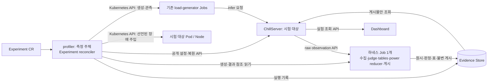

# Experiment 실행 — profiler 측정 컨트롤러

상태: 설계. CRD·controller·이미지·배포는 아직 구현하지 않는다.
정본: [실험 SRS](../../spec/experiments/SRS.md) EXP-01~15 · [Profiling 색인](README.md).

## 1. 범위와 하지 않는 것

`edge.dacs.io/v1alpha1`, namespaced `Experiment`는 E5 질문·조건·순서·비교 관계를 선언하고 실행 기록을 연결한다.
기존 `cmd/profiler` manager에 Experiment reconciler를 추가한다. ChillServer는 시험 대상이며 실행기를 넣지 않는다.
현재 profiler는 Run/BEO/Baseline/PowerModeTransitionCost를 등록한다(`cmd/profiler/controller_setup.go:43–58`).
**현재 OperationCost·DispatchOccupancy 실행은 ChillServer의 `SchedulerController.Admit` 안에 있다**(`internal/serving/kube/admission.go:114–116,249–259`).
Experiment의 profiler 배치는 이 현황을 일반화한 것이 아니라 측정 주체와 시험 대상의 생명주기를 분리하는 결정이다.

범위는 현재 단일 자원 풀·release namespace의 E5 실행이다. 배포·업그레이드, 다중 풀, 우선순위 큐, 새 workflow 서비스는 만들지 않는다.
판정·표·전력 계산식을 Go reconciler로 옮기지 않으며 기존 측정 CR 실행 위치도 이 작업에서 바꾸지 않는다.
[Plan 2](plans/02-profiling-run-execution.md)의 일회성 Job, [Plan 4](plans/04-minimal-profiler-control-path.md)의 durable 상태,
[Plan 7](plans/07-batch-energy-optimization-control-path.md)의 generation/terminal 처리,
[Plan 10](plans/10-transition-cost-measurement.md)의 controller/관측 Job 분리를 재사용한다.

## 2. 구성요소와 소유

그림은 논리적 연결이며 기본/Profiler Helm profile의 결합 배포도나 live 상태 증명이 아니다.
controller는 순서·공개 API 명령·Job 생명주기·compact status를 소유하고, 수치 판정은 하네스가 소유한다.
하네스는 `hack/e5` Python과 기존 prebuilt power reducer·publish bridge를 담은 **새 이미지**다. runtime 7 이미지에 속하지 않는다.
이미지 digest와 harness source SHA를 동결하고 Job 안에서 빌드·git archive·토큰 발급을 하지 않는다.
부하는 기존 workload별 `batch/v1` Job 형태를 쓰며 `backoffLimit: 0`, `restartPolicy: Never`를 유지한다.
하네스도 Experiment당 Job 하나·Pod attempt 하나이며 같은 무재시도 설정을 쓴다. Job 성공만으로 증거 완료를 선언하지 않는다.

## 3. Experiment spec

아래는 새 필드 설계다. 기존 round JSON을 그대로 CR에 넣거나 로컬 경로를 유지하는 계약이 아니다.
`spec` 전체에 ProfilingRun과 같은 CEL `self == oldSelf`를 둔다. 실행 전 수정도 거절하며 정정은 새 CR이다.
생성 경계에서 필수 구조·수치 범위·단계 ID 유일성·비교/주입 참조의 의미를 한 번 검증한다. 하위 소비자가 같은 검증을 반복하지 않는다.
실제 신원·가용성 관측은 준비 단계의 책임이다. 한 값만 허용하는 policy 필드나 사용자 지정 실행 명령은 만들지 않는다.

| 새 spec 필드 | 내용 | 실제 round/binding 입력 대응 |
|---|---|---|
| `question` | 답할 질문과 평가 목적 | 현재 외부 실험 설명; 새 명시 필드 |
| `target.components[]` | 구성요소 이름, 배포 리소스 참조, 기대 image digest·source SHA | `sourceSHA`, `release`, 배포 receipt의 구성요소별 신원 |
| `harness` | 하네스 이미지 digest·source SHA | `harnessSHA`; 기존 frozen harness 디렉터리 대체 |
| `loadGenerator` | 이미지·source 신원, 자원·shard·도착 분포·barrier 설정 | binding의 producer 신원·설정 |
| `powerMeasurement` | 장비 신원·대상 Node UID·계열 선택·측정 설정 | binding의 meter/collection 설정; 접속 비밀 제외 |
| `workloads[]` | 이름·UID·generation, 적용 SLO(분위수·목표·단위) | binding의 workloads·동결 SLO |
| `control` | scheduler 설정과 제어요소 스위치 | `h` → `scaleDownHeadroomFraction`, 선택 `minimumDemand` UID→비음수 값 |
| `inputs` | trace·seed·시작 상태·κ 등 `{store,key,size}` 불변 참조 | `restoreOriginTag` → `initialStateRef`; `rateBasis`/seed → `rateBasisRef`·`traceRefs`·`seedRef`; `kappa.reuseRows` → `kappaRef` |
| `stages[]` | 순서 있는 ID, 모드(자율/고정/제어요소 비활성), 시나리오, 길이, 설정·시작 상태 참조 | `rows`, binding schedule/factors; `rowTag`는 표시용 label로만 보존 |
| `comparisons[]` | 양쪽 stage ID 또는 과거 실행 UID·stage·결과 참조, 비교 이유 | `compareTags`/`compareOrigins` → 명시적 비교 관계; tag로 경로 추측 금지 |
| `failureInjection[]` | stage ID, 기준 시각·offset, 대상 선택 규칙, 동작/선행 주입 참조 | `failureInjection:true`·bound runbook → 구체 계획(§7) |
| `judgment` | 기존 규칙 식별자, SLO·생성기 품질·에너지/전력 완전성의 적용 설정 | binding 판정 정책·collection 조건; 공식 변경 없음 |
| `evidenceStore` | 입력과 별도로 실행 증거를 쓸 logical store | `run`/`evidence` 로컬 경로 대체; 키 규칙은 §8 |
| `publicationID` | 이번 실행의 안전한 새 게시 ID | `publication`의 게시 위치·실험 ID; 비밀 설정 제외 |

`environment*.json`의 토큰·CA·endpoint·host path는 spec 밖이다. 기존 profiler config/Secret과 Job 전달 binding으로 주입한다.
`binding`의 과학적 조건은 위 필드·불변 입력으로 옮기고 `control` 번호·로컬 실행 폴더는 신원으로 쓰지 않는다.
`preparationStatus`/`scoreboardInputs` 같은 운영 보조 파일을 필수 실행 계약으로 승격하지 않는다.
대기 상한·정리 상한·Job 실행 예산·수집 크기/용량 한계 등 운영 값은 **profiler config**에서 선택한다.
점유 시작 시 실제값과 설정 출처(config 이름·키·resourceVersion 등 실제 읽은 신원)를 `status.frozenConfig`와 실행 증거에 동결한다.
[ADR 0031](../../adr/0031-configuration-ownership-and-freezing.md)에 따라 실행 중 재조회로 값을 바꾸지 않는다. 프로토콜 상수는 policy knob로 만들지 않는다.

## 4. Status와 condition

`status.observedGeneration`과 type-keyed `[]metav1.Condition`(`listType=map`, `listMapKey=type`)을 둔다.
각 condition은 `status`, `reason`, `message`, `observedGeneration`, `lastTransitionTime`을 쓴다.
현재 stage/절차, 시작·종료 시각, 기대·관측 신원, 생성 Job/Pod의 이름·UID, 점유 실험 UID, 잔류 예약, 증거 참조만 status에 둔다.
raw·로그 본문·접속 비밀은 넣지 않는다. stage별 `procedures[]`에도 결과·reason·시각·참조를 남기고 최종 이력은 불변 실행 증거로 보존한다.
아래 단계 condition은 현재 stage를 나타내며 이전 stage 결과를 덮어 없애지 않는다. 미실행은 `Unknown/NotStarted`다.

| Condition | True의 뜻 | False 또는 대기 reason 예 |
|---|---|---|
| `PoolAcquired` | 이 실험이 단일 풀을 점유 | `PoolBusy`(점유 UID), `LeaderElectionRequired` |
| `Prepared` | 입력·워크로드·시험 대상·수집 준비 확인 | `MissingInput`, `FrozenInputInvalid`, `TargetUnavailable`, `IdentityMismatch`, `TargetDigestMismatch`, `EvidenceNotVisible`, `CollectorFailed` |
| `StateRestored` | 선언한 시작 상태·설정의 적용 결과 기록 | `RestoreFailed`, `ResetWaitTimeout`, `RemoteEffectUnknown` |
| `LoadComplete` | 기존 부하의 실제 종료 경계 기록 | `ExecutionLost`, `TargetRestarted`, `DeploymentDrift`, `RemoteEffectUnknown` |
| `Drained` | 발행 요청 결과를 동결 상한 안에 관측 | `DrainTimeout`, `ObservationUnavailable` |
| `Collected` | 필요한 raw와 출처 저장 완료 | `EvidenceUnreadable`, `CollectorFailed`, `EvidenceCapacityInsufficient`, `EvidenceStoreFailed` |
| `Judged` | 기존 규칙의 판정 결과 저장 완료(통과 아님) | `EvidenceUnreadable`, `JudgmentFailed` |
| `ExecutionComplete` | 계획한 절차의 작업 완료(평가 통과 아님) | `ProcedureFailed`, `RemoteEffectUnknown` |
| `MeasurementPassed` | 기록된 기존 규칙의 PASS | `SLOFailed`, `GeneratorInvalid`, `PowerIncomplete`, `InjectionInvalid`; 미판정은 Unknown |
| `CleanupComplete` | 원래 제어 설정 복구·자기 자원 반환 확인 | `ReturnTimeout`, `ResetWaitTimeout`, `ResidualState`, `OwnedJobNotFound`, `ObservationUnavailable` |
| `EvidenceComplete` / `Published` | 실행 증거 저장 / 최종 게시 저장 완료 | `EvidenceStoreFailed`, `PublicationFailed`, `PublicationConflict` |

세 완료 축은 `ExecutionComplete`, `MeasurementPassed`와 원 판정값(`PASS/FAIL/INVALID/NOT_EVALUATED` 등), `CleanupComplete`다.
SLO FAIL은 판정 완료된 측정 불합격이고, 수집기 종료·JSON 읽기 실패는 수행 오류다. 작업 완료·Job 성공을 PASS로 바꾸지 않는다.
실패 reason은 운영 STOP 유형을 반영한 새 설계 이름이다. 배포 drift/digest/restart 실패는 예방 설계이며 실제 STOP 발생 횟수를 주장하지 않는다.
Job NotFound는 정확한 UID·조회 사실을 보존한다. 다른 UID를 삭제하거나 자동으로 측정 실패/반환 완료로 바꾸지 않는다.

## 5. 단계별 동작과 기존 하네스 연결

각 `stages[]`를 준비 → 복원 → 부하 → drain → 수집 → 판정 → 정리 순서로 처리한다.
아래 줄 번호는 설계 시점 저장소 소스다. 운영의 실제 argv는 해당 attempt의 `*.command.json`이 권위이며 성공 횟수로 문자열 집계를 쓰지 않는다.
현행 `CPO.run`의 합쳐진 부하/drain/collect를 단계 경계로 나누되 계산식은 바꾸지 않는다.

| 절차 | 공개 API / Kubernetes 리소스 | 기존 함수와 파일:줄 | 실패 시 동작 |
|---|---|---|---|
| 준비 | Deployment/Pod 상태, GET settings/state/workloads/profiles; 입력 증거 읽기 | `Round.preflight` `hack/e5/round.py:374`; 신원 확인 `deploy:462`, `guard:565`; `CPO.boundary` `hack/e5/e5.py:1599` | 입력·신원·장비·용량 오류 기록, 부하 미시작; 배포 호출 안 함 |
| 시작 상태 복원 | GET/PUT `/api/v1/scheduler/settings`, GET `/state`, POST `/api/v1/scheduler/operations` reset/unroute/prepare/route | `CPO.restore:1692`, `factor:2137`, `clear_owned:2222`; `Round.headroom:526` | ACK·readback/실제 Decision.Settings 보존; 불확실 명령 재전송·후속 절차 금지 |
| 부하 | workload별 Job/Pod 생성·상태·logs·시작 barrier의 pods/exec; POST `/api/v1/workloads/{id}/infer`는 loadgen이 수행 | `CPO.job` `hack/e5/e5.py:1747–1779`, `run:1780–1976`; `Round.stage` `hack/e5/round.py:574` | 생성/GO 사실·UID 기록; 재발행 없음. drift·restart·실행 오류는 중단 |
| drain | 기존 Job/Pod 종료·로그, GET state/workloads; 실제 start/end/drained 시각 | `CPO.request_drain` `hack/e5/e5.py:1587–1597`, `run:1977–1995` | 상한 초과 기록, 예약 유지; 요청 drain을 자원 반환으로 보지 않음 |
| 수집 | 하네스 Job이 GET `/api/v1/observations/raw?hour=…`, `/raw/definitions`, `/raw/{hour}/{kind}` | `CPO.collect:2064`; `collect` `hack/e5/e5-archive.py:346–413` | API-only 유지; host/S3에서 관측 원시 직접 수집하는 fallback 없음. 누락/저장 실패는 미완료 |
| 판정 | 같은 하네스 Job이 저장된 client/raw·동결 정책으로 계산·증거 저장 | `judge` `hack/e5/e5.py:2401`, `summarize:2589`; `_reduce` `hack/e5/e5-archive.py:300`; `render` `hack/e5/tables.py:72`, `Round.reports` `hack/e5/round.py:654` | 누락·계산 불능을 0/PASS로 바꾸지 않음. 수행 오류는 중단; 측정 FAIL/INVALID는 원 사유 유지 |
| 정리 | settings/state/operations, 생성 기록의 정확한 Job UID만 삭제 | `CPO.cleanup_jobs:2258`, `factor_restore:2270`, `finish:2272`; `Round.finish` `hack/e5/round.py:695` | 정상 경로만 원 설정 복구·owned reset·반환 대기. 초과/오류면 잔류 장부 보존·강제 삭제 없음 |

준비에서는 기대 구성요소별 image digest·source SHA를 Deployment/Pod 공개 상태와 ChillServer 공개 신원에서 확인한 실제 신원과 대조한다.
다르면 기대·관측값을 기록하고 부하를 시작하지 않는다. 신원 미노출도 확인 불가 실패다. **이는 EXP-05의 배포 신원 확인이지 새 digest 형식 검사·재계산·바이트 동일성 검증 관문이 아니다.**
제어요소 비활성 스위치는 복원에서 적용한다. PUT 응답·후속 GET과 실제 Decision의 적용값을 구분하며 HTTP 오류만으로 미적용이라 단정하지 않는다.
모든 stage의 정상 정리는 실험 전 제어 설정을 복구한다. 과거 `finish`의 자율 off 처리나 물리 전력모드 복원을 원 설정 전체 복구의 증거로 간주하지 않는다.

하네스 Job은 첫 수집 때 한 번 만들며 순서 있는 stage를 처리한다. controller가 저장한 해당 stage의 drain/입력 참조를 읽고 API 수집 → 기존 power reducer → judge를 수행한다.
수집/판정 결과는 `experiments/<UID>/stages/<stageID>/...`에 불변 저장한다. controller는 독립 bounded read로 결과·증거 연결만 읽고 다음 정리로 진행한다.
Job은 다음 stage의 기록된 drain 경계를 동결 예산 안에서 기다린다. 매 stage Job을 새로 만들거나 Go에 판정기를 복제하지 않는다.
마지막 정리 뒤 controller가 저장한 최종 실행 기록을 받아 같은 Job이 tables/summarize·최종 게시를 끝낸다. 중간 실패면 후속 수집·판정·게시를 진행하지 않는다.

## 6. 상호 배제와 재시작

**전제: profiler leader election을 켠다.** 현재 `--leader-elect` 기본은 false다(`cmd/profiler/options.go:98–99`, `main.go:46–63`).
같은 watch namespace/풀의 profiler는 같은 기존 election ID를 사용하고 Helm의 해당 Lease RBAC를 활성화한다. Experiment 전용 Lease는 없다.
Experiment reconciler는 단일 worker로 시작/진행 결정을 직렬화하고, 점유 결정 전 API의 최신 Experiment 목록을 읽는다. 캐시/메모리 큐를 점유 장부로 쓰지 않는다.
실행 중이거나 반환 미확인 Experiment가 있으면 다음을 시작하지 않는다. 대기는 생성 시각 오름차순이며 동률만 이름·UID로 고정한다. 우선순위·재정렬은 없다.
대기 status에는 점유 UID와 `PoolBusy`를 표시한다. leader 획득이나 controller 재시작을 풀 반환으로 간주하지 않는다.
기존 ChillServer 노드 admission/예약은 그대로 실제 물리 자원을 소유한다. Experiment 직렬화가 이를 대신하거나 강제로 해제하지 않는다.

외부 명령 전 절차 시작·대상·요청 참조를 기록하고, 응답과 확인 결과를 저장한 뒤에만 완료 경계를 기록한다.
재시작은 기록된 경계에서만 다음 절차로 간다. 이미 시작한 부하는 기록된 Job/Pod UID의 관측만 계속하며 생성/GO를 재전송하지 않는다.
reset/prepare 응답 소실, UID 없는 부하, Job 소실/교체 등 결과가 불확실하면 `RemoteEffectUnknown`/`ExecutionLost`로 중단한다.
원 사유·시각·마지막 관측과 실물의 신원·할당·소유·예약을 보존하고 [ADR 0023](../../adr/0023-resource-ledger.md)에 따라 예약을 유지한다.
관측 I/O 재조회·확정된 경계 읽기와 측정 재시도는 다르다. 자동 재측정·자동 물리 복구·오류 뒤 정리/reset/uncordon은 하지 않는다.
정상 정리의 UID 한정 삭제와 원 설정 복구만 허용한다. 정리 상한 초과는 실패이며 다음 실험을 막는다.
삭제 요청도 점유를 우회하지 못하도록 Experiment finalizer를 유지한다. 반환 확인·실행 증거 보존 전 owner GC로 진행 중 Job을 지우지 않는다.
운영자가 명시적으로 잔류 자원을 정리한 뒤 확인된 사실을 기록해야 점유를 끝낼 수 있으며, CR 삭제·프로세스 종료 자체는 반환 증거가 아니다.

## 7. 장애 주입

spec에 기준(`stage`의 실제 부하 시작), `offsetSeconds`, 대상 선택 규칙과 동작을 명시한다. full/micro의 과거 offset을 controller 상수로 넣지 않는다.
직전 GET `/api/v1/scheduler/state`와 같은 관측 창의 `/api/v1/observations/load`를 근거로 선택한다.
기존 `serving_failure_targets`(`hack/e5/e5.py:334–350`)처럼 대상 workload UID·owner 일치, Ready, routing weight>0, assigned>0, 실제 Pod/Node UID를 요구한다.
규칙에 snapshot 유효 기간·서로 다른 Node 조건·동률 정렬(Node/Pod/instance)을 포함하며 선택 원본·후보·탈락 이유·선택 시각을 남긴다.
동작은 controller가 **Kubernetes API**로 Pod 삭제(UID precondition), cordon/uncordon(Node UID 확인·경합 방지 patch)을 수행한다. ChillServer 장애 주입 API를 만들지 않는다.
uncordon은 spec이 참조한 앞선 주입의 같은 Node에만 적용한다. 실제 선택·요청 method/path/body·응답·예정/실제 offset·시각을 증거로 남긴다.
조건 불만족·관측 만료·시간 창 이탈이면 명령을 보내지 않고 취소하며 해당 stage의 주입 평가를 `INVALID/InjectionInvalid`로 기록한다.
다른 대상·다른 시각으로 바꾸지 않는다. 응답 불명은 §6처럼 중단·예약 유지하며 자동 재주입/복구하지 않는다.
기존 운영 근거는 `CPO.failure_select`(`hack/e5/e5.py:2091–2136`)와 `Round.stage.watch`(`hack/e5/round.py:592–650`)다.

## 8. 증거·게시·조회

[Evidence Store](components/evidence-store.md)의 logical store/opaque key/size와 conditional-create, bounded 독립 읽기를 재사용한다.
trace·seed·시작 상태는 내용이 고정된 입력 객체다. 로컬 경로·현재 설정·동명 새 Workload로 대체하지 않는다.
실행 증거의 store는 spec에서 고정하고 키는 생성 시 부여된 불변 UID로 `experiments/<UID>/...`가 된다. 별도 configurable prefix 필드는 없다.
따라서 생성 시 실행 증거 위치가 결정되며 실제 key/size·저장 완료는 status에만 기록한다. 정의 스냅샷·명령/응답·시각·client/raw·판정·표·최종 실행 기록을 연결한다.
입력과 실행 기록은 PutImmutable로 보존한다. receipt만으로 저장 완료라 하지 않고 결과 loader 경계에서 크기 제한·schema·실험 UID/참조 연결을 한 번 확인한다.
참조된 객체는 삭제 금지다. controller/하네스에 DeleteObject 권한·자동 GC를 주지 않고, 운영 삭제도 보존된 정의/실행/게시의 참조가 있으면 거부한다.
CR 삭제가 증거 삭제로 이어지지 않는다. 저장 실패는 `EvidenceComplete=False`이며 이미 저장한 원시·판정을 보존한다.

게시 정본은 [관측 설계 §6.4](../serving/observability-split.md#64-실험-불변-요약-조회-api-b2-sch-45)다.
판정 Job이 raw/판정/실행 기록을 먼저 쓰고 `serving/experiments.v1alpha1/{id}/summary.json`을 마지막 PutImmutable로 쓴다.
요약에 **Experiment spec 스냅샷(정책·명시적 비교 관계·SLO 포함)**, CR 이름/UID/generation, 동결 설정·세 완료 축의 상태 스냅샷, 판정/증거 참조를 포함한다.
`Published`는 게시 후 controller가 기록하므로 게시물 스냅샷에 자기 자신의 게시 완료를 선행 주장하지 않는다. 게시 충돌은 새 ID를 요구하며 덮어쓰기/동일 바이트 비교로 회복하지 않는다.
ChillServer는 지금처럼 objects Reader/Lister로 게시물만 읽고 기존 `/api/v1/experiments[/{id}]`로 제공한다. Experiment CR을 읽는 새 권한·의존·캠페인 API는 추가하지 않는다.
실행 중 원 정의/status는 Kubernetes Experiment API로, 완료 정의/status/result는 게시 스냅샷과 증거 참조로 조회한다. 미게시 실행을 완료 목록에 넣지 않는다.
대시보드는 게시 spec의 정책·비교 관계와 정의/결과의 적용 SLO를 읽는다([DB-FR-66](../../spec/dashboard/SRS.md)).
`stagePolicy`/`stagePairing`/`stageComparison`과 요청률 유사성 기반 관계 추측을 삭제하고 `campaignPairs`/`policyStageGroups` 등 소비자를 명시적 관계로 바꾼다.
과거 게시의 spec/비교 필드 부재는 **비교 관계 미기록**이다. default·단계 ID·평균률로 복원하지 않으며 과거 게시 수정/재게시도 하지 않는다.

## 9. RBAC 추가분

| 주체 | 필요한 추가/재사용 권한 | 금지·범위 |
|---|---|---|
| profiler | namespace의 experiments get/list/watch, status patch, finalizers update; 기존 Jobs create/get/list/watch/delete | CR spec 쓰기·Deployment/이미지 교체 권한 없음 |
| profiler | Deployment get/list/watch, Pod get/list/watch/logs, loadgen barrier용 pods/exec create, 주입용 pods delete | release namespace 한정; 삭제는 기록된 UID precondition |
| profiler | Nodes get와 주입용 patch | cluster 범위; 선언된 Node UID와 `spec.unschedulable`만 코드에서 제한(RBAC 자체 필드 제한 아님) |
| profiler | 기존 leader election Lease 권한, config 읽기·Secret 전달 | 별도 실험 Lease 없음; Secret 본문은 status/증거 비노출 |
| 하네스 Job | ChillServer raw GET 인증, 입력/실행 증거 read·immutable write·게시 쓰기 | Kubernetes mutation·host mount·관측 archive 직접 수집·DeleteObject 권한 없음 |
| loadgen Job | 기존 infer 호출·dataset 전달 | 실험 CR·시험 대상 변경 권한 추가 없음 |
| 조회자 | Kubernetes Experiment get/list/watch; 기존 게시 조회 인가 | ChillServer SA에는 Experiment 읽기 추가 없음 |

기존 profiler Role의 Jobs/Lease/Secret 권한은 재사용한다(`charts/chill/templates/profiler_rbac.yaml:72–125`). 이미지·주소·인증정보는 기존 config/Secret 전달 경계로만 준다.

## 10. 전환 계획

1. 현재 측정은 `round.py`로 유지한다. 이 설계 작성으로 실행 경로·배포·클러스터를 바꾸지 않는다.
2. 의존 캠페인이 끝난 뒤 Experiment CRD/controller, profiler leader election 전제, 하네스 이미지/단일 Job 전달, 게시 스냅샷과 대시보드 소비를 함께 구현한다.
3. 같은 정의·입력·설정·시험 대상 신원을 `round.py`와 controller로 **각 1회** 실행한다. 경계/명령·부하 모집단·생성기 품질·적용 SLO·판정 이유·전력 coverage/에너지·정리 범위를 비교한다.
   자연 변동을 포함한 결과 범위 비교이며 byte/digest 일치 관문이나 자동 재측정이 아니다. 수행 오류를 측정 FAIL로 감추지 않는다.
4. 전환 수용 뒤 `round.py`, `run-ab-*.sh`의 중복 조립과 대시보드 추측 함수를 삭제한다. 재사용하는 `hack/e5` judge/tables/power 코드는 남긴다.
5. [ADR 0019](../../adr/0019-durable-stored-contract-compatibility.md)에 따라 캠페인 의존 중 저장 계약을 바꾸지 않고 단일 reader를 유지한다. 영향 작업용 객체만 운영자가 정리하며 dual reader·migration·alias를 만들지 않는다.
   과학 원시·과거 게시는 불변 보존한다. 과거 metadata 부재는 미기록으로 읽으며 새 정의를 소급 붙이지 않는다.

## 11. 요구사항 추적

| SRS | 충족 설계 |
|---|---|
| EXP-01 | §3 전체 spec CEL 불변·생성 경계 검증·새 CR 정정 |
| EXP-02 | §3 질문/신원/장비/워크로드/입력/단계/비교/주입 필드 |
| EXP-03 | §3 profiler config 선택·status/증거 동결, §4 실제 설정 기록 |
| EXP-04 | §1–2 profiler 배치, §5 공개 API/Kubernetes만 사용·배포 없음 |
| EXP-05 | §5 기대/관측 신원 불일치 시 부하 미시작·새 검증 관문 없음 |
| EXP-06 | §6 기존 leader election·직렬 worker·생성 순서·미확인 반환 차단 |
| EXP-07 | §5 일곱 절차·복원 시 제어요소 스위치 |
| EXP-08 | §4 절차 이력, §6 경계 재개·시작 부하 관측만·불확실 중단 |
| EXP-09 | §4 작업/측정/정리 세 축, §8 게시 스냅샷 |
| EXP-10 | §2·5 기존 하네스 판정/표/reducer·규칙/설정·원 결과 보존 |
| EXP-11 | §5 정상 정리, §6 오류 중단·잔류 장부·예약·삭제 방어 |
| EXP-12 | §3·7 선언 주입·API 실행 증거·조건 불만족 취소/무효 |
| EXP-13 | §3·8 생성 시 위치 고정·불변 참조·저장 상태·삭제 금지 |
| EXP-14 | §8 실행 결과의 최종 게시·새 ID 정정·과거 불변 |
| EXP-15 | §8 Kubernetes/게시 조회·명시적 정책/비교/SLO·추측 삭제 |

## 12. 열린 질문

사용자 결정이 필요한 미정 항목은 없다. 실행 예산·이미지 값·환경 Secret은 구현 시 소유 설정에서 선택하고 동결할 값이지 추가 정책 결정이나 이 설계의 미완료 분기가 아니다.
