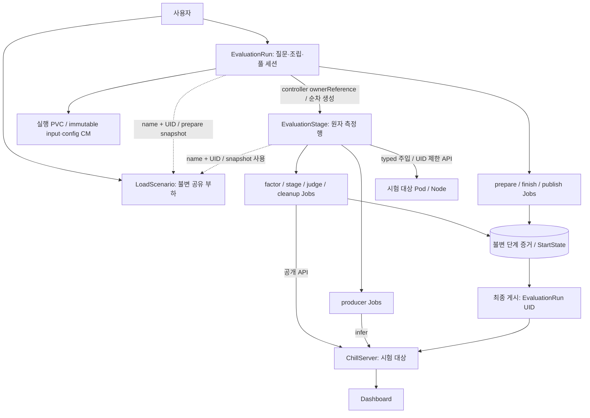

# EvaluationRun 실행 — profiler 측정 컨트롤러

상태: 승인된 설계, 구현 중.
정본: [실험 SRS](../../spec/experiments/SRS.md) EXP-01~15 · [Profiling 색인](README.md).

## 1. 범위와 하지 않는 것

`edge.dacs.io/v1alpha1`의 release namespace에 새 CR 세 개를 둔다. `LoadScenario`는 공유 부하 정의, `EvaluationRun`은 질문·조립·비교·단일 풀 세션, `EvaluationStage`는 원자 측정 한 행이다.
기존 `cmd/profiler` manager에 EvaluationRun·EvaluationStage reconciler를 추가한다. ChillServer는 시험 대상이며 실행기를 넣지 않는다.
현재 profiler는 Run/BEO/Baseline/PowerModeTransitionCost를 등록한다(`cmd/profiler/controller_setup.go:43–58`).
**현재 OperationCost·DispatchOccupancy 실행은 ChillServer의 `SchedulerController.Admit` 안에 있다**(`internal/serving/kube/admission.go:114–116,249–259`).
EvaluationRun의 profiler 배치는 이 현황을 일반화한 것이 아니라 측정 주체와 시험 대상의 생명주기를 분리하는 결정이다.

범위는 현재 단일 자원 풀·release namespace의 E5 실행이다. 배포·업그레이드, 다중 풀, 우선순위 큐, 새 workflow 서비스는 만들지 않는다.
복원·부하·drain·수집·정리 프로토콜과 판정·표·전력 계산식을 Go reconciler로 옮기지 않으며 기존 측정 CR 실행 위치도 바꾸지 않는다.
[Plan 2](plans/02-profiling-run-execution.md)의 일회성 Job, [Plan 4](plans/04-minimal-profiler-control-path.md)의 durable 상태,
[Plan 7](plans/07-batch-energy-optimization-control-path.md)의 generation/terminal 처리,
[Plan 10](plans/10-transition-cost-measurement.md)의 controller/관측 Job 분리를 재사용한다.
Katib는 탐색, Tekton은 CI가 주목적이고 Argo는 현재 고정 순서보다 의존성을 더 늘린다. 기존 Job + 제한된 controller를 유지하며 범용 workflow 엔진을 만들지 않는다.

## 2. 구성요소와 소유



그림은 논리적 연결이며 기본/Profiler Helm profile의 결합 배포도나 live 상태 증명이 아니다.
부모 controller는 풀·순서·자식 채택·끝 정리·게시, 자식 controller는 단계 Job·producer·주입·compact status를 소유한다. 단계 프로토콜·실시간 부하 관측·계산은 기존 하네스가 소유한다.
하네스는 `hack/e5` Python과 기존 prebuilt power reducer·publish bridge를 담은 **새 이미지**다. runtime 7 이미지에 속하지 않는다.
이미지 digest와 harness source SHA를 동결하고 Job 안에서 빌드·git archive·토큰 발급을 하지 않는다.
부하는 기존 workload별 `batch/v1` Job 형태를 쓰며 `backoffLimit: 0`, `restartPolicy: Never`를 유지한다.
하네스는 기존 단계 명령별 단발 Job과 마지막 단발 표·게시 Job으로 나누고 `parallelism/completions: 1`·무재시도를 요청한다.
이 설정만으로 Pod 단일 실행·exactly-once를 보장하지 않는다. 선택한 정확한 producer Pod UID에만 GO를 보내며 중복/교체 Pod와 불변 저장 충돌을 성공으로 숨기지 않는다.
Job 성공만으로 증거 완료를 선언하지 않는다.

## 3. 객체별 spec과 값 타입

세 CR 모두 spec 전체에 CEL `self == oldSelf`를 둔다. 실행 전 수정도 거절하며 정정은 새 CR이다.
생성 경계에서 필수 구조·수치 범위·ID 유일성·비교/주입 참조를 한 번 검증한다. 실제 신원·가용성은 prepare에서 관측한다.
`PinnedRef`는 Workload만 `{name,uid,generation}`, 불변 CR은 `{name,uid}`다. 기존 cluster-scoped Workload 외 cross-namespace 참조는 없다.
공유 카탈로그/입력에 consumer ownerReference를 두지 않는다. LoadScenario에는 status도 없다.

| 객체 | spec 필드 | 내용·기존 입력 대응 |
|---|---|---|
| LoadScenario | `workloads[]` | Workload 이름·UID·generation의 유일 정본. SLO는 그 generation의 적용 정의에서 얻음 |
| LoadScenario | `parts[]` | ID·durationSeconds·workload별 `rates` 또는 `alpha`(배타). 길이/부하는 stage에서 override 불가 |
| LoadScenario | `arrivalDistribution`, `traceRefs`, `seedRef`, `payloadManifestRef` | 고정 부하·입력 증거 `{store,key,size}`. Dataset은 Workload.datasetRef가 고정하므로 별도 dataset 참조 없음 |
| LoadScenario | `rateBasisRef`, `kappaRef` | alpha 해석 시 필수인 고정 기준·κ 증거 |
| EvaluationRun | `question`, `target` | 질문·목적; 구성요소별 리소스 참조·기대 image digest·source SHA |
| EvaluationRun | `harness` | 이미지 digest·source SHA. 과학 신원으로 **spec에만** 두며 운영 ConfigMap에는 없음 |
| EvaluationRun | `loadGenerator`, `powerMeasurement` | 생성기 이미지·source·자원·shards·barrier; 장비 신원·Node UID·계열·sampling |
| EvaluationRun | `control` | 공통 기본 ControlSettings: named switches·scaleDownHeadroomFraction·minimumDemand |
| EvaluationRun | `judgment`, `evidenceStore` | 생성기 품질(lateness 등)·에너지 coverage; 실행 증거 logical store. **SLO 복사본 없음** |
| EvaluationRun | `stages[]`, `comparisons[]` | 순서 있는 StageTemplate; 양쪽 stageID 또는 historical runUID/stageID/resultRef와 비교 이유 |
| EvaluationStage | `stageID`, `row`, `mode`, `loadScenarioRef` | 사용자 ID, 기존 E5 행 라벨(`scenario` 아님), autonomous/fixed/controls-disabled, 불변 부하 참조 |
| EvaluationStage | 완성 `control`·실행 맥락 | target/harness/generator/power/judgment/store와 동결 운영 CM·snapshot 참조 |
| EvaluationStage | `startState.evidenceRef`, `failureInjection[]` | 해석 완료 시작 증거와 typed 주입 계획. `evaluationRef` 없이 controller ownerReference가 부모 정본 |

| 값 타입(별도 CR 아님) | 계약 |
|---|---|
| StageTemplate | id·row·mode·loadScenarioRef·선택 control·startState·failureInjection; 부모 spec의 조립 입력 |
| ControlSettings / TargetIdentity / Judgment / Generator / PowerMeasurement | 제어·대상·판정·생성기·장비 타입 경계이며 독립 status/수명 없음 |
| FaultInjectionPlan / Record | 자식 spec의 불변 계획 / status의 compact 실행 기록; 상세는 불변 증거 |
| StartState / StageResult | conditional-create 불변 증거. state+settings·생산 run/stage UID·관측 시각·출력 참조 보존 |

builder 한 곳에서 부모 공통 값과 template을 합성한다. template control이 있으면 완성 설정으로 대체하며 숨은 부분 merge는 없다.
`startState`의 외부 evidenceRef 또는 앞선 stageID/output 중 하나를 받고, 자기/뒤 참조는 거절한다.
부모는 앞 단계 output을 실제 store/key/size로 해석한 뒤 완성 자식을 생성한다. 생성 뒤 자식 spec은 바꾸지 않는다.
동일 LoadScenario UID는 동일 선언 부하다. “같은 부하” 주장은 generator 설정도 같아야 하며 실제 발행·성공은 별도 단계 증거로 판단한다.
SLO·서버 버전·스위치는 LoadScenario에 넣지 않는다. Workload generation 불일치를 현재 값으로 치환하지 않는다.

`environment*.json`의 토큰·CA·endpoint·host path는 spec 밖이다. release namespace의 고정 ConfigMap `chill-evaluation-config`와 Secret·Job 전달 binding으로 주입한다.
`binding`의 과학적 조건은 위 필드·불변 입력으로 옮기고 `control` 번호·로컬 실행 폴더는 신원으로 쓰지 않는다.
`preparationStatus`/`scoreboardInputs` 같은 운영 보조 파일을 필수 실행 계약으로 승격하지 않는다.
대기/정리 상한·Job 실행 예산·수집 크기/용량 한계·SA/Secret 이름·SSH 접속값·StorageClass/PVC 크기·API URL 등 운영 값은 **ConfigMap `chill-evaluation-config`**에서 선택한다.
controller가 실험 시작 시 직접 GET하여 실제값과 ConfigMap 이름·UID·resourceVersion을 `status.frozenConfig`와 실행 증거에 동결한다. operator·profiler flag는 변경하지 않는다.
[ADR 0031](../../adr/0031-configuration-ownership-and-freezing.md)에 따라 실행 중 재조회로 값을 바꾸지 않는다. 프로토콜 상수는 policy knob로 만들지 않는다.

## 4. Status와 condition

`status.observedGeneration`과 type-keyed `[]metav1.Condition`(`listType=map`, `listMapKey=type`)을 둔다.
각 condition은 `status`, `reason`, `message`, `observedGeneration`, `lastTransitionTime`을 쓴다.
부모 status에는 frozenConfig·workspace(PVC name/UID)·currentStage·childRefs(name/UID)·전역 절차·시각·잔류·release 기록을 둔다.
자식 status에는 Job/Pod name·UID, goRef, injection 기록, outputs/resultRef·잔류와 `procedures[]`를 둔다. **단계 procedures 정본은 자식**이며 부모에 본문을 복제하지 않는다.
raw·로그 본문·접속 비밀은 넣지 않는다. 부모 startedAt가 점유를 나타내며 운영자 해제 annotation 원 값·처리 시각·증거도 부모에 남긴다.
부모 condition은 아래 다섯 개다. 미실행은 `Unknown/NotStarted`, 증거 완료는 검증된 참조로 표현한다.

| Condition | True의 뜻 | False 또는 대기 reason 예 |
|---|---|---|
| `PoolAcquired` | 이 실험이 단일 풀을 점유 | `PoolBusy`(점유 UID) |
| `ExecutionComplete` | 계획한 절차의 작업 완료(평가 통과 아님) | `ProcedureFailed`, `RemoteEffectUnknown` |
| `MeasurementPassed` | 기록된 기존 규칙의 PASS | `SLOFailed`, `GeneratorInvalid`, `PowerIncomplete`, `InjectionInvalid`; 미판정은 Unknown |
| `CleanupComplete` | 원래 제어 설정 복구·자기 자원 반환 확인 | `ReturnTimeout`, `ResetWaitTimeout`, `ResidualState`, `OwnedJobNotFound`, `ObservationUnavailable` |
| `Published` | 최종 게시 저장 완료 | `EvidenceStoreFailed`, `PublicationFailed`, `PublicationConflict` |

자식 condition은 `ExecutionComplete`, `MeasurementPassed`, `StageCleanupComplete` 세 개뿐이다. 마지막은 해당 단계 producer 정리 확인이며 원 설정 복구·풀 반환을 뜻하지 않는다.
부모 MeasurementPassed는 자식 원 판정을 집계한다: INVALID 하나라도 있으면 INVALID, 아니면 NOT_EVALUATED가 있으면 Unknown/NOT_EVALUATED, 아니면 FAIL 하나라도 있으면 FAIL, 모두 PASS면 PASS다.
세 완료 축은 `ExecutionComplete`, `MeasurementPassed`와 원 판정값(`PASS/FAIL/INVALID/NOT_EVALUATED` 등), `CleanupComplete`다.
SLO FAIL은 판정 완료된 측정 불합격이고, 수집기 종료·JSON 읽기 실패는 수행 오류다. 작업 완료·Job 성공을 PASS로 바꾸지 않는다.
절차별 reason은 준비의 `MissingInput/FrozenInputInvalid/TargetUnavailable/IdentityMismatch/EvidenceNotVisible/CollectorFailed`, 복원의 `RestoreFailed/ResetWaitTimeout/RemoteEffectUnknown`, 부하의 `ExecutionLost/IdentityMismatch`, drain의 `DrainTimeout/ObservationUnavailable`, 수집·판정의 `EvidenceUnreadable/EvidenceCapacityInsufficient/EvidenceStoreFailed/JudgmentFailed`로 원 오류와 연결한다.
배포 digest·drift·restart 검사는 유지하되 reason은 `IdentityMismatch`로 합치고 기대·원 관측값을 남긴다. 실제 STOP 발생 횟수를 주장하지 않는다.
Job NotFound는 정확한 UID·조회 사실을 보존한다. 다른 UID를 삭제하거나 자동으로 측정 실패/반환 완료로 바꾸지 않는다.

## 5. 단계별 동작과 기존 하네스 연결

부모 prepare는 공통 입력 해석·동결(LoadScenario·Workload 적용 정의 snapshot, 운영 설정)을 실행당 한 번 수행한다. 각 EvaluationStage는 동결 snapshot으로 그 단계의 신원·입력·장비를 확인하는 **단계별 준비** → 복원 → 부하 → drain → 수집 → 판정 → 단계 정리 순서다. 단계별 준비는 공통 입력 재해석이 아니며 부하·drain·수집은 기존 `e5.py stage` **한 Job 안에서** 이어진다.
자식이 factor/stage/judge/cleanup·producer Job을 소유하고 **Job ownerRef는 Stage UID**다(Pod는 Job 소유). prepare/finish/publish Job·PVC·input/config CM은 EvaluationRun 소유다. adapter는 기존 함수를 재사용하며 `Round`를 통째 import하지 않는다.
아래 공개 API 열은 **Job 안의 e5.py가 사용하는 인터페이스**다. controller가 부하 로그·GO·drain 프로토콜을 직접 소유하지 않는다.
줄 번호는 설계 시점 소스다. 기존 운영 attempt의 `*.command.json`은 의미 비교 근거이며 새 argv 계약은 아래 §5.1이다.

| 절차 / 내보낼 Job | Job 안의 공개 API / Kubernetes 리소스 | 기존 함수와 파일:줄 | 실패 시 동작 |
|---|---|---|---|
| 준비 / 하네스 사전 검사 | Deployment/Pod 상태, GET settings/state/workloads/profiles, 입력 증거·토큰 수명 | `Round.preflight` `hack/e5/round.py:374`, `guard:565`; `CPO.check_token_lifetime` `hack/e5/e5.py:1768–1779` | 신원·입력·장비·용량·수집기·토큰 만료 오류면 부하 미시작; 배포 안 함 |
| 복원 / `factor` | GET/PUT settings, GET state, POST operations reset/unroute/prepare/route; Node 전력모드 label patch | `CPO.factor` `hack/e5/e5.py:2137–2221`, `native_mode:2252–2257`; `Round.headroom` `hack/e5/round.py:526` | ACK/readback·Decision.Settings·Node UID/generation 기록; 불확실 명령 재전송 금지 |
| 부하 / `stage` | workload별 Job/Pod 생성·logs·pods/exec GO; infer는 loadgen이 호출 | `CPO.job` `hack/e5/e5.py:1743–1761`, `run:1780–1976`, `sampler:1717–1741` | 선택 Pod UID·개별 start·부분 GO 기록; 교체 Pod GO/부하 재발행 없음 |
| drain / 같은 `stage` | 기존 producer 종료 로그·counter·종료 신호, state/workloads | `CPO.request_drain` `hack/e5/e5.py:1587–1597`, `run:1977–1995` | 상한 초과·상태 불명은 중단·예약 유지; 요청 drain≠풀 반환 |
| 수집 / 같은 `stage` | GET `/api/v1/observations/raw?hour=…`, `/raw/definitions`, `/raw/{hour}/{kind}` | `CPO.collect` `hack/e5/e5.py:2064`; `collect` `hack/e5/e5-archive.py:346–413` | API-only 유지; host/S3 관측 raw 수집 fallback 없음. 생성기 cgroup 표본은 아래 별도 경계 |
| 판정 / `judge` | 저장된 client/raw·동결 설정으로 기존 계산·증거 저장 | `judge` `hack/e5/e5.py:2401`; `_reduce` `hack/e5/e5-archive.py:300` | 누락·계산 불능을 0/PASS로 바꾸지 않음; 수행 오류와 원 판정 FAIL/INVALID 구분 |
| 단계 정리 / `cleanup-jobs` | 자신이 만든 producer Job의 정확한 UID만 삭제 | `CPO.cleanup_jobs` `hack/e5/e5.py:2258–2269`; `Round.execute` `hack/e5/round.py:743` | UID 불일치·정리 실패는 잔류 기록·중단; 매 stage 원 설정 복구/reset 안 함 |
| 실험 끝 / `finish` 1회 | 원 제어 설정 복구, owned reset·state 반환 대기 | `CPO.finish` `hack/e5/e5.py:2272`; `Round.finish` `hack/e5/round.py:695`, `execute:732` | 상한 초과면 CleanupComplete=False·점유 유지; 이미 완료된 측정 판정은 게시 가능 |

준비에서는 기대 구성요소별 image digest·source SHA를 Deployment/Pod 공개 상태와 ChillServer 공개 신원에서 확인한 실제 신원과 대조한다.
다르면 기대·관측값을 기록하고 부하를 시작하지 않는다. 신원 미노출도 확인 불가 실패다. **이는 EXP-05의 배포 신원 확인이지 새 digest 형식 검사·재계산·바이트 동일성 검증 관문이 아니다.**
제어요소 비활성 스위치는 복원에서 적용한다. PUT 응답·후속 GET과 실제 Decision의 적용값을 구분하며 HTTP 오류만으로 미적용이라 단정하지 않는다.
단계 정리는 producer Job만 정리한다. 원 설정 복구 + owned reset + 풀 반환 대기는 실험 끝에 한 번만 한다. 예약/전이는 단계 사이 이어질 수 있다(`hack/e5/e5.py:1992`).
기존 `CPO.run` 예외의 자동 설정 복구(`hack/e5/e5.py:2003–2014`)는 Job 실행 경로에서 끈다. 오류 뒤 자동 reset·uncordon·후속 측정은 하지 않는다.
작업 폴더는 실행별 RWX PVC(`rook-cephfs`)의 `/work/campaign/run`이며 기존 증거 저장 PVC를 재사용하지 않는다.
하네스 Job은 실행별 RWX 작업 PVC의 같은 경로에서 앞 절차 산출을 이어받는다. 각 절차 종료 시 그 절차의 새 산출·시점 스냅샷을 `experiments/<UID>/...`에 conditional create로 저장하고 검증된 작은 결과 참조를 기록한다. 가변 phase/commands 파일은 절차별 다른 key로 보존하며 덮어쓰지 않는다. PVC 손실은 자동 재측정/새 Job 복원을 허용하지 않고 ExecutionLost/증거 실패로 남긴다.
PVC는 가변 작업 상태, store는 불변 증거 정본이다. controller는 반환 미확인 동안 Job/PVC를 의도적으로 정리하지 않으며 증거 업로드 실패 시 PVC를 보존한다. GC 지원 범위는 §6과 같다.
controller와 Job의 단계 증거는 `experiments/<UID>/stages/<stageID>/...`에 `ImmutableWriter`로 저장한다. 기존 publish bridge는 중간 저장/전달에 쓰지 않는다.
부하 Job은 재시작과 무관하게 sampler·GO·drain·수집을 계속한다. 주입용 GO 시각은 한 번 쓰는 진행 증거로 노출하고 실제 producer별 시작과 구분한다.
실행 중 genesis1 producer cgroup 표본은 사전 GO 검사·종료 counter·판정에 필요하며 현재 SSH + sudo crictl을 쓴다(`hack/e5/e5.py:1717–1741,1919–1938`).
node-agent는 producer Pod를 대상으로 선택하지 않고 공개 raw에도 해당 UID 표본이 없어 대체 불가로 확인했다(§12). stage Job은 명시 SSH Secret `chill-evaluation-producer-ssh`로 기존 sampler를 실행하며 표본 생성을 사후 raw 수집으로 대신하지 않는다.
최종 단발 표·게시 Job은 기록된 판정·정리 결과만 표현한다. 정리 실패도 세 축을 구분해 게시하며 후속 측정/복구를 시작하지 않는다.
`summarize`(`hack/e5/e5.py:2589`)·`render`(`hack/e5/tables.py:72`)를 재사용하고 `Round.reports`(`hack/e5/round.py:654`)의 필요한 표 조립만 기존 tables 경계로 옮긴다.

### 5.1 하네스 Job 계약

- argv: `python3 /opt/e5/hack/e5/evaluation.py <prepare|factor|stage|judge|cleanup-jobs|finish|publish> --run /work/campaign/run --spec /spec/spec.json [--stage <stageID>]`. stage 인자는 factor/stage/judge/cleanup-jobs에만 필수다. spec.json은 해당 소유자 spec(단계는 완성 StageSpec), execution.json은 부모/자식 UID·generation과 snapshot 연결, config.json은 동결 운영값이다. `/spec`은 immutable CM RO, `/work`는 실행 PVC RW다.
- 결과 JSON: `{schemaVersion:"evaluation-step.v1alpha1",runUID,generation,stageUID?,stageID?,step,execution:{status,reason},measurement:{verdict,reason}?,cleanup:{status,reason}?,startedAt,finishedAt,artifacts:[{store,key,size}]}`. 로컬 `results/prepare.json`, `results/stages/<id>/<step>.json`, `results/{finish,publish}.json`은 편의 사본이며 store result를 독립 load한다. 큰 judgment는 artifact다.
- exit code: **0**=절차·필수 불변 업로드 완료(PASS 아님), **1**=수행/입력/관측/업로드 오류 또는 효과 불명, **2**=명시 측정 INVALID 등 판정 완료(result 있음). Job 성공/실패나 exit 2만으로 MeasurementPassed를 정하지 않으며 신호·Pod 교체·Job retry로 자동 재실행하지 않는다.
- Job 이름: 부모는 `eval-<runUID lowercase without hyphens>-<prepare|finish|publish>`, 자식은 `eval-<stageUID lowercase without hyphens>-<factor|stage|judge|cleanup>`(≤63자, cleanup argv는 cleanup-jobs). producer도 Stage UID+workload ordinal로 결정한다. labels는 `edge.dacs.io/evaluation-run-uid`, `edge.dacs.io/evaluation-stage`(stageID 또는 run), `edge.dacs.io/evaluation-step`, `edge.dacs.io/workload-role=system`이며 단계에는 stage UID도 기록한다. 소유자 UID·동결 args/image/SA/PVC/spec/config 확인 후 채택한다.
- SA: `chill-evaluation-action`은 prepare/factor/stage/cleanup/finish, `chill-evaluation-publish`는 judge/publish(automount=false)에 사용한다. stage만 SSH Secret을 mount하며 모든 Job은 backoffLimit=0, parallelism/completions=1, restartPolicy=Never, bounded activeDeadlineSeconds다.
- store key: `experiments/<runUID>/preparation/...`, `/stages/<stageID>/<step>/...`, `/finish/...`. 단계 GO는 `/stages/<stageID>/go.json`, 주입 응답은 `/stages/<stageID>/injections/<id>/result.json`이다. **child UID는 경로에 넣지 않고 result에 기록**한다. 가변 파일은 절차별 snapshot key, 작은 result는 마지막 쓰기이며 충돌은 실패다. 최종 bridge는 `serving/experiments.v1alpha1/<runUID>/{execution.json,evidence-index.json,summary.json}`만 쓰며 summary가 마지막이다.

## 6. 상호 배제와 재시작

**전제: profiler leader election을 켠다.** 바이너리 `--leader-elect` 기본은 false(`cmd/profiler/options.go:98`)지만 Helm `profiler.leaderElection`은 이미 true다(`charts/chill/values.yaml:74`).
leader election이 꺼지면 **EvaluationRun·EvaluationStage reconciler를 등록하지 않는다**. 기존 controller 기동은 막지 않는다. 같은 풀은 기존 election ID를 쓰며 별도 실험 Lease는 없다.
풀 점유·finish·release·게시는 **부모만** 소유한다. 풀 배제 근거는 leader election + 단일 worker + **캐시 아닌 최신 EvaluationRun 목록**이며 메모리 큐는 점유 장부가 아니다.
실험 시작 때만 resourceVersion 조건부 status 갱신으로 `startedAt`·점유를 한 번 기록한다. 충돌·결과 불명확이면 목록을 다시 읽는다. **명령별 선점 장부는 두지 않으며 이 갱신을 풀 전체 fencing이라고 부르지 않는다.**
실행 중이거나 반환 미확인 실행이 있으면 다음을 시작하지 않는다. 대기는 생성 시각 오름차순, 동률만 이름·UID로 고정한다. 점유 UID와 `PoolBusy`를 표시하며 우선순위·재정렬은 없다.
leader election은 퇴임 leader의 늦은 명령을 차단하는 fencing이 아니다. 이 한계를 유지하며 leader 획득·관측 실패·프로세스 종료를 반환으로 보지 않는다.
기존 ChillServer admission/예약이 실제 물리 자원을 소유한다. 실행 직렬화가 이를 대신하거나 강제로 해제하지 않는다.

재개는 기존 profiler의 결정적 Job 이름 **Get / Create의 AlreadyExists 채택** 패턴을 쓴다(`internal/profiling/profiler/controller/execution_job.go:61–97`).
부모는 결정적 자식 이름·controller owner UID·완성 spec을 확인해 생성 응답 소실을 채택한다. 기록 child UID 소실/교체는 ExecutionLost이며 재측정 자식을 만들지 않는다. Job도 해당 부모/Stage owner UID·절차 label·동결 설정을 확인해 채택한다.
기록한 Job이 없어졌으면 `ExecutionLost`로 끝내며 대체 Job을 만들지 않는다(`internal/profiling/profiler/controller/run_reconciler.go:91–98`). 기존 Job/증거가 확정한 경계에서만 다음 절차로 간다.
이미 시작한 stage Job은 기존 producer를 관측한다. Job/Pod 교체·부분 GO·GO 응답 소실·응답 없는 reset/prepare 등 효과가 불확실하면 중단하고 원 사유·잔류 신원·할당·소유·예약·마지막 관측을 보존한다([ADR 0023](../../adr/0023-resource-ledger.md)).
관측 재조회/Job 채택과 측정 재시도는 다르다. 자동 재측정·자동 물리 복구는 없다. Job 실패 시 후속 stage를 시작하지 않는다.
정리 상한 초과는 실패이며 점유를 유지하지만 이미 확보한 측정 결과·정리 실패의 최종 게시는 허용한다.
부모는 실행 중 자식이 있으면 다음 자식/finish를 내보내지 않는다. StageCleanupComplete·Job 종료·부모 삭제 요청은 풀 반환이 아니다.
외부 효과(Job 생성·주입) 직전 자식은 **APIReader(비캐시)**로 부모를 읽어 풀 점유 중이며 자신이 기록된 active child인지 확인한다. fencing 보장이라고 주장하지 않는다.
단독 Stage는 금지다. controller EvaluationRun owner가 없거나 부모가 다른 child UID를 기록하면 terminal `ParentRequired`; 부모가 아직 자신의 UID를 미기록했으면 생성 응답 소실을 고려해 requeue 대기한다.
부모 deletionTimestamp 이후 새 자식은 만들지 않고 진행 중 자식은 단계 정리 경계까지 진행한다. 자식은 이를 위한 점유·active child 확인을 계속한다.
**background 삭제만 지원**한다. foreground/orphan 삭제로 Job이 사라지면 ExecutionLost·잔류를 기록하며 finalizer가 Job 보존을 보장한다고 주장하지 않는다.
부모 finalizer는 풀 반환·전역 보존, 자식 finalizer는 단계 증거·잔류 기록만 맡는다. 서로의 삭제 완료를 기다리는 순환은 금지하며 TTL 자동 GC도 쓰지 않는다.
운영자는 잔류 정리·풀 반환뿐 아니라 이전 발행 주체/진행 중 명령이 더 이상 작용하지 않음을 확인한 뒤 metadata의 `edge.dacs.io/evaluation-release` annotation으로 해제를 요청한다.
annotation에는 사유·시각·확인 증거 참조를 담는다. controller가 실제 반환을 관측하고 원 요청·처리 시각·증거를 status에 기록한 뒤 점유를 해제한다. spec은 불변이며 CleanupComplete 실패/측정 결과를 성공으로 고치지 않는다.

## 7. 장애 주입

주입은 **EvaluationStage spec의 FaultInjectionPlan**과 **status의 FaultInjectionRecord**다. 자식 controller가 수행한다. 기준은 stage Job의 producer GO 직후 별도 보존한 GO 시각과 offsetSeconds이며 drain 뒤 producer 최소 start로 바꾸지 않는다.
허용 지연 창·snapshot 유효 기간은 `chill-evaluation-config`에서 선택해 실행 시작 시 동결한다. 예정 시각·발송·응답·효과 관측 시각과 개별 producer start를 구분하며 정확한 순간의 효과를 보장하지 않는다.
재시작/관측 지연으로 허용 창을 놓쳤으면 늦게 수행하지 않고 `INVALID/InjectionInvalid`로 남긴다. full/micro의 과거 offset을 controller 상수로 넣지 않는다.
직전 GET `/api/v1/scheduler/state`와 같은 관측 창의 `/api/v1/observations/load`를 근거로 선택한다.
기존 `serving_failure_targets`(`hack/e5/e5.py:334–350`)처럼 workload UID·owner 일치, Ready, routing weight>0, assigned>0, 실제 Pod/Node UID를 요구한다.
선택 규칙에 서로 다른 Node 조건·동률 정렬(Node/Pod/instance)을 명시하고 원본·후보·탈락 이유·선택 시각을 기록한다.
controller가 **Kubernetes API**로 Pod 삭제(UID precondition), cordon/uncordon(Node UID 확인·경합 방지 patch)을 수행한다. cordon+삭제는 **cordon 응답 확인 → 같은 선택 Pod UID 삭제** 순서다.
uncordon은 앞선 주입의 같은 Node에만 적용한다. 실제 요청 method/path/body·응답·예정/실제 offset·시각을 증거로 남긴다.
조건 불만족·관측 만료·창 이탈이면 명령을 취소하고 해당 stage 주입 평가를 무효로 기록한다. 임의 대상·시각 대체는 없다. 응답 불명은 중단·예약 유지하며 자동 재주입/복구하지 않는다.
기존 근거는 `CPO.failure_select`(`hack/e5/e5.py:2091–2136`)와 `Round.stage.watch`(`hack/e5/round.py:592–650`)다.

## 8. 증거·게시·조회

[Evidence Store](components/evidence-store.md)의 logical store/opaque key/size와 conditional-create, bounded 독립 읽기를 재사용한다.
trace·seed·외부 시작 상태는 내용이 고정된 입력 객체다. 앞 단계에서 만든 시작 상태도 생산 시 불변 저장한다. 현재 설정·동명 새 Workload로 대체하지 않는다.
prepare에서 LoadScenario·카탈로그를 **한 번만** name+UID(Workload는 generation도) 확인·해석한다. LoadScenario spec snapshot과 적용 Workload 정의(ModelSpec·Preprocessor·Dataset 신원·SLO)를 conditional-create 증거와 immutable CM에 보존한다.
자식은 이 snapshot만 사용한다. 실행 중 LoadScenario 삭제 보호 장치는 필요 없으며 같은 이름 재생성도 기존 snapshot을 바꾸지 않는다.
실행 증거의 store는 spec에서 고정하고 키는 생성 시 부여된 불변 UID로 `experiments/<UID>/...`가 된다. 별도 configurable prefix 필드는 없다.
따라서 생성 시 실행 증거 위치가 결정되며 실제 key/size·저장 완료는 status에만 기록한다. 정의 스냅샷·명령/응답·시각·client/raw·판정·표·최종 실행 기록을 연결한다.
입력과 실행 기록은 `ImmutableWriter.PutImmutable`의 conditional create로 보존하며 단계 저장과 최종 게시 경로를 구분한다. receipt만으로 저장 완료라 하지 않고 결과 loader 경계에서 크기 제한·schema·실험 UID/참조 연결을 한 번 확인한다.
참조 증거 보호는 controller/하네스/실험 운영 계정에 **DeleteObject 권한을 주지 않는 것**으로 집행한다. 별도 참조별 삭제 거부 로직·자동 GC는 만들지 않는다.
CR 삭제가 증거 삭제로 이어지지 않는다. 저장 실패는 해당 `procedures[]`의 실패·원 사유로 남기고 검증된 최종 증거 참조를 발행하지 않으며 이미 저장한 원시·판정을 보존한다.

게시 정본은 [관측 설계 §6.4](../serving/observability-split.md#64-실험-불변-요약-조회-api-b2-sch-45)다.
게시 ID는 **EvaluationRun UID**다. 사용자 지정 `publicationID`는 두지 않는다. 최종 표·게시 Job만 bridge로 `serving/experiments.v1alpha1/<UID>/summary.json`을 마지막 PutImmutable로 쓴다.
기존 wire 타입 `ExperimentSummary`와 schemaVersion은 유지하고 선택 object `definition`에 **EvaluationRun spec + 해석된 LoadScenario spec snapshot·Workload 적용 정의**를 싣는다. 서버는 내용을 해석하지 않는다. 형태는 다음과 같이 고정한다(아래 타입 자리표시는 JSON 값으로 치환).
```text
{"schema":"evaluation-definition.v1alpha1","run":{"name":<string>,"uid":<string>},"spec":<EvaluationRun spec>,"loadScenarios":[{"name":<string>,"uid":<string>,"spec":<LoadScenario spec>}],"workloads":[{"name":<string>,"uid":<string>,"generation":<integer>,"slo":{"percentile":<number>,"targetLatencyNanos":<integer>},"model":<resolved identity>,"preprocessor":<resolved identity>,"dataset":<resolved identity>}]}
```
`workloads`는 prepare가 해석한 적용 정의이며 SLO 정본이다. CR spec에 SLO를 복제하지 않는다. `summary.stages[].id`는 `spec.stages[].id`와 같아야 하며 대시보드 조인 키로 쓴다.
실제 자식 spec/UID·동결 운영값·관측 신원·완료 축은 execution/evidence-index에 연결한다.
단계 증거는 이미 `experiments/<UID>/...`에 저장되어 있다. bridge는 이를 다시 쓰지 않고, 그 참조를 담은 작은 게시용 실행/증거 목록 객체와 summary만 게시 prefix에 쓴다. 기존 `sources`는 이 게시 객체를 가리킨다.
현재 bridge는 manifest의 sources를 같은 게시 prefix 안으로 제한하므로(`hack/e5/publish/main.go:106–128`) 이 경계는 유지한다. 중간 증거 writer와 최종 게시 bridge를 혼동하지 않는다.
`Published`는 게시 후 controller가 기록하므로 게시물에 자기 자신의 게시 완료를 선행 주장하지 않는다. 게시 충돌·정정은 새 EvaluationRun(새 UID)이 필요하며 덮어쓰기/동일 바이트 비교로 회복하지 않는다.
ChillServer는 지금처럼 objects Reader/Lister로 게시물만 읽고 기존 `/api/v1/experiments[/{id}]`로 제공한다. EvaluationRun CR을 읽는 새 권한·의존·캠페인 API는 추가하지 않는다.
**대시보드는 완료된 게시만 조회**한다. 진행 중/미게시 STOP은 `kubectl get evaluationruns,evaluationstages,loadscenarios`로 조회한다. 정리 실패도 세 축을 표시하며 미게시 실행을 완료 목록에 넣지 않는다.
대시보드는 `definition`의 정책·비교 관계와 정의/결과의 적용 SLO를 읽는다([DB-FR-66](../../spec/dashboard/SRS.md)).
`stagePolicy`/`stagePairing`/`stageComparison`과 요청률 유사성 기반 추측을 삭제하고 `campaignPairs`/`policyStageGroups` 등 소비자를 명시적 관계로 바꾼다.
이 변경으로 과거 게시의 정책/비교 화면은 **미기록**으로 바뀌는 가시적 변화가 생긴다. 같은 reader가 `definition` 부재로 읽으며 별도 과거 reader·재게시·단계 ID/평균률 추측은 없다.
배포는 **reader(서버·대시보드) 준비 → 새 publisher 활성화** 순서다. 새 게시가 생긴 뒤 unknown field를 거절하는 구 reader로 되돌리는 것은 지원하지 않는다.

## 9. RBAC 추가분

| 주체 | 필요한 추가/재사용 권한 | 금지·범위 |
|---|---|---|
| 사용자 / profiler | 사용자는 LoadScenario·EvaluationRun create/read, EvaluationStage read만; profiler는 세 CR get/list/watch, EvaluationStage create, 실행 두 CR status patch/finalizers update, 하네스 Jobs create/get/list/watch/delete | 사용자 evaluationstages create 금지; profiler는 CR spec·Deployment/이미지 교체 권한 없음 |
| profiler | Deployment/Pod get/list/watch, 선언 주입용 pods delete·Nodes get/patch | release namespace Pod UID precondition, Node UID·`spec.unschedulable` 한정 |
| profiler | 기존 leader election Lease 권한, `chill-evaluation-config` GET·immutable spec/config ConfigMap create/get·실행 PVC create/get/list/watch·Secret 전달 | 시작 시 직접 GET·동결, operator·profiler flag 변경 없음; 별도 실험 Lease 없음; Secret 본문은 status/증거 비노출 |
| 단계 하네스 Job | 기존 loadgen Jobs create/get/list/watch/delete, Pod get/list/watch/logs·pods/exec create, ChillServer settings/state/operations·raw GET 인증 | stage producer 생성/GO/정리·API 수집 주체; 정확한 UID·namespace만 |
| 복원 하네스 Job | Nodes get/patch: 기존 전력모드 요청 label·generation 관련 annotation | `chill.dacs.io/power-mode` 경로 재사용(`hack/e5/e5.py:2175,2252–2257`); host 전력 명령 금지 |
| stage Job의 cgroup sampler | genesis1 SSH/sudo crictl용 Secret `chill-evaluation-producer-ssh`(`ssh-privatekey`, `known_hosts`)·실행 권한 | node-agent 대체 불가 확인(§12); producer cgroup 범위만, 관측 raw host 수집과 구분 |
| 판정·표·게시 Job | 입력/실행 증거 read·immutable write·최종 게시 쓰기 | 계산 Job에는 Kubernetes mutation·관측 archive 직접 수집·DeleteObject 권한 없음 |
| loadgen Job / 조회자 | 기존 infer·dataset / 세 CR get/list/watch·기존 게시 조회 인가 | ChillServer SA에는 세 CR 읽기 추가 없음 |

Node 필드/label 범위는 RBAC 자체가 아니라 코드에서 제한한다. 기존 profiler Jobs/Lease/Secret 권한(`charts/chill/templates/profiler_rbac.yaml:72–125`)은 재사용하고 Job 역할별 ServiceAccount·Secret 전달을 분리한다.

## 10. 전환 계획

1. 현재 측정은 `round.py`로 유지한다. 이 설계 작성으로 실행 경로·배포·클러스터를 바꾸지 않는다.
2. 의존 캠페인이 끝난 뒤 3 CRD·부모/자식 controller·부모 5/자식 3 conditions·결정적 자식/Job 채택, leader election 전제와 하네스 이미지를 구현한다. 기존 Python 단계 의미를 유지하되 오류 시 자동 설정 복구는 끈다.
   `ExperimentSummary.definition` 선택 필드와 publisher(`hack/e5/publish/main.go`)·서버(`cmd/chill-server/experiment_service.go`)·대시보드 변경을 한 전환 커밋에 묶고, 배포는 reader → publisher 순서로 한다.
3. 기존 원시·동결 입력으로 **오프라인 judge 결과의 의미 동일성**을 확인한 뒤 **controller 경로 1회**를 실행한다. 기존 `*.command.json`과 새 Job argv/단계 증거·모집단·적용 SLO·품질·전력 coverage·정리 경계를 대조한다.
   byte/digest 일치 관문이나 자동 재측정은 아니다. 기존 증거로 비교할 수 없는 제어 경계만 배타적 운영 창에서 legacy/new 순차 1회씩 비교하며 같은 풀 동시 실행은 금지한다.
4. `Round.reports`에서 필요한 표 조립만 기존 tables 경계로 옮긴 뒤 `round.py`·`run-ab-*.sh` orchestration·대시보드 추측 함수를 삭제한다. 하네스 factor/stage/judge/cleanup/finish·reducer는 남긴다.
   round의 heavy flock이 제공하던 **배포와의 상호 배제도 사라진다**. 실행 중에는 배포하지 않는 운영 창을 사용하고 준비뿐 아니라 단계 중에도 기존 guard 의미의 신원/digest/Pod restart 감시를 Job 안에서 유지한다(`hack/e5/round.py:565–573,594–599`).
5. [ADR 0019](../../adr/0019-durable-stored-contract-compatibility.md)에 따라 캠페인 의존 중 저장 계약을 바꾸지 않고 단일 reader를 유지한다. 영향 작업용 객체만 운영자가 정리하며 dual reader·migration·alias는 없다.
   과학 원시·과거 게시는 불변 보존한다. `definition` 부재로 과거 비교가 미기록이 되는 화면 변화를 명시하고 재게시·소급 정의 부착을 하지 않는다.

## 11. 요구사항 추적

| SRS | 충족 설계 |
|---|---|
| EXP-01 | §3 세 CR spec CEL 불변·값 타입·PinnedRef·생성 경계 검증 |
| EXP-02 | §3 부모 정의·LoadScenario 부하·시작 상태·비교, §8 prepare 1회 해석·snapshot |
| EXP-03 | §3 운영 ConfigMap 동결(harness 제외)·§4 부모 frozenConfig/자식 실제 설정 |
| EXP-04 | §1–2·5 기존 단계 명령 Job·공개 API/Node 요청·배포 없음; cgroup 주체는 §12 |
| EXP-05 | §5 기대/관측 신원 불일치 시 부하 미시작·새 검증 관문 없음 |
| EXP-06 | §6 부모만 점유·최신 목록·active child/APIReader·ParentRequired·반환 미확인 점유 |
| EXP-07 | §5 자식 소유 부하→drain→수집·factor·단계 정리 / 부모 끝 정리 |
| EXP-08 | §4·6 자식/Job 채택·UID 소실 ExecutionLost·불확실 효과 중단·background 삭제 |
| EXP-09 | §4 부모 5/자식 3 conditions·자식 procedures 정본·부모 측정 판정 집계 |
| EXP-10 | §2·5 기존 하네스 단계/판정/reducer·실제 규칙/설정·§10 오프라인 의미 비교 |
| EXP-11 | §5 끝 1회 복구·반환 대기, §6 잔류 예약·운영자 annotation 해제·정리 실패 게시 |
| EXP-12 | §3·7 Stage typed plan/status record·GO 기준·동결 창·선택/명령 증거 |
| EXP-13 | §3·8 runUID/stageID 경로·snapshot·conditional create·삭제 권한 미부여 |
| EXP-14 | §8 Run UID 게시·definition=부모 spec+해석 부하 snapshot·실제 자식은 execution·과거 불변 |
| EXP-15 | §8·10 완료 게시 Dashboard/진행 중 kubectl·명시적 관계/SLO·reader 우선·과거 미기록 |

## 12. 결정(2026-10-31)

- cgroup 표본·kind 경계는 §1·5, 하위 모델 분해(2026-10-31)는 §3과 [ADR 0032 개정 이력](../../adr/0032-experiment-execution-boundary.md#개정-이력)을 따른다.
- FaultInjection·프로파일·Snapshot 등 별도 CR 기각 근거는 [ADR 0032 대안](../../adr/0032-experiment-execution-boundary.md#context)을 따른다. §1의 범위 밖 범용 workflow는 도입하지 않는다.
