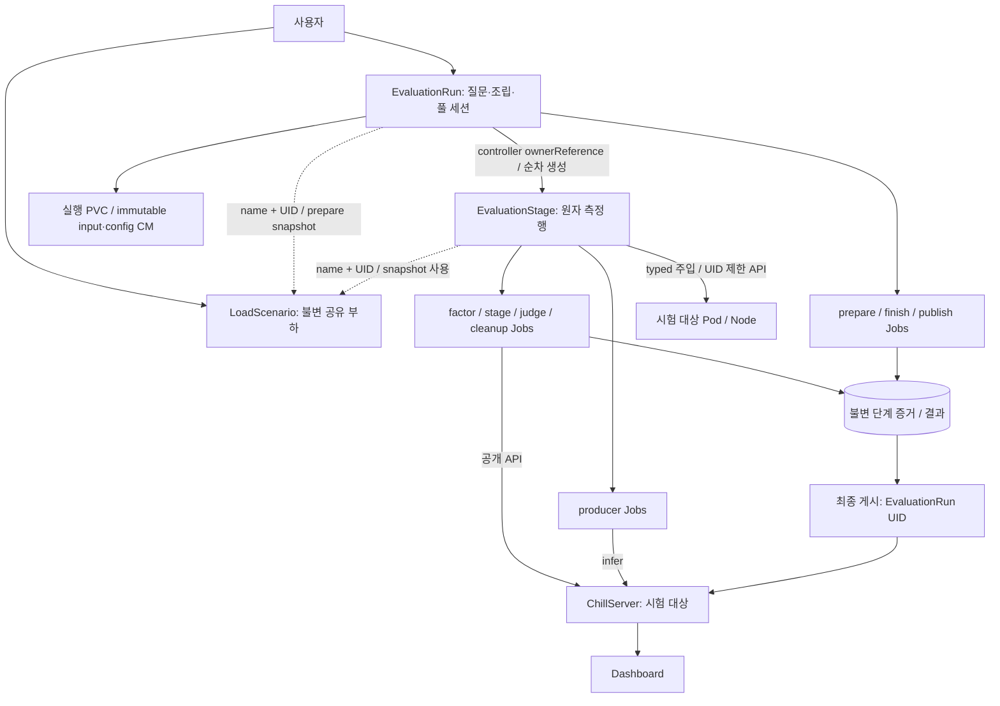

# EvaluationRun 실행 — profiler 측정 컨트롤러

상태: black-box 단일 계약 구현. 배포·실측 실행 승인은 별도다.
정본: [실험 SRS](../../spec/experiments/SRS.md) EXP-01~15 · [Profiling 색인](README.md).

## 1. 범위와 하지 않는 것

`edge.dacs.io/v1alpha1`의 release namespace에 새 CR 세 개를 둔다. `LoadScenario`는 공유 부하 정의, `EvaluationRun`은 질문·조립·비교·단일 풀 세션, `EvaluationStage`는 원자 측정 한 행이다.
기존 `cmd/profiler` manager에 EvaluationRun·EvaluationStage reconciler를 추가한다. ChillServer는 시험 대상이며 실행기를 넣지 않는다.
현재 profiler는 Run/BEO/Baseline/PowerModeTransitionCost를 등록한다(`cmd/profiler/controller_setup.go:43–58`).
**현재 OperationCost·DispatchOccupancy 실행은 ChillServer의 `SchedulerController.Admit` 안에 있다**(`internal/serving/kube/admission.go:114–116,249–259`).
EvaluationRun의 profiler 배치는 이 현황을 일반화한 것이 아니라 측정 주체와 시험 대상의 생명주기를 분리하는 결정이다.

범위는 현재 단일 자원 풀·release namespace의 evaluation 실행이다. 배포·업그레이드, 다중 풀, 우선순위 큐, 새 workflow 서비스는 만들지 않는다.
공개 설정 patch·부하·요청 drain·수집·평가 소유 정리 프로토콜과 판정·표·전력 계산을 Go reconciler로 옮기지 않으며 기존 측정 CR 실행 위치도 바꾸지 않는다.
[Plan 2](plans/02-profiling-run-execution.md)의 일회성 Job, [Plan 4](plans/04-minimal-profiler-control-path.md)의 durable 상태,
[Plan 7](plans/07-batch-energy-optimization-control-path.md)의 generation/terminal 처리,
[Plan 10](plans/10-transition-cost-measurement.md)의 controller/관측 Job 분리를 재사용한다.
Katib는 탐색, Tekton은 CI가 주목적이고 Argo는 현재 고정 순서보다 의존성을 더 늘린다. 기존 Job + 제한된 controller를 유지하며 범용 workflow 엔진을 만들지 않는다.

## 2. 구성요소와 소유



그림은 논리적 연결이며 기본/Profiler Helm profile의 결합 배포도나 live 상태 증명이 아니다.
부모 controller는 풀·순서·자식 채택·끝 정리·게시, 자식 controller는 단계 Job·producer·주입·compact status를 소유한다. 단계 프로토콜·실시간 부하 관측·계산은 기존 하네스가 소유한다.
하네스는 `hack/evaluation` Python과 publish bridge를 담은 별도 도구 이미지다. 전력 적분은 기존 공개 power API의 meter-only 응답을 재사용하며 runtime 7 이미지에 속하지 않는다.
이미지 digest와 harness source SHA를 동결하고 Job 안에서 빌드·git archive·토큰 발급을 하지 않는다.
부하는 기존 workload별 `batch/v1` Job 형태를 쓰며 `backoffLimit: 0`, `restartPolicy: Never`를 유지한다.
하네스는 기존 단계 명령별 단발 Job과 마지막 단발 표·게시 Job으로 나누고 `parallelism/completions: 1`·무재시도를 요청한다.
이 설정만으로 Pod 단일 실행·exactly-once를 보장하지 않는다. 선택한 정확한 producer Pod UID에만 GO를 보내며 중복/교체 Pod와 불변 저장 충돌을 성공으로 숨기지 않는다.
Job 성공만으로 증거 완료를 선언하지 않는다.

## 3. 객체별 spec과 값 타입

세 CR 모두 spec 전체에 CEL `self == oldSelf`를 둔다. 실행 전 수정도 거절하며 정정은 새 CR이다.
생성 경계에서 필수 구조·수치 범위·ID 유일성·비교/주입 참조를 한 번 검증한다. 실제 신원·가용성은 prepare에서 관측한다.
`PinnedRef`는 Workload만 `{name,uid,generation}`, 불변 CR은 `{name,uid}`다. 기존 cluster-scoped Workload 외 cross-namespace 참조는 없다.
공유 카탈로그/입력에 consumer ownerReference를 두지 않는다. LoadScenario에는 status도 없다.

하네스 action 계정은 평가 전용 최소 권한으로 Workload/Dataset/Preprocessor·외부 Node/Pod readiness·평가 소유 Job을 읽고, 자신의 generator Job/GO/정리만 수행한다. 공개 settings GET/PUT은 운영자와 같은 인가·ConfigMap update 검사를 통과한다. 내부 scheduler snapshot/capacity/profile/operation URL 권한이나 Node 전력모드 patch는 요구하지 않는다.

Harness exceptions use bounded CamelCase reason tokens (`ProcedureFailed` for
unstructured errors) and retain the original error in `execution.message` and
the error artifact. At the controller's shared condition boundary, reasons
outside `^[A-Za-z]([A-Za-z0-9_,:]*[A-Za-z0-9_])?$` or longer than 1024 bytes
become `ProcedureFailed`; their original text is prefixed to the condition
message, bounded to 32768 bytes without splitting UTF-8.

For an already-stuck prepare whose status patch was rejected, no operator
release is needed if the recorded Job/Pod identities and result remain:
`RunReconciler.reconcileRun` calls `advance` again while prepare has no
`finishedAt`; `advance` re-reads the immutable `run/prepare/result.json`.
After the normalized failure is patched, subsequent reconciles skip child
creation and execute finish. A successful no-control-effects finish clears
`occupyingRunUID` and sets `PoolAcquired=False/Returned`; cleanup failure
deliberately retains ownership and requires the existing operator release flow.

| 객체 | spec 필드 | 내용·기존 입력 대응 |
|---|---|---|
| LoadScenario | `workloads[]` | Workload 이름·UID·generation의 유일 정본. SLO는 그 generation의 적용 정의에서 얻음 |
| LoadScenario | `parts[]` | ID·durationSeconds·workload별 절대 rates. 길이/부하는 stage에서 override 불가 |
| LoadScenario | `arrivalDistribution`, `traceRefs`, `seeds`, `datasetRefs` | 고정 arrival·선택 trace 증거, workload별 uint64 문자열 seed와 `{name,uid}` Dataset 참조 |
| EvaluationRun | `question`, `target` | 질문·목적, 외부 구성요소 resource 참조와 readiness·UID 관측. CHILL image/source/profile exact-match gate 없음 |
| EvaluationRun | `harness` | 이미지 digest·source SHA. 과학 신원으로 **spec에만** 두며 운영 ConfigMap에는 없음 |
| EvaluationRun | `loadGenerator`, `powerMeasurement` | 생성기 image/source·메모리·shards·barrier·nodeName; 선언 Node UID·meter/source·series/sampling |
| EvaluationRun | `settingsPatch` | 선택 공개 SchedulerSettings 부분 객체. RFC7396이며 server 정본 검증과 ETag/If-Match 사용 |
| EvaluationRun | `judgment`, `evidenceStore` | 생성기 품질(lateness 등)·에너지 coverage; 실행 증거 logical store. **SLO 복사본 없음** |
| EvaluationRun | `stages[]`, `comparisons[]` | 순서 있는 StageTemplate; 양쪽 stageID 또는 historical publicationID/stageID와 비교 이유 |
| EvaluationStage | `stageID`, `row`, `loadScenarioRef` | 사용자 ID, 행 라벨, 불변 부하 참조 |
| EvaluationStage | `settingsPatch`·실행 맥락 | target/harness/generator/power/judgment/store와 동결 운영 CM·snapshot 참조 |
| EvaluationStage | `failureInjection[]` | 명시된 typed 외부 Pod/Node 주입 계획. controller ownerReference가 부모 정본 |

| 값 타입(별도 CR 아님) | 계약 |
|---|---|
| StageTemplate | id·row·loadScenarioRef·선택 settingsPatch·failureInjection; 부모 spec의 조립 입력 |
| TargetIdentity / Judgment / Generator / PowerMeasurement | 외부 대상·판정·생성기·장비 값 타입, 독립 status/수명 없음 |
| FaultInjectionPlan / Record | 자식 spec의 불변 계획 / status의 compact 실행 기록; 상세는 불변 증거 |
| StageResult | run/stage UID·실제 요청/전력·절차 시각·출력 참조를 보존한 불변 증거 |

builder가 부모 공통 값과 template을 합성한다. template에 settingsPatch가 있으면 부모 patch 전체를 대체하며, 두 patch를 숨은 merge하지 않는다. 생성 뒤 자식 spec은 바꾸지 않는다. 적용할 때만 live 공개 settings에 선택된 patch를 RFC7396으로 병합한다.
동일 LoadScenario UID는 동일 선언 부하다. “같은 부하” 주장은 generator 설정도 같아야 하며 실제 발행·성공은 별도 단계 증거로 판단한다.
SLO·서버 버전·스위치는 LoadScenario에 넣지 않는다. Workload generation 불일치를 현재 값으로 치환하지 않는다.

`environment*.json`의 토큰·CA·endpoint·host path는 spec 밖이다. release namespace의 고정 ConfigMap `chill-evaluation-config`와 Secret·Job 전달 binding으로 주입한다.
`binding`의 과학적 조건은 위 필드·불변 입력으로 옮기고 `control` 번호·로컬 실행 폴더는 신원으로 쓰지 않는다.
`preparationStatus`/`scoreboardInputs` 같은 운영 보조 파일을 필수 실행 계약으로 승격하지 않는다.
대기/정리 상한·Job 실행 예산·수집 크기/용량 한계·SA/Secret 이름·StorageClass/PVC 크기·API URL 등 운영 값은 **ConfigMap `chill-evaluation-config`**에서 선택한다.
controller가 실험 시작 시 직접 GET하여 실제값과 ConfigMap 이름·UID·resourceVersion을 `status.frozenConfig`와 실행 증거에 동결한다. operator·profiler flag는 변경하지 않는다.
[ADR 0031](../../adr/0031-configuration-ownership-and-freezing.md)에 따라 실행 중 재조회로 값을 바꾸지 않는다. 프로토콜 상수는 policy knob로 만들지 않는다.

운영 ConfigMap의 최종 키는 아래와 같다(정본: `charts/chill/values.yaml`, `internal/evaluation/controller/jobs.go`).

| 키 | 의미 / chart 기본값 |
|---|---|
| `actionServiceAccount`, `publishServiceAccount` | 실행 / 판정·게시 SA: `chill-evaluation-action`, `chill-evaluation-publish` |
| `storageClass`, `workspaceSize`, `minimumFreeBytes` | 작업 PVC: `rook-cephfs`, `400Gi`, `310000000000` |
| `jobActiveDeadlineSeconds` | Job 예산 `21600`; 최소 `540`초 |
| `injectionWindowSeconds`, `injectionSnapshotTTLSeconds` | 주입 허용 창·관측 유효 기간: 각각 `5`초 |
| `drainTimeoutSeconds` | 요청 drain·평가 소유 정리 상한 |
| `operational` | client·collection 운영값. `timeboxes.{setupSeconds,barrierSeconds,drainSeconds,flushSeconds,collectSeconds,apiSeconds}`, `tokenSafetyMarginSeconds`, `collection.maximumDurationSeconds`, `workloads[name].{producerEndpoint,producerTokenFile,producerCAFile,deliverySeconds,socketSeconds,gatewayCapSeconds,workers,lifetimeSeconds,podSpec,volumeMounts}` |
| `chillAPIURL`, `caSecret` | ChillServer URL·TLS CA Secret |
| `evidenceEndpoint`, `evidenceBucket`, `evidenceRegion`, `evidenceCredentialsSecret` | 증거 store 접속·전용 자격 Secret |

## 4. Status와 condition

`status.observedGeneration`과 type-keyed `[]metav1.Condition`(`listType=map`, `listMapKey=type`)을 둔다.
각 condition은 `status`, `reason`, `message`, `observedGeneration`, `lastTransitionTime`을 쓴다.
부모 status에는 frozenConfig·workspace(PVC name/UID)·currentStage·childRefs(name/UID)·전역 절차·시각·잔류·release 기록을 둔다.
자식 status에는 Job/Pod name·UID, goRef, injection 기록, outputs/resultRef·잔류와 `procedures[]`를 둔다. **단계 procedures 정본은 자식**이며 부모에 본문을 복제하지 않는다.
raw·로그 본문·접속 비밀은 넣지 않는다. 부모 startedAt가 점유를 나타내며 운영자 해제 annotation 원 값·처리 시각·증거도 부모에 남긴다.
부모 condition은 아래 다섯 개다. 미실행은 `Unknown/NotStarted`, 증거 완료는 검증된 참조로 표현한다.

| Condition | True의 뜻 | False 또는 대기 reason 예 |
|---|---|---|
| `PoolAcquired` | 이 실험이 단일 풀을 점유 | `PoolBusy`(점유 UID) |
| `ExecutionComplete` | 계획한 절차의 작업 완료(평가 통과 아님) | `ProcedureFailed`, `RemoteEffectUnknown` |
| `MeasurementPassed` | 기록된 기존 규칙의 PASS | `SLOFailed`, `GeneratorInvalid`, `PowerIncomplete`, `InjectionInvalid`; 미판정은 Unknown |
| `CleanupComplete` | 평가 소유 Jobs/Pods·writers 정리 및 변경한 공개 settings 경로 원복/외부 변경 생략 확인 | `ResidualState`, `RemoteEffectUnknown`, `SettingsConflict`, `ObservationUnavailable` |
| `Published` | 최종 게시 저장 완료 | `EvidenceStoreFailed`, `PublicationFailed`, `PublicationConflict` |

자식 condition은 `ExecutionComplete`, `MeasurementPassed`, `StageCleanupComplete`다. 마지막은 해당 단계의 정확한 producer Job/Pod 정리와 자신의 settingsPatch 원복/외부 변경 생략 기록을 확인한다. CHILL instances/routes가 0이라는 뜻이 아니다.
부모 MeasurementPassed는 자식 원 판정을 집계한다: INVALID 하나라도 있으면 INVALID, 아니면 NOT_EVALUATED가 있으면 Unknown/NOT_EVALUATED, 아니면 FAIL 하나라도 있으면 FAIL, 모두 PASS면 PASS다.
세 완료 축은 `ExecutionComplete`, `MeasurementPassed`와 원 판정값(`PASS/FAIL/INVALID/NOT_EVALUATED` 등), `CleanupComplete`다.
SLO FAIL은 판정 완료된 측정 불합격이고, 수집기 종료·JSON 읽기 실패는 수행 오류다. 작업 완료·Job 성공을 PASS로 바꾸지 않는다.
절차 reason은 입력·외부 가용성·평가자 신원·수집/저장 오류를 원 증거에 연결한다. settings 적용/원복의 HTTP 428·409·불확실 효과는 If-Match·ETag·상태 코드와 함께 보존한다.
실행 이미지·source exact-match는 평가자 자신의 harness/load-generator에만 적용한다. CHILL target는 외부 readiness·resource UID를 확인하고 runtime 신원은 관측 이력으로 남긴다.
Job NotFound는 정확한 UID·조회 사실을 보존한다. 다른 UID를 삭제하거나 자동으로 측정 실패/반환 완료로 바꾸지 않는다.

## 5. 단계별 동작과 기존 하네스 연결

부모 prepare는 LoadScenario·Workload 적용 정의·Dataset carrier·운영값을 한 번 동결한다. 자식은 단계별 외부 준비 확인 → 공개 settingsPatch 적용/readback → 부하 → 요청 drain → 수집 → 판정 → 자신이 만든 자원 정리와 변경 settings 경로 원복 순서다. 부하·drain·수집은 `conductor.CPO.run` 한 Job 안에서 이어진다.
자식이 factor/stage/judge/cleanup·producer Job을 소유하고 Job ownerRef는 Stage UID다(Pod는 Job 소유). prepare/finish/publish Job·PVC·input/config CM은 EvaluationRun 소유다.
아래 공개 API 열은 **Job 안의 conductor.py가 사용하는 인터페이스**다. controller가 부하 로그·GO·drain 프로토콜을 직접 소유하지 않는다.
줄 번호는 설계 시점 소스다. 기존 운영 attempt의 `*.command.json`은 의미 비교 근거이며 새 argv 계약은 아래 §5.1이다.

| 절차 / 내보낼 Job | Job 안의 공개 API / Kubernetes 리소스 | 기존 함수와 파일:줄 | 실패 시 동작 |
|---|---|---|---|
| 준비 / 하네스 사전 검사 | Deployment/Pod·Node readiness, Workload/Dataset 공개 정의, 토큰 수명 | `input_snapshot.prepare`, `input_snapshot.check_target`, `input_snapshot.check_fleet`, `auth.check` | 외부 신원·입력·용량·토큰 오류면 부하 미시작; 배포·내부 상태 변경 없음 |
| 설정 적용 / `factor` | GET/PUT `/api/v1/scheduler/settings`, ETag/If-Match, GET readback | `settings_patch.factor_apply` | 현재 settings에 RFC7396 settingsPatch 병합; If-Match·응답 ETag·상태·요청/응답·readback·appliedAt 보존; 적용 409 재시도 없음 |
| 부하 / `stage` | workload별 Job/Pod 생성·logs·pods/exec GO | `CPO.job`, `CPO.run`, `ProducerResources` | Dataset carrier의 evaluation을 `/evaluation`에 복사, 실제 payload ID/order/bytes·arrival Ready 확인; 모든 Pod에 동결 nodeName 전달 |
| drain / 같은 `stage` | producer 요청 종료 로그·정확한 Pod/container counter·Job 종료 | `CPO.run` | 요청 drain과 evaluator 자원 반환을 구별; CHILL instances/routes 조건 없음 |
| 수집 / 같은 `stage` | GET `/api/v1/observations/raw`의 requests/resources, GET `/api/v1/observations/power?from=…&to=…` | `archive.collect` | 실제 raw byte bounds 및 선언 node+meter/source identity 검증; 내부 scheduler stream 필수 조건 없음 |
| 판정 / `judge` | 저장된 client/request raw·meter 결과·동결 SLO | `judgment.judge`, `archive.meter_energy` | 전체 offered 분모·generator lateness·SLO·meter coverage 유지; SLO FAIL은 유효 결과 |
| 단계 정리 / `cleanup-jobs` | 정확한 소유 Job UID 삭제와 같은 소유 Pod 종료 확인, settings GET/PUT/readback | `CPO.cleanup_jobs`, `settings_patch.factor_revert` | 적용값과 같은 patch 경로만 원복, 외부 변경 경로는 기록 후 생략. 원복 409만 새 GET으로 1회 재판단하며 두 번째 409는 Returned 차단 |
| 실험 끝 / `finish` | 평가 소유 Job/Pod·writer 정리와 아직 원복하지 못한 patch 경로 확인 | `CPO.finish` | 자율 제어 instances/routes를 reset하거나 과거 settings 전체를 복원하지 않음 |

CHILL target의 image/source/profile은 관측 이력일 뿐 exact-match gate가 아니다. evaluator 자신의 harness/load-generator image/source와 Job/Pod UID·명령 신원은 유지한다. 공개 settingsPatch는 GET ETag를 If-Match에 넣어 현재 설정의 명시 경로만 바꾸고 readback으로 확인한다. 원복은 새 GET에서 아직 우리 적용값과 같은 경로만 복원하고, 외부 운영자가 바꾼 경로는 사유와 함께 생략한다. 원복 409는 한 번만 새 GET으로 재판단하며 두 번째 충돌은 원 응답을 보존하고 Returned를 막는다. arrays/scalars는 leaf이고 null은 RFC7396 삭제다.
작업 폴더는 실행별 RWX PVC(`rook-cephfs`)의 `/work/campaign/run`이며 기존 증거 저장 PVC를 재사용하지 않는다.
하네스 Job은 실행별 RWX 작업 PVC의 같은 경로에서 앞 절차 산출을 이어받는다. 각 절차 종료 시 그 절차의 새 산출·시점 스냅샷을 `experiments/<UID>/...`에 conditional create로 저장하고 검증된 작은 결과 참조를 기록한다. 가변 phase/commands 파일은 절차별 다른 key로 보존하며 덮어쓰지 않는다. PVC 손실은 자동 재측정/새 Job 복원을 허용하지 않고 ExecutionLost/증거 실패로 남긴다.
PVC는 가변 작업 상태, store는 불변 증거 정본이다. controller는 반환 미확인 동안 Job/PVC를 의도적으로 정리하지 않으며 증거 업로드 실패 시 PVC를 보존한다. GC 지원 범위는 §6과 같다.
controller와 Job의 단계 증거는 `experiments/<UID>/stages/<stageID>/...`에 `ImmutableWriter`로 저장한다. 기존 publish bridge는 중간 저장/전달에 쓰지 않는다.
부하 Job은 서버 재시작과 무관하게 GO·drain·수집을 계속한다. 주입용 GO 시각은 한 번 쓰는 진행 증거로 노출하고 실제 producer별 시작과 구분한다.
실행 중 producer cgroup 표본은 node-agent가 수집하고 기존 `/api/v1/observations/raw/{hour}/resources`의 닫힌 분을 하네스가 폴링한다. GO 전 `minimumReadySamples`개 완전한 counter와 종료 이후 실제 counter를 **자신이 만든 Pod UID + load containerID**로만 고른다. 다른 Pod·다른 컨테이너는 client로 분류하지 않으며, cgroup을 찾지 못한 errors/표본 누락은 readiness 우회가 아니라 상한 내 관측 대기 후 실패다.
자원 대상 계약은 **서버 namespace + `edge.dacs.io/workload-role=load-generator`**다. 이름·값은 서버 `resources.go`와 Python `conductor.py`의 계약 상수로 한 곳씩 선언하며 producer Pod template이 붙인다. resourceReceiver만 기존 대상과 OR하고 cluster observer의 선택은 바꾸지 않는다. 다른 실험 도구도 같은 일반 라벨을 쓸 수 있고 서버는 evaluation 라벨을 알지 않는다.
판정도 API resources adapter만 사용하며 local client cgroup 병합·SSH sampler·Secret·호스트 계정·sudo crictl 요구를 제거한다. 종료 counter 증거를 저장한 후 기존 start marker를 제거한다. 마지막 collect의 기존 raw 수집을 재사용하며 별도 종료 수집 경로는 만들지 않는다. 저장 resources 형식은 ADR 0019에 따라 그대로다.
최종 단발 표·게시 Job은 기록된 판정·정리 결과만 표현한다. 정리 실패도 세 축을 구분해 게시하며 후속 측정/복구를 시작하지 않는다.
`judgment.summarize`와 `tables.render`가 저장된 black-box 판정의 표와 게시 KPI를 조립하고, `publication.publish`가 불변 증거를 조립·게시한다. `evaluation.Harness`는 절차 dispatcher와 conductor adapter다. `evidence_io`는 기존 strict JSON·binding I/O를 소유하며 adapter의 `input_snapshot.load`와 JSON 비유한값 처리 차이를 유지한다. binding의 기존 네 source 키와 `phase.sourceObservations.imageSourceSHA` 계약은 그대로이고 새 모듈도 기존 harness 디렉터리 전체 COPY에 포함된다. 별도 로컬 deployment/calibration/restoration executor는 사용하지 않는다.

실행 중 D1은 `EvaluationStage.status.provisionalD1`의 선택적 최신 스냅샷이다.
conductor는 기존 `timeboxes.flushSeconds` 간격으로 새 닫힌 분을 확인하고,
`provisional-inputs/`에 requests만 별도 수집한다. raw.py의 dedup/final index와
최종 judgment의 순수 request reducer를 공유한다. 잠정 분모는 실제 producer 시작
시각 + 동결 scheduledOffset이 `closedThrough` 이하인 요청만 포함한다.
최종 D1의 deadline은 scheduled offset이 아니라 HTTP receipt부터 final까지의
`elapsedNanos`를 사용하므로 예정 시각이나 socket timeout으로 완료 상한을 만들지 않는다.
`unfinishedOrUnsent`는 `asOf` 시점의 미완료·미전송 집계이며, 아래 `collectionLoss`를
제외한다. 뒤늦은 result와 raw final로 같은 요청의 deadlineSuccess가 증가할 수 있다.
`asOf`는 계산 시각, `closedThrough`는 서버의 닫힌 분 cutoff이며 요청 완료 보장이 아니다.
분 경계가 바뀌거나 부분 수집이면 이전 성공 스냅샷을 유지하고 오류를 기록한다.
workloads/substages는 최종 KPI와 같은 이름을 쓰되 drain 전 `D1` 판정은 싣지 않는다.
`reachable`은 나머지 미확정 요청이 모두 성공할 때 요구 순위에 도달 가능한지다.
generatorQuality는 선택된 예정 도착의 현재 result 행으로 최종과 같은 issuance_fidelity 함수에서 계산한다.
Stage UID JSON-patch test 후 이 필드만 status patch한다(action SA의 추가 권한은
`evaluationstages/status: get, patch`; kubectl의 status patch가 먼저 GET을 수행한다). lifecycle·measurement는 controller 소유 그대로다.
로컬 latest JSON은 원자 교체하고 최종 raw evidence와 불변 publication은 덮어쓰지 않는다.
producer JSONL은 기존 result 전용 형식 그대로이며 send 이벤트나 infer 앞의 추가
write/flush는 없다. 최종 판정은 기존 전체 동결 분모·입력 의미를 유지한다.

producer별 전용 수집 thread는 `kubectl logs -f`의 바이트를 해석 없이 기존
`*-client.jsonl`에 즉시 append/flush한다. 이벤트 해석·자원 폴링·잠정 D1은
별도 main thread에서 수행하므로 느린 reducer가 log pipe 수집을 막지 않는다.
연속 쓰기 경로가 기존 free reserve 검사를 소유한다. producer writer들은 공유 lock
아래 다음 행의 바이트 수까지 반영해 여유를 확인하고 append/flush하므로 main
reducer가 멈춰 있어도 reserve를 소비하는 행은 쓰지 않는다. 위반은
`EvidenceCapacityInsufficient` capture 오류와 collectionLoss로 남기며 조용히 버리지 않는다.
잠정 판정은 디스크의 완전한 줄만 읽고 매 poll 종료 시 full-population raw cache를
해제한다. 전체 이력 index와 resource 목록의 peak memory는 아직 별도 개선 대상이다.
`phase.producerCapture[workload]`는 `plannedRequests`, `receivedRequestRows`,
`drained`, `collectionLoss`를 기록한다. producer의 drained 표시가 없고 planned보다
client 행이 적으면 그 차이를 `collectionLoss`로 분리한다. drained가 있으면 0이다.
최종·잠정 공용 request reducer와 게시 `kpis.requests[workload]`도 같은 이름을 사용한다.
수집 손실은 `unfinishedOrUnsent`나 성공으로 세지 않으며 frozen 분모·D1 판정식은
바꾸지 않는다. CHILL 관측으로 없어진 client 행을 보정하거나 재구성하지 않는다.
정상·STOP·예외 종료는 같은 종료 함수에서 writer join → 남은 디스크 행 처리 →
phase 저장 순서를 따른다. 행 수·drained·collectionLoss를 확정하고 join 이후 reader
오류도 capture 실패로 기록한다. 종료 중 추가 오류는 원래 `ProducerFailed` 등 primary
실패 사유를 덮어쓰지 않는다.
남은 공백: follow 연결 끊김의 재연결·`--since-time`·dedup은 구현하지 않으며, 발생 시 누락 행은 collectionLoss로 드러낸다.

### 5.1 하네스 Job 계약

- argv: `python3 /opt/evaluation/hack/evaluation/evaluation.py <prepare|factor|stage|judge|cleanup-jobs|finish|publish> --run /work/campaign/run --spec /spec/spec.json [--stage <stageID>]`. stage 인자는 factor/stage/judge/cleanup-jobs에만 필수다. spec.json은 해당 소유자 spec(단계는 완성 StageSpec), execution.json은 부모/자식 UID·generation과 snapshot 연결, config.json은 동결 운영값이다. `/spec`은 immutable CM RO, `/work`는 실행 PVC RW다.
- 입력 CM `eval-<runUID32>-input`에는 `snapshot-ref.json`의 snapshotRef만 담는다. 큰 입력 snapshot 본문은 store/PVC에 두며 CM에 복제하지 않는다(`internal/evaluation/controller/run.go`).
- 결과 JSON: `{schemaVersion:"evaluation-step.v1alpha1",runUID,generation,stageUID?,stageID?,step,execution:{status,reason},measurement:{verdict,reason}?,cleanup:{status,reason}?,startedAt,finishedAt,artifacts:[{store,key,size}]}`. 로컬 `results/prepare.json`, `results/stages/<id>/<step>.json`, `results/{finish,publish}.json`은 편의 사본이며 store result를 독립 load한다. 큰 judgment는 artifact다.
- exit code: **0**=절차·필수 불변 업로드 완료(PASS 아님), **1**=수행/입력/관측/업로드 오류 또는 효과 불명, **2**=명시 측정 INVALID 등 판정 완료(result 있음). Job 성공/실패나 exit 2만으로 MeasurementPassed를 정하지 않으며 신호·Pod 교체·Job retry로 자동 재실행하지 않는다.
- Job 이름: 부모는 `eval-<runUID lowercase without hyphens>-<prepare|finish|publish>`, 자식은 `eval-<stageUID lowercase without hyphens>-<factor|stage|judge|cleanup>`(≤63자, cleanup argv는 cleanup-jobs). producer도 Stage UID+workload ordinal로 결정한다. labels는 `edge.dacs.io/evaluation-run-uid`, `edge.dacs.io/evaluation-stage`(stageID 또는 run), `edge.dacs.io/evaluation-step`이며 하네스 Job은 `edge.dacs.io/workload-role=system`, producer Pod는 `edge.dacs.io/workload-role=load-generator`다. 단계에는 stage UID도 기록한다. 소유자 UID·동결 args/image/SA/PVC/spec/config 확인 후 채택한다.
- SA: `chill-evaluation-action`은 prepare/factor/stage/cleanup/finish, `chill-evaluation-publish`는 judge/publish(automount=false)에 사용한다. SSH Secret은 필요 없으며 모든 Job은 backoffLimit=0, parallelism/completions=1, restartPolicy=Never, bounded activeDeadlineSeconds다.
- action SA는 projected token을 사용하며 `expirationSeconds=activeDeadlineSeconds+60`이다(최소 token 수명 600초에 맞춰 deadline 최소 540초). 하네스는 회전된 token을 요청마다 다시 읽으며 최초 읽은 문자열을 재사용하지 않는다.
- store key: `experiments/<runUID>/preparation/...`, `/stages/<stageID>/<step>/...`, `/finish/...`. 단계 GO는 `/stages/<stageID>/go.json`, 주입 응답은 `/stages/<stageID>/injections/<id>/result.json`이다. **child UID는 경로에 넣지 않고 result에 기록**한다. 가변 파일은 절차별 snapshot key, 작은 result는 마지막 쓰기이며 충돌은 실패다. 최종 bridge는 `serving/experiments.v1alpha1/<runUID>/{execution.json,evidence-index.json,summary.json}`만 쓰며 summary가 마지막이다.

### 5.2 게시 목록의 사실 요약

`GET /api/v1/experiments`는 응답 크기를 줄이려고 각 항목의 `definition` 본문을 생략한다.
삭제는 저장소 삭제가 아닌 요청별 투영이며, `GET /api/v1/experiments/{id}`는 게시 당시의 전체
`definition`을 그대로 반환한다. evaluation publisher가 이미 `summary.json.definition`에
이름·spec·LoadScenario·Workload/SLO를 동결하므로 새 저장 형식이나 ADR 0019 버전 변경은 없다.

목록은 본문을 생략하기 전에 선택적 `facts`를 추가한다. 새 쿼리 파라미터는 없다.
`facts.name`/`question`은 `definition.run.name`/`spec.question`,
`settingsPatch`는 공통 patch 원문, `stages[]`는 기록된 `id,row,settingsPatch,loadScenarioRef`다.
stage의 settingsPatch 부재는 공통 patch 상속이며, 명시된 stage patch는 공통 patch 전체를 대체한다.
`sloSources[]`는 동결 Workload의 `name,uid,generation,slo`,
`loadSources[]`는 동결 LoadScenario의 `name,uid`다.
부하 계획 전체·주입 계획·기타 큰 정의는 상세에 남긴다. SLO 수치·generation은 정밀도를
낮추지 않으며, 실제 관측 KPI·판정·`comparisons`·기존 필드는 변경하지 않는다.

```json
{"facts":{"name":"run-name","settingsPatch":{"controls":{"power":false}},"stages":[{"id":"baseline","loadScenarioRef":{"name":"load","uid":"load-uid"}}],"sloSources":[{"name":"service","uid":"workload-uid","generation":1,"slo":{"percentile":95,"targetLatencyNanos":1000000000}}],"loadSources":[{"name":"load","uid":"load-uid"}]}}
```

저장된 정의에 실제 요약 사실이 없으면 `facts`를 생략한다. 과거 이름/ID로 정책을 추정하거나
현재 Workload·설정을 읽어서 과거 결손을 보충하지 않는다. 소비자는 선택 필드로 읽어야 하며,
기존 상세 hydrate 경로는 계속 유효하다.

새 게시물은 동결 Workload UID와 실제 관측 definition 목록을 따로 보존한다.
Workload name/UID 불일치는 실행을 중단하지만 generation과 sourceSHA는 관측 사실이다.
raw provenance 오류는 지표를 전역 무효화하지 않고, 모호한 requestID만 격리해 수와 사유를 남긴다.
`definitionID`는 사용할 수 있는 HTTP final의 단일 관측 신원이 있을 때만 채운다.
정책 v2 저장 계약은 `e5-summary.v4`, `e5-judgment.v3`, binding v4다.
bridge/reader의 외곽 unknown-field 거절은 유지하고, 원래 JSON 객체로 보존하는 KPI·definition
내부에는 새 strict 스키마를 만들지 않는다. 이미 게시된 과거 null은 수정·재게시하지 않는다.

게시 `sources[]`에는 실제 `identitySource`에 사용한 동결 input-snapshot의 기존 store/key 참조도 포함한다. Python `publication`은 이 참조를 그대로 조립하고, `hack/evaluation/publish`는 manifest의 선택적 `existingSources`를 기존 Statter로 한 번 확인한다(같은 Run/store·존재·크기). snapshot 재업로드나 digest 재계산은 하지 않는다.
기존 sources 규칙과 같이 참조가 없거나 크기가 다르면 신규 게시 객체를 쓰기 전에 게시를 실패시킨다. 출처를 조용히 지우거나 적용 SLO 검증을 우회하지 않는다. sources 배열의 항목 추가이므로 `serving-experiment.v1alpha1` 및 E5 summary 버전은 유지하며 과거 게시물은 변경하지 않는다.

## 6. 상호 배제와 재시작

**전제: profiler leader election을 켠다.** 바이너리 `--leader-elect` 기본은 false지만 Helm `profiler.leaderElection`은 true다.
leader election이 꺼지면 **EvaluationRun·EvaluationStage reconciler를 등록하지 않는다**. 기존 controller 기동은 막지 않는다. 같은 풀은 기존 election ID를 쓰며 별도 실험 Lease는 없다.
풀 점유·finish·release·게시는 **부모만** 소유한다. 두 reconciler 모두 worker 1(`MaxConcurrentReconciles: 1`)이며 풀 배제 목록은 **APIReader의 최신 EvaluationRun 목록**으로 읽는다. 메모리 큐는 점유 장부가 아니다(`internal/evaluation/controller/runtime.go`, `run.go`).
실험 시작 때만 resourceVersion 조건부 status 갱신으로 `startedAt`·점유를 한 번 기록한다. 충돌·결과 불명확이면 목록을 다시 읽는다. **명령별 선점 장부는 두지 않으며 이 갱신을 풀 전체 fencing이라고 부르지 않는다.**
실행 중이거나 반환 미확인 실행이 있으면 다음을 시작하지 않는다. 대기는 생성 시각 오름차순, 동률만 이름·UID로 고정한다. 점유 UID와 `PoolBusy`를 표시하며 우선순위·재정렬은 없다.
leader election은 퇴임 leader의 늦은 명령을 차단하는 fencing이 아니다. 이 한계를 유지하며 leader 획득·관측 실패·프로세스 종료를 반환으로 보지 않는다.
기존 ChillServer admission/예약이 실제 물리 자원을 소유한다. 실행 직렬화가 이를 대신하거나 강제로 해제하지 않는다.

재개는 기존 profiler의 결정적 Job 이름 **Get / Create의 AlreadyExists 채택** 패턴을 쓴다(`internal/profiling/profiler/controller/execution_job.go:61–97`).
부모는 결정적 자식 이름 `eval-<runUID32>-sNNN`(하이픈 없는 소문자 UID, 0부터 시작하는 단계 ordinal 3자리)·controller owner UID·완성 spec을 확인해 생성 응답 소실을 채택한다. 기록 child UID 소실/교체는 ExecutionLost이며 재측정 자식을 만들지 않는다. Job도 해당 부모/Stage owner UID·절차 label·동결 설정을 확인해 채택한다(`internal/evaluation/controller/run.go`, `jobs.go`).
기록한 Job이 없어졌으면 `ExecutionLost`로 끝내며 대체 Job을 만들지 않는다(`internal/profiling/profiler/controller/run_reconciler.go:91–98`). 기존 Job/증거가 확정한 경계에서만 다음 절차로 간다.
이미 시작한 stage Job은 기존 producer를 관측한다. Job/Pod 교체·부분 GO·GO 응답 소실·응답 없는 설정 PUT 등 효과가 불확실하면 중단하고 원 사유·자기 자원 UID·요청/응답·마지막 외부 관측을 보존한다. 설정 적용은 재시도하지 않으며, 원복의 확인된 409만 §5의 단 한 번 재판단을 허용한다.
관측 재조회/Job 채택과 측정 재시도는 다르다. 자동 재측정·자동 물리 복구는 없다. Job 실패 시 후속 stage를 시작하지 않는다.
정리 상한 초과는 실패이며 점유를 유지하지만 이미 확보한 측정 결과·정리 실패의 최종 게시는 허용한다.
부모는 실행 중 자식이 있으면 다음 자식/finish를 내보내지 않는다. StageCleanupComplete·Job 종료·부모 삭제 요청은 풀 반환이 아니다.
외부 효과(Job 생성·주입) 직전 자식은 **APIReader(비캐시)**로 부모를 읽어 풀 점유 중이며 자신이 기록된 active child인지 확인한다. fencing 보장이라고 주장하지 않는다.
단독 Stage는 금지다. controller EvaluationRun owner가 없거나 부모가 다른 child UID를 기록하면 terminal `ParentRequired`; 부모가 아직 자신의 UID를 미기록했으면 생성 응답 소실을 고려해 requeue 대기한다.
부모 deletionTimestamp 이후 새 자식은 만들지 않고 진행 중 자식은 단계 정리 경계까지 진행한다. 자식은 이를 위한 점유·active child 확인을 계속한다.
**background 삭제만 지원**한다. foreground/orphan 삭제로 Job이 사라지면 ExecutionLost·잔류를 기록하며 finalizer가 Job 보존을 보장한다고 주장하지 않는다.
부모 finalizer는 풀 반환·전역 보존, 자식 finalizer는 단계 증거·잔류 기록만 맡는다. 서로의 삭제 완료를 기다리는 순환은 금지하며 TTL 자동 GC도 쓰지 않는다.
운영자는 잔류 정리·풀 반환뿐 아니라 이전 발행 주체/진행 중 명령이 더 이상 작용하지 않음을 확인한 뒤 metadata의 `edge.dacs.io/evaluation-release` annotation으로 해제를 요청한다.
annotation 값은 JSON `{reason,at,by,evidenceRef?}`이며 `at`은 시각, `by`는 요청자다. 선택 evidenceRef 없이도 controller가 annotation 자체를 감사 증거로 저장한다. controller가 실제 반환을 관측하고 원 요청·처리 시각·증거를 status에 기록한 뒤 점유를 해제한다. spec은 불변이며 CleanupComplete 실패/측정 결과를 성공으로 고치지 않는다(`internal/evaluation/controller/run.go`).
release는 실행 완료(True/False)·CleanupComplete=False·PoolAcquired=True인 Blocked 상태에서만 수락한다. 서버는 그 밖의 상태를 409로 거절하고 controller도 선행 annotation을 무시하며 정상 실행을 계속한다. 목록·단건 projection의 conditions/currentStage/startedAt/finishedAt는 최상위 필드다.

## 7. 장애 주입

주입은 **EvaluationStage spec의 FaultInjectionPlan**과 **status의 FaultInjectionRecord**다. 자식 controller는 stage 완료 result를 아직 확인하지 않았을 때만 GO 증거의 시각+offsetSeconds로 주입하며 drain 뒤 producer 최소 start로 바꾸지 않는다. 완료 result 확인 후 미수행 계획은 실행하지 않고 `INVALID/InjectionInvalid`로 기록한다(`internal/evaluation/controller/stage.go`, `injection.go`).
허용 지연 창·snapshot 유효 기간은 `chill-evaluation-config`에서 선택해 실행 시작 시 동결한다. 예정 시각·발송·응답·효과 관측 시각과 개별 producer start를 구분하며 정확한 순간의 효과를 보장하지 않는다.
재시작/관측 지연으로 허용 창을 놓쳤으면 늦게 수행하지 않고 `INVALID/InjectionInvalid`로 남긴다. full/micro의 과거 offset을 controller 상수로 넣지 않는다.
주입 대상은 Workload owner가 연결된 실제 Kubernetes Pod UID와 Node UID·Ready 사실로 선택한다. scheduler routing/instanceAssignments/profile/snapshot은 선택 조건이 아니다. 선택·탈락 사유·정렬·관측 시각을 증거에 보존한다.
운영자 release도 evaluation-owned Job/Pod·writer와 변경한 설정 경로의 정리 사실을 확인한다. 자율 제어 instances/routes·reservation/action 개수나 scheduler stream을 반환 predicate로 사용하지 않는다.
controller는 선언한 fault만 실행한다. 계획이 없는 baseline에 fault나 smoke를 새로 추가하지 않는다.
controller가 **Kubernetes API**로 Pod 삭제(UID precondition), cordon/uncordon(Node UID 확인·경합 방지 patch)을 수행한다. cordon+삭제는 **cordon 응답 확인 → 같은 선택 Pod UID 삭제** 순서다.
uncordon은 앞선 주입의 같은 Node에만 적용한다. 실제 요청 method/path/body·응답·예정/실제 offset·시각을 증거로 남긴다.
조건 불만족·관측 만료·창 이탈이면 명령을 취소하고 해당 stage 주입 평가를 무효로 기록한다. 임의 대상·시각 대체는 없다. 읽기/관측 오류는 오류 반환으로 requeue하며 `RemoteEffectUnknown`으로 확정하지 않는다. 변이 요청 발송 후 효과 불명만 `RemoteEffectUnknown`으로 중단·예약 유지하고 자동 재주입/복구하지 않는다.
장애 주입의 소유자와 실행기는 `internal/evaluation/controller/injection.go`이며 대상은 공개 Kubernetes Pod/Node UID·readiness 사실로 선택한다. Python은 선언 plan과 불변 controller 응답을 같은 run/stage UID로 연결해 판정한다.

## 8. 증거·게시·조회

[Evidence Store](components/evidence-store.md)의 logical store/opaque key/size와 conditional-create, bounded 독립 읽기를 재사용한다.
trace와 inline seed는 내용이 고정된 부하 입력이다. 현재 설정·동명 새 Workload로 동결 정의를 대체하지 않는다.
prepare에서 LoadScenario·카탈로그를 **한 번만** name+UID(Workload는 generation도) 확인·해석한다. LoadScenario spec snapshot과 적용 Workload 정의(ModelSpec·Preprocessor·Dataset 신원·SLO)를 conditional-create 증거와 immutable CM에 보존한다.
자식은 이 snapshot만 사용한다. 실행 중 LoadScenario 삭제 보호 장치는 필요 없으며 같은 이름 재생성도 기존 snapshot을 바꾸지 않는다.

### 직접 선언과 Dataset carrier

`LoadScenario.spec.seeds`는 workload별 uint64 10진 문자열이고 keys는 workloads와 정확히 일치한다. `datasetRefs`는 workload별 `{name,uid}`만 받는다. prepare가 기존 Dataset의 immutable image/path와 Preprocessor input field 이름을 해석·동결한다. Job init container는 carrier의 evaluation 자료를 `/evaluation`으로 복사하며, producer가 실제 record ID·order·field bytes/hash를 Ready evidence에 기록한다.

host-built/uploaded input 파일·transitive bundle은 생성·다운로드하지 않는다. endpoint·CA/token projections·시간 상한·workers/lifetime는 동결 ConfigMap의 operational 값이다. Job은 evaluator가 직접 조립하고 `loadGenerator.nodeName`을 모든 generator Pod에 그대로 전달한다.

저장 계약은 binding `e5-binding.v4`, inputs `evaluation-inputs.v2alpha1`, snapshot `evaluation-snapshot.v2alpha1`, judgment `e5-judgment.v3`, summary `e5-summary.v4`다. 단일 reader이며 과거 불변 증거를 새 의미로 재해석하지 않는다.

`failurePolicy: v2`는 SLO·부하 충실도·offered/tail 에너지·주입 실현·drain·정리·발행을 독립 결과로 보존한다. lateness/gap 정책은 보고용 라벨이며, 부분 적분은 observedJoules와 coverage로 남기고 완전한 wholePoolJoules로 주장하지 않는다. power sourceIdentity·node/meter·from/to 범위 검증은 유지한다. CPU/throttle 카운터, NotReady, 경쟁 부하와 provenance label은 거절 조건이 아니다. 부하 0은 부하/SLO 주장, 전력 전무는 에너지 주장을 중단한다.

실행 증거의 store는 spec에서 고정하고 키는 생성 시 부여된 불변 UID로 `experiments/<UID>/...`가 된다. 별도 configurable prefix 필드는 없다.
따라서 생성 시 실행 증거 위치가 결정되며 실제 key/size·저장 완료는 status에만 기록한다. 정의 스냅샷·명령/응답·시각·client/raw·판정·표·최종 실행 기록을 연결한다.
입력과 실행 기록은 `ImmutableWriter.PutImmutable`의 conditional create로 보존하며 단계 저장과 최종 게시 경로를 구분한다. receipt만으로 저장 완료라 하지 않고 결과 loader 경계에서 크기 제한·schema·실험 UID/참조 연결을 한 번 확인한다.
참조 증거 보호는 controller/하네스/실험 운영 계정에 **DeleteObject 권한을 주지 않는 것**으로 집행한다. 별도 참조별 삭제 거부 로직·자동 GC는 만들지 않는다.
CR 삭제가 증거 삭제로 이어지지 않는다. 저장 실패는 해당 `procedures[]`의 실패·원 사유로 남기고 검증된 최종 증거 참조를 발행하지 않으며 이미 저장한 원시·판정을 보존한다.

게시 정본은 [관측 설계 §6.4](../serving/observability-split.md#64-실험-불변-요약-조회-api-b2-sch-45)다.
게시 ID는 **EvaluationRun UID**다. 사용자 지정 `publicationID`는 두지 않는다. 최종 표·게시 Job만 bridge로 `serving/experiments.v1alpha1/<UID>/summary.json`을 마지막 PutImmutable로 쓴다.
기존 wire 타입 `ExperimentSummary`와 schemaVersion은 유지하고 선택 object `definition`에 **EvaluationRun spec + 해석된 LoadScenario spec snapshot·Workload 적용 정의**를 싣는다. 서버는 내용을 해석하지 않는다. 형태는 다음과 같이 고정한다(아래 타입 자리표시는 JSON 값으로 치환).
```text
{"schema":"evaluation-definition.v1alpha1","run":{"name":<string>,"uid":<string>},"spec":<EvaluationRun spec>,"loadScenarios":[{"name":<string>,"uid":<string>,"spec":<LoadScenario spec>}],"workloads":[{"name":<string>,"uid":<string>,"generation":<integer>,"slo":{"percentile":<number>,"targetLatencyNanos":<integer>},"model":<resolved identity>,"preprocessor":<resolved identity>,"dataset":<resolved identity>}]}
```
`workloads`는 prepare가 해석한 적용 정의이며 SLO 정본이다. CR spec에 SLO를 복제하지 않는다. `summary.stages[].id`는 `spec.stages[].id`와 같아야 하며 대시보드 조인 키로 쓴다.
과거 비교의 `historical`은 `{publicationID,stageID}`이며 기존 게시 ID를 `GET /api/v1/experiments/{publicationID}`로 찾는다. publicationID는 서버의 단일 안전 경로 요소 규칙(`^[A-Za-z0-9_-][A-Za-z0-9_.-]*$`)을 따른다. runUID/resultRef를 별도로 싣지 않는다.
선택 object `outcome`에는 실행·측정·정리 축과 단계별 축·주입 결과를 싣는다([대시보드 계약 §3.1](../../plans/2026-11-01-evaluationrun-dashboard-handoff.md#31-outcome-형태-게시-요약의-선택-필드-서버-비해석-object)). 서버는 definition과 outcome을 object인지에 한해 검증하며 내부 값은 해석하지 않는다. outcome 부재는 과거 게시의 미기록이다. 목록 API는 definition을 생략하고 outcome은 유지하며 단건 API는 둘 다 유지한다. supersedes/정정 관계는 지원하지 않는다.
목록 전용 선택 필드 `comparisons`는 저장 definition의 `spec.comparisons` JSON을 그대로 투영한다(없으면 생략). 단건에는 definition이 있으므로 comparisons를 추가하지 않는다. publisher와 저장 summary는 이 파생 목록 필드를 쓰지 않는다.
실제 자식 spec/UID·동결 운영값·관측 신원·완료 축은 execution/evidence-index에 연결한다.
단계 증거는 이미 `experiments/<UID>/...`에 저장되어 있다. bridge는 이를 다시 쓰지 않고, 그 참조를 담은 작은 게시용 실행/증거 목록 객체와 summary만 게시 prefix에 쓴다. 기존 `sources`는 이 게시 객체를 가리킨다.
현재 bridge는 manifest의 sources를 같은 게시 prefix 안으로 제한하므로(`hack/evaluation/publish/main.go:106–128`) 이 경계는 유지한다. 중간 증거 writer와 최종 게시 bridge를 혼동하지 않는다.
`Published`는 게시 후 controller가 기록하므로 게시물에 자기 자신의 게시 완료를 선행 주장하지 않는다. 게시 충돌·정정은 새 EvaluationRun(새 UID)이 필요하며 덮어쓰기/동일 바이트 비교로 회복하지 않는다.
ChillServer는 objects Reader/Lister로 완료 게시를 기존 `/api/v1/experiments[/{id}]`에서 제공한다. 별도 `/api/v1/evaluations/active`는 direct Kubernetes reader로 PoolAcquired=True 부모와 현재 자식·LoadScenario만 읽어 진행 요약을 제공한다. GO 증거를 최초 검증할 때 기록한 자식 status.goAt을 보존하고, plannedSeconds는 부하 parts의 durationSeconds 합이다. 주입 계획·결과는 id로 연결한다([대시보드 계약 §2.1](../../plans/2026-11-01-evaluationrun-dashboard-handoff.md#21-진행-중-평가-표시--get-apiv1evaluationsactive)).
**완료 게시 목록과 진행 중 요약은 분리**한다. 정리 실패도 세 축을 표시하며 미게시 실행을 완료 목록에 넣지 않는다.
평가·부하 CRUD는 CRD 불변성과 UID 조건부 교체를 유지한다. 사전 점검은 새 부하 선언·Dataset/Workload UID·외부 target/Node readiness·풀 점유·자신의 실행 도구와 동시 실행 안전을 확인한다. CHILL target image/source/profile exact validity나 내부 capacity/scheduler snapshot을 요구하지 않는다.
대시보드는 `definition`의 정책·비교 관계와 정의/결과의 적용 SLO를 읽는다([DB-FR-66](../../spec/dashboard/SRS.md)).
`stagePolicy`/`stagePairing`/`stageComparison`과 요청률 유사성 기반 추측을 삭제하고 `campaignPairs`/`policyStageGroups` 등 소비자를 명시적 관계로 바꾼다.
이 변경으로 과거 게시의 정책/비교 화면은 **미기록**으로 바뀌는 가시적 변화가 생긴다. 같은 reader가 `definition` 부재로 읽으며 별도 과거 reader·재게시·단계 ID/평균률 추측은 없다.
배포는 **reader(서버·대시보드) 준비 → 새 publisher 활성화** 순서다. 새 게시가 생긴 뒤 unknown field를 거절하는 구 reader로 되돌리는 것은 지원하지 않는다.

## 9. RBAC 추가분

| 주체 | 필요한 추가/재사용 권한 | 금지·범위 |
|---|---|---|
| 사용자 / profiler | 사용자는 LoadScenario·EvaluationRun create/read, EvaluationStage read만; profiler는 세 CR get/list/watch, EvaluationStage create, 실행 두 CR status patch/finalizers update, 하네스 Jobs create/get/list/watch/delete | 사용자 evaluationstages create 금지; profiler는 CR spec·Deployment/이미지 교체 권한 없음 |
| profiler | Deployment/Pod get/list/watch, 선언 주입용 pods delete·Nodes get/patch | release namespace Pod UID precondition, Node UID·`spec.unschedulable` 한정 |
| profiler | 기존 leader election Lease 권한, `chill-evaluation-config` GET·immutable spec/config ConfigMap create/get·실행 PVC create/get/list/watch·Secret 전달 | 시작 시 직접 GET·동결, operator·profiler flag 변경 없음; 별도 실험 Lease 없음; Secret 본문은 status/증거 비노출 |
| 단계 하네스 Job | release-ns generator Jobs create/get/list/delete, Pod get/list/log·exec create, 선언 Workload/LoadScenario/Dataset/Preprocessor get, Nodes get, all-namespace Pods list | 공개 settings GET/PUT(동일 운영자 권한)·workloads GET·observations power/raw GET만; 내부 scheduler/operation·Node patch 없음 |
| 판정·표·게시 Job | 입력/실행 증거 read·immutable write·최종 게시 쓰기 | 계산 Job에는 Kubernetes mutation·관측 archive 직접 수집·DeleteObject 권한 없음 |
| loadgen Job / 조회자 | 기존 infer·dataset / 세 CR get/list/watch·기존 게시 조회 인가 | ChillServer SA에는 세 CR 읽기 추가 없음 |

Node 필드/label 범위는 RBAC 자체가 아니라 코드에서 제한한다. 기존 profiler Jobs/Lease/Secret 권한(`charts/chill/templates/profiler_rbac.yaml:72–125`)은 재사용하고 Job 역할별 ServiceAccount·Secret 전달을 분리한다.

## 10. 전환 계획

1. 실행 경계는 EvaluationRun/Stage controller와 evaluator Job이다. 과거 로컬 배포·calibration·복원 runner는 운영 미사용 확인 후 삭제했다.
2. factor/stage/judge/cleanup/finish와 표·게시 consumer는 새 black-box 단일 저장 계약을 사용한다. 실행은 한 단계씩 진행하며 Published와 evaluator-owned Returned 뒤 다음 단계로 간다.
3. 별도 승인된 실행만 제출한다. 코드 cutover·오프라인 checks를 실제 측정·클러스터 배포·factor 적용 증거로 주장하지 않는다.
4. 외부 target·Node readiness 및 evaluator 자신의 immutable image/source/Job/Pod UID 감시는 유지한다. CHILL image/profile exact-match·scheduler Decision·route·instance 복원은 실행 조건이 아니다.
5. [ADR 0019](../../adr/0019-durable-stored-contract-compatibility.md)의 단일 reader 원칙에 따라 영향 작업용 객체만 안전한 own cleanup 뒤 교체한다. historical raw/publication은 수정·삭제·재게시하지 않는다.

## 11. 요구사항 추적

| SRS | 충족 설계 |
|---|---|
| EXP-01 | §3 세 CR spec CEL 불변·값 타입·PinnedRef·생성 경계 검증 |
| EXP-02 | §3 부모 정의·LoadScenario 부하·시작 상태·비교, §8 prepare 1회 해석·snapshot |
| EXP-03 | §3 운영 ConfigMap 동결(harness 제외)·§4 부모 frozenConfig/자식 실제 설정 |
| EXP-04 | §1–2·5 기존 단계 명령 Job·공개 API/Node 요청·배포 없음; cgroup 주체는 §12 |
| EXP-05 | §5 기대/관측 신원 불일치 시 부하 미시작·새 검증 관문 없음 |
| EXP-06 | §6 부모만 점유·최신 목록·active child/APIReader·ParentRequired·반환 미확인 점유 |
| EXP-07 | §5 자식 소유 부하→drain→수집·factor·단계 정리 / 부모 끝 정리 |
| EXP-08 | §4·6 자식/Job 채택·UID 소실 ExecutionLost·불확실 효과 중단·background 삭제 |
| EXP-09 | §4 부모 5/자식 3 conditions·자식 procedures 정본·부모 측정 판정 집계 |
| EXP-10 | §2·5 기존 하네스 단계/판정/reducer·실제 규칙/설정·§10 오프라인 의미 비교 |
| EXP-11 | §5 끝 1회 복구·반환 대기, §6 잔류 예약·운영자 annotation 해제·정리 실패 게시 |
| EXP-12 | §3·7 Stage typed plan/status record·GO 기준·동결 창·선택/명령 증거 |
| EXP-13 | §3·8 runUID/stageID 경로·snapshot·conditional create·삭제 권한 미부여 |
| EXP-14 | §8 Run UID 게시·definition=부모 spec+해석 부하 snapshot·실제 자식은 execution·과거 불변 |
| EXP-15 | §8·10 완료 게시 Dashboard/진행 중 kubectl·명시적 관계/SLO·reader 우선·과거 미기록 |

## 12. 결정(2026-11-02 사용자 개정)

- **2026-11-02 producer cgroup을 node-agent raw로(사용자 결정)** 전환한다. 종전의 “node-agent 대체 불가”는 당시 producer 대상 미선택에 대한 관측이며 영구 제약이 아니므로 폐기한다. §5의 자원 전용 일반 라벨 계약으로 대상을 확장한다.
- 닫힌 분만 반환하는 기존 API의 지연을 감수하며 새 API·SSH 폴백은 없다. 기본 node-agent batch 10초에서 target 갱신 ≤10초 + 표본 2개 ≤2초 + 업로드 ≤10초 + 분 닫힘 ≤60초 = **≤82초**(정상 통신 가정). 기존 setup 194초를 전부 startup에 쓸 수 있으므로 194초 안에 추가 관측 대기를 보장할 수 없다. chart의 `operational.timeboxes.setupSeconds`만 **405초 = 194 + 82 + 기존 API 상한 129**로 올린다. ready 이후 300초 producer barrier 안에서도 82+129=211초다. 이미지 pull·API 장애의 무한 완료는 보장하지 않으며 전체 setup 상한을 넘으면 GO 없이 실패한다.
- 종료 표본은 기존 drain + collect 상한 안에서 기다리고 producer Job activeDeadline에도 기존 collect 상한을 포함한다. 최종 collect는 기존대로 한 번 수행한다. 폴링은 UTC 분마다 한 번, 같은 닫힌 분은 재계수하지 않는다.
- 하위 모델 분해(2026-10-31)는 §3과 [ADR 0032 개정 이력](../../adr/0032-experiment-execution-boundary.md#개정-이력)을 따른다. 독립 D2가 쓰는 `sample_cgroups.py`는 유지한다.
- FaultInjection·프로파일·Snapshot 등 별도 CR 기각 근거는 [ADR 0032 대안](../../adr/0032-experiment-execution-boundary.md#context)을 따른다. §1의 범위 밖 범용 workflow는 도입하지 않는다.
- 하네스 이미지의 Dockerfile 전용 `.dockerignore`는 `hack/evaluation`·과학 정의 문서를 포함한다. 루트 제어 이미지용 제외 규칙을 공유하지 않으며 실제 BuildKit 빌드로 입력 포함을 검증한다.
