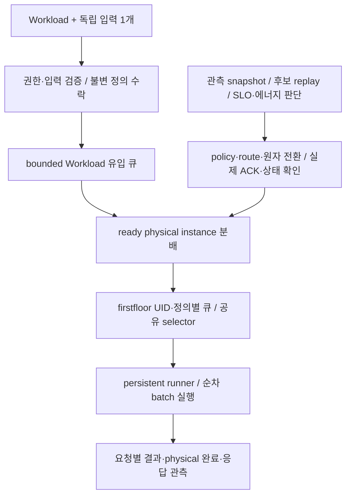

# Serving Design

## 현재 구현 범위

`cmd/chill-server`는 단일 HTTPS ChillServer다. Kubernetes bearer 신원을
TokenReview/SAR로 검증하고 모델·Workload CRUD와 추론을 제공한다.
`internal/serving`은 불변 적용 snapshot, 접수 gate, bounded Workload 큐,
인스턴스 route·physical drain과 private JSONL 관측을 소유한다.
모델-only 투명 proxy나 시작 시 고정 노드 테이블은 사용하지 않는다.

firstfloor actor·persistent ORT CPU/CUDA·RKNNLite runner와 같은 실행 경로의 profiling을
연결했다. 실제 실행·측정 근거가 없는 인스턴스는 Ready 추론 대상으로 취급하지 않는다.
구현 구조, 로컬 smoke와 qualified hardware evidence는 서로 다른 확인 수준이다.
Workload는 Preprocessor와 Dataset을 참조하고 원시 표본(JPEG, UTF8)을 받으며, 전처리 module이 runner
안에서 모델 입력을 만든다. 설계와 검증 기록은 [이기종 워크로드 구현 설계](heterogeneous-workloads.md)에 있다.

## 문서 탐색

| 알고 싶은 것 | 원본 문서 |
|---|---|
| Workload·POOL·입력·CRUD·권한·접수·드레인 | [워크로드 관리](workload-management.md) |
| 판단 입력·후보 replay·SLO/에너지 선택·전환 DAG·제어 불변식 | [스케줄러 구현 설계](scheduler-implementation.md) |
| firstfloor typed 요청·IPC·시간·수명·CPU/장치·fixed-batch·baseline·catalog | [실행기와 측정 계약](scheduler-runtime-measurement.md) |
| scheduler 설정, compact API와 관측 조회 | [설정과 관측 API](scheduler-api.md) |
| 원시 표본·전처리기와 데이터셋 catalog·여러 모델 파일 산출물·데이터셋 표본 측정 | [이기종 워크로드 구현 설계](heterogeneous-workloads.md) |
| 워크로드별 활성 POOL, 측정 POOL, 가용 노드, 워크로드별 자동제어와 완료 여유 | [워크로드별 POOL과 자동제어](workload-pools.md) |
| 판단 기록 크기 | [판단 기록 다이어트 (M0)](decision-record-diet.md) |
| 요청 행, 불변 값의 ID 참조, 시간 세그먼트와 로컬 버퍼, 오프라인 표 산출 | [관측 분리 (M1)](observability-split.md) |
| option별 SLO 용량표, κ 합 판정, 노드 계획과 DP, 비교 기간, 완료 여유 규칙 | [용량표 계획기 (M4)](analytic-planner.md) |
| option별 SLO 용량 κ, κ 검증, κ 합과 노드별 DP 계획기의 E1 비교 | [인스턴스 용량표 근거](capacity-table-evidence.md) |
| Pod-bound Service·EdgeMesh 전달·수동 원자 실행·manifest | [인스턴스 전달과 수동 실행](scheduler-operations.md) |
| 요구사항별 구현 대응과 당시 검증 수준 | [스케줄러 SRS 대조](scheduler-srs-audit.md) |
| 온라인 전환 문헌·알고리즘 적용 한계 | [온라인 전환 레퍼런스](online-switching-references.md) |
| 과거 network·local gate·smoke·배포 checkpoint | [실행·배포 이력](scheduler-execution-history.md) |
| 최신 live evidence·현재 수용 범위와 제약 | [실클러스터 검증 현황](../../plans/2026-10-13-scheduler-live-evidence-campaign.md) |

[Workload 시간창 부하 집계 계획](../../plans/serving-windowed-workload-load.md)은
현재 스케줄러에 통합된 최초 후보의 기록이며 별도 다음 구현 지시가 아니다.

## 요청과 제어의 경계

상자는 별도 서비스·CRD·메시지 브로커를 뜻하지 않는다. 요청 진입은 새 구성 계산이나
raw evidence 다운로드를 기다리지 않고 현재 준비·physical capacity 안에서 분배한다.
CHILL이 physical instance를 선택하고 EdgeMesh는 해당 단일 목적지로 운반한다.
한 Pod는 runner 하나와 순차 실행 하나를 제공하며 여러 Workload가 공유할 수 있다.
공유하더라도 UID·불변 정의·개별 SLO·원래 경과 시간과 물리 점유는 구분한다.

## 요구사항과 증거의 권위

요구사항은 [시스템 명세](../../spec/README.md),
[라우팅과 배칭](../../spec/03_routing.md),
[구성 비용](../../spec/04_configuration_selection.md),
[전환 실행](../../spec/05_transition_control.md),
[스케줄러 SRS](../../spec/scheduler/SRS.md)와
[워크로드 SRS](../../spec/workloads/SRS.md)가 원본이다.
프로세스·필드·경로는 위 구현 문서의 결정이며 명세를 대체하지 않는다.
요청 지연의 모집단·백분위·no-data 해석은
[SLO 관측과 집계](../../spec/README.md#slo-관측과-집계)를 따른다.

전체 FULL 통과는 주장하지 않는다. 현재 미완료 근거와 해소된 과거 blocker는
[실클러스터 검증 현황](../../plans/2026-10-13-scheduler-live-evidence-campaign.md)에서 구분하며,
과거 배포·synthetic 실행 결과를 현재 hardware 종단 통과로 재사용하지 않는다.
원시 표본 경로는 runtime image의 CPU runner smoke까지 확인했고 live cluster, Jetson과 RKNN 실행,
혼합 부하 평가는 [이기종 워크로드 9.1절](heterogeneous-workloads.md#91-검증-기록)의 미검증 범위다.
