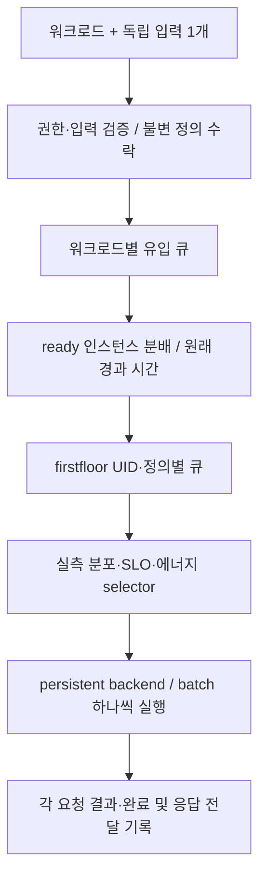

# Serving Design

## 현재 구현 범위

`cmd/serving-entrypoint`는 단일 HTTPS Workload owner다. Kubernetes bearer 신원을
TokenReview/SAR로 검증하고 모델 및 Workload 등록, 조회, 수정, 삭제와 추론을 제공한다.
`internal/serving`은 불변 적용 snapshot, 접수 gate, bounded Workload 큐,
인스턴스별 route와 physical drain 및 private JSONL 관측을 소유한다.
모델-only 투명 proxy와 시작 시 고정 테이블은 제거되었다.

firstfloor actor·persistent ORT CPU/CUDA·RKNNLite runner와 동일 실행 경로의 profiling을
연결했다. 실제 큐·batch·policy 증거, 후보 replay와 원자 전환 및 측정은
[스케줄러 구현 설계](scheduler-implementation.md)에 기록한다.
검증 결과는 [Workload 계약](workload-management.md)과 SRS 대조의 검증 상태에서 구분한다.

## 구현 계획

- [Workload 시간창 부하 집계](../../plans/serving-windowed-workload-load.md):
  지정 구간 분석 후보의 기록. 확정 스케줄러 설계의 운영 관측과 후보 입력에 통합한다.
- [스케줄러 SRS 대조 결과](scheduler-srs-audit.md):
  원본 명세·현재 구현의 요구사항별 판정과 사용자 선택에 따른 firstfloor 실행 경계.
- [스케줄러 구현 설계](scheduler-implementation.md):
  확정 SRS를 firstfloor 실행·동일 경로 측정·SLO/에너지 후보·실제 전환에 연결하는 설계.

## 설계 기준

이 문서는 [시스템 명세](../../spec/README.md)의 구현 설계다. 요구사항은
[라우팅과 배칭](../../spec/03_routing.md),
[구성 비용](../../spec/04_configuration_selection.md),
[전환 실행](../../spec/05_transition_control.md)을 따른다.
스케줄러의 고수준 입력·출력·책임과 수용 기준은
[스케줄러 SRS](../../spec/scheduler/SRS.md)를 따른다.
프로세스 수, CRD 필드, API 경로는 논리적인 역할과 별도로 정한다.

구성 유지·전환 정책의 문헌과 적용 한계는
[온라인 전환 정책 레퍼런스](online-switching-references.md)에 정리한다.
이 문헌 안내는 특정 알고리즘의 채택을 확정하지 않는다.

### firstfloor 재사용 원칙

CHILL은 firstfloor의 actor·bounded queue·persistent runner·IPC를 재사용한다.
immutable measured bundle과 작은 mutable policy를 제공하며, actor와 후보 replay가
같은 selector로 UID·불변 정의·개별 SLO·원래 경과 시간에 맞는 배치를 선택한다.
실제 큐·running batch·적용 profile/decision/cap·완료 증거를 관측한다.

ORT CPU/CUDA는 numeric/bool named multi-tensor 입력과 named 출력, RKNNLite는
실제 전달 capability가 제공한 입력·배치 domain을 따른다. batch 1과 실제 초기화·
측정된 sparse batch domain을 사용하며 standalone reference evidence는 별도 조건이다.
SLO 위반은 모델의 `deadlinePolicy=drop|keep|defer`로 처리한다. 명시적인 요청 수명과
caller 취소는 세 모드 모두 별도로 적용한다.

2026-10-13에 `/home/genesis1/ETRI/donghwan/firstfloor`의 현재 제공 소스와 비교했다.
CHILL 실행기는 단순한 Go module 교체가 아니라 UID/불변 정의별 큐, 여러 typed tensor,
ORT CUDA와 같은 경로의 profiling을 연결한 구현이다. 원본 전체를 덮어쓰지 않는다.
원본의 body 오류 분류를 inference/profile 공통 경계에 반영했다: 요청 취소 중 읽기
실패는 408, byte 한도 초과는 413을 우선하며 JSON 뒤의 읽기 오류 원인도 보존한다.
두 HTTP 경로의 회귀 검사와 실제 TCP body-read timeout의 408/no-execution을 확인했다.

모델의 firstfloor 설정에 `deadlinePolicy`를 선언하며 생략 시 `keep`이다.
`drop`은 만료되거나 실행 불가능한 queued 요청만 408로 제거한다. `keep`은 늦은
요청도 처리하며 채울 수 있는 minimum-C batch를 즉시 선택한다(동률은 큰 batch).
`defer`는 실행 불가능한 head를 후순위 FIFO로 옮기고 normal queue가 빈 뒤 처리한다.
normal/deferred는 같은 요청 수·byte 한도를 공유하며 active batch는 SLO 때문에
취소하지 않는다. mode 변경은 worker 재시작/인스턴스 교체이고 actor와 replay가
같은 선택 함수를 사용한다. 고정-K profiling은 SLO로 요청을 버리지 않으며 선택한
mode를 불변 측정 조건과 실제 metadata에 기록한다.

runner IPC는 big-endian uint32 길이와 작은 JSON header, little-endian binary tensor
payload다. tensor 값은 IPC에서 JSON 배열로 전달하지 않는다. 공개 HTTP JSON은 원본도
유지하는 경계이며 CHILL의 multi-tensor/정밀 UINT64/BOOL/FP16와 CUDA 지원을 유지한다.

실제 Python echo runner와 HTTP actor에서 세 모드를 확인했다: `drop`은 expired 요청을
실행하지 않고 408로 끝내며, `keep`은 expired 요청을 fresh 요청보다 먼저 처리하고,
`defer`는 fresh 요청을 먼저 처리한 뒤 expired 요청을 완료한다. active 요청은
SLO를 넘겨도 성공 결과를 반환했다. overdue 큐의 C1=10/C2=15에서는 batch 1,
C1=C2=10에서는 batch 2를 선택했고 SDK까지 실제 no-execution 완료 증거를 전달했다.
raw IPC의 UINT64 최대값·BOOL·FP16은 11-byte binary payload로 정확히 왕복했다.
고정-K 측정 조건, replay, CRD enum/default 및 UI의 세 모드 선택도 검증했다.
이는 로컬 synthetic 실행 증거이며 실제 CPU/CUDA/RKNN 측정이나 live-cluster 검증은 아니다.

## 워크로드와 외부 요청

워크로드는 서비스 식별자, 기존 모델 등록정보 참조와 SLO 백분위 및 목표 시간을 정의한다.
POOL은 현재 소속 노드와 서빙 중인 워크로드를 운영 상태로 참조하며,
구성 선택과 실제 전환에 따라 이 관계를 갱신한다. 같은 모델이라도 SLO가 다르면
다른 워크로드로 표현할 수 있으므로 모델 이름만으로 서비스 정체성을 대신하지 않는다.

- 사용자는 워크로드 목록·상세에서 식별자, 모델, SLO, 입력 형식과 요청 가능한
  상태를 조회한다.
- 추론 요청에는 워크로드 식별자와 독립적으로 완료할 수 있는 추론 입력 1개를 보낸다.
  CHILL은 등록된 정의를 확인하며, 요청마다 모델·SLO 정의를 복사하거나 덮어쓰게 하지 않는다.
- 운영자는 모델 등록정보와 워크로드를 CRUD하고 모델 연결과 SLO를 관리한다.
  등록, 요청 접수 조건과 변경 및 삭제는 [워크로드 관리 SRS](../../spec/workloads/SRS.md)를 따른다.
  리소스와 API, 접수 중지와 드레인 및 동적 POOL 상태는 [워크로드 관리 구현 설계](workload-management.md)에서 구체화한다.

하나의 추론에 함께 필요한 여러 tensor나 파일은 입력 1개를 구성할 수 있다.
독립적인 추론 입력은 각각 별도 요청으로 보낸다. 응답과 SLO는 각 요청에 적용하며,
사용자는 내부 인스턴스 배치나 실행 배치 크기를 알 필요가 없다.
워크로드의 SLO 백분위·목표 시간은 스케줄러의 제어 목표다. 요청 지연은 CHILL
수신부터 응답 반환 완료까지 측정하며, 집계와 분석 책임은
[SLO 관측과 집계](../../spec/README.md#slo-관측과-집계)를 따른다.

## 노드 자원과 모델 인스턴스

노드와 서빙 파드는 1:N, 하나의 서빙 파드가 제공하는 모델 인스턴스와 워크로드도
1:N 관계를 허용한다. 노드 하나를 모델 하나나 워크로드 하나의 전용 장비로 취급하지 않는다.
한 파드는 하나의 모델 실행 인스턴스를 제공하며, 같은 산출물·런타임·입력 조건으로
처리할 수 있는 여러 워크로드가 이를 공유할 수 있다.

worker Pod 하나는 persistent runner 하나와 순차 batch 실행 하나를 제공한다.
실행 중 취소된 HTTP 교환도 runner 완료 또는 actual container 종료까지 물리 자원을 점유한다.

| 조절 대상 | CHILL의 제어 단위 |
|---|---|
| 전체 모델 실행 인스턴스 수 | 서빙 Pod 추가·제거 |
| 인스턴스 하나에 줄 실행 자원 | Pod별 자원 할당과 그에 연동되는 backend 설정 |
| 한 번에 묶어 실행할 입력 수 | 배칭 정책 |

CHILL의 자원 할당 단위·프로파일 실행 구성 단위·서빙 인스턴스를 일치시킨다.
CPU quota·threads와 실제 affinity를 각각 확인하며, 한 배치 내부에서 여러 CPU를 사용한다.
여러 Pod의 인스턴스는 각자 배치 하나씩 병렬 실행할 수 있다.

현재 구성은 실제 Node label과 자원, native 준비와 연결 관측으로 산출한다.
파드 수·실측 자원 조건·배치 정책·전력모드의 후보 계산과 실제 전환은 스케줄러 owner가 연결한다.
자원 변경과 전환 계약은 [전환 명세](../../spec/05_transition_control.md)의 기준으로 구분한다.
메모리는 프로파일에서 관측한 사용량으로 필요한 예산을 산정하는 가용성 제약이다.
시스템 예약분과 프로파일에 포함되지 않은 서빙 부가 사용량을 고려하며,
메모리 할당량 자체를 성능·비용 조절용 탐색 변수로 사용하지 않는다.

공존의 기준은 순간 CPU/GPU 사용률이 아니라 **배정 가능한 자원**이다. 이미 다른
서빙 파드에 할당한 연산 자원을 중복 할당하지 않는다. CPU 파드끼리는 분리된 CPU
할당, GPU 파드끼리는 서로 다른 물리 GPU를 사용한다. GPU 파드의 보조 CPU와
메모리도 계산하므로, CPU 파드와 GPU 파드의 공존에도 자원 배정이 필요하다.

별도 장치 할당기를 만들지 않고 Kubernetes의 기존 자원 할당을 사용한다. GPU는
운영자가 마련한 장치 자원 노출·할당을 활용하며, 한 물리 GPU를 여러 모델 파드가
time-slicing이나 MPS로 나누는 구성은 범위 밖이다. CPU의 request/limit만으로는
CPU 집합이 분리되지 않는다. 전용 CPU 배정에는 CPU Manager의 static 정책,
Guaranteed Pod와 정수 CPU 할당 등 플랫폼 조건이 필요하다. 프로파일링 Job의
관측 컨테이너를 포함한 Pod 자원 설정도 이 조건과 맞아야 한다. 실제 지원 여부와
배정 결과는 배포 시 확인하며, 이 문서가 현재 클러스터의 격리를 입증하지는 않는다.

Serving 준비 파드의 artifact/profile init 컨테이너도 선택한 프로파일의 CPU
request/limit과 선택한 메모리 예산을 사용한다. GPU 장치 요청은 실행 컨테이너에만
둔다. 모든 컨테이너의 CPU·메모리 request/limit이 양수이며 같으면 Guaranteed
조건을 충족하지만, 분수 CPU도 Guaranteed가 될 수 있으므로 QoS만으로 전용 CPU
배정을 입증하지 않는다. CPU 수량은 반올림하거나 request/limit을 강제로 맞추지 않는다.

공유 인스턴스에서도 적용 정의, 유입 큐와 대기 및 실행 관측은 Workload UID로 구분한다.
native custom batching API의 CHILL guard는 다른 UID를 같은 실행 배치에 넣지 않는다.
CPU 스레드와 `instance_group.count: 1`은 frozen profiling/serving 계약에 맞춘다.
한 실행 배치가 끝난 뒤 다음 backend 실행을 시작하며 실제 완료 경계는 native 관측으로 확인한다.
adaptive SLO 기반 추가 대기 알고리즘을 구현했다고 주장하지 않는다.

할당을 분리해도 캐시·메모리 대역폭·노드 전력·열은 영향을 주고받을 수 있다.
우선 자원이 맞는 공존 후보를 허용하고 실제 지연·전력 차이를 관측한다. 자원 적합성과
SLO 적합성은 별개의 판단이며, 관측 없이 무간섭을 보장하거나 모든 조합의 간섭
예측기를 만들지 않는다. 노드 전력모드 변경은 공존 중인 모든 인스턴스에 영향을 준다.

## 요청 처리 흐름



한 상자가 별도 서비스나 CRD 하나를 뜻하지 않는다. 유입 대기열도 우선 논리적인
요청 관리 구조이며, 별도 메시지 브로커나 영속 큐를 요구하지 않는다.

### 처리 단위와 추적 정보

| 단위 | 관리할 정보 |
|---|---|
| 사용자 요청 | 워크로드, 최초 수신·분배·native monotonic spans·응답 완료, actual 인스턴스·batch·definition, 오류·거절·timeout/cancel·미완료 결과 |
| 실행 배치 | 같은 워크로드의 호환되는 입력 묶음과 각 입력·결과에 대응하는 요청 |

각 요청은 모델 인스턴스 하나에 배정한다. 인스턴스는 같은 워크로드의 호환되는
요청들을 묶어 실행하고 각 결과를 해당 요청에 연결해 반환한다.
서로 다른 요청의 완료 순서는 독립적이다.

CHILL은 요청별 원시 시각과 처리 결과를 보존하고, 워크로드별 요청 수와 지연
분포·백분위를 제공한다. 실제 완료·오류·거절·timeout/cancel·미완료를 관측에
드러내며, 실험의 성공·실패 해석은 분석자가 수행한다. 관측 구간과 통계 부재의
표현은 [SLO 관측과 집계](../../spec/README.md#slo-관측과-집계)를 따른다.

### 시간 기준과 실행 종료

종단 지연은 entrypoint의 동일 monotonic 기준으로 최초 수신부터 응답 반환 완료까지 측정한다.
firstfloor는 queue/service/backend/native elapsed를 해당 worker의 monotonic 기준으로 제공한다.
SDK의 `ObservedAt`은 local receipt 시각이다. remote UTC는 원시 관측 시각으로 보존하고,
worker duration과 local observation age·측정 transport envelope를 각각 적용한다.

immutable profile의 empirical service 분포와 incremental energy, 개별 SLO·UID별 실제
도착 간격으로 추가 대기·배치·다음 큐를 선택한다. queued cancel은 실행 전 제거하며,
running cancel은 실제 완료 또는 runner/container 종료로 physical release를 확인한다.
caller나 transport가 종료되어도 실행 종료가 불명이면 physical capacity를 유지한다.
실제 backend 종료 또는 해당 physical container의 종료 증거를 확인해야 drain을 완료한다.
자동 inference 재실행이나 별도 recovery engine은 없다.

### 책임 분리

| 역할 | 책임 |
|---|---|
| 현재 구성·후보와 전환 | 실제 Node label·allocation·ready/stop 상태, 전환 중 replay, whole-pool 에너지 비교, 실제 원자 동작과 완료 관측 |
| 요청 진입 및 분배 | TLS/bearer 권한, Workload와 named tensor 확인, 불변 snapshot 수락, bounded 큐, 인스턴스 선택과 응답 관측 |
| CHILL native policy 연결 | immutable measured bundle, mutable cap/wait/envelope, 원래 UID·정의·SLO·elapsed와 적용 증거 |
| firstfloor actor/backend | 모델 초기화, UID별 compatible batching·큐 선택·대기, 순차 persistent 추론, typed 결과와 실제 progress |

요청마다 새 구성 계산이나 evidence 다운로드를 기다리지 않는다.
입력별 route와 가중치 합을 갱신 시 캐시하고 현재 준비와 physical capacity 안에서 분배한다.
수용 가능한 인스턴스가 있으면 즉시 전달하며 유입 큐가 실행 batch를 모으는 대기를 추가하지 않는다.

워크로드별로 유입 대기 상태를 구분하여 하나의 섞인 FIFO가 자원 할당 정책을
대신하지 않게 한다. 같은 모델 인스턴스를 공유하는 경우에도 이 경계를 유지한다.

부하는 워크로드별 inputs/s로 관측하며 요청률과 같다. 대기·완료량도 요청 수로
기록하고 내부 실행 배치 수와 구분한다. 관리 작업 중 요청과 공유 인스턴스의 처리 계약은
[워크로드 관리 SRS](../../spec/workloads/SRS.md)를 따른다.

## Why concealment forces routing

Some configuration changes cannot be made underneath live traffic. A power mode
applies to a whole node, and on a memory-constrained device a new model cannot
be resident before the old one leaves.

The [transition specification](../../spec/05_transition_control.md) requires
planning request handling while a node changes state. Routing can move traffic
to other ready nodes when the changing node cannot continue serving.

## 기존 전달 경로의 네트워크 관측

아래는 기존 전달 경로를 설계할 때 기록한 관측이다. 워크로드별 요청 처리·배칭의
검증이나 현재 라이브 상태 확인을 대신하지 않는다.

| Observation | Verified against |
|---|---|
| `kube-proxy` runs only on the three control-plane nodes | cluster |
| every `istio-system` workload runs only on the control plane, and no pod on any edge node carries an `istio-proxy` sidecar (0 of 100) | cluster |
| Gateway API CRDs are not installed; the EdgeMesh agent's RBAC covers `networking.istio.io` and not `gateway.networking.k8s.io` | cluster |
| `edgemesh-agent` runs on all ten nodes | cluster |
| EdgeMesh's load balancer implements round-robin, random, and consistent-hash selection, reads `DestinationRule` and not `VirtualService`, and applies no per-backend weight | [`pkg/loadbalancer`](https://github.com/kubeedge/edgemesh/tree/main/pkg/loadbalancer) |
| CHILL already depends on EdgeMesh: the operator labels the evidence-store Service with `service.edgemesh.kubeedge.io/service-proxy-name`, and edge measurement workers reach it on every Run | cluster |
| a cloud-side pod reaches a pod on `jetsono` through a single-endpoint Service carrying that same label, and the entry point forwards a request across that path | cluster |
| that forwarding costs about 1.4 ms on a connection the entry point keeps open: 6.0–6.7 ms end to end against 4.5–5.8 ms for the same request answered without leaving the cloud | cluster |

KServe and Knative do not ship a proxy. KServe declares Istio or an
`ingressClassName` as a prerequisite and recommends Gateway API; Knative defines
its own `KIngress` abstraction and ships three interchangeable implementations.
Both assume a networking layer that can weight.

## Where a request branches

EdgeMesh's proxy is a DaemonSet. It intercepts through the iptables rules of the
node the client runs on and selects an endpoint there. No point exists through
which all requests pass.

An external consumer has no such node, so its request enters the cluster
somewhere, and that entry is the one point every external request crosses.

## 현재 인스턴스 전달 경로

고정 노드 테이블을 복원하지 않고, native physical instance의 현재 Kubernetes
Pod를 단일 목적지 Service에 연결한다.

Choosing a backend and reaching it pull in opposite directions: calling a shared
Service hands the choice to EdgeMesh, which applies no weight, and calling a pod
address directly does not resolve across the tunnel.

Each actual serving Pod gets `chill-executor-<Pod UID>`, a ClusterIP Service owned
by that Pod. Its selector is only `edge.dacs.io/serving-pod-uid=<actual Pod UID>`,
installed after Kubernetes assigns the UID; its sole TCP port is named `http`,
8080, targeting the isolated firstfloor container's named `http` port. The Service
carries `service.edgemesh.kubeedge.io/service-proxy-name: ""`, matching the
existing EdgeMesh proxy filter. One endpoint leaves EdgeMesh nothing to select:
CHILL chooses the physical instance, EdgeMesh transports the request.

```
entry point ── physical-instance choice ──▶ chill-executor-<Pod UID>:8080
                                                    │  EdgeMesh tunnel
                                                    ▼
                                       that Pod's firstfloor container
```

The decision is CHILL's and the transport is EdgeMesh's, which is the division
that already governs power mode.

This is an internal execution-instance transport, not a user-facing inference
service. Workload names describe the inference service and its SLO role; model
names identify the model artifact, not firstfloor or another execution engine.
The executor Service name is shared by all Workloads using that physical Pod.

목적지는 실제 Pod UID와 container identity를 구분한다. 생성 동작은 실제 UID label과
소유권·selector·port가 일치하는 Service만 생성/재사용한다. 같은 이름의 다른 binding은
수정하지 않고 거부한다. Observer와 Capture, policy read-back, native drain은 모두 이
Service의 ClusterIP를 사용하며 직접 PodIP·정적 노드 route fallback은 없다.
UID label은 실제 UID와 현재 label을 test하는 JSON Patch로 추가한다. CNI·kubelet의
status/resourceVersion 갱신은 이 metadata-only binding을 막지 않는다. 다른 label 변경이나
Pod 교체는 거부하며 재시도하지 않는다. 기존 preparation의 CPU·memory quantity는
stdlib `maps.EqualFunc(resource.Quantity.Equal)`로 값만 비교한다. API의 quantity 표기나
내부 문자열 cache 차이를 다른 자원 할당으로 취급하지 않는다.
GET으로 현재 Service의 소유권·selector·EdgeMesh label·port를 검증하고, selector가
현재 Pod/container 하나만 선택하는지 namespace Pod LIST로 확인한다. HTTP probe 뒤
Pod/container를 다시 읽어 교체된 executor를 이전 인스턴스로 게시하지 않는다.
Pod는 `RestartPolicyNever`여야 한다. 같은 Pod UID 뒤에서 container가 재시작하여
이미 게시한 physical instance의 실행 목적지가 바뀌는 것을 허용하지 않는다.
native model/state와 immutable profile/runtime evidence의 준비 검증은 그대로 유지한다.
Pod Ready나 Service 생성만으로 추론 준비를 완료하지 않는다.

제거는 native drain과 실제 container 종료 증거를 확인한 뒤 자기 Pod 소유의 Service를
resourceVersion/UID precondition으로 삭제하고 Pod finalizer 및 config를 해제한다.
이때는 namespace·이름·Pod owner identity만 확인한다. 자기 Service의 selector나 proxy
label drift가 종료된 Pod의 cleanup을 막게 하지 않는다. 다른 Pod 소유의 Service는
삭제하지 않는다. Pod owner reference는 Kubernetes GC에도 같은 수명을 연결한다.
Workload cleanup도 종료 증거 이후 자기 Pod의 Service를 해제한다.
Pod source finalizer의 추가/해제는 immutable Pod UID를 포함한 Kubernetes
strategic-merge primitive-list delta로 자기 항목만 변경한다. 다른 finalizer를
보존하며 unrelated kubelet status/resourceVersion 갱신은 충돌 원인이 아니다.
UID 변경이나 API의 실제 metadata 제약 오류는 그대로 반환한다. 해제 전
UID/container-bound 실제 종료 증거와 Pod 종료 확인은 유지한다.
기존 EdgeMesh 설정이나 다른 workload는 변경하지 않는다.
namespace owner Role에는 Service GET/DELETE를 기본으로 허용하며,
scheduler/native operation 경로가 켜진 경우 CREATE를 추가한다.

## 구현 대응

| 현재 기능 | 구현 경계 |
|---|---|
| 모델 및 Workload CRUD | HTTPS owner와 private uncached Kubernetes writer, TokenReview/SAR, resourceVersion `If-Match`, 참조 삭제 보호 |
| 요청 접수 및 분배 | immutable applied snapshot, bounded Workload 큐, 준비된 인스턴스의 route와 가중치 합 |
| 모델 변경 및 삭제 | 모든 관련 admission 닫기, 전체 physical drain, 해제, 닫힌 새 snapshot 전체 게시 후 gate 열기 |
| 현재 POOL | 실제 Node label과 자원, native instance와 확인된 Workload 연결. 별도 Pool CRD나 합성 Node 없음 |
| 실행과 profiling | 같은 firstfloor actor/runner, 실제 initialized·measured sparse batch와 service/backend/native/client 분포 |
| 관측 보존 | private persistent JSONL과 immutable S3 window, 전체 모집단 집계와 no-data null |

외부 요청은 `/api/v1/workloads/{id}/infer`의 named tensor 독립 샘플 한 건이다.
[Workload 관리 계약](workload-management.md)의 입력 검증과 SLO를 우회하는 alias는 없다.

원자 동작 측정 command의 membership은 detached Node와 명시적으로 선택한
`measurement-*` isolated POOL 사이의 이동만 허용한다. 다른 live POOL의 Node를
편입하지 않으며 동일 Node UID, 선택된 Workload 없음, exclusive journal 조건을 유지한다.
같은 출발·도착 상태의 no-op는 membership 비용으로 측정하지 않는다.

`serving-operation --execute-config FILE`은 측정과 별개의 수동 원자 실행 경계다.
`--measurement-config`와 함께 사용하지 않으며, catalog 검증·현재 owner에 Loaded인
CPU profile의 기존 `preparations[profileID]`만 준비한다. inline `PrepareSpec`,
route/power/resize 동작, 임의 runner 명령을 실행 manifest로 받지 않는다.
입력은 `operation`(기존 `Operation`의 id/kind/node, remove의 정확한
podUID/containerID instance 또는 membership의 pool), `profileID`, `namespace`,
선택 `actuationNamespace`, 독점
`journalDirectory`, 별도 HTTPS 신뢰·caller 인증의 `ownerURL`/`ownerCAFile`/
`ownerTokenFile`, `schedulerConfigMap`/`schedulerConfigKey`/`sourceConfigRV`,
`expectedPool`, 명시 history 시작 시각 `routingHistoryFrom`이다. store는 별도 입력 없이
owner-loaded preparation의 binding에서 가져온다. 선택 `operation.excludedPodNamespaces`는
`["baseline-fleet","fastdds-test"]`의 승인 namespace 중 operation별 제외할 목록이다.
사용자가 승인한 7개 Node에서만 현재 해당 class Pod를 admission/interference blocker에서
제외하며 기본 namespace ignore는 없다. Node UID는 계속 실제 검증하고 재생성된 Pod도 같은
class 정책을 따른다. 다른 namespace/Node와 실제 serving-instance 제외는 거절한다.
policy는 결과 operation에 보존하며 `before.pods`/`actual.pods`, observer와 raw power/latency는
현재 외부 Pod의 실제 identity와 소비를 계속 포함한다.
Kubernetes credential은 Kubernetes 작업에만 사용하며 owner로 자동 전달하지 않는다.
owner는 명시한 CA 파일과 caller token을 모두 요구하며 ambient trust로 대체하지 않는다.
verified HTTPS origin 하나만 허용하고 redirect를 따르지 않는다.
startup bundle은 catalog 검증 profile의 공통 `Profile.NativeBundle()` producer에서
owner와 CLI가 같은 key/declared size를 도출한다. owner만 immutable publisher이며 CLI는
저장된 payload를 다시 읽어 size를 자가 증명하거나 bytes/digest 비교 gate를 추가하지 않는다.
기존 materializer가 producer-declared size를 확인한 뒤 native startup 파일을 게시한다.
이 trusted publisher 계약을 같은 크기의 임의 변조에 대한 암호학적 증명으로 해석하지 않는다.
선택된 `completionCalibration`이 있으면 기존 immutable raw loader로 다시 읽고
동일 profile/Node/allocation 조건의 검증된 최대 completion 관측과 전체 출처를 native
policy에 연결한다. 선택이 없으면 configured bootstrap policy를 그대로 유지한다.
planner의 calibration 선택과 기존 인스턴스에 실제 적용된 native policy를 혼동하지 않는다.

실행 전에 desired/current controls OFF, 진행 중 owner action 없음, 같은 native
ConfigMap resourceVersion의 전체 `staticRouting` 성공 acknowledgement와 실제
route readback 일치를 요구한다. owner snapshot은 해당 완료보다 늦고 최근 control
interval 이내여야 한다. remove는 그 전체 경로에서 이미 제외된 정확한 configured
source만 허용하며 owner `snapshot.outstanding`에서 execution·transport·response
소유권이 모두 사라진 뒤 기존 native drain/termination/removal을 호출한다.
ack은 일시적인 `state.results`가 아니라 기존 `/api/v1/observations/scheduler`의
`action.actual`에서 exact source revision의 최신 manual result를 찾는다. 명시
`routingHistoryFrom`부터 고정 query 종료 시각까지 기존 cursor/limit으로 조회하고,
그 뒤 새 owner snapshot을 읽는다. 보관 기간을 늘리거나 시작 이후 전체 history를 조회하지 않는다.
`/pools`의 waiting/running/assignedUnknown 0이나 native queue empty만으로 이를
대체하지 않는다. prepare/membership target은 owner instance가 없어야 한다.
prepare는 fresh Node/비제외 active Pod 요청·init/sidecar/overhead를 기존 capture 경로로
다시 합산하고 owner의 inventory/reserved와 공통 `ValidateNodeBudget`으로 admission한다.
기존 serving Pod, 비제외 미확인 GPU 소유권, CPU overlap/예약 부족, memory 초과와
실제 Node MemoryPressure는 거절한다. 오래된 owner aggregate의 Ready는 재사용하지 않는다.
이는 설정 reservation/operator exclusion 기반 admission이지 실제 CPU 격리·외부 Pod의
성능 불변·SLO·에너지 절감 보장이 아니다. membership도 비제외 active non-DaemonSet
Pod가 없어야 하고 실제 serving-instance DaemonSet은 거절한다. 제외 Pod는 그대로 두며
physical absence로 보고하지 않는다. `--measurement-config`에서는 이 exclusion을 허용하지 않는다.
membership은 detached와 해당 configured preparation POOL 사이의 실제 변경만 허용하고
기존 sole writer `MoveNodePool`의 UID/resourceVersion patch/readback을 사용한다.
원복도 새 현재 revision·expectedPool witness로 같은 경계를 호출한다. CLI는 완전한
`OperationResult`를 stdout에 출력한다. 부모 실행자는 원래 두 Workload/SLO/model과
전체 route map을 보존하고, 기존 owner `staticRouting`으로 한 UID만 바꾼 뒤 실제
새 instance 완료를 관측하며, 전체 원래 route를 복구·ack·완전 drain한 다음 제거한다.
이는 manual execution 근거이며 automatic scheduler judgment나 power 측정 근거가 아니다.

prepare 입력은 부모가 캡처한 현재 ConfigMap JSON(`$CM_CAPTURE`)에서 생성한다.
`PROFILE_ID`는 해당 revision에서 owner가 Loaded라고 확인한 기존 CPU profile ID이며,
그 외 환경 변수는 부모가 확인한 namespace/HTTPS trust/caller token/독점 journal이다.
이 예시는 manifest 생성만 하며 Workload·SLO·model·route map을 변경하지 않는다.

```sh
jq --arg key "$SCHEDULER_KEY" --arg profile "$PROFILE_ID" \
  --arg operation "$OPERATION_ID" --arg journal "$JOURNAL_DIRECTORY" \
  --arg owner "$OWNER_URL" --arg ca "$OWNER_CA_FILE" --arg token "$OWNER_TOKEN_FILE" \
  --arg history "$ROUTING_HISTORY_FROM" \
  '. as $cm | ($cm.data[$key] | fromjson) as $config |
   $config.preparations[$profile] as $prepare |
   {operation: {id: $operation, kind: "prepare", node: $prepare.instance.node},
    profileID: $profile, namespace: $cm.metadata.namespace,
    journalDirectory: $journal, ownerURL: $owner, ownerCAFile: $ca,
    ownerTokenFile: $token, schedulerConfigMap: $cm.metadata.name,
    schedulerConfigKey: $key, sourceConfigRV: $cm.metadata.resourceVersion,
    expectedPool: $prepare.instance.pool, routingHistoryFrom: $history}' "$CM_CAPTURE"
```

출력을 보존한 JSON 파일로 `serving-operation --execute-config FILE`을 호출한다.
remove는 같은 current-config binding에 `operation.kind="remove"`와 실제 관측한
정확한 `operation.instance`를 사용한다. membership은 `kind="membership"`와
실제 목적지 `operation.pool`(detach는 빈 문자열), 현재 실제 `expectedPool`을 사용한다.
각 단계마다 현재 revision·ack·snapshot을 새로 캡처하며, route는 이 CLI로 변경하지 않는다.
실행 flags는 `--execute-config FILE --timeout 10m`와 별도 native Kubernetes 연결의
`--kube-api-server URL --kube-token-file FILE --kube-ca-file FILE`이다.
API server를 생략하면 기존 `rest.InClusterConfig()`만 사용하며 로컬 kubeconfig는
읽지 않는다. 명시 API server에서 token/CA flags를 생략하면 표준 service-account
token/CA 경로를 사용한다. owner CA/token은 manifest의 별도 명시 파일이며 자동 전달하지 않는다.

## 프로파일 기반 지연 계산과 검증

프로파일은 frozen 자원, 전력모드와 native batch 조건별 raw 실행시간 분포,
incremental energy/item과 실제 memory peak를 제공한다. 완료 campaign과 원시 evidence의
identity 및 조건을 검증하고 idle-baseline confidence 설정을 profile과 배정 기록에 유지한다.
공유 selector의 요청별 replay가 현재 실행·도착·transition readiness와 원래 경과 시간을 반영한다.

profiling과 serving은 같은 [실행 계약](../../spec/00_measurement.md#측정의-단위)을 사용한다.
같은 실행 조건은 SLO가 다른 Workload에도 재사용하며, actual Node·backend·affinity·
GPU UUID·threads·batch 초기화 조건과 raw 근거를 유지한다. 현재 준비·측정 적격성·
SLO 평가는 각각의 판단이다.

firstfloor state/progress와 client span·응답 완료, decision/action/power 기록을 연결한다.
종단 percentile은 원래 수신 기준 요청별 분포에서 계산하고, baseline·wall operation·
incremental execution 에너지를 같은 전체 POOL comparison horizon에서 한 번씩 반영한다.

같은 노드에 공존하는 파드들의 단독 실험에서 잰 노드 전체 전력을 단순 합산하지 않는다.
측정 경계는 [프로파일링 설계](../profiling/README.md#serving-resource-allocation)를 따른다.

## 구현 및 검증 경계

아래 실행 기록은 이전 serving 작업 단위의 checkpoint다. 현재 firstfloor
scheduler 통합의 실행 증거는 [scheduler 구현 문서](scheduler-implementation.md)의
최종 검증 기록에 별도로 남긴다.

local isolated kind와 verified HTTPS로 등록, 조회, fractional SLO 수정, stale `If-Match`,
공유 모델 변경 barrier, 참조 삭제 보호와 실제 Workload 삭제 및 새 UID 재등록을 확인했다.
private RWO journal과 MinIO immutable window, TLS/bearer/named tensor loadgen도 실행했으며
근거 없는 admission은 `503 MissingEvidence`로 닫혔다.

이전 공식 Triton native runner에서 다중 named numeric/bool tensor 결과, 같은 priority의 서로 다른
Workload UID batch guard, 여러 실현 batch 크기, native queue timeout과 `REQUEST_END`를 확인했다.
matching ACTIVE/IDLE runner의 fixed batch 실행, warmup 제외, model resident 및 실제
cgroup memory peak와 root RAPL 읽기도 smoke로 확인했다.

이는 full qualifying power campaign이 아니다. **완전한 native campaign → Ready gateway 추론**,
ARM/RKNN hardware와 live testbed는 검증하지 않았다. 이전 test나 Helm 실행을 최신 refactor의
모든 gate 통과로 설명하지 않는다. 정확한 배포 값과 변경 기록은
[Workload 관리 계약 12장](workload-management.md#12-배포와-구현-검증-경계)을 따른다.
