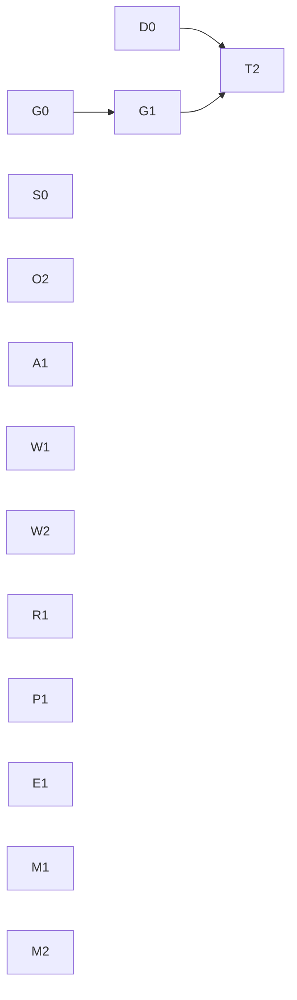

# 수요 변화 반응 경로의 불필요 비용 제거 계획

기준 소스 `c8240a55`. 근거 루트 `R=ops/pools-deploy/deployB/control-378-system-reaction-20261111/rerun-adaptive`(선택 Run `56926774`). 원문:
- scheduler 기록: API 페이지 `R/native-scheduler-pages/*.json.gz`, 실제 저장 journal `R/native-scheduler-catalog-replay.tar.gz`
- 요청: `R/published-originals/stages/<stage>/stage/artifacts/measured/obs/20261111T11/requests.jsonl.gz`(final 행과 native supplement)
- CPU·heap: `R/evaluation-monitor/*-cpu.pb.gz`, `*-heap.pb.top.txt`. CPU profile은 부하 시작 약 137초 뒤 30초 채집이라 시작 직후 지연의 기여율로 쓰지 않는다.
- 클러스터 읽기 전용 `kubectl get`(2026-11-11 후반)

## 1. 문제 정의

CHILL은 허용 자원 안에서 서비스별 설정 분위수 E2E SLO를 충족하는 배치를 고르고, 충족 후보 중 에너지를 최소화하며, 판단과 적용을 제어 주기 안에 끝내야 한다.

control378은 공식 판정 PASS/PASS이고 60초 이후 non-on-time은 0/0이다. 남은 실패는 모두 **수요가 늘어난 직후**에 있다. IC excess는 첫 60초 non-on-time 939건으로 허용 tail 1,439건의 65%를 썼다.

**문제:** 수요가 늘어난 직후 IC 요청이 25~30초 동안 거의 전부 SLO를 놓친다. 실패량은 두 가지로 정해진다.
1. 부족한 공급이 그동안 SLO 안에 처리하는 양(과부하 중 goodput).
2. 공급이 실효로 늘어나기까지 걸리는 시간(반응 경로).

공급이 늘어난 뒤에는 남는 공급을 회수하기까지의 시간이 에너지를 정한다(회수 경로).

시간 목표 하나를 맞추는 것이 기준이 아니다. 세 경로와 이를 실행하는 server 자원에 있는 **불필요한 비용을 빠짐없이 찾아 제거하는 것**이 기준이다. §2는 원문으로 확인한 비용 목록이다. 각 항목을 필요(물리·정합성)와 불필요로 나누고, 원인이 확정되지 않은 항목은 그렇게 표시한다.

에너지 목적 달성은 이 근거로 검증하지 않았다.

## 2. 비용 목록과 근원 원인

### 2.1 과부하 중 기존 공급이 SLO goodput 0을 낸다 — 현상 확정, 원인 가설

IC server final 행, SLO 1초(E2E `elapsedNanos` ≤ 1초), lifetime 2초:

| stage | 도착 구간(초) | 요청 | 성공 응답 | SLO 내 완료 |
|---|---|---:|---:|---:|
| excess | 0–2.5 | 87 | 73 | 21 |
| excess | 2.5–30 | 842 | 17 | **0** |
| excess | 30–40 (genesis2 공급 후) | 309 | 282 | 278 |
| excess | 0–60 | 1,879 | 1,013 | 940 |
| workload | 2.5–25 | 690 | 93 | **0** |
| workload | 25–35 | 310 | 310 | 305 |

excess 2.5–30초 jetsono 실행. batch는 instance·batchID로 중복 제거했다. 실행 시간은 nativeRunningAt→nativeFinishedAt, 지속 처리량은 첫 batch 시작→마지막 batch 종료 기준이다. 실행 전 만료는 final과 native supplement를 requestID로 결합해 확인했다(218개 중 49개는 native 행에만 종료 정보가 있다).
- batch 39개, 모두 16개, 실행 p50 0.694초, batch 사이 공백 p50 1ms. 지속 처리량 22.5 req/s. 수요는 약 31 req/s.
- 842개 중 624개는 batch로 실행됐고 모두 SLO를 넘겼다. 나머지 218개는 실행 전 queue에서 lifetime 만료됐다.
- queue p50 1.6~1.8초. queue와 실행 시간의 합이 SLO 1초를 늘 넘는다.

executor는 100% 바빴지만, 실행한 요청이 모두 이미 SLO를 지킬 수 없는 요청이었다. 공급 부족 약 28%가 SLO 실패 100%가 됐다.

**SLO를 지킬 수 없는 요청이 실행 자원을 쓰는 구조.**
- firstfloor executor에는 기한을 지킬 수 없는 요청을 실행 전에 버리는 정책(`deadlinePolicy` `drop`·`defer`, `internal/firstfloor/scheduler.go:373-445`)이 있다. `keep`도 취소·lifetime 만료된 queued 요청은 제거하지만, SLO만 넘긴 요청은 실행한다(`scheduler.go:373-407,477-488`, `server.go:224-263`).
- 정책은 profile의 측정 조건(`Profile.Condition.Firstfloor.DeadlinePolicy`)으로 고정된다. launch와 route가 profile 정책을 전달하고(`kube/scheduler_operations_launch.go:431-433`, `operations/operations_routing.go:72-75`), replay는 instance 정책과 profile 정책이 다르면 후보를 거부한다(`scheduler_replay_actions.go:122-128`). 이 Run의 IC executor native metadata 정책은 모두 `keep`이다(API 페이지 192회).
- replay는 `drop`·`defer`를 이미 모델링한다(`scheduler_replay.go:693`, `scheduler_replay_requests.go:333-406`).
- dispatch는 readiness·capacity와 weighted routing만 보고, SLO 잔여 시간에 따른 완료 가능성은 보지 않는다(`internal/serving/runtime.go:535-605`).

**원인 가설:** SLO를 지킬 수 없는 요청을 실행하지 않는 규칙이 시스템 수준(dispatch·executor·replay 공통)으로 정해져 있지 않다. 그 결과 공급 부족이 전면적인 SLO 실패로 증폭된다. 정책을 바꿨을 때 batch 구성과 공백이 어떻게 바뀌는지, goodput이 얼마인지는 같은 도착열 재생(G0)으로만 확정한다.

**502·504 의미.** native lifetime 만료가 일반 backend 오류로 전달되면 gateway 502, gateway 자신의 lifetime 만료는 504다(`firstfloor/server.go:234-263`, `serving/firstfloor/client.go:225-232`, `serving/runtime.go:630-637,691-714`, `httpapi/handler.go:784-791`). 502는 native 고장과 같은 뜻이 아니다. native client·runtime·loadgen에 자동 재시도는 없다.

### 2.2 수요 증가 → 실효 공급 경로

| 구간(초) | excess | workload | 분류 |
|---|---:|---:|---|
| 부하 시작 → 부하를 본 첫 판단 snapshot | 6.03 | 0.85 | 불필요: 주기 polling(2.3) |
| 첫 판단 → 증설 판단 snapshot | 10.63 | 10.35 | excess 미확정, workload 관측 지연(2.3) |
| 증설 snapshot → launch (평가) | 3.44 | 3.35 | 일부 불필요(2.7) |
| prepare | 6.73 | 6.97 | 내부 미분해(2.8) |
| prepare 완료 → route 시작 | 3.17 | 3.17 | 불필요(2.4) |
| route | 0.82 | 0.63 | 내부 미분해(2.6) |
| 합계 | 30.83 | 25.32 | |

### 2.3 수요 변화가 판단에 들어오는 방식

- **주기 polling — 확정.** server는 요청 도착과 queue를 실시간으로 알지만, 계획기는 10초마다 관측한다.
- **수요 희석 — 관측.** excess 11:40:33 판단의 IC rate는 20.6 req/s로 실제 약 32의 2/3였다. recent 10초 window 19.7 req/s(부하 6초만 포함)와 queued 54/60에서 나온 값이다.
- **excess 첫 판단의 미증설 — 미확정.** keep Overload(queue 54), surrogate 500,000회(예산 소진), finalist 16개 exact 뒤 채택 이동이 없었다. `capacity.search.steps`는 채택된 이동만 기록한다(`scheduler_capacity.go:103-126`). 증설이 정답이라고 가정하지 않는다.
- **workload 첫 판단의 Keep은 정당.** 부하 0.85초 뒤 snapshot(rate 20.0, queued 14)에서 Keep exact 재생이 12,016/12,016 완료, p95 702ms였다. 이 10초는 관측 지연이다.

### 2.4 승인된 stage 진행이 평가에 직렬화된다 — 확정

`application/scheduler_service.go:428-466`의 goroutine 하나가 `controlRound`와 `Continue`를 처리한다. 둘 다 application lock과 `tickMu`를 잡는다. 같은 Run의 대기:

| 전이 | 대기(초) | 원인 |
|---|---:|---|
| genesis2 prepare 완료 → route (두 stage) | 3.17 | 진행 중 Tick 평가 |
| jetson-nano·rasp5 prepare 완료 → route (11:41) | 1.7 | 진행 중 Tick 평가 |
| route 완료 → stop 시작 (12:00:11) | 7.79 | Continue capture의 window 7.63초 |
| stop 완료 → drain 시작 (12:00) | 7.12 | 사이에 Admit·Tick 실행 |

이 직렬화는 정합성에도 쓰인다. Tick은 계산 뒤 `publishDecisionLocked`로 snapshot을 게시하고, `publishSnapshotLocked`는 그 snapshot에 없는 instance의 route-writer fence를 지운다. `startTransition`은 게시된 snapshot의 routing을 admission `Before`로 고정한다. 설정 변경도 `tickMu` 직렬화에 기댄다. Ready-subset 진행은 `SchedulerReadyExpansion`으로 현재 조건을 다시 평가한다. lock을 푸는 것만으로는 분리되지 않는다. background observer·prepare·route·Tick·Continue가 공유하는 `refreshMu` 대기는 아직 측정하지 않았다.

2026-11-12 A1 진행·평가 분리 구현:

- 주기 admission/Tick과 completion/Continue를 별도 goroutine으로 실행한다.
  application lock은 controller 조회에만 쓰고, `tickMu`는 capture와 승인·기록·launch를
  직렬화한다. `EvaluateScheduler`는 불변 capture를 받아 두 lock 밖에서 실행한다.
- 승인은 최신 설정·예약 설정·preparation과 게시 snapshot 시각을 확인하고, 물리
  동작을 승인하거나 기존 owner를 진행할 때 실물·예약을 다시 capture한다. 순수
  관측/Keep round는 전체 List를 반복하지 않는다. 물리 admission 입력이 달라졌으면
  평가를 버리고 다음 Tick에서 다시 판단한다. 새 target은 최신 native idle·arrival
  이력까지 포함한 `SchedulerTargetAdmission`으로 재검증한다. 이 exact replay도
  lock 밖에서 실행하며, 다시 lock을 잡은 뒤 최신 설정·진행·실물을 확인한다.
  target을 새 실물 상태로 조용히 바꾸지 않는다. executor 완료에 따른 ledger
  변경도 게시 직전 mutex 아래에서 다시 확인한다.
  Occupancy는 실제 평가가 선택한 cell과 적용값만 비교하고, provenance 갱신 시각·window·
  표본 수와 선택하지 않은 cell의 변화는 승인 무효화에서 제외한다.
  요청 모집단은 계속 변하는 입력이며 최종 target replay가 최신 capture를 사용하므로
  요청 모집단과 routing credit의 변화는 승인 무효화 비교에서 제외한다.
  Instance의 `ObservedAt`, `NativeSpanAt`, `LastServiceEndAgeNanos`,
  `LastServiceEndAgeUpperNanos`, `ArrivalAgesMS`, `AdmissionIdleUnknown`도
  clock·traffic 파생값이므로 비교에서 제외한다. 이 분류는 `SchedulerInstance.ApprovalInputs`가
  Instances와 Options에 공통 적용하며, 새 필드는 reflect 회귀에서 명시적 분류를 요구한다.
  `Ready`, `Allocation`, `Routable` 등 실물 admission 입력 변화는 계속 평가를 무효화한다.
- decision 기록에는 원래 평가 입력을 남긴다. 현재 state에는 승인 시점의 새 snapshot을
  게시한다. Continue가 그사이 진행했으면 평가를 게시하거나 launch하지 않으므로
  과거 snapshot이 writer fence나 admission `Before`를 되돌리지 않는다.
  snapshot 게시 함수도 시각 역행을 거부한다.
- Continue의 Ready-expansion은 기존 `SchedulerReadyExpansion`과 최신 window·실물
  검증을 유지한다. decision/action 기록 선행 조건도 유지한다. 두 capture의 timing
  span은 누적한다. 승인용 실물 재조회, 기록, Ready-expansion과 `refreshMu` 경합은
  여전히 직렬 구간이며, 실제 대기 기여도와 p50/p95는 다음 실측에서 확인한다.

회귀는 평가 진입을 context 경계에서 정지시킨 채 prepare 완료→실제 route ACK,
설정 수용, 예약·실물 변경, 새 writer fence 보존과 snapshot 시각 단조성을 검사한다.

### 2.5 매 주기·매 stage 반복되는 전체 재조회 — 확정

| 항목 | 비용 | 원인 |
|---|---|---|
| `Admit` | 238 round p50 1.87초, p95 2.18초, 최대 3.56초 | `measurementRoots`(`kube/admission.go:46-110`)가 측정 CR 6종을 전부 List한다. ProfilingRun은 6,567개(JSON 29MB)이고 terminal 6,498·JobFailed 66·ExecutionPolicyInvalid 3이다. CPU profile에서 이 decode가 30초당 2.8초 |
| `Admit`의 Nodes·serving Pods·DeviceClasses List | 위에 포함 | 같은 주기 Tick capture가 같은 목록을 다시 읽는다 |
| capture `window` | Tick p50 0.57초, p95 0.82초; Continue 최대 7.63초 | `observationLog.LoadWindow`가 매 Tick·Continue마다 60초치 요청 기록을 읽는다. 공용 writer barrier 대기, request/client decode·join, coverage, 정렬이 포함된다(`observation_log_read.go:407-410`, `observation_log.go:543-579`). 구성 비율은 미분해 |
| Continue 전체 capture | 46회 p50 0.56초, p95 1.07초, 최대 7.79초 | 연속 stage마다 window와 refresh를 다시 한다 |
| rolling occupancy 재집계 | workload CPU 2.79초/46.17초(6.0%) | 매 refresh마다 요청 기록을 두 번 decode한다(`application/occupancy_cache.go:117-205`, `observation/observation_log_occupancy.go:22-90`). Tick window와 별개 경로 |

`Admit`은 `tickMu`를 잡고 Tick 앞에서 실행된다. 매 round가 Tick 전에 약 1.9초를 쓰고, 그동안 Continue도 진행하지 못한다. 같은 유형의 회귀(전체 Pod 재목록)를 control377의 O1에서 고쳤다. terminal 측정 CR도 변경·삭제·재생성될 수 있으므로, 증분 관측은 이 변화를 놓치지 않아야 한다.

### 2.6 route 적용 경로 — 미분해

route action(0.6~2.5초)에는 대상별 Pod List, ConfigMap GET/PATCH, Pod annotation PATCH, native ACK polling, ACK 뒤 전체 `Observer.Refresh`, routing 영속화용 Pod List가 들어 있다(`operations/operations_routing.go:61-99,110-285`). action 완료 뒤 Continue가 별도 전체 capture를 실행하며, 그 비용은 §2.4·§2.5에 포함한다(`kube/scheduler_operations_launch.go:141-177`). executor는 config를 1초 주기로 polling한다(`internal/firstfloor/config.go:174-201`). 정책 ACK가 최대 1초 늦을 수 있다.

### 2.7 평가 계산 — 분해 확정, 개선 여지 미확정

Tick `evaluate` p50 3.62초: search 2.30(surrogate 0.56, exact 1.75), rates 0.54, payback 0.38, preparation 0.31초. excess CPU에서 replay 38.9%, 그중 `chooseBatches` 24.3%, `ServiceDistribution.QuantileNanos`(`sort.Search`) 12.5%, `energyGainWait` 9.9%다. 같은 profile 표본의 분위수를 반복 탐색한다. 탐색 예산과 finalist 수는 바꾸지 않는다. 같은 결과를 내는 계산 비용만 대상이다.

### 2.8 prepare 내부 — 미분해

genesis2 IC prepare 6.73초에는 Pod 생성, 컨테이너 시작, ORT CUDA 초기화, batch 1~16 warmup(`initializedBatches`)이 들어 있다. action 기록에는 시작·완료와 ready 시각만 있다.

### 2.9 serving service 비용 — 큰 항목 확인, 제거 가능량 미확정

excess IC batch 16의 전처리 p50은 구간별 약 291~335ms, backend p50은 약 270~441ms다. 전처리에 normalization 중간 배열과 `stack→transpose→copy`가 있다(`build/model-artifacts/preprocessors/mobilenet-nchw/preprocessor.py:25-44`, `runtime/firstfloor/runner.py:147-149`). 과부하 중 처리량을 직접 정한다. artifact·profile 정합성을 바꾸는 수정은 현재 제약 밖이다.

### 2.10 판단 기록 비용 — 확정(실제 journal)

선택 Run 구간(11:39:40–12:16:19) 저장 행 5,213개 중 decision 219개가 265,889,054B(96.6%)다. decision 평균 1.21MB:

| 필드 | 평균 bytes | 성격 |
|---|---:|---|
| `capacity.plans` | 707,378 | 후보 평가 표 전체(420행). 재생 입력 아님 |
| `snapshot.dispatchOccupancy` | 294,295 | 판단 시점 rolling cache 선택값. Run 중 21종 |
| `snapshot.options` | 104,842 | 당시 승인된 preparation으로 만든 선택지. `ObservedAt` 제외 시 1종 |
| `snapshot.costRefs`·`baselineRefs` | 48,492 | 참조 목록 |
| 나머지 | 약 59,000 | 판단 고유 내용 |

[M0](decision-record-diet.md)의 compact 계약(상한 135KiB)이 실제 규모에서 9배로 깨졌다. S1(`6c60b106`)은 1.6%인 action만 줄였다. `dispatchOccupancy`·`options`는 재생 입력이고(`scheduler_capacity_decision.go:168-181`, `scheduler_capacity_nodes.go:242-254`) 현재 catalog로 재계산할 수 없다.

### 2.11 server 메모리 — 보유 경로 확인

workload working set 최대 4013MiB / limit 4Gi, live heap 1,607MB. 누적 경로(겹치므로 합산하지 않음): `SchedulerService.Refresh` 740MB, `cloneCatalogProfile` 469MB, scheduler HTTP 응답 265MB, `OperatingPower` 조회 85MB. `cloneCatalogProfile`은 cache hit에도 service samples를 복제한다. GC mark는 CPU 6.6%다.

## 3. 수정 계획

원칙: SLO·profile·탐색 예산·finalist 수·설정 값은 바꾸지 않는다. 같은 판단을 더 싸게, 같은 공급으로 더 많이 SLO 안에 처리한다. 원인이 확정되지 않은 항목은 먼저 분해한다.

### 3.1 단위

**과부하 중 goodput**

| 단위 | 대상 | 내용 | 완료 기준 |
|---|---|---|---|
| G0 goodput 재생 | 2.1 | 같은 도착열(두 stage 부하 구간)을 jetsono profile로 재생해 `keep`·`drop`·`defer`와 dispatch 단계의 SLO 완료 가능성 판정을 비교한다. 실제 batch 처리량, batch 공백, SLO 초과·queued lifetime 만료·실행 중 lifetime 초과량을 나눈다. requestID별 gateway 종료(502/504)·native 종료·batch 실행을 결합한다. 코드 변경 없음 | 정책별 SLO goodput과 계획기 예측 일치 여부 확정 |
| G1 과부하 규칙의 소유 위치 | 2.1 | G0 결과로 정한다. 후보: (a) deadline 정책을 profile 식별 조건에서 빼고 서비스 수준 운영 규칙으로 정한다. profile service 분포는 그대로 쓰고 replay가 같은 규칙으로 예측한다. (b) profile·executor 정책은 그대로 두고 dispatch가 SLO 완료 가능성으로 route·조기 종료를 정한다. 이미 native queue에 넘긴 요청은 회수하지 못한다. 어느 쪽이든 거절 요청은 수요와 SLO 실패 모집단에 남기고, 물리 완료 전에 outstanding을 해제하지 않으며, 자동 재시도는 도입하지 않는다. profile 재측정은 현재 범위 밖이다. (a)는 profile 계약 변경이므로 사용자 결정 대상이다 | 같은 도착열에서 과부하 구간 SLO goodput 증가, 정상 구간 결과 동일 |
| S0 serving service 분해 | 2.9 | 전처리·backend·IPC/복사·postprocess를 고유 batch 단위로 분해하고, 같은 tensor를 만드는 중복 allocation/copy 제거 가능성을 확인한다 | 제거 가능량 확정 |

**반응 경로와 회수 경로**

| 단위 | 대상 | 내용 | 완료 기준 |
|---|---|---|---|
| O2 측정 CR 증분 관측 | 2.5 | `Admit`이 측정 CR 전체를 매번 List하지 않게 한다. 변경·삭제·재생성은 놓치지 않는다. Nodes·Pods·DeviceClasses는 같은 주기 관측을 공유한다. 대기 순서·terminal 판정·measurement taint 단일 writer 계약 유지 | `Admit` p50 < 0.1초, 기존 admission 회귀 통과 |
| A1 진행과 평가 분리 | 2.4 | Tick 평가를 불변 입력 위에서 lock 밖으로 옮기고 그동안 Continue가 진행한다. 불변식: Continue 이후 과거 snapshot을 현재로 재게시하지 않는다. 승인 시 최신 설정·예약·실물 상태를 적용한다. 오래된 평가로 fence를 지우거나 admission 기준을 되돌리지 않는다. Ready-expansion 평가와 action 기록 선행 조건 유지. `refreshMu` 대기를 분리 측정 | prepare→route, route→stop→drain→remove 각 전이에서 평가·Admit·불필요 capture 대기를 제거한다. 필요한 최신 관측·ACK 시간과 나머지 대기를 분리해 보고한다. 회귀: 평가 중 진행, 설정 변경, writer-fence 보존, snapshot 시각 역행 없음, 동시 owner·Ready-subset |
| W1 요청 window 재사용 | 2.5 | 먼저 window를 barrier 대기·scan·decode·join·정렬로 분해 기록한다. 이어서 server가 쓴 요청 기록을 Tick·Continue마다 다시 읽지 않고 메모리 window를 갱신한다. gap 판정(`schedulerRequestCoverageError`)과 재시작 복원은 기존 log에서 한다. Continue는 전이에 필요한 근거만 갱신한다 | window p50 < 0.05초, Continue capture 감소, 재시작 뒤 같은 window |
| W2 occupancy 중복 scan 제거 | 2.5 | rolling occupancy가 요청 기록을 별도로 두 번 decode하지 않게 한다. window·late supplement·선택 멤버십·분위수 의미 유지 | 같은 occupancy 결과, CPU 감소 |
| R1 route 적용 경로 | 2.6 | 반복 inventory·refresh, ConfigMap 전달과 executor의 1초 config polling을 분해하고 줄인다. destination/container identity, 실제 policy ACK, recovery·writer-fence 계약 유지 | route 내부 구간별 기록, 반복 조회 제거, ACK 지연 감소 |
| P1 prepare 단계 기록 | 2.8 | prepare action에 Pod scheduled·container started·runtime init·warmup 완료 시각을 남긴다 | 다음 실측에서 지배 단계 확정 |
| D0 첫 판단 재생 | 2.3 | excess 11:40:33의 settings·arrivals·catalog·selected occupancy·options를 정확히 복원해 production Search로 재생한다. Keep과 대안의 exact SLO·에너지를 비교하고 생성·surrogate·finalist·exact·postfilter 중 선택 차이의 원인을 확정한다 | 원인 확정 |
| T2 수요 변화 반영 | 2.3 | D0·G1 결과로 정한다. 후보: server가 관측한 queue 증가·Overload를 즉시 판단 시작 조건으로 쓴다, 수요 추정의 계단 희석. D0 전에는 설계하지 않는다 | 같은 입력에서 첫 판단 지연 감소, 정당한 Keep 유지 |

**server 자원**

| 단위 | 대상 | 내용 | 완료 기준 |
|---|---|---|---|
| E1 평가 계산 비용 | 2.7 | 결과가 같은 범위에서 replay의 분위수 탐색·표본 복제·rates/payback 반복 계산을 줄인다 | evaluate p50 감소, 같은 입력 결과 bit 단위 동일 |
| M1 판단 기록 정규화 | 2.10 | `capacity.plans`를 선택 target·keep·finalist 행으로 줄인다. 판단 시점 selected occupancy와 승인된 option 입력은 기존 catalog 저장 메커니즘으로 불변 버전 보존하고 decision은 버전과 주기 고유 값만 참조한다. 재생은 원래 값·순서·멤버십·provenance를 정확히 복원하고 현재 catalog로 재계산하지 않는다. Dashboard 표와 `hack/kappa` 전환. 저장 계약 변경(ADR 0019), campaign 사이 배포 | 실제 decision 투영 ≤ 135KiB, 복원 입력 동등, 누락 참조 오류, 새 catalog 포함 총 기록량 측정 |
| M2 중복 보유 제거 | 2.11 | cache hit에서도 하는 `cloneCatalogProfile` 표본 복제와 조회 응답의 중복 보유를 없앤다. 나머지 보유 경로를 분해한다 | live heap·GC CPU 감소, 같은 판단 결과 |

T2만 D0와 G1에 의존하고 G1만 G0에 의존한다. 나머지는 서로 독립이다. G0·D0와 확정된 비용 제거(O2, A1, W1)를 먼저 독립 착수한다. G0 뒤 G1, D0·G1 뒤 T2를 진행하며, 의존성이 풀리면 T2를 계산·기록·메모리 작업 뒤로 미루지 않는다. 분해(R1, P1, S0)와 계산·기록·메모리(E1, W2, M1, M2)도 독립 진행한다.

단위의 수치 완료 기준은 비교 지표다. 기준을 달성해도 남은 불필요 비용을 허용하지 않는다.

### 3.2 연구 harness 항목 (CHILL 경로와 분리)

load generator가 open-loop 요청마다 새 HTTPS 연결을 연다(`load-generator/src/chill_loadgen/cli.py:150-185`). server CPU의 13~16%가 TLS handshake(RSA 서명)이고 제어 평가와 경쟁한다. 이것이 측정 대상(독립 client)인지는 실험 계약 결정이다. 바꾼다면 campaign 사이에 적용하고, 그 효과를 CHILL 경로 개선 성과와 섞지 않는다.

### 하지 않는 것

- 탐색 예산·finalist 수·SLO·설정 변경, profile 재측정.
- 근거 없는 공급 사전 확보(headroom).
- Dashboard WebSocket 403, orangepi 영구 fence(제어·측정 결과에 영향 없는 운영 항목).

## 4. 검증

- G0·D0: 재생 입력과 결과를 근거 디렉터리에 보존.
- 단위마다 회귀와 같은 입력 재생. A1·W1·W2·O2·R1은 `-race` 포함.
- 독립 리뷰: 정확성(lock·동시성·fence·admission·ACK 계약), 메모리·연산을 따로.
- gate: `make lint`, `make test TEST_PYTHON=<3.10+>`, `make arch-check`, `make gopls-check`, Dashboard 변경 시 typecheck·lint·test·build.

## 5. main 실수용

control378과 같은 E5. 판정 항목:
- 과부하 구간 SLO goodput, 구간별 IC 실패(첫 60초, 이후), 502/504 구성
- §2.2·§2.4 표의 각 구간, `Admit`·window·evaluate·Continue capture·route 내부 분포
- decision 행 크기와 시간당 기록 크기, server CPU 구성, live heap과 working set 최대
- 에너지: 전체 POOL 에너지, 같은 H의 keep·선택 후보 비교. 정책 우열은 같은 시작 상태 근거 없이는 주장하지 않는다
