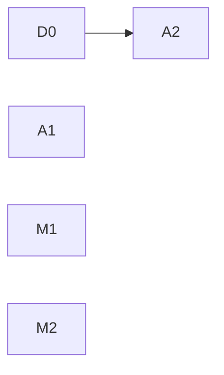

# 수요 변화 반응과 판단 기록 비용 계획

기준 소스 `c8240a55`. 근거 루트 `R=ops/pools-deploy/deployB/control-378-system-reaction-20261111/rerun-adaptive`(선택 Run `56926774`). 원문:
- scheduler API 페이지 `R/native-scheduler-pages/*.json.gz`(5,650행)
- 실제 저장 journal `R/native-scheduler-catalog-replay.tar.gz`(`v1alpha5/*/scheduler*.jsonl`)
- 요청 `R/request-metrics.json`, heap `R/evaluation-monitor/*heap.pb.top.txt`

## 1. 문제 정의

CHILL은 허용 자원 안에서 서비스별 설정 분위수 E2E SLO를 충족하는 배치를 고르고, 충족 후보 중 에너지를 최소화하며, 판단과 적용을 10초 제어 주기 안에 끝내야 한다.

control378은 control377의 측정 무효 원인을 제거했고 공식 판정 PASS/PASS다. 60초 이후 non-on-time은 0/0이다. 남은 실패는 모두 **수요가 늘어난 직후**에 있다.

| IC (excess) | 값 |
|---|---:|
| offered | 28,793 |
| on-time 비율 / SLO 요구 | 96.74% / 95% |
| 허용 tail | 1,439건 |
| 첫 60초 non-on-time (HTTP error 866 포함) | 939 (허용 tail의 65%) |

**문제:** 수요가 늘면 실효 공급까지 25~31초가 걸리고, 그동안 늘어난 요청의 대부분이 실패한다. 이 Run은 통과했지만 초기 전환 하나가 허용 tail의 65%를 썼다. 같은 실패량이 같은 분모에서 두 번 반복되면 실패한다. 반복 전환의 실제 결과는 측정하지 않았다.

이 문제는 두 층으로 나뉜다.

1. **제어 구조 지연.** 25~31초 중 물리 작업(prepare·route)은 7.5초뿐이다. 나머지는 관측 주기, 증설 선택 지연, 평가에 묶인 진행 대기다. 이것은 설계 결함이며 고친다.
2. **반응형 설계의 하한.** prepare 약 7초를 포함하면, 수요가 바뀐 뒤 판단하고 준비하는 구조로는 어떤 경우에도 10초 안에 실효 공급을 만들 수 없다. 10초 안에 공급하려면 공급을 미리 확보해야 하고, 이는 에너지 최소화와 맞바꾸는 결정이다. **이 결정은 설정 변경이나 새 knob으로 하지 않으며 사용자 결정 대상이다(§3.3).**

에너지 목적 달성은 이 계획의 근거로 검증하지 않았다.

두 번째 문제는 판단 기록 비용이다. 판단 한 건이 1.2MB이고 매 주기 쌓인다. 이것이 server 메모리·GC와 증거 보존 비용을 정하고, 메모리 한계는 control377의 퇴거와 같은 결과(제어 상실)를 낸다.

## 2. 근원 원인

### 2.1 수요 증가 → 실효 공급 경로 — 확정(원문 시각열)

| 구간(초) | excess | workload |
|---|---:|---:|
| 부하 시작 → 부하를 본 첫 판단 snapshot | 6.03 | 0.85 |
| 첫 판단 → 증설을 고른 판단 snapshot (추가 대기) | 10.63 | 10.35 |
| 증설 판단 snapshot → launch (평가) | 3.44 | 3.35 |
| prepare (genesis2 IC) | 6.73 | 6.97 |
| prepare 완료 → route 시작 (평가 대기) | 3.17 | 3.17 |
| route | 0.82 | 0.63 |
| 합계 (부하 시작 → route 완료) | 30.83 | 25.32 |

excess 시각열: 11:40:27.2 부하 시작 → 11:40:33.2 판단 Overload → 11:40:43.8 판단 Feasible(genesis2 증설) → 11:40:47.3 prepare 시작 → 11:40:54.0 완료 → 11:40:57.2 route 시작 → 11:40:58.0 완료. workload는 11:58:13.1 첫 판단이 Keep, 11:58:23.5 판단이 증설을 골랐다.

두 stage 모두 **부하를 본 첫 판단이 증설하지 않아** 약 10초를 더 썼다.

### 2.2 승인된 stage의 진행이 평가에 직렬화된다 — 확정(소스)

`application/scheduler_service.go:428-466`의 제어 goroutine 하나가 `controlRound`(Admit·Tick 평가)와 `Continue`를 모두 처리한다. `Completions()`는 Tick 사이 대기 중에만 읽는다. Tick과 Continue는 application lock과 `tickMu`를 함께 잡는다. 평가가 매 주기 2.3~3.9초 걸리므로, 그 사이 끝난 prepare는 평가가 끝나야 route를 시작한다. 두 stage 모두 Tick이 prepare 완료 약 0.6초 전에 시작해 3.17초를 기다렸다.

이 직렬화는 정합성에도 쓰인다. Tick은 계산 뒤 `publishDecisionLocked`로 snapshot을 게시하고, `publishSnapshotLocked`는 그 snapshot에 없는 instance의 route-writer fence를 삭제한다. `startTransition`은 게시된 snapshot의 routing을 admission `Before`로 고정한다. 설정 변경도 `tickMu` 직렬화에 기댄다. Ready-subset 진행은 `SchedulerReadyExpansion`으로 현재 조건을 다시 평가한다. 따라서 lock을 푸는 것만으로는 분리되지 않는다. 오래된 평가 결과가 새 상태를 덮어쓰지 않는 규칙이 함께 필요하다.

### 2.3 부하를 본 첫 판단이 증설하지 않는다 — 원인 미확정

excess 11:40:33 판단:
- IC rate 20.6 req/s. 이는 recent 10초 window의 19.7 req/s(부하 6초만 포함)와 queued 54/60의 합이다. 실제 offered는 약 32 req/s다.
- keep Overload(queue 54), reasons `NoPlanMeetsSLO`.
- surrogate 평가 500,000회(예산 소진, `terminationReason=evaluationBudget`), finalist 16개 정확 평가 뒤 채택한 이동이 없었다. `capacity.search.steps`는 채택된 이동만 기록하므로 후보를 탐색하지 않았다는 뜻은 아니다(`scheduler_capacity.go:103-126`).

workload 11:58:13 판단은 부하 0.85초 뒤 snapshot이라 수요를 거의 보지 못했다(rate 20.0, queued 14). 다음 판단(rate 32.7)이 증설했다.

후보 생성, surrogate 순위, finalist 진입, exact 결과 중 어디서 genesis2 증설이 빠졌는지는 같은 입력 재생으로만 확정할 수 있다. 수요 추정이 계단 변화를 희석하는 것은 관측된 사실이지만, 그것이 원인인지는 재생 전에는 단정하지 않는다.

### 2.4 판단 기록이 매 주기 정적 입력과 파생 표 전체를 반복 저장한다 — 확정(실제 journal)

선택 Run 구간의 실제 저장 행(5,650행):

| 종류 | 행 | bytes | 비율 |
|---|---:|---:|---:|
| decision | 238 | 288,689,991 | 96.7% |
| power | 4,790 | 4,781,242 | 1.6% |
| action | 96 | 4,528,480 | 1.5% |
| control 등 | 526 | 465,433 | 0.2% |

decision 한 행 평균 1.21MB:

| 필드 | 평균 bytes | 성격 |
|---|---:|---|
| `capacity.plans` | 707,378 | 후보 평가 표 전체(420행). 판단·재생 입력이 아님 |
| `snapshot.dispatchOccupancy` | 294,295 | profile별 dispatch 점유 분포(509개). catalog에서 유도, 주기마다 거의 같음 |
| `snapshot.options` | 104,842 | 배치 선택지(112개). catalog에서 유도 |
| `snapshot.costRefs`·`baselineRefs` | 48,492 | 참조 목록 |
| 나머지 | 약 59,000 | 판단 고유 내용(keep·target·search·settings·workloads 등) |

판단 고유 내용은 약 5%다. 나머지는 매 주기 같은 catalog 유도 입력과 판단 입력이 아닌 평가 표다. [M0](decision-record-diet.md)의 compact 계약(합성 약 68KB, 상한 135KiB)은 실제 규모에서 9배로 깨졌다. S1(`6c60b106`)은 1.5%인 action만 줄였다.

`capacity.plans` 소비자는 Dashboard `features/scheduler-capacity.tsx`(표)와 `hack/kappa/main.go:223`(새 재평가 결과의 개수)다. 저장된 표를 판단·재생이 읽지 않는다. `snapshot.dispatchOccupancy`·`options`는 재생 입력이므로 지우지 않고 참조로 바꿔야 한다.

### 2.5 server 메모리 여유 — 관측, 보유자 미확정

workload stage working set 최대 4013MiB / limit 4Gi, heap 1.6GB. heap top 경로에 `firstfloor.CloneServiceSamples`, `NewServiceDistribution`, 보유된 `encoding/json.Marshal` 결과, `Catalog.Refresh`가 있다. `inuse_space` 누적 경로가 겹치므로 합산하지 않는다. 보유자는 분해 전이다.

## 3. 수정 계획

원칙: SLO·profile·예산·finalist 수·설정은 바꾸지 않는다. prepare 시간은 줄이지 않는다.

### 3.1 측정 지표

세 값을 따로 측정한다. 물리 시간을 뺀 값으로 10초 목표 달성을 주장하지 않는다.
- 부하 시작 → 실효 공급(route 완료·첫 dispatch)
- 증설 판단 snapshot → 실효 공급
- 제어 계산·대기(첫 관측 지연, 증설 선택 추가 대기, 평가, 진행 대기)

### 3.2 단위

| 순서 | 단위 | 내용 | 완료 기준 |
|---|---|---|---|
| 1 | D0 증설 누락 재생 | 11:40:33과 11:58:13 snapshot을 production Search로 같은 입력 재생한다. genesis2 증설 후보가 후보 생성·surrogate 순위·finalist 진입·exact 결과의 어디서 빠지는지 추적한다. 코드 변경 없음 | 누락 단계 확정, §2.3 갱신 |
| 2 | A1 진행과 평가 분리 | Tick 평가를 불변 입력 위에서 lock 밖으로 옮기고, 그동안 Continue가 진행하게 한다. 불변식: Continue 이후 과거 snapshot을 현재 상태로 재게시하지 않는다. 승인 시 최신 설정·예약·실물 상태를 적용한다. 오래된 평가로 fence를 삭제하거나 admission 기준 상태를 되돌리지 않는다. Ready-expansion 평가와 action 기록 선행 조건을 유지한다 | prepare 완료→route 시작 ≤ 0.5초. 회귀: 평가 중 prepare→route 진행, 평가 중 설정 변경, writer-fence 보존, snapshot 시각 역행 없음, 기존 동시 owner·Ready-subset |
| 3 | A2 증설 선택 | D0 결과로 설계한다. D0 전에는 설계하지 않는다 | 같은 입력 재생에서 첫 판단이 증설을 고름 |
| 4 | M1 판단 기록 계약 | 저장 decision에서 `capacity.plans`를 선택 target·keep·finalist 행으로 줄이고, `snapshot.dispatchOccupancy`·`options`는 catalog 참조로 저장해 재생 시 catalog에서 해석한다(S1의 profileID 참조와 같은 방식). Dashboard 표와 `hack/kappa`를 전환한다. 저장 계약 변경(ADR 0019), campaign 사이 배포 | 실제 control378 decision 투영 ≤ 135KiB, 같은 입력 재생 결과 동일 |
| 5 | M2 메모리 보유자 | 현재 baseline heap을 보유 객체·경로로 분해한다. M1 뒤 같은 조건으로 비교한다. 코드 변경 없음 | 보유자 확정 |

A1, M1, M2는 서로 독립이다. A2만 D0에 의존한다.

### 3.3 사용자 결정: 10초 목표의 범위

A1·A2가 끝나도 반응형 구조의 하한은 대략 `관측 0~10초 + 평가 약 3.5초 + prepare 약 7초 + route 약 0.7초`로 10초를 넘는다. 실효 공급까지 10초를 지키려면 공급을 미리 확보해야 한다. 두 선택지가 있다.

- (a) 10초 목표를 제어 구조(판단과 승인된 동작의 진행)에 적용하고, 수요 계단의 실효 공급 시간은 측정해 보고한다.
- (b) 수요 변화 중 SLO를 판단 기준에 넣어, 계획기가 전환 위험을 에너지와 함께 비교하게 한다. 계획기 목적의 변경이다.

결정 전에도 3.2의 단위는 두 선택지 모두에 필요하다.

### 하지 않는 것

- 평가 시간 단축(탐색 예산·finalist 수). 평가 자체는 10초 안이고 A1 뒤에는 진행을 막지 않는다.
- prepare 단축, 공급 사전 확보(3.3 결정 전).
- Dashboard WebSocket 403, orangepi 영구 fence. 제어 결과에 영향이 없고 운영 조치 대상이다.

## 4. 검증

- D0: 재생 입력·결과를 근거 디렉터리에 보존.
- A1: 위 회귀와 lock·경쟁 검사(`-race`).
- M1: 실제 control378 decision을 투영해 크기 측정, 같은 입력 재생 결과 비교, Dashboard·kappa 확인.
- 독립 리뷰: 정확성(lock·동시성·fence), 메모리·연산을 따로.
- gate: `make lint`, `make test TEST_PYTHON=<3.10+>`, `make arch-check`, `make gopls-check`, Dashboard 변경 시 typecheck·lint·test·build.

## 5. main 실수용

control378과 같은 E5. 판정 항목:
- 3.1의 세 지표, prepare 완료→route 시작
- 구간별 IC 실패(첫 60초, 이후)
- decision 행 크기와 시간당 기록 크기, server working set 최대
- 에너지: 전체 POOL 에너지와 같은 H의 keep·선택 후보 비교. 정책 우열은 같은 시작 상태 근거 없이는 주장하지 않는다
