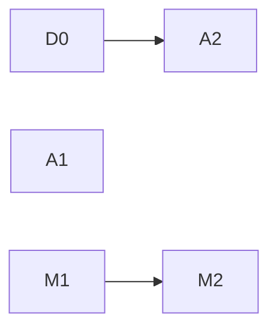

# 수요 변화에 대한 반응과 판단 기록 비용 계획

기준 소스 `c8240a55`. 근거 루트 `R=ops/pools-deploy/deployB/control-378-system-reaction-20261111/rerun-adaptive`(선택 Run `56926774`). 원문: `R/native-scheduler-pages/*.json.gz`(scheduler 기록 5,650행), `R/request-metrics.json`, `R/evaluation-monitor/*heap.pb.top.txt`.

## 1. 문제 정의

CHILL은 허용 자원 안에서 서비스별 설정 분위수 E2E SLO를 충족하는 배치를 고르고, 충족 후보 중 에너지를 최소화하며, 판단과 적용을 10초 제어 주기 안에 끝내야 한다.

control378은 control377의 측정 무효 원인(디스크·퇴거·gap·직렬 release·전체 재목록)을 제거했고 공식 판정 PASS/PASS다. 정상 상태에서는 60초 이후 지연이 0/0이다. 남은 실패는 모두 **수요가 바뀐 직후**에 있다.

| IC (excess) | 값 |
|---|---:|
| offered | 28,793 |
| on-time 비율 / SLO 요구 | 96.74% / 95% |
| 허용 여유 | 약 500건 |
| 첫 60초 non-on-time (HTTP error 866 포함) | 939 |

부하 변화 한 번이 SLO 허용 실패 예산의 약 2/3를 쓴다. 이 Run이 통과한 것은 900초에 변화가 한 번뿐이었기 때문이다. 변화가 두 번이면 실패한다.

**문제:** 수요가 늘었을 때 실효 공급까지 25~31초가 걸린다. 그중 물리 작업(prepare·route)은 약 7.5초이고 나머지 18~23초는 제어 구조가 만든다. 10초 주기 목표는 판단(round p95 7.0/7.5초)만 충족하고 적용은 충족하지 못한다.

두 번째 문제는 판단 기록 비용이다. 이것이 제어 루프의 가용성(메모리·GC)과 증거 보존 비용을 정한다.

## 2. 근원 원인

### 2.1 수요 증가 → 실효 공급 경로 — 확정(원문 시각열)

| 구간(초) | excess | workload | 성격 |
|---|---:|---:|---|
| 부하 시작 → 부하를 본 첫 판단 snapshot | 6.0 | 11.2 | 주기 양자화(0~10초) |
| 잘못된 판단으로 잃은 주기 | 10.6 | 0 | 2.3 (미확정) |
| snapshot → launch (평가) | 3.4 | 3.4 | 평가 시간 |
| prepare (genesis2 IC) | 6.7 | 7.0 | 물리 |
| prepare 완료 → route 시작 | 3.2 | 3.2 | **평가 대기** |
| route | 0.8 | 0.6 | 물리 |
| 합계 | 30.8 | 25.3 | |

excess 시각열: 11:40:27.2 부하 시작 → 11:40:33.2 판단 Overload(이동 없음) → 11:40:43.8 판단 Feasible → 11:40:47.3 prepare 시작 → 11:40:54.0 완료 → 11:40:57.2 route 시작 → 11:40:58.0 완료.

### 2.2 적용 단계가 평가에 직렬화된다 — 확정(소스)

`application/scheduler_service.go:428-466`의 제어 goroutine 하나가 `controlRound`(Admit·Tick 평가)와 `Continue`(이미 승인된 transition의 다음 stage)를 모두 처리한다. `Completions()`는 Tick 사이 대기 중에만 읽는다. 평가가 매 주기 2.3~3.9초 동안 이 goroutine과 application lock을 잡으므로, 그 사이 끝난 prepare는 평가가 끝날 때까지 다음 stage(route)를 시작하지 못한다. 두 stage 모두 prepare 완료 0.2초 전에 Tick이 시작되어 3.2초를 기다렸다.

판단에는 평가가 필요하지만, 이미 승인된 transition의 진행에는 새 평가가 필요 없다. **진행을 평가에 묶은 구조가 원인이다.** 평가 시간을 줄여도 대기 상한만 줄 뿐 직렬 구조는 남는다.

### 2.3 첫 판단이 증설하지 않았다 — 미확정, 같은 입력 재생 필요

11:40:33 판단은 IC rate 20.6 req/s(실제 약 32), queued 54, keep Overload, `NoPlanMeetsSLO`였다. search step은 keep(k=0, evaluated 0) 하나뿐이고 k=1로 나아가지 않았다. 10초 뒤 rate 31.9에서는 k=1(410개 평가) 끝에 genesis2 증설을 골랐다.

- rate 20.6은 부하가 6초만 들어간 10초 recent window와 minimumDemand 20이 만든 값이다. 수요 추정이 계단 변화를 희석한다.
- 그 rate에서 keep의 IC routing 용량(37.9)은 충분해 보이는데 Overload다. 즉 판정 원인이 queue(54)라면, 이동 후보가 queue를 해소한다고 보지 않았을 가능성이 있다.

두 가설(수요 희석, backlog를 해소하는 후보 평가 부재) 중 무엇인지는 이 snapshot의 같은 입력 재생으로만 확정할 수 있다. workload stage에는 같은 손실이 없었다(첫 판단 snapshot이 부하 1초 뒤라 이미 다음 주기에 32.7을 봤다). 즉 이 원인은 부하 시작 시점과 주기의 위상에 따라 0~10초를 더한다.

### 2.4 판단 기록이 M0 계약의 15배로 회귀했다 — 확정

| 기록 종류 | 행 | bytes | 비율 |
|---|---:|---:|---:|
| decision | 238 | 361,481,026 | 96.2% |
| power | 4,790 | 9,185,562 | 2.4% |
| action | 96 | 4,757,918 | 1.3% |
| control 등 | 526 | 509,112 | 0.1% |

decision 한 행은 약 1.5MB이고 그중 49%가 `capacity.plans`(741KB, 매 판단 420개 Node×선택지 평가 행)다. [M0](decision-record-diet.md)가 정한 판단 기록 목표는 약 100KB였다. S1(`6c60b106`)은 1.3%인 action만 줄였다. 시간당 약 450MB의 대부분이 이 표다.

`capacity.plans`의 소비자는 Dashboard `features/scheduler-capacity.tsx`(표 표시)와 `hack/kappa/main.go:223`(개수)뿐이다. 판단과 재생은 이 표를 읽지 않는다.

### 2.5 server 메모리 여유 — 관측, 원인 미분해

workload stage working set 최대 4013MiB / limit 4Gi. heap(1.6GB)의 큰 항목: `firstfloor.CloneServiceSamples` 466MB, `NewServiceDistribution` 250MB, 보유된 `encoding/json.Marshal` 결과 319MB, `Catalog.Refresh` 누적 619MB. control377은 퇴거로 판단을 잃었다. 메모리 한계도 같은 결과(제어 상실)를 낸다. 이 계획은 원인 분해까지만 한다.

## 3. 수정 계획

원칙: 수요 변화 후 실효 공급까지의 **제어 구조 지연**을 한 주기(10초) 안으로 만든다. SLO·profile·예산·설정은 바꾸지 않는다. 물리 작업 시간(prepare)은 이번 범위에서 줄이지 않는다.

완료 지표: `부하 시작→route 완료 − prepare − route 실행` (control378: 23.3 / 17.7초) ≤ 10초. 보조로 첫 60초 non-on-time.

| 순서 | 단위 | 내용 | 완료 기준 |
|---|---|---|---|
| 1 | D0 첫 판단 재생 | 11:40:33 snapshot을 production Search로 같은 입력 재생한다. 수요를 32로 바꾼 입력, queue를 0으로 바꾼 입력과 비교해 2.3의 원인을 확정한다. 코드 변경 없음 | 원인 하나 확정, 이 문서 2.3 갱신 |
| 2 | A1 진행과 평가 분리 | 승인된 transition의 stage 진행(`Continue`)이 진행 중인 평가를 기다리지 않게 한다. 평가는 capture한 snapshot 위에서 application lock 밖에서 계산하고, 결과 승인·launch만 lock 안에서 한다. 평가 도중 진행된 transition은 기존 owner rebase·fence(`target_scope.go`)로 반영한다 | prepare 완료→route 시작 ≤ 0.5초. 기존 동시 owner·fence·Ready-subset 회귀 통과 |
| 3 | A2 수요 계단 반응 | D0 결과에 따라 정한다. 수요 희석이 원인이면 판단에 쓰는 rate가 계단 변화를 한 주기 안에 반영하게 한다. backlog 평가가 원인이면 queue를 해소하는 후보가 평가되게 한다. D0 전에는 설계하지 않는다 | 같은 입력 재생에서 11:40:33이 증설을 고름 |
| 4 | M1 판단 기록 계약 복원 | 저장하는 decision에서 `capacity.plans` 전체 표를 빼고 선택 target·keep·finalist에 해당하는 행만 남긴다. 전체 표는 live API와 같은 입력 재생으로 얻는다. Dashboard 표와 `hack/kappa`를 이 계약으로 전환한다. 저장 계약 변경(ADR 0019)이므로 campaign 사이에 배포 | 실제 규모 decision 행 ≤ 135KiB(`TestSchedulerRecordStoresCompactDecision` 상한), 시간당 기록 크기 1/5 이하 |
| 5 | M2 메모리 분해 | 보유 heap을 profile 표본, 보유 marshal 결과, catalog refresh로 나눠 원인 객체와 보유자를 확정한다. 코드 변경 없음 | 보유자 확정과 다음 단위 제안 |

A1과 M1은 서로 독립이다. A2는 D0에 의존한다. M2는 M1 결과(보유 marshal 감소)를 반영해 판단한다.

### 하지 않는 것

- 판단 평가 시간 단축(탐색 예산·finalist 수). 평가는 10초 안이고, A1 뒤에는 적용을 막지 않는다.
- prepare 시간 단축. 물리 작업이며 별도 항목이다.
- Dashboard WebSocket 403. 운영 접근 문제이며 제어·측정 결과에 영향이 없다. 별도로 처리한다.
- orangepi Pod의 영구 fence. 의도된 안전 동작이며 해소는 운영 조치다.

## 4. 검증

- D0: 재생 입력과 결과를 근거 디렉터리에 보존.
- A1: 평가 중 completion 도착 시 즉시 진행, 평가 결과와 진행된 transition의 동시성 회귀. 같은 owner·fence 회귀.
- M1: 실제 control378 decision으로 투영 크기 측정, Dashboard·kappa 소비 확인.
- 독립 리뷰: 정확성(lock·동시성·fence), 메모리·연산을 따로.
- gate: `make lint`, `make test TEST_PYTHON=<3.10+>`, `make arch-check`, `make gopls-check`, Dashboard 변경 시 typecheck·lint·test·build.

## 5. main 실수용

control378과 같은 E5. 판정: 제어 구조 지연(위 완료 지표), 구간별 IC 실패, prepare 완료→route 시작, decision 행 크기와 시간당 기록 크기, server working set 최대.
