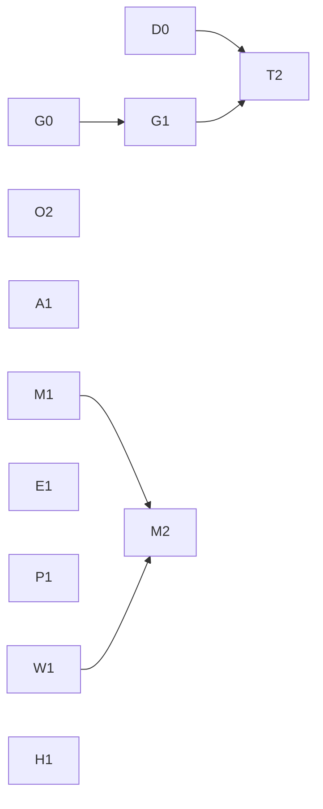

# 수요 변화 반응 경로의 불필요 비용 제거 계획

기준 소스 `c8240a55`. 근거 루트 `R=ops/pools-deploy/deployB/control-378-system-reaction-20261111/rerun-adaptive`(선택 Run `56926774`). 원문:
- scheduler 기록: API 페이지 `R/native-scheduler-pages/*.json.gz`, 실제 저장 journal `R/native-scheduler-catalog-replay.tar.gz`
- 요청: `R/published-originals/stages/<stage>/stage/artifacts/measured/obs/20261111T11/requests.jsonl.gz`
- CPU·heap: `R/evaluation-monitor/*-cpu.pb.gz`, `*-heap.pb.top.txt`
- 클러스터 읽기 전용 `kubectl get` (2026-11-11 후반)

## 1. 문제 정의

CHILL은 허용 자원 안에서 서비스별 설정 분위수 E2E SLO를 충족하는 배치를 고르고, 충족 후보 중 에너지를 최소화하며, 판단과 적용을 제어 주기 안에 끝내야 한다.

control378은 공식 판정 PASS/PASS이고 60초 이후 non-on-time은 0/0이다. 남은 실패는 모두 **수요가 늘어난 직후**에 있다. IC excess는 첫 60초 non-on-time 939건으로 허용 tail 1,439건의 65%를 썼다.

**문제:** 수요가 늘어난 직후 25~31초 동안 IC 요청이 거의 전부 실패한다. 이 구간의 실패량은 두 가지로 정해진다.
1. 부족한 공급으로 얼마나 많은 요청을 제때 처리하는가 (과부하 중 goodput).
2. 공급이 실효로 늘어나기까지 얼마나 걸리는가 (반응 경로).

시간 목표 하나를 맞추는 것이 기준이 아니다. 두 경로에 있는 **불필요한 비용을 빠짐없이 찾아 제거하는 것**이 기준이다. 아래 §2는 원문으로 확인한 비용 목록이고, 각 항목을 필요(물리·정합성)와 불필요로 나눴다.

에너지 목적 달성은 이 근거로 검증하지 않았다.

## 2. 근원 원인

### 2.1 과부하 중 기존 공급이 0에 가까운 goodput을 낸다 — 확정

excess stage IC, 부하 시작 기준 2.5초 구간(server final 행):

| 구간(초) | 수신 | 제때 완료 | jetsono queue p50 (ms) | service p50 (ms) | batch |
|---|---:|---:|---:|---:|---:|
| 0–2.5 | 87 | 73 | 995 | 612 | 16 |
| 2.5–30 | 852 | 27 | 1,620–1,820 | 624–713 | 16 |
| 30–40 (genesis2 공급 후) | 229 | 202 | 7 | 38–95 | 1–2 |

workload stage도 같다(0–25초 수신 769, 제때 151, queue p50 약 1.9초).

부하 중 기존 IC 공급은 jetsono 한 instance(batch 16, 약 0.65초)였다. 처리량은 약 24 req/s이고 수요는 약 32 req/s다. 부족분은 약 25%인데 제때 처리는 3% 수준으로 떨어졌다. queue가 요청 lifetime(2초) 가까이 차서, 실행되는 요청이 이미 기한을 넘긴 상태로 처리되기 때문이다(실패 원인 `context deadline exceeded`, batch 16 안에서 실행).

firstfloor executor에는 기한을 지킬 수 없는 요청을 실행 전에 버리는 정책(`deadlinePolicy` `drop`·`defer`, `internal/firstfloor/scheduler.go:373-445`)이 있다. 이 정책은 profile의 측정 조건(`Profile.Condition.Firstfloor.DeadlinePolicy`)으로 고정된다. launch는 profile의 정책으로 executor를 띄우고(`kube/scheduler_operations_launch.go:432`), replay는 instance 정책과 profile 정책이 다르면 후보를 거부한다(`scheduler_replay_actions.go:122-128`, `ImmutableNativeDeadlinePolicyMismatch`). 이 Run의 IC profile은 모두 `keep`으로 측정됐다(실행 정책 913건 `keep`, `defer`는 다른 model path 1개). 따라서 계획기는 IC에 다른 과부하 정책을 고를 수 없다.

한편 replay는 `drop`·`defer`를 이미 모델링한다(`scheduler_replay.go:693`, `scheduler_replay_requests.go:333-406`). 과부하가 아닐 때 세 정책의 service 시간은 같고, 차이는 기한을 이미 지킬 수 없는 요청을 실행하느냐뿐이다.

**원인:** 과부하 시 동작(기한을 넘길 요청을 실행할지)이 서비스 수준의 운영 규칙으로 정해지지 않고, profile 측정 조건으로 묶여 있다. IC profile이 `keep`이라 공급 부족 25%가 실패 97%로 증폭됐다. 이것이 첫 60초 실패량의 가장 큰 원인이다. `drop`이었다면 이 구간 제때 비율이 처리량/수요(약 75%)에 가까웠을 것으로 추정한다 [INFERENCE: 같은 도착열 재생으로 확정 필요].

### 2.2 수요 증가 → 실효 공급 경로

| 구간(초) | excess | workload | 분류 |
|---|---:|---:|---|
| 부하 시작 → 부하를 본 첫 판단 snapshot | 6.03 | 0.85 | 불필요: 주기 polling |
| 첫 판단 → 증설 판단 snapshot | 10.63 | 10.35 | 불필요(2.3) |
| 증설 snapshot → launch (평가) | 3.44 | 3.35 | 일부 불필요(2.6) |
| prepare | 6.73 | 6.97 | 물리, 내부 미분해(2.7) |
| prepare 완료 → route 시작 | 3.17 | 3.17 | 불필요(2.4) |
| route | 0.82 | 0.63 | 물리 + capture |
| 합계 | 30.83 | 25.32 | |

### 2.3 수요 변화가 판단에 들어오는 방식 — 확정(관측), 일부 미확정

- **주기 polling.** server는 요청 도착과 queue를 실시간으로 알지만, 계획기는 10초마다 관측한다. 첫 관측까지 0~10초가 걸린다.
- **수요 희석.** excess 11:40:33 판단의 IC rate는 20.6 req/s였다. 실제 수요는 약 32 req/s다. 이 값은 recent 10초 window 19.7 req/s(부하 6초만 포함)와 queued 54/60에서 나왔다.
- **excess 첫 판단의 미증설 — 미확정.** keep Overload(queue 54), surrogate 500,000회(예산 소진), finalist 16개 exact 뒤 채택 이동이 없었다. `capacity.search.steps`는 채택된 이동만 기록한다(`scheduler_capacity.go:103-126`). 원인은 같은 입력 재생으로만 확정한다. 증설이 정답이라고 가정하지 않는다.
- **workload 첫 판단의 Keep은 정당.** 부하 0.85초 뒤 snapshot(rate 20.0, queued 14)에서 Keep exact 재생이 12,016/12,016 완료, p95 702ms로 SLO를 충족했다. 이 10초는 관측 지연이다.

### 2.4 승인된 stage 진행이 평가에 직렬화된다 — 확정

`application/scheduler_service.go:428-466`의 goroutine 하나가 `controlRound`와 `Continue`를 처리한다. 둘 다 application lock과 `tickMu`를 잡는다. 평가 중 끝난 prepare는 평가가 끝나야 route를 시작한다(두 stage 3.17초). 같은 Run에서 jetson-nano·rasp5 prepare 완료(11:41:03.9) 뒤 route도 Tick launch(11:41:05.6)까지 1.7초 기다렸다.

이 직렬화는 정합성에도 쓰인다. Tick은 계산 뒤 `publishDecisionLocked`로 snapshot을 게시하고, `publishSnapshotLocked`는 그 snapshot에 없는 instance의 route-writer fence를 지운다. `startTransition`은 게시된 snapshot의 routing을 admission `Before`로 고정한다. 설정 변경도 `tickMu` 직렬화에 기댄다. Ready-subset 진행은 `SchedulerReadyExpansion`으로 현재 조건을 다시 평가한다. lock을 푸는 것만으로는 분리되지 않는다.

### 2.5 매 주기 반복되는 전체 재조회 — 확정

| 항목 | 매 주기 비용 | 원인 |
|---|---|---|
| `Admit` | p50 1.87초, p95 2.18초, 최대 3.56초 (238 round) | `measurementRoots`(`kube/admission.go:46-110`)가 측정 CR 6종을 전부 List한다. ProfilingRun은 6,567개(JSON 29MB)이고 거의 모두 terminal이다. CPU profile에서 이 List decode가 30초당 2.8초 |
| `Admit`의 Nodes·serving Pods·DeviceClasses List | 위에 포함 | 같은 주기의 Tick capture가 같은 목록을 다시 읽는다 |
| capture `window` | Tick p50 0.57초, p95 0.82초; Continue 최대 7.6초 | `observationLog.LoadWindow`가 매 Tick·Continue마다 60초치 요청 기록을 다시 읽는다. server는 이 기록을 직접 쓴 주체다 |
| Continue 전체 capture | stage마다 p50 0.57초, p95 1.22초 | stop→drain→remove처럼 연속 stage마다 window와 refresh를 다시 한다 |

`Admit`은 `tickMu`를 잡고 Tick 앞에서 실행된다. 매 round가 Tick 시작 전 약 1.9초를 쓰고, 그동안 Continue도 진행하지 못한다. 측정 CR은 terminal이 되면 바뀌지 않는다. 같은 유형의 회귀를 control377의 O1(전체 Pod 재목록)에서 고쳤다.

### 2.6 평가 계산 — 확정(분해), 개선 여지 미확정

Tick `evaluate` p50 3.62초: search 2.30초(surrogate 0.56, exact 1.75), rates 0.54초, payback 0.38초, preparation 0.31초. CPU profile(30초)에서 replay가 39%다. 그중 `chooseBatches` 24%, `ServiceDistribution.QuantileNanos`(`sort.Search`) 12.5%, `energyGainWait` 10%다. heap에는 `firstfloor.CloneServiceSamples`·`NewServiceDistribution`이 크다(누적 경로는 겹치므로 합산하지 않는다). 같은 profile 표본의 분위수를 반복 정렬 탐색하고 표본을 복제하는 비용이 있다. 탐색 예산과 finalist 수는 바꾸지 않는다. 같은 결과를 내는 계산 비용만 대상이다.

### 2.7 prepare 내부 — 미분해

genesis2 IC prepare 6.73초에는 Pod 생성, 컨테이너 시작, ORT CUDA 초기화, batch 1~16 warmup(`initializedBatches`)이 들어 있다. action 기록에는 시작·완료와 ready 시각만 있다. 어느 단계가 지배하는지 모른다.

### 2.8 판단 기록 비용 — 확정(실제 journal)

선택 Run 구간(11:39:40–12:16:19) 저장 행 5,213개 중 decision 219개가 265,889,054B(96.6%)다. decision 평균 1.21MB:

| 필드 | 평균 bytes | 성격 |
|---|---:|---|
| `capacity.plans` | 707,378 | 후보 평가 표 전체(420행). 재생 입력 아님 |
| `snapshot.dispatchOccupancy` | 294,295 | 판단 시점 rolling cache 선택값. Run 중 21종 |
| `snapshot.options` | 104,842 | 당시 승인된 preparation으로 만든 선택지. `ObservedAt` 제외 시 1종 |
| `snapshot.costRefs`·`baselineRefs` | 48,492 | 참조 목록 |
| 나머지 | 약 59,000 | 판단 고유 내용 |

[M0](decision-record-diet.md)의 compact 계약(상한 135KiB)이 실제 규모에서 9배로 깨졌다. S1(`6c60b106`)은 1.6%인 action만 줄였다. `dispatchOccupancy`·`options`는 재생 입력이고(`scheduler_capacity_decision.go:168-181`, `scheduler_capacity_nodes.go:242-254`) 현재 catalog로 재계산할 수 없다.

### 2.9 server CPU·메모리 경합 — 확정(profile)

- 30초 CPU 40.5초 중 TLS server handshake(RSA 서명)가 6.5초(16%)다. load generator가 open-loop 요청마다 새 HTTPS 연결을 열고 닫는다(`load-generator/src/chill_loadgen/cli.py:150-185`). 이 CPU는 같은 server의 제어 평가와 경쟁한다.
- Kubernetes List decode가 9.5%다(대부분 2.5의 `Admit`).
- workload stage working set 최대 4013MiB / limit 4Gi.

## 3. 수정 계획

원칙: SLO·profile·탐색 예산·finalist 수·설정 값은 바꾸지 않는다. 같은 판단을 더 싸게, 같은 공급으로 더 많이 제때 처리한다.

### 3.1 단위

| 순서 | 단위 | 대상 | 내용 | 완료 기준 |
|---|---|---|---|---|
| 1 | G0 과부하 goodput 재생 | 2.1 | 같은 도착열(excess·workload 부하 구간)을 jetsono profile로 `keep`·`drop`·`defer` 각각 재생해 제때 처리 수를 비교한다. 계획기 replay가 executor 정책을 어떻게 모델링하는지 확인한다. 코드 변경 없음 | 정책별 제때 처리 수와 계획기 예측 일치 여부 확정 |
| 2 | G1 과부하 정책의 소유 위치 | 2.1 | G0 결과로 정한다. 후보: (a) deadline 정책을 profile 식별 조건에서 빼고 서비스 수준 운영 규칙으로 정한다. profile의 service 분포는 그대로 쓰고 replay가 그 정책으로 예측한다. (b) 현 계약을 유지하고 필요한 정책으로 profile을 다시 측정한다. (a)는 profile 계약 변경이므로 사용자 결정 대상이다 | 같은 도착열에서 과부하 구간 제때 처리 증가, 정상 구간 결과 동일 |
| 3 | O2 측정 CR 증분 관측 | 2.5 | `Admit`이 측정 CR 전체를 매번 List하지 않게 한다. terminal CR은 다시 읽지 않는다. Nodes·Pods·DeviceClasses는 같은 주기의 관측을 공유한다. 대기 순서·terminal 판정·measurement taint 단일 writer 계약은 유지 | `Admit` p50 < 0.1초, 기존 admission 회귀 통과 |
| 4 | A1 진행과 평가 분리 | 2.4 | Tick 평가를 불변 입력 위에서 lock 밖으로 옮기고 그동안 Continue가 진행한다. 불변식: Continue 이후 과거 snapshot을 현재로 재게시하지 않는다. 승인 시 최신 설정·예약·실물 상태를 적용한다. 오래된 평가로 fence를 지우거나 admission 기준을 되돌리지 않는다. Ready-expansion 평가와 action 기록 선행 조건을 유지 | prepare 완료→route 시작 ≤ 0.5초. 회귀: 평가 중 진행, 설정 변경, writer-fence 보존, snapshot 시각 역행 없음, 동시 owner·Ready-subset |
| 5 | W1 요청 window 재사용 | 2.5 | server가 쓴 요청 기록을 Tick·Continue마다 다시 읽지 않고 메모리 window를 갱신한다. 기록 누락·gap 판정(`schedulerRequestCoverageError`)과 재시작 복원은 기존 log에서 한다. Continue는 진행에 필요한 상태만 갱신한다 | window p50 < 0.05초, Continue capture 감소, 재시작 뒤 같은 window |
| 6 | D0 첫 판단 재생 | 2.3 | excess 11:40:33의 settings·arrivals·catalog·selected occupancy·options를 정확히 복원해 production Search로 재생한다. Keep과 대안의 exact SLO·에너지를 비교하고 생성·surrogate·finalist·exact·postfilter 중 선택 차이의 원인을 확정한다 | 원인 확정 |
| 7 | T2 수요 변화 반영 | 2.3 | D0와 G1 결과로 정한다. 후보: server가 관측한 queue 증가·Overload를 즉시 판단 시작 조건으로 쓴다(주기 대기 제거), 수요 추정의 계단 희석. D0 전에는 설계하지 않는다 | 같은 입력에서 첫 판단 지연 감소, 정당한 Keep 유지 |
| 8 | E1 평가 계산 비용 | 2.6 | 결과가 같은 범위에서 replay의 분위수 탐색·표본 복제·rates/payback 반복 계산을 줄인다. 같은 입력 재생 결과가 bit 단위로 같아야 한다 | evaluate p50 감소, 같은 입력 결과 동일 |
| 9 | P1 prepare 단계 기록 | 2.7 | prepare action에 Pod scheduled·container started·runtime init·warmup 완료 시각을 남긴다. 코드 변경은 기록만 | 다음 실측에서 지배 단계 확정 |
| 10 | M1 판단 기록 정규화 | 2.8 | `capacity.plans`를 선택 target·keep·finalist 행으로 줄인다. 판단 시점 selected occupancy와 승인된 option 입력은 기존 catalog 저장 메커니즘으로 불변 버전 보존하고 decision은 버전과 주기 고유 값만 참조한다. 재생은 원래 값·순서·멤버십·provenance를 정확히 복원하고 현재 catalog로 재계산하지 않는다. Dashboard 표와 `hack/kappa` 전환. 저장 계약 변경(ADR 0019), campaign 사이 배포 | 실제 decision 투영 ≤ 135KiB, 복원 입력 동등, 누락 참조 오류, 새 catalog 포함 총 기록량 측정 |
| 11 | M2 메모리 보유자 | 2.9 | heap 보유 객체·경로 분해. M1·W1 뒤 같은 조건 비교 | 보유자 확정 |
| 12 | H1 측정 harness 연결 | 2.9 | load generator가 요청마다 새 TLS handshake를 하는 것이 측정 대상인지 결정하고, 아니면 연결 재사용 또는 session resumption으로 바꾼다. 측정 계약 변경이므로 campaign 사이에 적용 | server handshake CPU 감소, 요청 결과 계약 유지 |

G0·D0·O2·A1·W1·E1·P1·M1·H1은 서로 독립이다. 실패량 영향 순으로 G0→G1, 반응 경로의 확정된 불필요 비용(O2, A1, W1), 판단 원인(D0→T2), 계산·기록 비용(E1, M1, M2), 미분해 항목(P1), harness(H1) 순으로 진행한다.

### 하지 않는 것

- 탐색 예산·finalist 수·SLO·설정 변경.
- 근거 없는 공급 사전 확보(headroom). 실효 공급 전 실패는 G1·T2로 줄이고, 남는 양은 측정해 보고한다.
- Dashboard WebSocket 403, orangepi 영구 fence. 제어·측정 결과에 영향이 없는 운영 항목이다.

## 4. 검증

- G0·D0: 재생 입력과 결과를 근거 디렉터리에 보존.
- 단위마다 회귀와 같은 입력 재생. A1·W1·O2는 `-race` 포함.
- 독립 리뷰: 정확성(lock·동시성·fence·admission 계약), 메모리·연산을 따로.
- gate: `make lint`, `make test TEST_PYTHON=<3.10+>`, `make arch-check`, `make gopls-check`, Dashboard 변경 시 typecheck·lint·test·build.

## 5. main 실수용

control378과 같은 E5. 판정 항목:
- 과부하 구간 제때 처리 비율, 구간별 IC 실패(첫 60초, 이후)
- §2.2 표의 각 구간, `Admit`·window·evaluate·Continue capture 분포
- decision 행 크기와 시간당 기록 크기, server CPU 구성과 working set 최대
- 에너지: 전체 POOL 에너지, 같은 H의 keep·선택 후보 비교. 정책 우열은 같은 시작 상태 근거 없이는 주장하지 않는다
