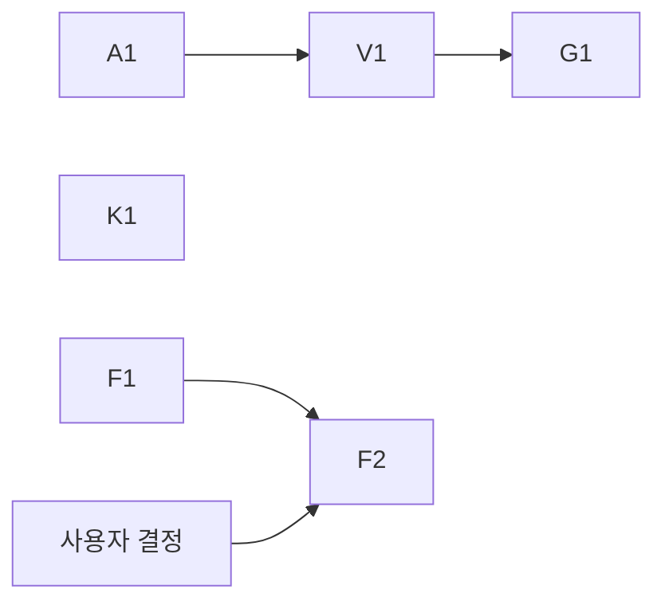

# 판단 근거의 신선도·충실도·국소화 계획

기준 소스 `a301a989`. 근거:
- `C9=ops/pools-deploy/deployB/control-379-overload-admission-20261112` (Reject·Delay 두 Run, admission 적용 후 첫 실측)
- `C8=ops/pools-deploy/deployB/control-378-system-reaction-20261111/rerun-adaptive`, 저장 journal `native-scheduler-catalog-replay.tar.gz`
- 분석 스크립트: `ops/pools-deploy/intent/decision-fidelity-20261112/*.py` (원문 요청 final 행, scheduler 기록, catalog profile 행만 사용)

## 1. 문제 정의

CHILL은 허용 자원 안에서 서비스별 설정 분위수 E2E SLO를 충족하는 배치를 고르고, 충족 후보 중 에너지를 최소화하며, 판단과 적용을 제어 주기 안에 끝내야 한다. 모든 판단(배치, 경로, 요청 admission)은 CHILL이 가진 **세계의 모습**(profile로 예측한 처리 시간, 관측한 실행기·노드·진행 중 작업 상태)에서 나온다.

**문제:** CHILL은 그 세계의 모습이 지금 판단에 쓸 만큼 신선한지, 실제와 맞는지, 일부가 비었을 때 어디까지 영향을 주는지를 확인하지 않는다. 그래서 모습이 낡거나 틀리거나 일부 비면, 판단이 조용히 틀리거나 시스템 전체가 판단을 멈춘다.

control376부터 379까지 같은 구조가 반복됐다.

| Run | 국소 사실 | 시스템 전체 결과 |
|---|---|---|
| 376 | 실행 중 batch 하나가 profile 표본 범위를 넘음 | 모든 후보의 정밀 평가 정지, v1 fallback |
| 377 | 서버 퇴거로 관측 gap, orangepi edge 단절 | 측정 무효, 판단 근거 상실 |
| 378 | profile이 jetsono IC 처리량을 31.8 req/s로 봄(실제 22.5) | 수요 증가에 늦게 반응, 과부하 구간 goodput 0 |
| 379 | orangepi의 멈춘 prepare 하나 | 309개 판단 전부에서 현 상태(keep) 평가 불가, 경로 재적용 139회 |
| 379 | 경로 적용 직후 실행기 상태를 gateway가 판단 불가로 봄 | 실행기는 놀고, 요청 250~355건씩 2초 기한까지 대기 후 timeout |

국소 현상을 하나씩 고치는 대신, 판단 근거를 다루는 방식 세 가지를 바꾼다:
- 신선도: 빠른 판단(요청 admission)이 느린 관측(제어 주기 snapshot)에 묶이지 않게 한다.
- 국소화: 모델에 담기지 않는 사실은 그 사실이 닿는 부분만 판단 불가로 만든다.
- 충실도: 예측과 실제의 차이를 계속 재고 기록한다.

에너지 목적 달성은 이 근거로 검증하지 않았다.

## 2. 원문으로 확인한 사실

### 2.1 control379 결과: 첫 60초 실패는 사라졌고, 실패의 모양이 바뀌었다

| Run·stage | onTime 비율 | late | rejected | timeout | 첫 60초 non-on-time |
|---|---:|---:|---:|---:|---:|
| Reject excess | 98.52% | 64 | 305 | 58 | 0 |
| Reject workload | 96.43% | 49 | 356 | 623 | 106 |
| Delay excess | 99.63% | 20 | 0 | 87 | 35 |
| Delay workload | 96.97% | 79 | 0 | 794 | 0 |

control378 excess는 첫 60초에 939건이 실패했다. admission이 과부하 중 goodput 붕괴를 없앴다. 남은 실패는 run 중간의 묶음(burst)이다(`C9/*/request-analysis.json`의 `minutes`). 예: Reject workload 12분째 timeout 355, Delay workload 1분째 385, 5분째 268.

### 2.2 가장 큰 실패 묶음: 실행기는 놀고 gateway가 요청을 보내지 않았다 — 확정(현상)

gateway에서 실행기를 배정받지 못하고 최종 기한(2초)에 끝난 요청(`outcome=timeout`, instance 없음)을 시간으로 묶고, 그 시간 해당 서비스 실행기의 native batch 실행을 겹쳐 봤다(`idle.py`).

| 서비스 | 시작(UTC) | 길이 | gateway timeout | 그동안 실행기 busy |
|---|---|---:|---:|---:|
| IC | 19:57:50 | 8.0초 | 268 | 0% |
| IC | 20:08:35 | 10.1초 | 355 | 3% |
| IC | 20:34:32 | 10.1초 | 334 | 12% |
| IC | 20:38:18 | 8.1초 | 251 | 25% |
| PLC | 20:04:35 | 10.5초 | 139 | 1% |

19:57:50 사례: jetsonx IC 실행기는 19:57:50.495에 마지막 batch를 끝내고 19:58:00.562까지 batch를 하나도 실행하지 않았다. 그사이 도착한 IC 요청 268건은 `gatewayWaitNanos≈2.0e9`로 gateway에서만 기다렸다. 직전 19:57:47.7–50.0에 route 동작이 있었고, 실행 재개는 다음 route(19:57:59.6–58:01.9) 중이다. 실패 기록에는 왜 배정하지 않았는지가 없다(`error=RequestTimeout`만 있음).

gateway는 실행기의 admission 입력이 판단 불가이면 그 실행기로 배정하지 않는다. 판단 불가 조건에는 관측 snapshot의 native policy `ProfileID`와 instance profile의 일치가 들어 있다(`internal/serving/runtime.go:711`). native 상태는 제어 경로의 관측 갱신으로만 들어온다(`runtime.go:1608`). route는 native policy를 다시 쓴다(`operations/operations_routing.go:72,226,276`). 즉 **요청 단위(ms) 판단이 제어 주기(10초) 관측의 신선도에 묶여 있다.** route 직후 무엇이 판단 불가를 만들었는지(ProfileID 불일치, 관측 시각, 실행 중 residual 범위 초과 중 어느 것인지)는 기록이 없어 아직 확정하지 못했다(§3 R1).

### 2.3 멈춘 동작 하나가 모든 판단에서 현 상태 평가를 막았다 — 확정

control379 판단 309개 모두 keep이 `Pending`이었다. 사유는 306건이 `MissingActionInstanceState:prepare-3cbe367f…(orangepi)…`다. orangepi에서 19:39:59에 시작한 prepare가 `partial`로 끝나 멈췄고(edge 단절, control377 G1과 같은 노드), replay가 그 동작의 instance 상태를 모델링하지 못했다. keep을 평가할 수 없으니 매 판단은 비-keep target을 고른다. target은 route 하나뿐이고 기대 에너지는 keep과 같다(차이 중앙값 0 J).

| Run | keep 상태 | route 완료 |
|---|---|---:|
| control378 | Feasible 226, Overload 10, Pending 2 | 15 |
| control379 Reject | Pending 156 | 66 |
| control379 Delay | Pending 153 | 73 |

route 하나는 약 2.3초이고 native policy를 다시 쓴다. §2.2의 묶음은 route 직후에 생긴다. 다만 모든 route 뒤에 묶음이 생기지는 않았다. route 전후 ±6초 구간에 실패가 몰리는 비율은 그 구간이 차지하는 시간 비율과 비슷했다(`corr.py`). 무엇이 차이를 만드는지는 R1 확정에 포함한다.

### 2.4 예측 모델이 실제 serving과 다르다 — 확정

같은 profile·batch 크기로 serving한 batch(instance·batchID로 중복 제거)의 runner service 시간과 profile 표본을 비교했다(`model_vs_real.py`, `support.py`).

| profile | batch | serving batch 수 | serving p50 / p95 (ms) | profile p50 / p95 (ms) | p50 비 |
|---|---:|---:|---|---|---:|
| seq-genesis2-ic-cuda-gpu-1500 | 1 | 1,926 | 23.0 / 36.0 | 7.5 / 9.4 | 3.05 |
| seq-genesis2-ic-cuda-gpu-1500 | 2 | 168 | 36.8 / 62.1 | 14.0 / 16.3 | 2.64 |
| v3-lattepanda-plc-cpu-fixed | 1 | 10,269 | 3.2 / 6.0 | 2.5 / 5.1 | 1.29 |
| seq-jetsono-ic-cpu-mode-15w | 16 | 44 | 684 / 911 | 534 / 608 | 1.28 |
| seq-jetson-nano-plc-cpu-maxn | 1 | 20,601 | 4.6 / 12.4 | 4.0 / 9.1 | 1.13 |
| seq-jetsonx-ic-cpu-mode-15w-4core | 1 | 13,471 | 45.1 / 90.0 | 40.2 / 69.5 | 1.12 |
| seq-rasp5-ic-cpu-fixed | 1 | 36,890 | 23.5 / 39.2 | 22.0 / 30.0 | 1.07 |
| seq-jetsono-ic-cpu-mode-15w | 1 | 17,249 | 41.3 / 69.5 | 40.7 / 61.6 | 1.01 |

(control378. control379의 genesis2 b1은 serving batch의 21.3%가 profile 최대값을 넘었다.)

- **실행 코드가 측정한 코드와 다르다.** control378에서 서빙한 profile 7개 중 5개는 측정 때와 다른 runtime image로 prepare됐다(genesis2 IC: 측정 `d3c5f425…`, serving `f21276eb…`). 이미지 버전을 profile 유효성 조건으로 보지 않는 현재 설계(`chill-dashboard/README.md` 135행 설명)의 가정이 genesis2에서 3배 차이로 깨진다.
- **같은 이미지여도 조건이 다르다.** jetsono IC는 같은 이미지인데 batch 16이 1.28배다(serving의 preprocess 308ms + backend 341ms). 전처리와 backend가 같은 CPU를 나눠 쓰는 연속 부하 조건은 측정 조건과 다르다.
- **정상 상태 예측은 맞는다.** 판단이 예측한 keep p95와 다음 60초 실제 p95의 비는 IC 중앙값 0.95, 90%가 1.10 이하다(`pred.py`). SLO(1초)에 여유가 큰 구간에서는 차이가 드러나지 않는다.
- **포화 근처에서 드러난다.** control378 판단은 jetsono IC 한 instance의 routing 용량을 37.9 req/s로 봤고 실제 지속 처리량은 22.5 req/s였다. control379에서 gateway가 받아들인 뒤 executor가 기한 불가로 거절한 요청이 stage마다 121~361건이다. gateway 예측이 실제보다 낙관적이라는 뜻이다.

CHILL에는 serving 결과로 profile의 맞음을 확인하는 경로가 없다. path feedback은 POST 예약 시간만 다룬다.

### 2.5 실패의 원인을 기록하지 않는다 — 확정

gateway 대기 끝 timeout 행에는 대기 이유(판단 불가와 그 원인, capacity 없음, 접수 중지)가 없다. 판단은 예측을 남기지만 그 예측이 얼마나 맞았는지는 남기지 않는다. 그래서 Run마다 원문을 사람이 맞춰 봐야 원인을 찾는다. 이 문서의 §2.2~2.4가 그렇게 찾은 것이다.

## 3. 근원 원인

| | 원인 | 상태 | 근거 |
|---|---|---|---|
| R1 | 요청 admission이 제어 경로 관측(snapshot)에 의존하고, 그 관측이 낡거나 route 직후 불일치하면 실행기 전체를 판단 불가로 둔다 | 현상 확정, 판단 불가의 구체 조건 미확정 | §2.2 |
| R2 | 모델링할 수 없는 국소 사실(멈춘 동작)이 현 상태 평가 전체를 막는다. 현 상태를 평가하지 못하면 판단은 매 주기 동작을 낸다 | 확정 | §2.3, control376 S1과 같은 구조 |
| R3 | profile 유효성이 실행 코드·조건과 묶여 있지 않고, serving 결과로 확인하지 않는다 | 확정 | §2.4 |
| R4 | 비-on-time 요청의 원인과 예측 오차를 기록하지 않는다 | 확정 | §2.5 |

R2가 route를 매 주기 만들고, R1이 그 route 뒤에 실행기를 멈춰 세운다. 두 원인이 겹쳐 control379의 가장 큰 실패를 만들었다. R3은 R1의 한 경로(실행 중 batch가 profile 범위를 넘으면 판단 불가)를 키우고, 포화 근처의 배치·admission 판단을 틀리게 한다. R4가 없으면 R1~R3의 수정 효과를 다음 Run에서 확인할 수 없다.

## 4. 수정 방향과 수준

| 원인 | 고치는 수준 | 하지 않는 것 |
|---|---|---|
| R1 | gateway가 이미 아는 사실(배정, 응답 도착, 실행 완료)로 실행기 상태를 스스로 갱신하고, 제어 경로 관측은 그 사실과 어긋날 때만 권위로 쓴다. 같은 profile로의 route는 admission 입력을 무효로 만들지 않는다 | 판단 불가 실행기로 무검사 배정, 관측 주기 단축으로 덮기 |
| R2 | 모델링할 수 없는 동작·instance는 그것과 그것을 필요로 하는 후보만 판단 불가로 두고, 나머지 위에서 keep을 평가한다. 어떤 instance를 뺐는지 판단 기록에 남긴다. 현재 상태와 같은 target은 동작을 내지 않는다 | orangepi 예외 처리, 멈춘 동작 자동 삭제 |
| R3 | serving batch의 service 표본을 profile 분포와 계속 비교해 실행기·profile·batch별 괴리를 기록한다. profile이 serving을 대표하는 조건(이미지 등)은 사용자 결정으로 정한다(§5 결정) | profile 수치 보정, 근거 없는 여유 계수 |
| R4 | 모든 비-on-time 요청에 원인(gateway 대기 이유와 그 하위 원인, executor 거절, 실행 실패)을 남기고, 판단마다 직전 판단 예측과 실제의 차이를 남긴다 | 새 지표 체계, 대시보드 확장 우선 |

## 5. 단위와 순서

| 순서 | 단위 | 내용 | 완료 기준 |
|---|---|---|---|
| 1 | A1 원인 기록 | gateway 대기 이유(판단 불가와 하위 조건: 관측 없음·profile 불일치·policy 미지·residual 범위 밖·요청 상태 미지, capacity 없음, 접수 중지, Delay 대기)를 대기 상태 전환마다 요청에 남기고 final 행에 싣는다. 판단 기록에 직전 판단의 서비스별 예측 p 분위수와 그 구간 실제값을 남긴다 | 합성 회귀에서 각 대기 이유가 행에 남는다. 저장 계약 변경은 ADR 0019에 따라 이 작업 단위에서 한 번 |
| 2 | V1 R1 메커니즘 확정 | control379 19:57:50의 runtime 입력(관측 snapshot, route 전후 native metadata)을 같은 입력으로 재생해 어느 조건이 실행기를 판단 불가로 만들었는지 확정한다. 입력이 남아 있지 않으면 같은 순서(route → 관측 갱신 전 dispatch)를 재현하는 회귀로 확정한다 | 판단 불가 조건 하나 확정, §2.2 갱신 |
| 3 | G1 gateway 실행기 상태 | V1 결과로 설계한다. gateway가 소유한 사실(배정·응답 도착·실행 완료)로 실행기 상태를 갱신해 관측 주기를 기다리지 않게 한다. route가 같은 profile을 유지하면 admission 입력을 유지한다 | V1 재현 회귀에서 route 직후 대기 timeout 0, 실행기 idle 중 대기 요청 없음. 기존 admission·미실행 증명·물리 점유 회귀 통과 |
| 4 | K1 판단 불가의 국소화 | 모델링할 수 없는 동작·instance를 판단에서 빼고 keep을 평가한다. 뺀 대상과 이유를 판단에 남긴다. 그 instance를 쓰는 후보는 판단 불가로 둔다. 현재 상태와 같은 target은 동작을 만들지 않는다 | control379 판단 입력 재생에서 keep 평가 성공, route 동작 없음. control376 S1 회귀 유지 |
| 5 | F1 충실도 측정 | serving batch service 표본을 profile·batch별로 모아 profile 분포와 비교(분위수 비, 지원 범위 밖 비율)하고 실행기별로 기록·노출한다 | control378·379 원문을 넣으면 §2.4 표와 같은 값이 나온다 |
| 6 | F2 충실도 정책 | 사용자 결정 뒤 구현 | 결정에 따름 |

A1·K1·F1은 서로 독립이다. G1은 V1, V1은 A1에 의존한다(A1 없이도 재현 회귀로 V1을 시작할 수 있으면 병행). 실패량 기준 우선순위는 G1·K1(control379 최대 실패 묶음) > A1(확정과 다음 실측의 전제) > F1 > F2.

### 사용자 결정 (F2)

serving이 profile과 다를 때 CHILL이 어떻게 판단할지 정해야 한다.
- (a) profile 유효성에 runtime 식별(이미지 digest 등)을 넣는다. 다른 이미지로 serving하려면 다시 측정한다. 측정 기반 판단이라는 CHILL의 전제를 지킨다. 측정 비용이 든다.
- (b) 이미지 무관 가정은 유지하고, F1이 괴리를 확인한 실행기·profile을 판단에서 판단 불가(또는 별도 표식)로 다룬다.
- (c) serving에서 관측한 service 표본을 예측에 쓴다(온라인 모델). 측정 프로토콜과 serving 조건의 차이(jetsono 1.28배)까지 반영하지만, 측정·판정 계약이 크게 바뀐다.

권장은 (a)와 F1의 조합이다. (a)는 genesis2 3배 같은 코드 차이를 막고, F1은 같은 코드에서의 조건 차이를 보이게 한다.

### 이 계획에서 뒤로 미루는 것

- control-reaction-plan의 반응 경로 비용(O2 Admit 재조회, A1 진행·평가 직렬화, W1 window 재읽기 등): 비용은 실재하지만 control379에서 첫 60초 실패가 0/35/106/0으로 줄어 현재 실패의 주원인이 아니다. 이 계획의 단위 뒤에 진행한다.
- 판단 기록 크기(M1), 메모리(M2), 평가 계산(E1): 가용성·비용 항목으로 별도 진행한다.
- Dashboard WebSocket 403, 기존 간헐 실패 테스트.

## 6. 검증

- 단위별 회귀와 같은 입력 재생. G1·K1은 control379 원문 입력으로 재생한다.
- 독립 리뷰: 정확성(lock, 물리 점유, 미실행 증명, replay 일치)과 메모리·연산을 따로.
- gate: `make lint`, `make test TEST_PYTHON=<3.10+>`, `make test-native`, `make arch-check`, `make gopls-check`, Dashboard 변경 시 typecheck·lint·test·build.

## 7. main 실수용

control379와 같은 E5(Reject·Delay). 판정:
- 비-on-time 요청의 원인 분포(A1 기록), 실행기 idle 중 gateway 대기 timeout 수
- keep 상태 분포, route 수(control378 15, control379 66/73)
- 실행기·profile·batch별 serving/profile 괴리(F1)
- 서비스별 onTime 비율·goodput·완료 latency 분포, 에너지(전체 POOL, 같은 H의 keep·선택 후보)
