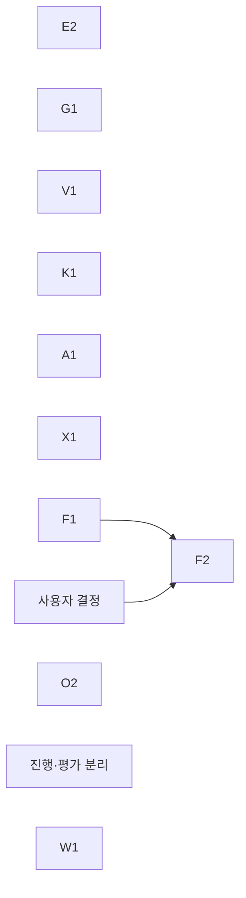

# 판단 상태의 정합성·공통성·대표성·비용 계획

기준 소스 `a301a989`. 근거:
- `C9=ops/pools-deploy/deployB/control-379-overload-admission-20261112` (admission 적용 후 첫 실측. Reject·Delay 두 Run, `final-report.md`)
- `C8=ops/pools-deploy/deployB/control-378-system-reaction-20261111/rerun-adaptive`, 저장 journal `native-scheduler-catalog-replay.tar.gz`
- 분석 스크립트 `ops/pools-deploy/intent/decision-fidelity-20261112/*.py`. 수치는 독립 검증에서 다시 계산했다. 요청 원문(`requests.jsonl.gz`)은 누적 snapshot이므로 stage client requestID cohort와 결합하고 native supplement를 병합한 뒤, 실행 batch는 `(instance, batchID)`로 중복 제거했다.

## 1. 문제 정의

CHILL은 허용 자원 안에서 서비스별 설정 분위수 E2E SLO를 충족하는 배치를 고르고, 충족 후보 중 에너지를 최소화하며, 판단과 적용을 제어 주기 안에 끝내야 한다. 판단(배치·경로·요청 admission)은 모두 CHILL이 가진 상태, 곧 실행기·노드·진행 중 동작의 관측과 profile 예측에서 나온다.

control379는 첫 60초 실패를 크게 줄였다(IC 939/762 → 0~106). 남은 실패와 비용은 판단이 쓰는 상태 자체에서 나온다. 네 가지다.

1. **상태 전이 정합성.** gateway의 실행기 상태가 제어 주기 관측으로만 갱신된다. 순간적인 관측 하나가 다음 관측까지 실행기 전체를 판단 불가로 고정한다.
2. **후보 간 공통 물리 상태.** 모델링할 수 없는 동작 하나가 현재 상태(keep)만 평가 불가로 만든다. 다른 후보는 그 동작을 갖지 않은 세계를 평가한다. 그래서 매 판단이 불필요한 전환을 낸다.
3. **측정 대표성.** profile이 실제 serving을 대표하는지 확인하지 않는다. 판단이 예측한 지연과 실제 지연이 크게 다르다.
4. **판단 계산 비용.** 판단 근거 계산이 제어 주기를 넘는다. 이번 작업(overload-admission)이 만든 회귀다.

control376~379에서 같은 구조가 반복됐다: 국소 사실 하나가 시스템 전체 판단을 막거나 틀리게 했다(376 실행 중 batch의 profile 범위 초과 → 정밀 평가 정지, 379 아래 §2). 에너지 목적 달성은 이 근거로 검증하지 않았다.

## 2. 원문으로 확인한 사실

### 2.1 control379 결과: 첫 60초 실패는 크게 줄었고, 실패가 run 중간으로 옮겨 갔다

| Run·stage | onTime 비율 | late | rejected | timeout | 첫 60초 non-on-time | 이후 |
|---|---:|---:|---:|---:|---:|---:|
| Reject excess | 98.52% | 64 | 305 | 58 | 0 | 427 |
| Reject workload | 96.43% | 49 | 356 | 623 | 106 | 922 |
| Delay excess | 99.63% | 20 | 0 | 87 | 35 | 72 |
| Delay workload | 96.97% | 79 | 0 | 794 | 0 | 873 |

(control378: 첫 60초 939/762, 이후 0/0.) 네 stage 모두 공식 SLO PASS.

### 2.2 gateway가 놀고 있는 실행기로 요청을 보내지 않았다 — 19:57:50 메커니즘 확정

gateway에서 실행기를 배정받지 못하고 최종 기한(2초)에 끝난 요청의 묶음. busy는 `[첫 timeout 요청 수신, 마지막 수신 + 2초]` 구간에서 해당 서비스 실행기의 실행 batch를 `(instance, batchID)`로 중복 제거하고 실행 구간의 합집합을 구간 길이로 나눈 값이다.

| 서비스 | 시작(UTC) | 길이 | gateway timeout | 실행기 busy |
|---|---|---:|---:|---:|
| IC | 19:57:50 | 8.0초 | 268 | 0.08% |
| IC | 20:08:35 | 10.1초 | 355 | 1.70% |
| IC | 20:34:32 | 10.1초 | 334 | 3.63% |
| IC | 20:38:18 | 8.1초 | 251 | 7.13% |
| IC | 20:41:38 | 2.1초 | 72 | 16.33% |
| PLC | 20:04:35 | 10.5초 | 139 | 0.56% |

**19:57:50 사례의 메커니즘(확정).** 19:58:01.88에 끝난 route 기록의 `actual.before.native`에 jetsonx의 직전 관측(19:57:50.448)이 남아 있다. 요청 하나가 `running`(batch 12742, 크기 1, `serviceElapsedMS=0.098`)이고 `exchangeElapsedNanos=null`, `precedingIdleNanos=null`이다.
- native는 요청을 running으로 옮긴 뒤 실행 goroutine을 시작한다. IPC 교환이 시작되기 전에는 두 IPC 필드가 비어 있다(`internal/firstfloor/scheduler.go:310-351,490-515`, `types.go:220-225`).
- admission은 running 요청의 `ExchangeElapsedNanos`가 없으면 잔여 시간을 계산하지 못하고(`internal/serving/admission.go:107-108`) 실행기 전체를 판단 불가로 둔다(`runtime.go:711-712`).
- gateway는 그 batch의 실행 완료를 받지만(`backendDone`) 저장된 `State.Native.Requests`를 고치지 않는다. 판단 불가가 다음 관측까지 이어진다.
- 실제 batch 12743은 19:57:50.495에 끝났고, 다음 batch 12744는 19:58:00.562에 시작했다. 10.07초 동안 실행기는 놀았고 IC 요청 268건이 gateway에서 기다리다 끝났다.
- profile 불일치나 잔여 시간 범위 초과가 아니다. profile은 일치하고 관측 시각도 있다. route는 관측 갱신을 일으켜 이 짧은 상태를 채집할 기회를 만든다.

다른 묶음의 조건은 아직 분류하지 않았다.

### 2.3 실패한 prepare 하나가 모든 판단에서 keep 평가를 막았다 — 확정

| Run | keep Pending | IC prepare `MissingActionInstanceState` | 그 밖 | route 완료 |
|---|---:|---:|---:|---:|
| control378 | 2 (Feasible 226, Overload 10) | 0 | 2 | 15 |
| control379 Reject | 156 | 155 | 1 | 66 |
| control379 Delay | 153 | 151 | 2 | 73 |

306/309(99.0%)가 같은 동작을 가리킨다: orangepi **IC** prepare `…target-68348c1a…/v3-orangepi-ic-rknnlite-fixed/…-2`. 이 prepare는 `partial`로 끝났고 실패 정보는 init `profile: Error (exit 1)`이다. 같은 시각 orangepi **Smol** prepare(`serving-4b806460d79a9e1b4bbb`)는 init profile이 evidence store 읽기 timeout으로 실패했다(`C9/pod-errors/0020-…`). 두 사건은 별개이고, IC prepare 실패 원인은 아직 모른다.

**비대칭이 핵심이다.** replay에서 snapshot의 미완료 동작은 keep 평가에만 들어간다(`scheduler_replay.go:480-506`, `scheduler_replay_actions.go:158-181`). 비-keep 후보는 그 동작이 없는 초기 상태에서 평가된다. 그래서 실패한 과거 prepare가 keep에만 불이익을 준다. keep이 평가 불가이니 매 판단이 비-keep target(route 하나, 기대 에너지 차이 중앙값 0 J)을 고른다. 두 target 사이를 오가며 IC 실행기의 `maxBatchSize`가 2→16→2로 바뀌었다.

### 2.4 판단이 예측한 지연과 실제가 크게 다르다 — 확정(현상), 원인 미확정

control379에서 판단이 고른 target의 IC p95 예측과 실제 완료 지연:

| | Reject | Delay |
|---|---:|---:|
| 고른 target의 IC p95 예측 p50 (ms) | 213 | 222 |
| 실제 완료 latency p95, excess / workload (ms) | 828 / 894 | 750 / 696 |
| executor 대기 p95 (ms) | 738 / 824 | 664 / 610 |

control378 완료 p95는 147/152ms였다. 처리 시간이 아니라 executor 대기가 크다. 실행기는 jetsonx IC CUDA이고 serving batch 1·2 처리 시간은 profile과 맞는다(b1 p50 31.5ms, b2 58.5ms, profile 최대 초과 0.2%/1.1%). 대기가 예측의 4배인 원인은 아직 확정하지 않았다. 후보: §2.3의 route 왕복으로 바뀐 `maxBatchSize=2`(b2 약 60ms면 처리량 약 33 req/s로 수요 약 31 req/s에 거의 포화), executor 거절 361건(Reject; gateway가 받아들였지만 executor가 기한 불가로 거절).

### 2.5 profile이 serving을 대표하는지 확인하지 않는다 — 대표성 검증 부재 확정, 인과 미확정

control378 stage cohort의 serving batch와 profile 표본(marginal 기술 통계):

| profile·batch | serving batch 수 | serving p50 / p95 (ms) | profile p50 / p95 (ms) | p50 비 |
|---|---:|---|---|---:|
| genesis2 IC CUDA b1 | 1,327 | 22.9 / 35.8 | 7.5 / 9.4 | 3.05 |
| genesis2 IC CUDA b2 | 123 | 37.0 / 62.1 | 14.0 / 16.3 | 2.65 |
| lattepanda PLC b1 | 9,868 | 3.2 / 6.0 | 2.5 / 5.1 | 1.29 |
| jetsono IC b16 | 44 | 684 / 911 | 534 / 608 | 1.28 |
| jetson-nano PLC b1 | 10,696 | 4.6 / 12.6 | 4.0 / 9.1 | 1.13 |
| rasp5 IC b1 | 35,093 | 23.5 / 39.1 | 22.0 / 30.0 | 1.07 |
| jetsono IC b1 | 17,249 | 41.3 / 69.5 | 40.7 / 61.6 | 1.01 |

- control378이 서빙한 profile 6개 중 4개는 측정 때와 다른 runtime image로 prepare됐다(genesis2 IC: 측정 `d3c5f425…`, serving `f21276eb…`). 이미지 차이가 3배 차이의 원인인지는 확정하지 않았다.
- control379 genesis2 b1은 serving batch의 21.3%(1,341/6,290)가 profile 표본 최대값을 넘었다. 이것은 service 최대값 초과이고, `conditionalService.outsideSupportQueries`(idle-gap 조건의 지원 범위 밖 질의)와는 다른 지표다.
- 예측기는 nearest idle-gap·trial 균등 가중의 조건부 분포를 쓴다. 위 표는 표본을 합친 marginal 비교라 예측 오차 자체는 아니다.
- CHILL에는 serving 결과로 profile을 확인하는 경로가 없다.

### 2.6 판단 계산이 제어 주기를 넘었다 — 확정, 이번 작업이 만든 회귀

| 단계 p50(초) | control378 | control379 Reject excess |
|---|---:|---:|
| Tick evaluate | 3.62 | 9.35 |
| search / exact / surrogate | 2.30 / 1.75 / 0.56 | 6.21 / 5.62 / 0.65 |
| rates / payback | 0.54 / 0.38 | 1.91 / 0.86 |

Tick 191/282(4 stage 합)가 10초를 넘었다. round는 `Admit` 약 1.9초가 더해져 p50 12.2초다. 30초 CPU profile(`C9/reject/evaluation-monitor/e5-feedback-excess-cpu.pb.gz`) 호출 경로 분해:
- replay admission(`admitArrivals→routeRequests`) 27.6초/68.3초 = 40.5%
- 그중 실행기 입력 판단 가능 검사(`admissionExecutorKnown`) 20.2초 = 29.6%. replay의 `prepareAdmissionInstance` 10.4초와 `beginAdmission` 9.7초에서 두 번 부른다. 안에서 running 잔여 분위수(`ResidualQuantileNanos`→`sort.Search`) 13.1초, idle 지원 검사(`QuantileNanos`) 6.4초
- 완료 projection(`projectAdmission`) 7.3초 = 10.6%

같은 입력의 조건부 분위수를 dispatch마다 다시 계산한다.

### 2.7 실패 원인을 기록하지 않는다 — 확정(진단 경로 결손)

gateway 대기 끝 timeout 행에는 대기 이유가 없다(`error=RequestTimeout`만). §2.2의 메커니즘은 route 기록에 우연히 남은 `before.native`로 찾았다. 판단은 예측을 남기지만 그 예측이 같은 조건에서 얼마나 맞았는지는 남기지 않는다.

### 2.8 아직 설명하지 못한 실패

- executor 거절 Reject 361건(excess 121, workload 240). Delay는 0.
- Delay에서 instance 배정 뒤 timeout: excess 82, workload 125(gateway-only timeout은 5, 656. workload client socket timeout 13 별도).
- late 64/49/20/79건.
- PLC Reject workload gateway timeout 139건(§2.2 PLC 묶음).

## 3. 근원 원인

| | 원인 | 상태 | 근거 |
|---|---|---|---|
| R1 | gateway의 실행기 상태가 제어 경로 관측으로만 갱신되고, gateway가 아는 사실(배정·실행 완료)로 고쳐지지 않는다. 순간 상태(pre-IPC running) 하나가 다음 관측까지 실행기 전체를 판단 불가로 고정한다 | 19:57:50 확정, 다른 묶음 미분류 | §2.2 |
| R2 | 후보들이 같은 초기 물리 상태에서 평가되지 않는다. 모델링할 수 없는 동작은 keep에만 들어가 keep 전체를 평가 불가로 만든다 | 확정 | §2.3 |
| R3 | profile이 serving을 대표하는지 검증하지 않는다 | 검증 부재 확정, 차이의 인과(이미지·조건) 미확정 | §2.4, §2.5 |
| R4 | 판단 근거 계산이 같은 입력의 분위수를 반복 계산해 제어 주기를 넘는다 | 확정 | §2.6 |
| R5 | 비-on-time의 원인과 같은 조건의 예측 오차를 기록하지 않는다(진단 경로 결손) | 확정 | §2.7 |

R2가 매 판단 route를 만들고, route가 관측 갱신을 일으켜 R1의 순간 상태 채집 기회를 만든다. route 왕복은 `maxBatchSize`도 바꿔 §2.4의 대기 증가 후보가 된다. R4는 모든 판단을 늦춰 R1의 관측을 더 낡게 한다. R5가 없으면 R1~R4의 수정 효과를 다음 Run에서 확인할 수 없다.

## 4. 수정 방향과 수준

| 원인 | 고치는 수준 | 안전 계약 | 하지 않는 것 |
|---|---|---|---|
| R1 | gateway가 소유한 사실로 실행기 상태를 갱신한다: 실행 완료·미실행 증거가 확인된 요청은 상태에서 뺀다. 관측은 정확한 물리 실행기 identity와 실제 ACK 정책에 연결하고, 그 사실과 어긋날 때만 권위로 쓴다 | HTTP timeout·전송 실패를 물리 완료로 보지 않는다. pre-IPC running을 근거 없이 queued나 idle로 바꾸지 않는다(완료 사실이 올 때까지는 실행 중). runtime·replay 입력 전이를 같은 회귀로 검증한다 | 판단 불가 실행기로 무검사 배정, 관측 주기 단축 |
| R2 | 모든 후보를 같은 초기 물리 상태에서 평가한다. 모델링할 수 없는 동작·instance는 실행 가능 용량에서 빼되 모든 후보에 똑같이 적용하고, 뺀 대상과 이유를 판단에 남긴다 | 실물 allocation·예약·outstanding·요청 모집단·owner DAG·fence·정리 의무 보존. 같은 Node의 자원·전력·전이 의존성은 영향 범위에 포함. 독립적인 배치·증설·축소·교체·routing·절전 평가는 계속한다 | orangepi 예외, 실패한 동작 자동 삭제 |
| R3 | serving batch의 service 표본을 profile 분포와 계속 비교하고 실행기·profile·batch별로 기록한다. marginal 괴리와 같은 조건(idle-gap·batch)의 예측 오차를 구분한다. service 최대값 초과와 idle-gap 지원 밖 질의를 따로 기록한다 | 측정·저장 계약 보존 | profile 수치 보정, 근거 없는 여유 계수 |
| R4 | 한 판단(한 replay dispatch) 안에서 (분포 identity, startup nil과 실제 gap 0 구분, 경과, 분위수)가 같은 계산은 한 번만 한다. 실행기 입력 검사의 이중 호출을 없앤다 | 값뿐 아니라 support·unknown 결과도 동일 | 탐색 예산·finalist 축소, replay에서 admission 제거 |
| R5 | 비-on-time 요청에 원인(gateway 대기 이유와 하위 조건, executor 거절, 실행 실패)을 남긴다. 판단마다 직전 판단 예측과, 적용 상태·horizon·요청 모집단·수요 가정이 같은 구간의 실측을 남긴다 | ADR 0019: 영향받는 저장 writer·reader·replay·조회 소비자를 같은 단위에서 전환, campaign 중 변경 금지, 과거 원문 보존 | 새 지표 체계 |

## 5. 단위와 순서

| 단위 | 내용 | 완료 기준 |
|---|---|---|
| E2 판단 계산 회귀 복구 | R4. replay admission의 실행기 입력 검사 이중 호출 제거, 조건부 분위수 계산을 판단 단위로 재사용, projection 중복 제거. 호출 경로별로 측정 | control379 판단 입력 재생에서 결과 bit 단위 동일(support·unknown 포함). exact p50 ≤ 2초는 비교 목표이고, round 전체와 적용 지연을 함께 판정 |
| G1 gateway 실행기 상태 | R1. §4 계약대로 완료·미실행 증거로 상태 갱신 | 19:57:50 상태 전이(pre-IPC running 관측 → 완료 → 다음 관측 전 dispatch)를 재현하는 회귀에서 대기 timeout 0. 기존 admission·미실행 증명·물리 점유 회귀 통과 |
| V1 다른 묶음 분류 | §2.2의 나머지 묶음과 PLC 묶음을 같은 방식(route 기록의 before.native, 관측 시각)으로 분류 | 묶음별 판단 불가 조건 기록. G1 범위 밖 조건이 나오면 계획 갱신 |
| K1 후보 공통 초기 상태 | R2. §4 계약대로 | control379 판단 입력 재생에서 keep 평가 성공. 같은 실물·정책·routing의 불필요 재적용 0(수요 변화에 필요한 전환은 유지). control376 S1 회귀 유지 |
| A1 원인·예측 오차 기록 | R5 | 합성 회귀에서 대기 이유·거절·예측 오차가 행에 남는다 |
| X1 미설명 실패 분해 | §2.4 executor 대기 4배, §2.8 항목. A1 기록이 없는 control379는 원문 결합으로 할 수 있는 만큼 분해한다 | 항목별 원인 또는 필요한 추가 기록 확정 |
| F1 대표성 측정 | R3 측정 | control378·379 원문으로 정정된 cohort 계약을 재현 |
| F2 대표성 정책 | 사용자 결정 뒤 | 결정에 따름 |
| 반응 경로 | control-reaction-plan의 O2(`Admit` 1.9초), 진행·평가 분리, W1(window 재읽기) | 각 계획의 기준 |

모두 독립으로 시작할 수 있고 F2만 F1과 사용자 결정에 의존한다. 우선순위: E2(이번 작업이 만든 회귀, 모든 판단의 주기 초과) · G1 · K1(control379 최대 실패 묶음과 route 왕복) > A1 · V1 · X1(남은 실패 확정과 다음 실측의 전제) > O2 · 진행·평가 분리 · W1(주기 초과와 반응 지연에 계속 기여) > F1 > F2.

### 사용자 결정 (F2)

serving이 profile과 다를 때 placement·capacity·gateway·executor가 그 입력을 어떻게 쓸지 일관되게 정해야 한다.
- (a) profile 유효성에 runtime 식별(이미지 digest 등)을 넣는다. 다른 이미지로 serving하려면 다시 측정한다.
- (b) F1이 괴리를 확인한 실행기·profile을 판단에서 판단 불가로 다룬다.
- (c) serving에서 관측한 service 표본을 예측에 쓴다(측정·판정 계약이 크게 바뀐다).

(a)+F1은 R3의 부분 해결이다. 같은 이미지의 serving 조건 차이(jetsono b16 1.28배)는 남는다. F2를 정하기 전에는 R3을 해결로 표시하지 않는다.

### 하지 않는 것

판단 기록 크기(M1)·메모리(M2)는 가용성·비용 항목으로 별도 진행한다. Dashboard WebSocket 403, 기존 간헐 실패 테스트는 이 계획 밖이다.

## 6. 검증

- 단위별 회귀와 같은 입력 재생. E2·K1은 control379 판단 입력, G1은 19:57:50 상태 전이로 재생한다.
- 독립 리뷰: 정확성(lock, 물리 점유, 미실행 증명, replay 일치, 후보 공통 상태)과 메모리·연산을 따로.
- gate: `make lint`, `make test TEST_PYTHON=<3.10+>`, `make test-native`, `make arch-check`, `make gopls-check`, Dashboard 변경 시 typecheck·lint·test·build.

## 7. main 실수용

control379와 같은 E5(Reject·Delay). 판정:
- Tick·round 분포(10초 초과 수), evaluate 하위 단계
- 비-on-time 요청의 원인 분포(A1), 실행기 idle 중 gateway 대기 timeout 수
- keep 상태 분포, route 수(control378 15, control379 66/73), `maxBatchSize` 변경 수
- 고른 target의 예측 p95와 실제 완료 p95, executor 대기 분포
- 실행기·profile·batch별 serving/profile 괴리(F1)
- 서비스별 onTime 비율·goodput, 에너지(전체 POOL, 같은 H의 keep·선택 후보)
