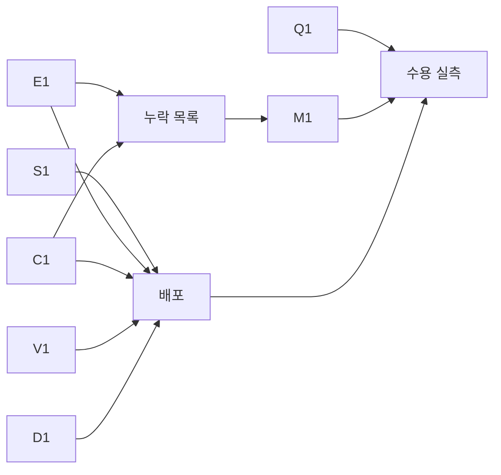

# 에너지 목적 달성 계획

기준 소스 `1da858ef`. 근거:
- `C10=ops/pools-deploy/deployB/control-380-decision-fidelity-20261112` (Reject·Delay Run). 판정: `ops/pools-deploy/intent/decision-fidelity-20261112/control380-verdict.md`
- `C9=ops/pools-deploy/deployB/control-379-overload-admission-20261112` (같은 trace·seed·SLO·최소 수요·부하)
- 노드별 실측 전력: stage별 `judge/artifacts/measured/judgment.json`의 `power.nodes[].joules`/900초. 시계열은 `scheduler-observations/*.json.gz`의 `power` 이벤트
- 판단 기록: 같은 파일의 `decision`·`snapshot` 이벤트
- 원문 집계 `census.py`와 반사실 평가 `cf-energy/`(`report.md`, `report-followup.md`, JSON, scratch test `cf_*_test.go`). 모두 `ops/pools-deploy/intent/energy-objective-20261112/` 아래에 있다. 반사실 평가는 control380 판단 입력을 같은 불변 ID의 profile 112개로 재현했다(keep 98,878.618 J, 오차 0%). 그 뒤 모델 자체 경로로 후보를 강제 평가했다.
- 독립 검증 두 건(수치 재계산, 구조 검토)의 지적을 반영했다.

## 1. 문제 정의

CHILL의 목표는 세 가지다.
1. 허용 자원 안에서 서비스별 설정 분위수 E2E SLO를 충족하는 배치를 고른다.
2. 충족 후보 중 에너지를 최소화한다.
3. 판단과 적용을 제어 주기 안에 끝낸다.

명세의 대표 표도 같은 질문을 한다: 같은 부하에서 SLO를 지키며 정적 배치보다 적은 POOL 에너지를 쓰는가(`docs/spec/README.md` 실클러스터 평가, Δ=고정−CHILL).

control374~380은 1과 3을 고쳤다. control380에서 IC의 60초 이후 non-on-time은 네 stage 모두 0이다. 2는 그동안 실측으로 검증하지 않았다.

**진짜 문제: CHILL은 정상 상태에서 에너지를 최적화하지 않는다.**
- 후보 탐색은 SLO를 충족하고 모델로도 더 싼 배치를 정밀 평가까지 보내지 못한다. keep을 충족하는 동안 준비(prepare)를 포함한 판단은 0회다. 첫 배치 뒤 CHILL은 사실상 정적 배치이고, 고를 수 있는 움직임은 제거와 경로 변경뿐이다.
- 판단이 최소화하는 에너지 항과 전환 비용은 다른 전력모드·profile의 측정을 옮겨 쓴다. 이 값이 판단의 비교 크기를 정한다.
- 판단의 에너지 예측을 실측과 대조하지 않는다. 그래서 이 상태가 여러 차례의 실측 동안 드러나지 않았다.

## 2. 원문으로 확인한 사실

### 2.1 같은 부하, 다른 배치, 실측 약 69W 차이

비교 노드는 모델이 에너지를 비교하는 8개 노드다(genesis1·orin-nano 제외). 모델 W는 판단의 `keep.expectedJoules`/600초다.

| Reject workload | IC 배치 | 모델 keep W | 실측 비교 8노드 W | 실측 genesis2 W | 전체 POOL W |
|---|---|---:|---:|---:|---:|
| control379 | jetsonx `v3-jetsonx-ic-cuda-mode-20w-6core` | 148.27 | 165.50 | 66.33 | 287.3 |
| control380 | genesis2 `seq-genesis2-ic-cuda-gpu-1500` | 164.80 | 234.95 | 131.16 | 351.3 |
| 차이 | | **+16.52** | **+69.45** | +64.83 | +64.0 |

같은 stage 짝의 비교 8노드 차이: Reject excess +54.3W, Delay excess +68.2W. control380 Delay workload는 meter 공백으로 PARTIAL이며 전체 POOL은 UNKNOWN이다.

두 배치 모두 IC SLO(p95 ≤ 1,000ms)를 충족했다. 반사실 평가에서 control379의 실제 활성 배치(`control379-live-only`)를 control380 입력에 준비 완료 상태로 옮기면 모델도 SLO 충족으로 판정한다(IC p95 222.8ms, PLC 47.6ms, Smol 789.7ms, 148.36W).

### 2.2 탐색이 더 나은 후보를 정밀 평가에 보내지 않는다

판단 target 분류(control379·380, Reject·Delay):

| Run | keep 판단 불가·target keep | keep 판단 불가·이동 | keep 충족·target keep | keep 충족·이동 | prepare 포함 |
|---|---:|---:|---:|---:|---:|
| control379 | 0 | 309 | 0 | 0 | 0 |
| control380 | 1 | 0 | 300 | 1 | 0 |

keep을 충족하는 판단 301회 중 prepare를 포함한 target은 0이다. control379의 이동 309회는 모두 keep 판단 불가 상태에서 나왔고 prepare는 없다.

control380 판단 입력(02:42:11Z)에서 탐색 경로를 추적한 결과(`cf-energy/report-followup.md` §2)는 세 가지다.

1. **fluid 근사가 전환 후보를 탈락시킨다.** `internal/serving/scheduler_state.go:150-161`의 식은 다음과 같다.
   ```text
   h = totalNanos + 1e9*route + 1e9*backlog/routingRate + serviceRateSum/routingRate
   excess = max(0, h/target − 1)
   ```
   `route`는 후보의 가장 긴 준비 시간이다. 이 항은 수요가 있는 모든 workload에 붙는다. `retainedRoutingRate`(전환 전까지 유지되는 Ready 실행기의 처리량)가 수요를 다 감당해 backlog가 0이어도 남는다. 그래서 준비 시간이 SLO보다 긴 후보는 모두 fluid 불가다. 함수 주석은 "optimistic fluid search score"인데 실제로는 정밀 평가보다 엄격하다. 정밀 평가는 기존 Ready 실행기가 전환 동안 계속 처리하는 것을 반영한다. edge IC profile을 포함한 조합 방문 수는 jetsonx 3,210회, jetsono 4,710회, orangepi RKNN 6,180회다. fluid 충족은 모두 0이다.
2. **출발점 기아.** keep 출발점이 평가 예산 500,000을 모두 썼다. empty 출발점은 방문하지 않았다. priced seed는 empty와 같아 별도 출발점이 없었다(`internal/scheduler/v2/finalists.go:192-233`).
3. **shortlist가 같은 배치의 변형뿐이다.** 정밀 평가 후보 16개는 모두 genesis2 IC를 유지하는 batch 정책 변형이다. surrogate 값이 모두 98,744.83 J로 같다.

놓친 후보의 예: IC를 orangepi RKNN으로 옮기는 후보의 fluid excess는 34.3이다(route 35.2초). 정밀 평가에서는 전환을 포함해도 SLO를 충족한다(IC p95 289.4ms). 600초 에너지는 159.0W로 keep 164.8W보다 낮다. payback과 minimumGain도 통과한다(이득 3,477.8 J > 불확실성 15.7 J). **탐색이 자기 목적에서 더 나은 해를 정밀 평가에 넘기지 않는다.**

### 2.3 에너지 항이 다른 조건의 측정을 합친다

`internal/serving/scheduler_cost_baseline.go:43-75`의 동작: 같은 노드·모드·상태의 측정(rank 0)이 없으면 같은 노드의 다른 모드·상태 측정을 옮겨 쓴다. 그것도 없으면 설정 기본값을 쓴다. 가정 문자열은 남기지만 순위 비교에 그대로 들어간다. control380 정상 상태에서 비-exact 유휴 출처는 세 노드다.
- genesis2 53.14W: 2026-10-24 `fixed` 모드 무부하 측정을 GPU_1500으로 옮김
- genesis3 50.26W: 같은 방식
- orin-nano: 설정 기본값 54W, 실측 5.5W, 비교 범위 밖

control379 초기 판단에는 jetsonx·jetsono의 `node` 출처도 있었다. POOL에서 전력이 가장 큰 두 노드가 둘 다 옮겨 온 값이다.

genesis2 IC 서빙 전력의 모델 구성:

| 항 | 값 | 출처·조건 |
|---|---:|---|
| 노드 유휴 | 53.14W | `node` 이전, `fixed` 모드, 인스턴스 없음 |
| 요청 증분 | 0.268 J/input × 32.72 req/s = 8.77W | profile `energyPerInputJoules`. GPU_1500, profile 유휴 기준 118.44W 위의 증분 |
| 모델 합 | 61.91W | |
| 실측(정상 서빙) | 131.16W | GPU_1500 |
| 실측(stage 사이 요청 없음, 02:32:30–02:34:30, 168표본) | 69.44W | GPU_1500, IC 인스턴스 적재 |

확정 사실은 두 가지다. 모델 오차가 −69.3W다. 그리고 증분 항(profile 유휴 118.44W 기준)과 유휴 항(`fixed` 무부하 53.14W)의 측정 조건이 다르다. 명세는 이 합성을 금지한다.
- `docs/spec/04_configuration_selection.md:28-31`: 근거가 없는 모드는 누락으로 공개하며 다른 모드의 값이나 0으로 채우지 않는다.
- `docs/spec/00_measurement.md:171-176`: 모델 준비 유휴와 서빙 비참여를 구분하고, 증분과 유휴를 중복·누락 없이 합친다.
- `docs/spec/00_measurement.md` 측정 설정과 실패: 없는 수치를 채워 넣지 않는다.

**[INFERENCE]** profile 유휴 118.44W와 증분을 같은 의미로 합치면 127.20W가 되어 실측 서빙 전력과 3% 차이다. 그러나 같은 노드의 무부하 적재 상태는 69.44W다. 따라서 "모델 적재 유휴"라는 이름의 두 측정이 서로 다른 상태(가속기 활성 유지 대 깊은 유휴)를 가리킨다. 서빙 중 노드 상태별 전력의 정의와 측정이 필요하다. 118.44W를 정답으로 쓰는 것은 근거가 아니다.

### 2.4 전환 비용도 다른 셀의 측정을 옮겨 쓴다

control380 입력에서 edge IC 후보가 쓰는 전환 비용 셀은 모두 `source=node`이고 exact 셀은 없다. 선택 순서는 exact → node → device class → default다.

| 대상 | 동작 | 옮겨 온 측정 | 초 | J |
|---|---|---|---:|---:|
| jetsonx IC, MODE_20W_6CORE | power | MODE_15W_4CORE→MODE_15W_6CORE | 62.4 | 597 |
| jetsonx IC, MODE_20W_6CORE | prepare | 다른 모드(15W_4CORE)의 **Smol** profile prepare | 627.8 | 6,288 |
| orangepi IC RKNN | prepare | MobileNet **CPU** profile prepare | 35.2 | 127 |

jetsonx 전환 합 690.2초는 비교 기간 600초보다 길다. jetsonx 후보는 payback 뒤에도 유지된다. 그러나 minimumGain에서 이득이 −2,263 J라 keep으로 돌아간다. 이 계산의 전환 항은 모두 옮겨 온 값이다.

### 2.5 정상 상태의 유일한 이동은 제거다

control380 Reject excess의 02:32:01 판단(`plan-fb3395b08ade`)이 유일한 이동이다. jetsono·orangepi·jetson-nano 인스턴스를 제거하고 경로를 바꾼다. 모델 절감 3.53W, route 0초다. genesis2 IC는 이동 전후 모두 존재하므로 genesis2 유휴 과소평가는 이 비교에서 상쇄된다. 이 이동의 실측 에너지 효과는 검증되지 않았다. 확정 사실은 이것이다: route가 0인 제거만 §2.2의 탈락을 피하므로 이동은 제거로만 나온다.

### 2.6 예측을 실측과 대조하지 않는다

판단 기록에는 노드별 유휴 항(`idleCosts`)은 있지만 노드별 총 예측 W(유휴 + 증분)와 동작별 예측 시간·J를 실측과 결합하는 기록·분석이 없다. 명세는 "실제 SLO와 에너지와 계산의 오차는 기존 종단 평가에서 확인한다"고 한다(`04_configuration_selection.md:43-44`). 지금까지는 지연만 확인했다.

### 2.7 수요·하한·공급

control380 02:42:11Z 판단:

| workload | 관측 req/s(60초/최근) | 최소 수요(하한) | 계획 수요 | 계획 공급(routingRate) | 공급/계획 |
|---|---:|---:|---:|---:|---:|
| PLC | 11.92 / 12.40 | 40 | 40 | 1,364.2 | 34.1 |
| IC | 32.02 / 32.70 | 20 | 32.72 | 285.0 | 8.7 |
| Smol | 0.083 / 0 | 0.3 | 0.3 | 1.7 | 5.5 |

최소 수요는 운영 설정이다. 최적화는 이 하한 아래에서 검증하며, 결과를 위해 하한을 바꾸지 않는다. 공급 배수가 하한 때문인지, 배치 단위(인스턴스 하나의 처리량) 때문인지는 이 표만으로 확정하지 않는다.

### 2.8 평가 에너지의 경계

genesis1은 판단에서 제외되는 노드다. chill-server와 부하 생성기, 그리고 개발 작업이 도는 이 작업 머신이다. control379·380 전체 POOL에는 포함된다. stage별 genesis1 전력은 control375~377 146~148W, control378~379 103~123W, control380 111~135W다(변동 45.2W). 변동을 개발 작업에 귀속하는 것은 [INFERENCE]다. 배치 효과는 비교 노드 집합으로만 판정할 수 있다.

### 2.9 판단 비용

control380 Reject Run 1,958초 중 평가가 1,388초(70.9%)다. 정상 상태 판단(Reject 103회, Delay 197회)은 모두 모델 ΔJ 0의 keep이다. §2.2 때문에 이 계산은 결과를 바꿀 수 없다. Reject excess Tick 72회 중 53회가 제어 주기 10초를 넘었다(정상 stage는 0~1회).

## 3. 근원 원인

| ID | 근원 | 확정도 | 근거 |
|---|---|---|---|
| S | 탐색이 정밀 평가가 충족으로 보는 저에너지 후보를 정밀 평가까지 보내지 못한다. fluid 근사가 기존 실행기가 처리하는 전환 구간을 모든 요청의 지연으로 계산하고, keep 출발점이 예산을 독점하며, shortlist가 같은 배치의 변형으로 찬다 | 확정 | §2.2: 방문 14,100회 중 fluid 충족 0, 정밀 평가 충족·payback 통과 후보 누락, keep 충족 중 prepare 0/301 |
| E | 에너지 항이 다른 전력모드·상태·날짜의 측정과 설정 기본값을 같은 의미처럼 합친다 | 이전은 확정. 이전이 서빙 오차의 주원인인 것은 [INFERENCE] | §2.3 |
| C | 전환 비용이 다른 model·profile·mode의 측정을 옮겨 쓴다 | 확정(edge IC 후보 셀 3/3 이전) | §2.4 |
| V | 에너지·전환의 예측을 실측과 대조하지 않는다 | 확정(기록·분석 부재) | §2.6 |
| Q | 에너지 판정 경계: 비교 노드 집합과 genesis1·PARTIAL이 섞인다 | 확정 | §2.1, §2.8 |

S는 최적화가 자기 목적 안에서도 움직이지 못하게 한다. E·C는 움직였을 때 비교하는 크기를 틀리게 한다. V가 없으면 E·C를 고친 결과가 맞는지 판정할 수 없다. Q는 에너지 판정의 선행 조건이다.

## 4. 수정 원칙과 채택한 결정

- **탐색은 정밀 평가보다 엄격하지 않다.** 정밀 평가가 충족으로 볼 후보를 근사가 탈락시키지 않는다. 출발점들은 기존 예산 안에서 모두 정밀 평가 후보를 낸다. 예산·finalist 수는 바꾸지 않는다.
- **에너지 항은 같은 측정 의미끼리만 합친다.** 노드 전체 기준 전력은 한 번만 센다. 단독 profile의 노드 전체 유휴를 더해 공존 비용을 만들지 않는다.
- **측정이 없는 셀은 채우지 않는다.** 다른 셀이나 기본값을 쓰지 않고 누락으로 공개한다. 후보 사이에 같은 미지 항은 소거한다. 비교 결과를 바꾸는 미지 항이 있으면 그 비교는 에너지 판단 불가로 기록하고, 에너지 이유의 전환은 내지 않는다. SLO 이유의 전환은 유지한다.
- **비교 기간 H(600초)는 바꾸지 않는다.** 전환은 실측 셀로 같은 H의 총에너지에서 판정한다.
- 보정 계수·여유 계수·실측 기반 사후 보정, 최소 수요 변경은 하지 않는다. 빠진 측정은 기존 측정 요청(노드 무부하·모델 적재·준비·제거·전력모드 변경)으로 채운다.
- 배포 단위: S1·E1·C1·V1·D1을 한 배포로 묶는다. S만 배포하면 이전된 값으로 움직이고, E·C만 배포하면 탐색이 여전히 움직이지 못한다. S1로 전환 후보가 정밀 평가에 들어오면 판단 시간이 늘어 목표 3을 깨므로 D1이 같은 배포에 필요하다. 오프라인 검증에서는 변경별 효과를 따로 보인다.
- **판단 비용은 결과를 바꾸지 않는 방법으로만 줄인다.** finalist 수·예산·정밀 평가 생략으로 시간을 맞추지 않는다. 선택될 수 없는 후보의 계산, 작업 배정의 꼬리, 같은 계산의 반복만 없앤다.

## 5. 작업 단위

| ID | 근원 | 변경 | 수용 기준 |
|---|---|---|---|
| Q1 판정 경계 | Q | 에너지 판정·보고를 모델 비교 노드 집합, genesis1, 전체 POOL로 나눈다. PARTIAL은 UNKNOWN으로 유지한다. campaign 중 genesis1에서 제품 외 작업을 금지하는 운영 규칙을 명시한다 | 판정 표가 세 값을 분리한다. 예측−실측 비교가 같은 노드 집합·같은 시간 구간을 쓴다 |
| S1 탐색 도달성 | S | (a) fluid 지연을 정밀 평가와 같은 모집단으로 계산한다. 정밀 평가의 Tick 고정 cohort(관측 도착 + 최소 수요 보충)를 공유하고, `a=min(route,H)`, cohort 누적 도착 `N(t)`, 단계별 마지막 도착 시각으로 준비 단계(질량 `queued+N(a)`, retained 처리량·service)와 전환 후 단계(질량 `N(H)−N(a)`, target 처리량·service)의 backlog를 마지막 도착 시각까지 계산한다. 지연은 `(B−1)⁺/처리량 + service`이고, 두 점에서 설정 분위수를 고른다. retained가 없으면 준비 단계 요청은 route를 기다린다. 모든 요청에 route를 더하던 항을 없앤다. fluid는 점 근사다: 단계 지연을 그 단계 마지막 요청의 지연으로 두므로 동시 도착 burst에서는 정밀 평가보다 엄격할 수 있고, 초기 queue의 자기 대기는 더하지 않아 낙관적일 수 있다. 그런 후보는 shortlist 순위만 밀리며 keep과 각 출발점의 끝점은 정밀 평가된다. (b) 출발점(keep·empty·priced)마다 남은 예산을 `ceil(남은 예산/남은 출발점)`으로 나누고 쓰지 않은 몫은 이월한다. deadline은 공유한다. keep이 먼저 돈다. (c) shortlist 중복 기준을 물리 배치(노드별 MaxBatch 제외 인스턴스 정규화, `Table.Placement`)로 한다. 탐색의 variant 묶음은 바꾸지 않는다 | 성질 회귀(production `p.plan`·bridge, 비균등 도착·p95 포함, burst 제외로 범위 명시): 정밀 평가 충족이면 fluid도 충족. 소규모 문제에서 탐색 선택이 전수 정밀 평가의 최적과 같다(oracle). 예산이 출발점 수보다 작아도 keep의 정밀 평가가 남는다. control380 동결 입력에서 RKNN 후보가 정밀 평가에 들어간다 |
| E1 노드 상태별 에너지 | E | 노드 전력을 상태별로 정의한다. 빈 노드는 같은 노드·모드의 무부하 측정, 인스턴스 하나는 그 상태의 직접 측정 또는 같은 모드·meter의 해당 profile 유휴 기준(요청 증분 EPI가 그 위에서 측정된 기준이므로 서빙 = profile 유휴 + EPI×요청률이 한 의미다), 인스턴스 여럿은 그 상태의 직접 측정만 쓴다. 다른 모드·상태 이전, 설정 기본값, 공존을 단독 측정 합으로 만든 값은 비-exact다. keep과 후보 사이 비-exact 항의 signed 노출(같은 참조·같은 시간)이 소거되지 않으면 비교는 `EnergyUndecidable`이고 누락 셀을 기록한다. keep이 SLO를 충족하면 그 후보는 선택되지 않고, payback의 판단 불가 비교는 미상환이다. keep이 SLO를 못 지키면 기존 순서로 회복 전환을 고른다 | 합성 회귀: 다른 모드 측정만 있는 노드는 에너지 전환을 결정하지 않고 누락 셀이 남는다. genesis2 IC 단일 인스턴스는 118.44+8.77W로 계산된다(이전 53.14+8.77W, 서빙 실측 131.2W). 같은 미지 항은 소거된다. 이전된 prepare가 있는 후보는 에너지 이동으로 선택되지 않지만 SLO 회복 이동은 선택된다 |
| C1 전환 비용 셀 | C | 같은 노드의 같은 profile(준비·제거)·같은 모드 쌍(전력모드) 셀만 쓴다. 없으면 누락으로 공개 | control380 입력에서 edge IC 후보의 누락 셀이 기록되고, 이전 셀을 쓰는 경로가 없다 |
| V1 예측-실측 기록 | V | 판단 기록에 노드별 예측 W(상태·항·출처)와 동작별 예측 시간·J를 남긴다. 평가 분석기가 다음 판단까지의 노드 실측 W, 동작 실측과 결합해 오차를 낸다. 저장 계약 변경 1회(ADR 0019) | 합성 회귀에서 행에 항·출처가 남는다. 분석기가 노드·stage별, 동작별 예측−실측 표를 낸다 |
| D1 판단 비용 | 목표 3 | S1 적용 후 control380 동결 입력의 `EvaluateScheduler`가 9.7~15.1초다(기존 5.2초). 늘어난 시간은 서로 다른 전환 배치의 실제 native replay다(jetsonx 15W 전환 후보가 각 3.5~4.9초, 고정 modulo 배정에서 같은 worker에 몰림, `projectAdmission` 48%). tested-rate 진단이 1.7초를 더한다. (a) keep이 SLO를 충족하면, 정밀 평가 전에 구조적으로 에너지 판단 불가인 후보(keep에 없는 비-exact 동작 셀 보유)는 replay하지 않고 판단 불가로 기록한다. (b) 정밀 평가 worker는 고정 modulo 배정 대신 공유 큐로, 예상 비용(`TPre`)이 큰 후보부터 가져간다. 결과 축약은 후보 순서대로 한다. (c) native admission의 batch 선택에서 같은 요청 순서 탐색을 batch profile마다 반복하지 않는다(측정으로 효과 확인 뒤 적용, 결과 동일성 회귀). (d) 판단에 쓰이지 않는 tested-rate 진단을 판단 마감 밖으로 옮길 수 있는지 소비자를 확인한다 | 같은 입력에서 선택·기록이 변경 전과 같다(동일성 회귀). control380 동결 입력 3회의 판단 시간과, 실측의 제어 주기 초과 Tick 수를 보고한다 |
| M1 필요 측정 완비 | E·C | 측정할 셀은 배포 후 판단 기록 `missingCells`의 합집합이다. control380 동결 입력에서 E1·C1 코드가 낸 셀: genesis2 `GPU_1500` 무부하 node-wall, genesis3 `GPU_1500` 무부하 node-wall, genesis2 IC+PLC 공존 적재 node-wall, genesis2 `seq-genesis2-ic-cuda-gpu-1500` 제거, genesis3 `seq-genesis3-smol-cpu-int8-gpu-1500-obr-20261106` 제거, genesis2 `seq-genesis2-plc-cpu-gpu-1500` 준비, orangepi `v3-orangepi-ic-rknnlite-fixed` 준비, orangepi `seq-orangepi-smol-cpu-int8-fixed` 준비(`fixed`), jetsonx 무부하 `MODE_20W_2CORE→MODE_20W_6CORE` 전력모드 변경, jetsonx `v3-jetsonx-ic-cuda-mode-20w-6core` 준비. 기존 측정 요청으로 측정한다. 운영(main) | 검증 경로 비교에 필요한 셀이 모두 측정됨. 배포 후 판단 기록의 `missingCells`가 비교를 막으면 수용 실측 결과는 **blocked**다 |



## 6. 수용 기준

**오프라인(동결 입력, 배포 전)**
- control380 동결 입력: RKNN 후보가 정밀 평가에 들어간다. 에너지 항이 측정된 상태에서 선택이 같은 H의 총에너지 최소 후보다.
- S1 oracle 회귀 통과. 변경별 효과(S1만, E1·C1만, 전체)를 따로 보고한다.

**실측(같은 E5 trace·seed·SLO·최소 수요, M1 완료 뒤)**
- **에너지(합격 조건):** 같은 시작 배치를 고정한 정적 stage(자율 제어 끔)와 CHILL stage의 전환 포함 **전체 POOL** 총에너지를 비교한다. 전체 POOL에는 genesis1의 제품 제어 비용이 들어간다. CHILL이 SLO를 지키며 meter 오차 범위를 넘게 낮아야 한다. 비교 8노드 차이는 배치 효과 분석에 따로 보고한다. 전체 POOL이 UNKNOWN이면 판정 불가다.
- **예측 정합(합격 조건):** 에너지 이유로 전환한 판단(예측 ΔJ > 0)마다, 그 판단이 비교에 쓴 노드들의 같은 구간 예측 에너지와 실측 에너지 차이의 절댓값 합이 예측 ΔJ보다 작다. keep 판단의 노드별 오차와 동작별 예측 시간·J와 실측의 차이는 따로 보고한다.
- **SLO(합격 조건):** 서비스별 설정 분위수 충족. 60초 이후 non-on-time을 control380과 비교한다.
- **제어 주기(합격 조건):** 제어 주기를 넘긴 Tick·round가 있으면 목표 3 미달로 판정하고 판단 비용 단위를 연다. 결정 적용까지의 지연 분포를 보고하고, 비동기 준비 완료와 이번 주기의 결정 적용을 구분한다.
- keep 충족 중 prepare 포함 target의 수, 각 target의 예측 절감과 실측 절감.

## 7. 범위 밖

- profile 지연 대표성(decision-fidelity F1/F2): 사용자 보류.
- 판단 계산 비용 최적화: §2.9를 수용 실측에서 다시 측정한 뒤 정한다. 제어 주기 준수는 §6에서 판정한다.
