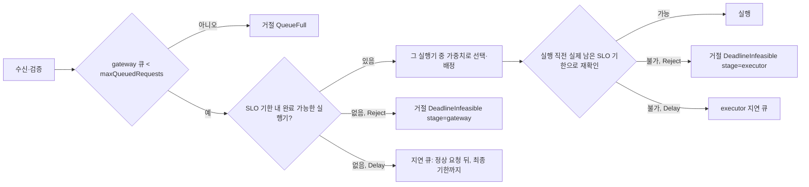
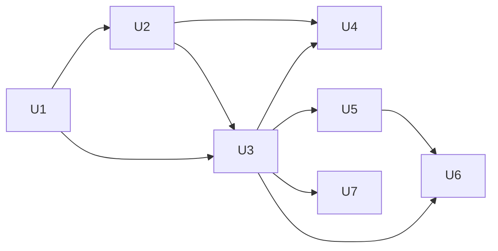

# 과부하 처리 구조: 완료 가능성 기반 admission과 기한 내 성공 지표

기준 소스 `cb733ccc`. 근거: [control-reaction-plan](control-reaction-plan.md) §2.1, control378 원문 `ops/pools-deploy/deployB/control-378-system-reaction-20261111/rerun-adaptive`.

## 1. 문제

control378 IC 과부하 구간(excess 2.5–30초)에서 jetsono는 쉬지 않고 batch 39개(요청 624개)를 실행했지만 SLO 1초 안에 끝난 요청은 0개였다. 218개는 실행 전에 lifetime이 만료됐다. 처리량 22.5 req/s, 수요 약 31 req/s로 부족분은 약 28%였지만 SLO 실패는 100%였다.

원인은 SLO를 지킬 수 없는 요청이 실행 자원을 쓰는 구조다.
- gateway dispatch는 readiness·capacity·가중치만 보고 완료 가능성을 보지 않는다(`internal/serving/runtime.go:540-605`).
- executor의 기한 정책(`drop`·`defer`·`keep`)이 profile 측정 조건에 묶여 있고(`kube/scheduler_operations_launch.go:431-433`, `operations/operations_routing.go:72-75`, `scheduler_replay_actions.go:122-128`), IC profile은 모두 `keep`이다. `keep`은 SLO를 넘긴 요청도 실행한다.
- 집계는 거절을 성공으로 세지 않지만(`hack/evaluation/request_analysis.py:87-104`), 늦은 완료·거절·timeout을 구분하지 않는다. 관측 latency 분포는 빠른 거절을 유한 표본으로 섞는다(`internal/serving/observation/observation_log_reduce.go:75-98`).

## 2. 목표 구조

참고: Clockwork(OSDI 2020) §4.1·4.4·5.3, Triton `ModelQueuePolicy`(REJECT·DELAY·`max_queue_size`), Ray Serve `max_queued_requests`, Google SRE SLI 정의. Triton 정책의 기준은 큐 timeout이고, CHILL은 SLO 완료 가능성으로 판단한다.

### 2.1 두 기한

| 기한 | 출처 | 용도 |
|---|---|---|
| SLO 기한 | `receivedAt + slo.targetLatency` | 완료 가능성 판단, 기한 내 성공 판정 |
| 최종 기한 | 수신 시 확정한 `Receipt.Deadline`(Workload lifetime, header override, fallback 적용 결과. `httpapi/handler.go:534-542,633-648`) | 요청 종료(timeout). 실행 중인 연산은 강제 중단하지 않고 물리 완료까지 점유를 추적한다(기존 계약 유지, 강제 중단은 범위 밖) |

두 값은 이미 Workload API에서 분리돼 있다(`api/v1alpha1/workload_types.go`). 이 작업은 판단 지점마다 어느 기한을 쓰는지 고정한다.

### 2.2 서비스별 과부하 정책

Workload `spec.admission`(새 필드, Definition에 동결):

| 필드 | 값 | 의미 |
|---|---|---|
| `policy` | `Reject`(기본) | SLO 기한 안에 완료할 수 없다고 판단한 요청은 실행하지 않고 명시적 사유와 함께 거절한다 |
| | `Delay` | 기한을 지킬 수 있는 요청을 먼저 처리하고, 이 요청은 뒤로 미뤄 최종 기한까지 처리한다. **늦은 완료를 허용하는 정책이다** |
| `maxQueuedRequests` | 양의 정수, 기본 1024 | gateway에서 배정을 기다리는 요청(정상·지연 큐 합) 상한. 가득 차면 새 요청을 거절한다 |

- 정책은 서비스(SLO 소유자)의 운영 규칙이다. profile 측정 조건에서 분리한다. profile의 service 분포는 정책과 무관하게 그대로 쓴다(과부하가 아닐 때 정책별 실행은 같다. 성능 조건 grouping은 이미 정책을 제외한다: `internal/profiling/derivation/curve_plan.go:446-488`).
- 정책은 요청 단위로 executor에 전달한다. 한 instance가 여러 Workload를 섬겨도 각 요청이 자기 정책을 따른다. 정책 변경에 executor 재시작이 필요 없다.
- 전역 `--queue-limit`(`cmd/chill-server/options.go:138`, Helm `charts/chill/values.yaml:530`)은 `maxQueuedRequests`로 대체하고 삭제한다.
- native `maxQueueSize`(instance 전체 큐)와 native HTTP admission semaphore(`internal/firstfloor/scheduler.go:505-514`, `server.go:101-109`)는 별도 물리 상한으로 유지한다.
- executor 측정 계약(`ModelSpec` firstfloor `deadlinePolicy`, frozen RunConfig)은 측정 provenance이므로 그대로 둔다. serving 경로에서 profile 정책을 쓰는 코드와 불일치 검사는 삭제한다.
- fixed-batch instance는 SLO 판단을 하지 않는 기존 예외를 유지한다(`docs/spec/scheduler/SRS.md:158`). gateway 완료 가능성 필터에서도 같은 예외로 다룬다(판단 없이 후보에 남긴다).

### 2.3 요청 처리

**앞단(gateway, `runtime.go` `chooseLocked`·`dispatchLocked`).** 후보 실행기마다 예상 완료 시각을 계산해 SLO 기한 안인 실행기만 남기고, 그 안에서 기존 SWRR로 고른다.

완료 시각 예측:
- 물리 capacity 판정은 기존처럼 instance `outstanding`으로 한다. 완료 시각 예측에는 쓰지 않는다(running·전송 중·응답 대기가 섞여 있다).
- 예측 대상은 그 실행기의 요청 집합이다: 관측 native 요청(phase·Workload·Definition·SLO·deferred 상태·`PrecedingIdleNanos`·`ExchangeElapsedNanos`)과 아직 관측되지 않은 assignment, 그리고 이 요청. 관측 snapshot의 나이만큼 시각을 진행시킨다.
- 이 집합을 공유 `ChooseBatch`(같은 Workload·Definition 호환성, EDF, deferred FIFO, batch 선택, fill 대기)로 결정적으로 진행시켜 이 요청이 끝나는 시각을 얻는다. batch 처리 시간은 profile `ServiceDistribution`의 SLO percentile 값이다.
- 실행 중 batch는 BatchID로 한 번만 센다. 남은 시간은 경과 시간 조건부(생존) 분포의 SLO percentile이다(기존 `SampleResidual`과 같은 조건화, `service_distribution.go:203-280`). 관측 경과가 profile 지원 범위를 넘으면 그 실행기는 판단 불가로 둔다.
- 응답 reserve는 수락 때 고정한 `completionMarginMS`(POST reserve)다.
- 이 값은 단계별 분위수를 이어 붙인 **판단 규칙**이며 E2E 완료 시간의 분위수 보장이 아니다. 최종 판단은 executor 재확인이 한다.
- 계산은 runtime과 replay가 공유하는 함수 하나로 둔다(`internal/serving`).
- 판단 입력(profile 분포·정책·관측 상태)이 없는 실행기는 후보에서 뺀다. 남은 후보가 모두 판단 불가이면 완료 불가와 구분한 `AdmissionUnknown` 상태로 최종 기한까지 큐에서 기다린다. runtime과 replay가 같은 규칙을 쓴다. 조용한 근사나 무검사 배정은 하지 않는다.
- 완료 가능한 실행기가 없음과 물리 capacity 없음을 구분한다. capacity가 없으면 기존처럼 큐에서 기다린다.
- Delay 요청은 지연 큐로 옮긴다. 한 dispatch 호출 안에서 공유 실행기로 갈 수 있는 모든 Workload의 정상 요청을 먼저 처리한 뒤, 지연 요청을 예상 완료가 가장 이른 실행기에 배정한다. 정상 유입이 계속되면 지연 요청은 굶을 수 있고, 최종 기한에 기존 `RequestTimeout`으로 끝난다. aging·quota 설정은 두지 않는다. 큐 순회는 한 dispatch 호출에 큐 길이만큼으로 제한한다.
- 지연 큐는 기존 gateway 큐 소비자 전부에 연결한다: 취소·timeout, retirement 때 accepted route 보존(`retainAcceptedRoutesLocked`), `StopSchedulerInstance`, snapshot `QueueOrder`·pending 집계(`runtime_scheduler.go:332-401,489-499`), replay 복원.

**실행 직전(executor, `internal/firstfloor`).** batch 확정 직전에 최신 monotonic 시각으로 각 요청의 취소·최종 기한을 검사하고, 정상 요청의 실제 남은 SLO 예산을 다시 계산한다(`ChooseBatch`, `policy.go:61-68,138-217` 재사용). 만료 요청을 제거하면 batch를 다시 고른다. 현재 `expireQueued`는 `startBatch` 진입 전에 한 번만 돌고 `startBatch`는 고정 `now`를 쓴다(`scheduler.go:204-211,373-482`). profiling 분기는 그대로 둔다. 불가능한 요청은 그 요청의 정책을 따른다: Reject는 실행 없이 종료(기존 drop 경로), Delay는 executor 지연 큐(기존 defer 경로). 실행 중인 batch는 선점하지 않는다.

**거절 응답.** 과부하 admission 거절은 같은 구조를 쓴다(인증·입력 오류 계약은 그대로): `code`(`QueueFull`·`DeadlineInfeasible`), `stage`(`gateway`·`executor`), `policy`, `predictedCompletionNanos`(gateway 판단 시), `remainingSLONanos`. executor 거절은 기존 미실행 증명(`internal/serving/firstfloor/client.go:275-290`)을 유지해 timeout과 구분한다. HTTP: `QueueFull` 429(기존), `DeadlineInfeasible` 503. 현재 `SLODeadlineDrop`(408, timeout으로 분류)은 `DeadlineInfeasible`로 대체한다(`path_timing.go:92` 소비자 포함). native queue-full도 `QueueFull stage=executor`로 전달한다. actor queue-full은 검증된 요청 identity·미실행 증명으로 처리한다. HTTP semaphore의 pre-decode queue-full(`internal/firstfloor/server.go:101-115`)은 native가 요청을 아직 모르므로 명시적 미접수 응답으로 검증하고, gateway가 그 exchange의 동결 Dispatch identity·policy로 정규화한다. 없는 native progress는 합성하지 않는다. native lifetime timeout은 `BackendUnavailable`이 아니라 명시적 `RequestTimeout`으로 변환한다(`firstfloor/client.go:231-260`, `runtime.go:634-638`). 429·503 모두 평가에서 실패로 남고 자동 재시도는 추가하지 않는다.

### 2.4 계획기 replay 일치

replay는 runtime과 같은 규칙으로 예측해야 한다(`docs/spec/scheduler/SRS.md:119`).
- dispatch 후보 필터에 공유 완료 가능성 함수를 쓴다(`scheduler_replay_requests.go:183-231`). gateway 큐 상한, Reject·Delay 분기, executor 재확인(기존 `ChooseBatch`, drop/defer 모델 `:295-421`)을 요청 정책으로 연결한다.
- 결과를 `onTime`·`late`·`rejected`·`timeout`·`failed`·`unfinished`로 분리한다. 거절은 `timeout`으로 세지 않는다.
- SLO 판정(`feedback_evaluate.go:92-143`)은 그대로다: 전체 모집단 분위수, 완료가 아닌 결과는 +Inf. 늦은 완료는 유한 표본이므로 분위수에서 이미 실패한다.
- 불충족 후보 순위(`scheduler_capacity_evaluate.go:430-488`)의 첫 기준을 `FailureFraction`에서 `1 − onTime/모집단`(오름차순)으로 바꾼다. SLO 충족 판정과 충족 후보의 에너지 우선은 그대로다. 현재 기준은 전부 늦게 완료하는 후보를 일부 거절하고 나머지를 제때 끝내는 후보보다 앞에 둘 수 있다. 계획 목적(설정 분위수 SLO 충족)은 기한 내 성공 비율로 정의되므로 같은 목적의 순위다.
- 거절된 요청도 다음 판단의 수요로 남는다. 기존 `Compute=true`로 보존하고, gateway 거절에 `Accepted=true`를 꾸며 넣지 않는다(`scheduler_replay.go:562-569`).
- 정책 소유 이동에 따라 replay 정책 생성(`scheduler_validate.go:262-270`)과 SLO wake(`scheduler_replay.go:693-699`)는 요청별 동결 정책을 쓴다. admission 정책·상한을 `CapacityInput`(`capacity.go:27-46,98-107`)과 재사용 키(`feedback_rates.go:40-41`)에 넣어 정책 변경 뒤 이전 capacity row를 재사용하지 않게 한다.

### 2.5 지표·평가

정의(Google SRE SLI):
- **평가 대상 요청**: stage 부하 구간에 예정된 offered 요청 전체(기존 동결 trace).
- **기한 내 성공**: client 전체 응답 2xx, server final `completed`, `executionComplete`, client 측정 지연 ≤ SLO target.
- **기한 내 성공률** = 기한 내 성공 / 평가 대상 요청.
- **Goodput** = 기한 내 성공 / 부하 구간 길이(req/s). 부하 구간에 도착한 요청 cohort 기준이며, 그 cohort가 drain 중 기한 안에 끝낸 성공도 분자에 넣는다. 최종 분모는 Workload별 부하 길이, 잠정 분모는 같은 cohort cutoff(`closed_through`)까지의 길이다.
- 결과 분류(상호 배타, 합 = 평가 대상): `onTime`, `late`(완료했지만 SLO 초과), `rejected`(사유별), `timeout`(최종 기한), `failed`(실행·전송 실패), `incomplete`(발행 안 됨·결과 없음·수집 손실·충돌 증거). `onTime`·`late`는 모두 client 2xx·server `completed`·`executionComplete`를 요구한다. HTTP timeout 뒤 native 완료는 late 성공으로 바꾸지 않는다. client socket timeout과 server 최종 기한 timeout은 원인별로 구분한다.
- 완료 요청 latency 분포(p50·p95·p99·max)는 `onTime`+`late`만으로 따로 보고하고, 반드시 위 비율·goodput과 함께 낸다. 거절을 늘려 latency만 낮아진 결과는 개선으로 판정하지 않는다(판정은 기한 내 성공률·goodput으로만 한다).
- 정책별 거절: `policy × stage × code` 개수, 거절 요청의 gateway 대기·executor 대기 분포.
- 대기 분리: gateway 대기는 enqueue부터 dispatch 또는 큐 안 종료(거절·timeout·cancel)까지, executor 대기는 native enqueue부터 running 또는 큐 안 종료까지(native monotonic span). 수신→enqueue ingress 시간은 기존 timing으로 따로 둔다. 기존 `QueueMS`는 ingress를 포함하므로 재사용하지 않는다(`observation_records.go:38-39`). 큐에 들어가지 않은 단계는 0이 아니라 없음이다.

수집 위치:
- server final 행(`internal/serving/observation_records.go` `RequestRow`): outcome `rejected`에 거절 구조, `gatewayWaitNanos`, `executorWaitNanos`, 적용 `policy`.
- `httpapi/handler.go:582-605`: executor 거절을 `timeout`이 아닌 `rejected`로 기록.
- load generator(`load-generator/src/chill_loadgen/cli.py:87-118`): 거절 응답 body의 code·stage를 행에 보존. client outcome 계약(`http_error`)은 유지.
- 평가(`hack/evaluation/judgment.py`, `request_analysis.py`): 위 분류·비율·goodput·분포·정책별 집계. 기존 offered 분모와 성공 guard 유지. 게시 allowlist(`tables.py`)와 잠정 결과 CRD(`api/v1alpha1/evaluationstage_types.go`)까지 연결.
- 관측 조회(`observation_log_reduce.go`): latency 분포는 `completed`만, 결과 개수는 따로.
- Dashboard: 실험 결론의 결과 막대가 새 분류를 모두 표시(`features/experiments-conclusion.tsx:102-140`, 현재 `http_error` 등 누락). live board의 terminal 분모 비율은 "종료 요청 기준"으로 표기해 기한 내 성공률과 구분.

## 3. 저장 계약 (ADR 0019)

한 작업 단위에서 한 번 바꾼다: Workload CRD(`spec.admission`, applied Definition), server request row, native request·progress·오류 응답, scheduler snapshot·estimate·feedback(결과 분류·지연 큐), capacity row 입력, client 행의 거절 metadata, server-start 기록(`queueLimit` 제거), 평가 input snapshot(적용 admission·effective lifetime, `hack/evaluation/input_snapshot.py:193-200`), judgment(`e5-judgment.v4`)·summary(`e5-summary.v5`), 잠정 결과 CRD. 과거 필드 부재를 `Reject`·1024로 소급 해석하지 않는다. 이전 형식 reader·alias는 두지 않는다. campaign 사이에 배포하고 이전 형식에 기대는 작업용 객체는 정리한다. 게시된 과학 원문은 바꾸지 않는다.

설정 소유(ADR 0031): 정책과 상한은 Workload에 있고 Definition·Run 동결 기록으로 재현한다.

## 4. 구현 단위와 의존

| 단위 | 내용 | 주 파일 |
|---|---|---|
| U1 계약 | Workload `spec.admission`(enum `Reject`·`Delay`, 기본 `Reject`; `maxQueuedRequests` 기본 1024), validation, Definition projection, CRD·deepcopy 생성, 평가 input snapshot 보존. 거절 code·stage 상수. 문서(`docs/spec/03_routing.md`, `scheduler-runtime-measurement.md`), 새 ADR 0033 | `api/v1alpha1/workload_types.go`, `internal/serving/management/projection.go`, `internal/serving/types.go`, `cmd/chill-server/options.go`, `charts/chill` |
| U2 executor | native 요청에 정책 전달(`RequestContext`), serving 모드에서 요청 정책으로 drop/defer 적용, batch 시작 재확인을 최신 시각으로, 구조화 거절 응답과 executor 대기, native queue-full·lifetime timeout 구조화, serving의 profile 정책 결합·불일치 검사 삭제(launch·route·prepare contract·ACK·replay mismatch, `application/profiles.go:217-220`, `operations/static_routing.go:40`, `operations_prepare.go:203-206`). frozen 측정 `deadlinePolicy`와 `EffectiveDeadlinePolicy` 기본값은 그대로 | `internal/firstfloor/*`, `internal/serving/firstfloor/client.go`, `internal/serving/kube/*`, `internal/serving/operations/*` |
| U3 gateway | 공유 완료 가능성 함수, `chooseLocked` mask, `dispatchLocked` Reject·Delay·지연 큐와 모든 큐 소비자 연결, 큐 상한을 Definition에서, `--queue-limit`·Helm·`RuntimeConfig.QueueLimit`·기동 기록 삭제, HTTP 매핑, final 행 거절 구조·대기 분리 | `internal/serving/runtime.go`, 새 `internal/serving/admission.go`, `httpapi/handler.go`, `observation_records.go` |
| U4 replay | 공유 함수·큐 상한·요청 정책·지연 큐·결과 분리·순위 기준, 정책 생성·SLO wake·`CapacityInput`·재사용 키 | `internal/serving/scheduler_replay*.go`, `feedback_evaluate.go`, `scheduler_capacity_evaluate.go` |
| U5 평가 | 분류·비율·goodput·분포·정책별 집계, v4/v5, allowlist, 잠정 CRD | `hack/evaluation/*`, `api/v1alpha1/evaluationstage_types.go` |
| U6 조회·화면 | 관측 reduce 분리, 실험 결론 결과 막대, live 표기 | `internal/serving/observation/*`, `chill-dashboard/*` |
| U7 load generator | 거절 code·stage 보존 | `load-generator/*` |

U3는 U2의 executor 거절 응답 계약을 쓰므로 U2 뒤다. U5·U7은 U3의 final 행·응답 body 계약이 정해지면 병렬로 간다.

## 5. 검증

- **과부하 재현 회귀(핵심 수용 기준).** 실제 measured batch 크기별 service 분포(jetsono IC profile)와 fill 조건을 쓰는 dynamic fixture에 31 req/s, SLO 1초, lifetime 2초를 30초 넣는다. arrival trace·service sample 순서와 seed·POST reserve·초기 상태·판정 시각을 동결한다. 변경 전·Reject·Delay의 예상 outcome 개수와 허용 오차를 fixture에 수치로 적고 assert한다. runtime·replay 개수 일치는 같은 가상 시각과 같은 service sequence에서 검사한다. 허용 기준:
  - 변경 전 코드: 기한 내 성공이 0에 가깝다(control378과 같은 모양). 이 fixture가 원래 결함을 재현함을 먼저 보인다.
  - Reject: 기한 내 성공 수가 변경 전보다 크고, 실행된 요청 중 SLO 초과 비율이 작다. 거절은 성공으로 세지 않는다. 기대 비율(처리량/수요)은 batch fill과 작은 batch 성능을 무시한 상한 가설이며 판정 기준이 아니다.
  - Delay: 결과가 onTime·late·timeout으로 분류되고 합이 offered와 같다. Reject와의 우열은 단정하지 않는다(지연 batch 실행 중 도착한 정상 요청이 막힐 수 있다).
  - runtime과 replay가 같은 입력에서 같은 결과 분류 개수를 낸다.
- 단위별 회귀: 완료 가능한 실행기 선택, 전부 불가 시 Reject·Delay, Delay 뒤 정상 요청 우선(공유 실행기의 다른 Workload 포함), 지연 batch 실행 중 정상 요청 도착, 혼합 Workload·정책, residual 지원 범위 초과, 판단 입력 누락(`AdmissionUnknown`), 큐 상한 경계, executor 재확인 거절의 미실행 증명, batch 확정 직전 만료 제거, native queue-full·lifetime timeout 분류, 최종 기한 timeout과 실행 중 점유 유지, 정책 변경 시 재시작 없음.
- 평가: 혼합 결과(onTime·late·rejected·timeout·failed·incomplete) 합 = offered, 거절만 늘린 입력이 latency는 낮아도 성공률·goodput이 낮게 나오는 회귀.
- 기존 회귀 중 정책 결합을 고정하던 것(`scheduler_deadline_test.go`, `worker_test.go:628-685`의 live 정책 변경 거부, `client_test.go:99-143`)은 새 계약으로 갱신한다.
- 독립 리뷰: 정확성(lock·점유·미실행 증명·replay 일치)과 메모리·연산(dispatch 경로 비용)을 따로.
- gate: `make manifests generate`, `make lint`, `make test TEST_PYTHON=<3.10+>`, `make test-native`, `make arch-check`, `make gopls-check`, `make helm-lint helm-template`, Dashboard typecheck·lint·test·build.

## 6. main 실수용

control378과 같은 E5, IC Workload `admission.policy=Reject`. 판정: 과부하 구간 기한 내 성공률·goodput, 결과 분류(offered 합 일치), 완료 latency 분포, 정책별 거절 사유·대기 분포, 첫 60초 실패 수(control378 939). 같은 조건 `Delay` 한 번으로 늦은 완료 비중을 비교한다.

## 7. 구현 중 확인한 사실: profile과 실제 serving 처리 시간 차이

완료 가능성 판단(gateway 예측·executor 재확인)과 계획기 replay는 모두 profile의 service 분포를 쓴다. control378 jetsono IC에서 둘이 크게 다르다.

| 항목 | batch 16 처리 시간 |
|---|---:|
| profile `chill-system/seq-jetsono-ic-cpu-mode-15w/9d509455…`, nearest busy-gap 분위수 | 0.503초 (capacity 31.8 req/s) |
| control378 excess 2.5–30초 실제 batch 39개(native running→finished) 중앙값 | 0.690초 (preprocess 303ms + backend 351ms, 지속 22.5 req/s) |

실제가 약 37% 길다. 근거: `ops/pools-deploy/intent/overload-admission/jetsono-ic-control378-excess-batches.json`, `jetsono-ic-profile-catalog-row.json`.

영향:
- 계획기는 jetsono 한 instance가 31 req/s를 감당한다고 보았을 수 있다. control378 첫 판단의 미증설(control-reaction-plan §2.3 D0)과 연결될 가능성이 있다 [INFERENCE].
- admission은 profile 기준으로 판단하므로, 실제 처리가 더 느리면 완료 가능하다고 보고 받아들인 요청이 SLO를 넘길 수 있다. executor 재확인도 같은 profile을 쓰므로 이 오차를 잡지 못한다.

이 작업은 admission 구조를 profile과 일관되게 구현하고 검증한다(과부하 fixture는 profile 처리 시간으로 control378의 과부하 비율 1.38을 재현한다). profile–serving 차이의 원인(측정 조건, preprocess 경합, 전력 모드)은 별도 단위로 조사한다. 실측(§6)에서 실행된 요청의 SLO 초과 비율이 이 차이의 크기를 보여 준다.
