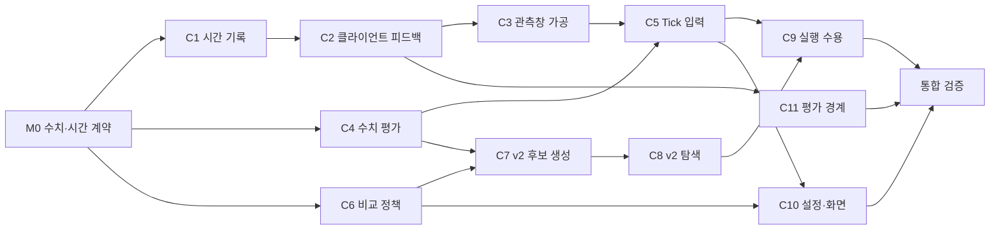

# Path-aware SLO: 구체화·구현 계획

기준: [문제 정의](path-aware-problem-statement.md), [2차 답안](path-aware-design-answers-draft.md).
출발 소스: Before `517fe0175d80d23611ca25385fe3849681e8364e`.
상태: 계획. 코드 롤백·구현·배포는 아직 수행하지 않았다.

## 1. 구현할 동작

최근 비연산 지연을 관측창에서 가공하고, 매 Tick의 κ·배치 판단에 반영한다. 기존 v2를 기반으로 SLO 충족 배치는 에너지로, 미충족 배치는 지연 개선으로 비교한다. Workload 우선순위는 SLO 초과 기준과 사용자 설정 순위 중 선택한다.

장치·경로 조합별 원인을 세부 모델링하지 않는다. 실시간 피드백과 원표본 가공에 책임을 모으며, 관측 부족을 이유로 새 제어 대기 게이트를 추가하지 않는다.

## 2. Before에서 확인한 구현 공백

| 공백 | 계획에 미치는 영향 |
|---|---|
| 클라이언트 RTT는 load-generator JSONL에만 있고 온라인 Tick으로 들어오지 않음 | 클라이언트 관측을 기존 요청 기록에 연결하는 수집 경계가 필요하다. |
| 현재 evaluation의 SLO 시간은 서버 final의 `elapsedNanos` | 새 클라이언트 E2E 정의에 맞춰 평가와 표시도 함께 바꾼다. |
| κ는 SLO 충족 처리율이며 실제 지연값이 아님. 실패 replay는 `-1`, 일부 κ=0 행은 Grid도 없음 | 미충족 후보의 지연 개선을 비교할 자료와 계산을 추가해야 한다. |
| `ZeroCapacity` 후보 제거, κ 중심 후보 축약, 미충족 retire 거절이 존재 | 마지막 비교기만 바꾸지 않고 후보 생성부터 실행 수용까지 연결한다. |

## 3. 첫 작업: 수치·시간 계약 확정 — M0

구현에 앞서 아래 다섯 항목을 하나의 짧은 수치 설계로 완성한다. 이는 개발 순서이며 운영 중 새 검증 게이트가 아니다.

### 3.1 시간 회계와 클라이언트 보고

- 클라이언트 전송 시작·수신 완료, 서버 수신·응답, Worker 처리의 측정 위치를 고정한다.
- 같은 요청의 클라이언트 E2E와 서버 경과시간 차이는 외부 왕복 잔여다. 이 값만으로 진입·반환 지연을 각각 알 수는 없다. TOTAL·POST 식에서 실측 구간과 모델상 배분을 구분한다.
- 클라이언트는 결과 수신 뒤 경과시간을 보고하고, 서버는 기존 RequestID로 요청 기록과 결합하는 방향을 채택한다. 실제 endpoint·필드는 기존 HTTP/API 관례에 맞춰 정한다.
- 응답을 못 받아 RequestID가 없는 실패는 클라이언트 실패로 집계한다. 서버 구간을 임의로 연결하지 않는다.
- 늦은 보고·중복 보고와 관측창 소속 기준을 정한다. 보고 도착 때문에 과거 요청의 실행 조건을 바꾸지 않는다.

### 3.2 원표본 가공과 초기 동작

기존 관측창을 사용해 Workload별 비연산 입력을 만든다. 가공식은 최근 기록의 변화와 예측 오차를 다룬다. 새 평활화 계수·신뢰수준·대기시간 설정을 먼저 늘리지 않는다.

초기 표본이 없는 동안의 값, 창이 채워지는 동안의 갱신, 실패·미완료의 포함 방법을 명시한다. 기존 고정 여유를 초기값으로 사용할지까지 이 단계에서 결정한다. 초기 변동이 반드시 사라진다고 가정하지 않고, 표본이 들어올 때 입력과 판단이 어떻게 변하는지 사례로 확인한다.

### 3.3 κ와 미충족 지연의 계산

수치 모델은 현재 부하·프로파일·비연산 입력으로 다음을 산출해야 한다.

- SLO 충족 처리 용량 κ.
- 요구 부하에서 후보 배치의 E2E 지연 및 실패·미완료 평가값.
- 후보의 기존 에너지 평가에 전달할 값.

관측 변화가 κ와 후보 평가에 연결되는 갱신식을 정한다. κ=0이어도 지연이 다른 후보를 구분해야 한다. 현재의 실패값 `-1`이나 수요/공급 비율을 실제 지연으로 재사용하지 않는다.

기존 계산 중 무엇을 재사용할 수 있는지는 이 식의 의존관계로 정한다. 매 Tick 전체 replay를 반복하거나 κ에 임의 비율을 곱하는 방식으로 먼저 구현하지 않는다.

### 3.4 비교 정책

- 전체 SLO 충족 후보를 우선하고, 충족 후보끼리는 에너지로 비교한다.
- 미충족 후보는 SLO 목표 대비 지연 초과를 비교하고, 효과가 같으면 에너지로 비교한다.
- **SLO 초과 기준:** Workload별 상대 초과를 큰 순서로 비교한다.
- **설정 순위 기준:** 사용자가 정한 Workload 순서로 비교한다.

실패·미완료를 비교값에 포함하는 방법, 같은 순위·미지정 Workload의 순서, 기본 선택값을 이 단계에서 명시한다. 그 규칙을 설정·탐색·최종 평가가 함께 사용한다.

### 3.5 M0의 완료 조건

다음 사례에서 입력, 계산값, 후보 순서, 선택 이유를 숫자로 설명할 수 있어야 한다.

1. 연산 조건은 같고 비연산 지연만 증가·감소하는 경우.
2. 모든 후보가 SLO를 넘지만 연산 지연은 서로 다른 경우.
3. SLO 초과 기준과 설정 순위 기준이 다른 배치를 선택하는 경우.
4. 표본 없음·초기 창·timeout·늦은 보고가 있는 경우.
5. 배치 변경 전후의 연산·비연산 지연 구성을 설명하는 경우.

수학적 구체화의 산출물은 가공식, κ 갱신식, 미충족 비교식, 시간 중복 없는 회계표다. 이 결과를 확정한 뒤 아래 코드 작업에 들어간다.

## 4. 책임 분리

| 책임 | 구현 위치·방향 |
|---|---|
| 클라이언트 측정·보고 | 기존 load-generator HTTP client와 공개 수집 계약. 측정과 보고 비용의 경계를 분리한다. |
| 보고 수락·기록 결합 | `serving/httpapi`, 기존 `serving/observation` 기록 경계. 인증·입력 처리는 HTTP, 요청 결합·창 조회는 observation이 소유한다. |
| TOTAL·POST 가공 | `internal/serving`의 시간 산술·관측창 가공 전용 파일. 저장소나 Kubernetes 조회를 계산식에 넣지 않는다. |
| κ·지연·에너지 평가 | Serving의 기존 수치 adapter. 프로파일·관측 입력으로 순수 평가값을 만든다. |
| 후보 탐색·비교 | `scheduler/protocol`과 `scheduler/v2`. 원표본·HTTP·Kubernetes 대신 순수 입력만 받는다. |
| Tick·실행 연결 | `serving/kube`와 Runtime. 같은 Tick의 계산 입력·결정·실행 입력을 연결한다. |
| 설정·표시·평가 | 기존 settings/API/Dashboard/evaluation 경로. 정책 선택과 연산·비연산 구성, 실제 결과를 표시한다. |

새 파일은 시간 산술, 표본 가공, 후보 수치 평가처럼 책임별로 나눈다. 기존 거대 파일에 기능을 몰거나 별도 프레임워크를 만들지 않는다. v1도 사용하는 공통 비교·admission은 v2 전용 변경과 구분해 회귀를 확인한다.

## 5. 최소 커밋 단위와 완료 확인

각 커밋은 한 동작과 그 소비자 확인을 함께 담는다. 실제 파일 목록은 M0의 I/O를 기준으로 고정한다.

| 단위 | 한 번에 바꿀 동작 | 완료 확인 |
|---|---|---|
| C1 시간 기록 | Before의 서버·Worker 기록에서 필요한 정확한 시간 경계를 보완 | 한 요청의 TOTAL·POST 회계에 중복·누락 없음 |
| C2 클라이언트 피드백 | 클라이언트 측정·보고와 기존 요청 기록 결합 | 실제 local HTTP 수신 완료값, 늦은 보고, 응답 없는 실패가 각각 기록됨 |
| C3 관측창 가공 | M0의 원표본 가공식을 기존 관측창에 연결 | 같은 원표본은 같은 입력, 창 변화가 다음 입력에 반영됨 |
| C4 수치 평가 | κ 갱신과 미충족 지연 평가에 필요한 자료·계산 구현 | κ=0인 두 후보도 지연 차이로 비교 가능 |
| C5 Tick 입력 | 가공값·수치 평가·Runtime 실행 입력 연결 | 결정 기록과 실제 신규 요청의 입력 일치, 접수된 요청 조건 보존 |
| C6 비교 정책 | 기존 settings와 순수 평가 I/O에 두 우선순위 정책 연결 | 같은 후보에서 정책에 따른 순서 차이, 설정 왕복 보존 |
| C7 v2 후보 생성 | `group/cap/cover/priced`의 κ 중심 축약·시작점을 새 목표에 맞춤 | κ=0이어도 개선 후보가 탐색에 들어옴 |
| C8 v2 탐색 | `polish/combine/finalists/funnel`의 비교·가지치기 연결 | 작은 전체열거 사례와 후보 순서 대조, 잘못된 조기 탈락 없음 |
| C9 실행 수용 | 목표 미충족과 물리 실행 불가를 구분해 admission·bridge·후처리 정렬 | SLO 미충족 개선이 정상 실행으로 이어짐. Ready·소유·요청 처리·정상 handback 보호 유지 |
| C10 설정·화면 | 두 정책 선택과 Workload 순위 입력, 연산·비연산 지연 표시 | 실제 설정 화면 저장·조회와 결정의 정책이 일치 |
| C11 평가 경계 | 기존 평가가 새 클라이언트 E2E 정의를 사용하도록 변경 | 서버 시간·클라이언트 시간 구분, 실패·timeout 포함 결과 확인 |

C7·C8에서는 기존 v2의 탐색 구조를 유지하되, 새 목적에 맞지 않는 κ 전용 축약·하한은 교체한다. C9에서는 SLO 미충족만으로 개선을 막는 조건을 고치며, 실제 소유·자원·진행 중 요청 보호는 해당 책임 경계에 남긴다.

## 6. 의존성과 분담

M0 뒤에는 관측 수집(C1~C3), 수치 평가(C4), 정책 계약(C6)을 독립 분담한다. 이후 알고리즘(C7~C8), 실행 연결(C5·C9), 화면(C10), 평가(C11)를 의존성에 맞춰 분담한다.

advisor-2가 I/O·파일 소유를 먼저 정하고 통합을 맡는다. `scheduler.go`, Runtime, 공통 protocol 등 공유 파일은 한 작업자만 수정한다. 서브에이전트는 지정 커밋 범위만 수행한다.

## 7. 통합 검증과 배포 순서

- **관측부터 실행까지:** local client 요청·피드백·관측창·Tick·v2 선택·실제 Worker 요청 입력을 연결한다. 선택 비교만 통과하고 최종 admission에서 사라지는 경우까지 확인한다.
- **목표 검증:** M0의 다섯 사례와 두 우선순위 정책, κ=0 후보 개선, 요청 동결을 확인한다. 실시간 피드백의 초기·부하 증가·감소 구간도 포함한다.
- **회귀·품질:** v1/v2 공통 소비자와 기존 안전 경계를 확인한다. 책임 분리, 중복 계산·복사, 불필요한 상태·설정·거절 조건을 검토한다. 영향 패키지 검사 후 저장소 lint/test·architecture/gopls 및 변경된 UI/생성물 검사를 통합본에서 수행한다.
- **실측:** 검증된 정확 source와 실행법을 main에 인계한다. main이 기존 공식 배포 경로로 설치하고 동일 부하에서 E2E·지연 구성·선택 배치·에너지·제어 계산 비용을 확인한다. 모델 예측과 실제 개선을 구분해 판정한다.

Before 기반 개발은 별도 작업 브랜치에서 시작한다. 현재 live를 되돌리는 작업은 별도 배포 절차로 다루며, 기존 요청·프로파일·raw·실험 결과는 유지한다. 이번 계획 작성에서는 peer 통신이나 live 작업을 하지 않는다.

## 8. 코드 확인 근거

경로는 위 Before 소스 기준이다.

- 시간·온라인 관측: `internal/serving/request_timing.go`, `observation/observation_log_scheduler.go:347`, `kube/scheduler_application_capture.go:18`.
- 클라이언트·평가: `load-generator/src/chill_loadgen/http_client.py:138`, `hack/evaluation/request_analysis.py:72`.
- κ 자료: `internal/serving/capacity.go:49–77,162–201,263–284`.
- 후보·실행 차단: `scheduler_capacity_table.go:65–66`, `scheduler_admission.go:9–23`.
- 비교·축약: `internal/scheduler/protocol/rank.go:37`, `v2/cap.go:21`, `v2/polish.go:52`.

Before 원문과 pinned gopls의 `LoadWindow` 정의, `BuildCapacityRow`·`Rank.Better` 참조를 확인했다. 이 문서는 구현·실험 완료 근거가 아니다.
