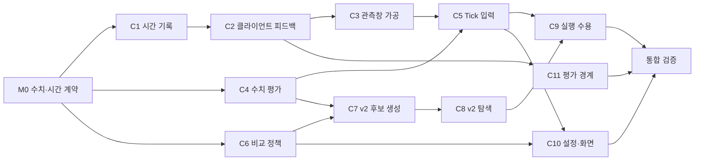

# Path-aware SLO: 구체화·구현 계획

기준: [문제 정의](path-aware-problem-statement.md), [2차 답안](path-aware-design-answers-draft.md).
출발 소스: Before `517fe0175d80d23611ca25385fe3849681e8364e`.
상태: Before 기반 구현·로컬 소비자 검증·독립 코드/자원 리뷰 완료. 실배포·실측은 main이 수행한다.

## 1. 구현할 동작

최근 비연산 지연을 관측창에서 가공하고, 매 Tick의 κ·배치 판단에 반영한다. 기존 v2를 기반으로 SLO 충족 배치는 에너지로, 미충족 배치는 지연 개선으로 비교한다. Workload 우선순위는 SLO 초과 기준과 사용자 설정 순위 중 선택한다.

장치·경로 조합별 원인을 세부 모델링하지 않는다. 실시간 피드백과 원표본 가공에 책임을 모으며, 관측 부족을 이유로 새 제어 대기 게이트를 추가하지 않는다.

## 2. Before에서 확인한 구현 공백

| 공백 | 계획에 미치는 영향 |
|---|---|
| 클라이언트 RTT는 load-generator JSONL에만 있고 온라인 Tick으로 들어오지 않음 | 클라이언트 관측을 기존 요청 기록에 연결하는 수집 경계가 필요하다. |
| 현재 evaluation의 SLO 시간은 서버 final의 `elapsedNanos` | 새 클라이언트 E2E 정의에 맞춰 평가와 표시도 함께 바꾼다. |
| κ는 SLO 충족 처리율이며 실제 지연값이 아님. 실패 replay는 `-1`, 일부 κ=0 행은 Grid도 없음 | 미충족 후보의 지연 개선을 비교할 자료와 계산을 추가해야 한다. |
| `ZeroCapacity` 후보 제거, κ 중심 후보 축약, 미충족 retire 거절이 존재 | 마지막 비교기만 바꾸지 않고 후보 생성부터 실행 수용까지 연결한다. |

## 3. 수치·시간 계약 — M0

### 3.1 시간 회계

각 경과시간은 해당 프로세스의 monotonic clock으로 측정한다.

| 기호 | 의미 |
|---|---|
| E | 클라이언트 전송 시작부터 응답 본문 수신 완료 |
| Q | 서버 접수부터 배정까지의 대기 |
| S | 서버 수신부터 실제 native 요청의 sender 동결까지 |
| N | native가 보고한 전체 처리 경과시간 |

`TOTAL = E − Q − N`, `POST = E − S − N`, `PRE = TOTAL − POST`.
따라서 `E = Q + N + TOTAL = S + N + POST`다. POST는 외부 왕복을 포함하는 회계상 여유이며, 물리적 편도 반환시간으로 표시하지 않는다. native 경과시간에는 native 내부 대기·처리가 포함된다.

클라이언트는 수신 뒤 별도 연결로 관측을 보고한다. 기존 RequestID로 결합하고 동일 보고는 한 번 집계한다. 원본은 보존한다. 결합 표본은 서버 수신시각으로 기존 관측창에 배속한다. RequestID 없는 실패는 클라이언트 실패로 남긴다.

### 3.2 관측창 가공과 요청 동결

Workload별 TOTAL·POST의 경험 분위수를 기존 SLO percentile로 계산한다. 유효 표본이 없으면 기존 `completionMarginMS`를 초기값으로 사용한다. 첫 표본부터 갱신하며 별도 표본 수 게이트를 두지 않는다.

결정에는 해당 Tick의 입력을 기록한다. 실제 요청은 접수 때 POST를 동결하고 native 호출에 실제 S와 함께 전달한다. 이후 Tick·설정 변경은 신규 요청에만 적용한다. 전체 클라이언트 실패 모집단과 시간 분해가 가능한 결합 표본 수는 따로 표시한다.

합성 요청의 계산에는 `S_model = Q_model + PRE`, 결과에는 `E_model = Q_model + N_model + TOTAL`을 쓴다. 진행 중 요청에는 실제 동결 S·POST와 native 경과·잔여시간을 사용한다.

### 3.3 처리율·탐색·최종 평가

POST는 native chooser의 배치 선택·대기·drop에 영향을 준다. 현재 조건에서 검사한 처리율 중 최대 통과값을 `κ̂`로 기록한다. 검사한 rate와 결과를 함께 보존한다. 통과값이 없는 0은 물리 처리량 0을 뜻하지 않는다.

라우팅은 기존 프로파일의 `capacityThroughput`을 상대 가중치로 사용해 먼저 구성한다. 이를 `RoutingWeight`로 구분한다. keep와 최종 선택의 현재 nominal rate만 기존 Poisson·window·percentile 판정으로 검사한다. 검사하지 않은 영역을 보간하지 않으며, κ̂ 결과를 새 실행 거절 게이트로 쓰지 않는다.

v2의 저비용 탐색→최종 후보 평가 구조를 유지한다. 탐색에서는 프로파일 가중치 μ, 최소 조건부 service·occupancy s, 현재 backlog q, 요구율 λ, 전환시간 r, 비교기간 T로 다음 heuristic을 계산한다.

```
B    = max(0, q + (λ − μ_retained) × r)
Bmax = B + max(λ − μ_target, 0) × max(T − r, 0)
h    = TOTAL + r + Bmax / μ_target + Σ(μ_i × s_i) / μ_target
e_h  = max(0, h / SLO − 1)
```

위 식의 시간 단위는 일치시킨다. h는 탐색용 근사이며 실제 E2E 예측·처리량 보장으로 표시하지 않는다. 프로파일 항은 Tick당 한 번 가공하고 move에서는 scalar 합만 갱신한다.

keep와 최종 후보는 기존 chooser·conditional raw service·seed·진행 중 요청·전환을 사용해 유한 요청 집단을 replay한다. 비교기간 이후 새 요청 없이 완료·drop·만료·미완료를 수집한다. 기존 에너지 식은 유지한다. 전체 rate grid를 매 Tick 재생하거나 move마다 replay하지 않는다.

기존 `MinimumDemand`가 관측 요청률보다 크면 비교기간의 최소 요청 수까지 균등 간격의 합성 요청만 보충한다. 모든 후보에 같은 집단을 사용한다. 실제 관측·raw는 그대로 두고 합성 수요를 구분해 기록한다.

### 3.4 비교 정책

전체 SLO 충족 후보를 먼저 고르고, 충족 후보끼리는 에너지를 비교한다. 미충족 후보의 Workload별 비교 순서는 다음과 같다.

1. 실패·미완료 비율.
2. 성공한 요청의 SLO 상대 지연 초과.
3. 앞선 결과가 같으면 실패 요청의 조건부 연산 개선 가능성.

drop된 요청에 완료시간을 만들지 않는다. 조건부 점수는 현재 실행 가능한 batch의 프로파일과 확정 대기를 사용하며, 실제 완료 예측과 구분한다. 효과가 같으면 기존 에너지·keep·결정적 key 순서를 사용한다.

`excess`는 Workload 비교값을 나쁜 순으로 비교한다. `workload`는 설정된 UID 순서를 먼저 비교하고 미지정 Workload는 같은 후순위 그룹으로 비교한다. 기본은 `excess`; 빈 순위도 같다. 저장된 미등록 UID는 보존하고 현재 판단에서 제외한다.

### 3.5 수치 사례와 완료 확인

- E120/Q20/S30/N60ms이면 TOTAL40/POST30ms다. 서버 대기가 20ms 증가해 E·Q·S가 같이 늘어도 두 여유는 변하지 않는다.
- L100ms, batch1 30ms·2J, batch2 70ms·1J, 요청 2개에서 POST10ms는 batch2의 80ms 완료를 허용한다. POST40ms는 batch1 두 번의 70/100ms로 바뀐다. 이전 완료분포에 차이만 더할 수 없다.
- L100ms/TOTAL20ms, q2, λ10/s, μ_retained10/s, r50ms, T1s에서 μ50/s·s20ms 후보의 h는130ms다. μ25/s·s40ms 후보는190ms다. κ̂가 모두0이어도 탐색이 구분하며 최종 replay가 재순위한다.
- SLO100/50ms인 두 Workload에 후보 P=110/80ms, Q=140/55ms면 `excess`는 Q, 첫 Workload 우선은 P를 고른다.
- 표본 없음·첫 표본·timeout·늦은 보고, 모든 후보의 drop, 동결 요청과 신규 요청, 실제 실행 수용까지 소비자 검사로 연결한다.

## 4. 책임 분리

| 책임 | 구현 위치·방향 |
|---|---|
| 클라이언트 측정·보고 | 기존 load-generator HTTP client와 공개 수집 계약. 측정과 보고 비용의 경계를 분리한다. |
| 보고 수락·기록 결합 | `serving/httpapi`, 기존 `serving/observation` 기록 경계. 인증·입력 처리는 HTTP, 요청 결합·창 조회는 observation이 소유한다. |
| TOTAL·POST 가공 | `internal/serving`의 시간 산술·관측창 가공 전용 파일. 저장소나 Kubernetes 조회를 계산식에 넣지 않는다. |
| κ·지연·에너지 평가 | Serving의 기존 수치 adapter. 프로파일·관측 입력으로 순수 평가값을 만든다. |
| 후보 탐색·비교 | `scheduler/protocol`과 `scheduler/v2`. 원표본·HTTP·Kubernetes 대신 순수 입력만 받는다. |
| Tick·실행 연결 | `serving/kube`와 Runtime. 같은 Tick의 계산 입력·결정·실행 입력을 연결한다. |
| 설정·표시·평가 | 기존 settings/API/Dashboard/evaluation 경로. 정책 선택과 연산·비연산 구성, 실제 결과를 표시한다. |

새 파일은 시간 산술, 표본 가공, 후보 수치 평가처럼 책임별로 나눈다. 기존 거대 파일에 기능을 몰거나 별도 프레임워크를 만들지 않는다. v1도 사용하는 공통 비교·admission은 v2 전용 변경과 구분해 회귀를 확인한다.

## 5. 최소 커밋 단위와 완료 확인

각 커밋은 한 동작과 그 소비자 확인을 함께 담는다. 실제 파일 목록은 M0의 I/O를 기준으로 고정한다.

| 단위 | 한 번에 바꿀 동작 | 완료 확인 |
|---|---|---|
| C1 시간 기록 | Before의 서버·Worker 기록에서 필요한 정확한 시간 경계를 보완 | 한 요청의 TOTAL·POST 회계에 중복·누락 없음 |
| C2 클라이언트 피드백 | 클라이언트 측정·보고와 기존 요청 기록 결합 | 실제 local HTTP 수신 완료값, 늦은 보고, 응답 없는 실패가 각각 기록됨 |
| C3 관측창 가공 | M0의 원표본 가공식을 기존 관측창에 연결 | 같은 원표본은 같은 입력, 창 변화가 다음 입력에 반영됨 |
| C4 수치 평가 | κ 갱신과 미충족 지연 평가에 필요한 자료·계산 구현 | κ=0인 두 후보도 지연 차이로 비교 가능 |
| C5 Tick 입력 | 가공값·수치 평가·Runtime 실행 입력 연결 | 결정 기록과 실제 신규 요청의 입력 일치, 접수된 요청 조건 보존 |
| C6 비교 정책 | 기존 settings와 순수 평가 I/O에 두 우선순위 정책 연결 | 같은 후보에서 정책에 따른 순서 차이, 설정 왕복 보존 |
| C7 v2 후보 생성 | `group/cap/cover/priced`의 κ 중심 축약·시작점을 새 목표에 맞춤 | κ=0이어도 개선 후보가 탐색에 들어옴 |
| C8 v2 탐색 | `polish/combine/finalists/funnel`의 비교·가지치기 연결 | 작은 전체열거 사례와 후보 순서 대조, 잘못된 조기 탈락 없음 |
| C9 실행 수용 | 목표 미충족과 물리 실행 불가를 구분해 admission·bridge·후처리 정렬 | SLO 미충족 개선이 정상 실행으로 이어짐. Ready·소유·요청 처리·정상 handback 보호 유지 |
| C10 설정·화면 | 두 정책 선택과 Workload 순위 입력, 연산·비연산 지연 표시 | 실제 설정 화면 저장·조회와 결정의 정책이 일치 |
| C11 평가 경계 | 기존 평가가 새 클라이언트 E2E 정의를 사용하도록 변경 | 서버 시간·클라이언트 시간 구분, 실패·timeout 포함 결과 확인 |

C7·C8에서는 기존 v2의 탐색 구조를 유지하되, 새 목적에 맞지 않는 κ 전용 축약·하한은 교체한다. C9에서는 SLO 미충족만으로 개선을 막는 조건을 고치며, 실제 소유·자원·진행 중 요청 보호는 해당 책임 경계에 남긴다.

오프라인 `SchedulerTargetAdmission`은 현재 입력에서 **새 전환을 시작할 수 있는지**만 판단한다. 진행 중 전환의 계속 실행·취소 권한을 대신하지 않으며, 예약·accepted 요청·target ID를 그대로 사용한다.

## 6. 의존성과 분담



M0 뒤에는 관측 수집(C1~C3), 수치 평가(C4), 정책 계약(C6)을 독립 분담한다. 이후 알고리즘(C7~C8), 실행 연결(C5·C9), 화면(C10), 평가(C11)를 의존성에 맞춰 분담한다.

advisor-2가 I/O·파일 소유를 먼저 정하고 통합을 맡는다. `scheduler.go`, Runtime, 공통 protocol 등 공유 파일은 한 작업자만 수정한다. 서브에이전트는 지정 커밋 범위만 수행한다.

## 7. 통합 검증과 배포 순서

- **관측부터 실행까지:** local client 요청·피드백·관측창·Tick·v2 선택·실제 Worker 요청 입력을 연결한다. 선택 비교만 통과하고 최종 admission에서 사라지는 경우까지 확인한다.
- **목표 검증:** M0의 다섯 사례와 두 우선순위 정책, κ=0 후보 개선, 요청 동결을 확인한다. 실시간 피드백의 초기·부하 증가·감소 구간도 포함한다.
- **회귀·품질:** v1/v2 공통 소비자와 기존 안전 경계를 확인한다. 책임 분리, 중복 계산·복사, 불필요한 상태·설정·거절 조건을 검토한다. 영향 패키지 검사 후 저장소 lint/test·architecture/gopls 및 변경된 UI/생성물 검사를 통합본에서 수행한다.
- **메모리·연산 별도 리뷰:** 독립 에이전트가 데이터·캐시·goroutine의 보유와 해제, 반복 복사·할당, Tick당 계산량을 검토한다. 필요한 부하·할당 검사를 수행하고 지적을 반영한 뒤 푸시한다.
- **실측:** 검증된 정확 source와 실행법을 main에 인계한다. main이 기존 공식 배포 경로로 설치하고 동일 부하에서 E2E·지연 구성·선택 배치·에너지·제어 계산 비용을 확인한다. 모델 예측과 실제 개선을 구분해 판정한다.

Before 기반 개발은 별도 작업 브랜치에서 수행했다. main은 검증된 통합 소스를 공식 배포 경로로 설치하며, 기존 요청·프로파일·raw·실험 결과를 유지한다.

## 8. 코드 확인 근거

경로는 위 Before 소스 기준이다.

- 시간·온라인 관측: `internal/serving/request_timing.go`, `observation/observation_log_scheduler.go:347`, `kube/scheduler_application_capture.go:18`.
- 클라이언트·평가: `load-generator/src/chill_loadgen/http_client.py:138`, `hack/evaluation/request_analysis.py:72`.
- κ 자료: `internal/serving/capacity.go:49–77,162–201,263–284`.
- 후보·실행 차단: `scheduler_capacity_table.go:65–66`, `scheduler_admission.go:9–23`.
- 비교·축약: `internal/scheduler/protocol/rank.go:37`, `v2/cap.go:21`, `v2/polish.go:52`.

Before 원문과 pinned gopls의 `LoadWindow` 정의, `BuildCapacityRow`·`Rank.Better` 참조를 확인했다. 이 문서는 구현·실험 완료 근거가 아니다.
