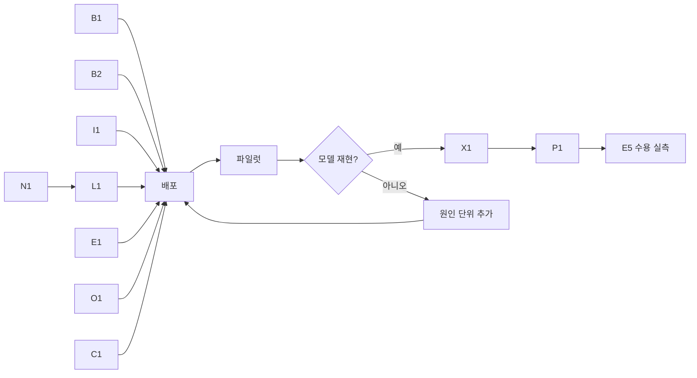

# Profile–Serving 동등성 계획

기준 소스 `40d6da58` (control382 배포본). 근거:
- `ops/pools-deploy/intent/profile-spec-20261113/report.md` (serving–profile 괴리 집계, 요청 392,430건·실행 배치 353,425개·serving profile 14개). 원자료 `data/`.
- `ops/pools-deploy/intent/profile-spec-20261113/root/` (단계별 분해. profile 원시 trial 111개 `profile-raw/`, `stage-decomposition-report.txt`, `stage-comparisons.json`, `exact-input-matched-summary.jsonl`).
- control382 보고 `ops/pools-deploy/deployB/control-382-energy-objective-20261112/final-report.md` (측정 요청 미승인, 분석기 실패).
- 명세 `docs/spec/00_measurement.md`, `docs/spec/04_configuration_selection.md`.

## 1. 문제 정의

스케줄러는 profile의 배치별 실행시간 분포와 에너지로 SLO·용량·에너지를 판단한다. 이 판단이 맞으려면 **같은 조건에서 profile과 serving이 같은 능력을 보여야 한다.** 지금은 그렇지 않다.

- genesis2 IC CUDA의 serving 실행시간은 profile의 1.8~3배다. jetsono PLC 2.9배, jetson-nano PLC 2.3배다.
- serving에 쓰인 profile 14개 전부가 측정과 다른 실행 이미지로 돌았다.
- genesis2 GPU_1500의 "모델 적재 유휴"는 profile 118.4W, serving의 요청 없는 구간 69.4W다.
- 같은 조건에서 profile과 serving을 맞춰 보는 단계가 없다.

또 측정 자체가 막혀 있다. control382에서 측정 요청 5개가 5,350초 동안 승인되지 않았다.

## 2. 원문으로 확인한 사실

### 2.1 차이는 운영점에서 생긴다

profile 원시 trial의 단계별 시간(전처리·추론·후처리·IPC 잔차)과 serving 배치 기록을 대조했다(`root/stage-decomposition-report.txt`).

중앙값 비교다. 분포 일치를 뜻하지 않는다.

| 사례 | 차이가 나는 단계·조건 | 같은 조건으로 좁히면 |
|---|---|---|
| genesis2 IC CUDA 배치 2 | 전체 배치의 추론 p50 1.2ms → 24.7~25.8ms. 실행 중 다른 요청이 들어온 배치는 추론 25.8~27.7ms, service 39.9~50.1ms | 다른 요청이 안 들어온 배치는 service p50 13.5~15.1ms, 추론 p50 1.20~1.25ms. profile 13.97ms, 1.20ms와 중앙값이 같다. 다만 이 배치들도 추론 p95가 28.7~31.3ms라 분포는 다르다 |
| genesis2 IC CUDA 배치 1 | 전처리(평균 초과분의 57~73%)와 추론(23~40%). 직전 유휴 간격 20~100ms 배치는 전처리 22ms | 유휴 간격 5~20ms 배치는 service p50 8.9ms. profile 7.5ms에 가깝다 |
| jetson-nano PLC CUDA 배치 1 | 직전 유휴 1초 이상인 배치(420개)의 추론 35.5ms | 유휴 1ms 미만은 추론 14.67ms, service 18.7ms. profile 14.64ms, 18.1ms와 중앙값이 같다 |
| jetsono PLC 배치 1 | 전처리·추론·잔차 모두. 다른 요청이 안 들어온 배치도 3.4ms (profile 1.18ms) | 실행 중 유입 하나로는 설명되지 않는다. 유휴 간격까지 맞춘 비교는 아직 없다 |
| lattepanda IC CPU, Smol | 차이 작음(1.01~1.07배) | |

- 실행 중 유입과 긴 실행의 관계는 양방향이다. 실행이 길면 그동안 다른 요청이 들어올 확률도 높다. 또 완료 기록이 없는 유입은 집계에서 빠진다. 따라서 "유입이 실행을 늦춘다"는 인과는 [INFERENCE]다.
- profile의 직전 유휴 간격은 측정 도구의 속도가 정한다. 배치·노드마다 중앙값 1~59ms, 최대 대부분 120ms 이하다. serving은 0.1ms부터 수 초까지다(`data/latency-with-conditions.json`).
- profile 측정에는 실행 중 다른 요청 유입이 없다. 요청 하나를 보내고 끝나면 다음을 보낸다(`runtime/ortcpu/runner.py:885-902`).
- 입력 부분집합 차이만으로는 설명하기 어렵다. 프로파일링·평가 부분집합에 같은 JPEG 36개가 있고, 같은 이미지끼리 비교해도 genesis2 배치 1은 1.83~2.03배, lattepanda IC는 1.04배다(`root/exact-input-matched-summary.jsonl`). 당시 측정 이미지 안의 데이터가 지금 로컬 사본과 같다는 전제는 [INFERENCE]다.
- [INFERENCE] 유휴 뒤 클럭·캐시 상태와 실행 중 수신 처리의 간섭이 원인 후보다. 확정하지 않는다.

### 2.2 실행 이미지

- 측정 이미지는 조건으로 보존된다(`internal/profiling/derivation/curve_plan.go:112`).
- profile 선택 기준이 이미지·runtime 버전을 지운다(`internal/serving/profile_selection.go:82-89`, `curve_plan.go:447-492`).
- 노드 간 재사용 비교도 이미지를 지운다(`internal/serving/kube/catalog_reuse.go:130-164`).
- serving 준비는 측정 이미지를 현재 선언 이미지로 덮어쓴다(`internal/serving/application/profiles.go:63-83`). 이를 고정하는 테스트가 있다(`profiles_test.go:185-287`).
- 명세는 같은 실행 경로·버전을 요구한다(`docs/spec/00_measurement.md:9-12, 88-93`).
- 기존 측정 이미지로는 현재 gateway가 보내는 요청을 받을 수 없다. `8b8dc7a3`이 native 요청에 `context.admissionPolicy`를 추가했고, 측정 이미지 revision(`1e31b2a0` 계열)의 요청 해석은 모르는 필드를 거절한다(HTTP 400).

### 2.3 유휴 전력

- 측정 profile 14개 중 13개의 유휴 측정은 시작 warm-up 1회 뒤 2초 정착, 10초 측정이다(`data/conditions-final.json`). 정착 시간은 이미 측정 입력이다(`runtime/ortcpu/runner.py:763-771`).
- genesis2 IC CUDA의 유휴 118.4W와 serving의 요청 없는 2분 구간 69.4W(표본 168개)는 49W 다르다.
- 증분 에너지는 이 유휴를 빼서 계산한다(`internal/profiling/derivation/derive.go:118-155`).

### 2.4 측정이 막힌 원인

- **수동 reset의 예약 반환.** reset은 `disable-autonomy → unroute → drain → remove → release → lower-power`를 한 작업으로 묶는다(`internal/serving/kube/manual_reset.go:245-300`).
  - 앞 5단계는 완료됐다. 마지막 단계만 genesis2의 현재·전환 가능 모드에서 측정 최저 모드를 고를 수 없어 실패했고(`manual_reset.go:460-461`), 작업은 `partial`로 끝났다(`manual_reset.go:335-338`).
  - 반환 association이 Pod UID 표시용 instance ID와 비어 있는 executor ID를 같은 것으로 보지 못했다. 그래서 owner 전체의 5노드 예약이 반환되지 않았다(`reservation.go:303-321, 452-526`, `operation_scope.go:42-65`).
  - reset 인계는 identity→Node 근거를 잃는다(`reservation.go:90-98`).
- **failed-start의 수동 remove.** 수동 remove는 Pod UID 표시 ID를 executor ID로 넘겨 거절됐다(`measurement_sequence.go:287-299`). 자동 경로에는 이를 바꾸는 `bindTerminatedPodRemoval`이 이미 있다(`scheduler_operations_launch.go:401-410`).
- **분석기.** `dependsOn`은 `omitempty` 없는 slice라 `null`이 유효한 빈 의존성이다(`internal/serving/scheduler.go:459-470`). `hack/evaluation/prediction_analysis.py:115-121`이 이를 목록으로 가정해 실패했다.

## 3. 근원

| ID | 근원 | 확정도 |
|---|---|---|
| R1 | profile 측정이 serving의 운영점을 재현하지 않는다. 직전 유휴 간격 범위와 실행 중 유입이 없다 | 확정(§2.1). 물리적 원인은 [INFERENCE] |
| R2 | 실행 이미지가 profile의 적용 조건에서 빠졌고, serving이 측정하지 않은 이미지로 돈다 | 확정(§2.2) |
| R3 | 유휴 전력이 serving의 유휴 상태와 다른 시점에 측정된다 | 차이는 확정, 시점 원인은 [INFERENCE] |
| R4 | 같은 조건에서 profile과 serving을 대조하지 않는다 | 확정 |
| R5 | dispatch occupancy `d`는 포화 배치의 시작 간격에서 그 배치의 실제 실행시간이 아니라 profile 전체 평균 실행시간을 뺀다(`internal/serving/occupancy_estimator.go:283-284`). 스케줄러 재생은 조건부 실행시간에 `B×d`를 더한다. profile 평균이 실제와 다르면 `d`가 틀리고, 음수는 0으로 잘린다 | 확정(코드) |
| B | 측정을 막는 결함: reset 예약 반환, 수동 remove identity, 분석기 null | 확정(§2.4) |

## 4. 책임과 원칙

**가장 불확실성이 적은 경로**: 원인을 실험으로 하나씩 분리해 모델에 반영하는 대신, **profile을 serving과 같은 실행 경로·이미지·운영점에서 측정**한다. 그러면 스케줄러의 기존 소비 모델(배치 크기와 직전 유휴 간격에 대한 조건부 실행시간 분포)에 serving과 같은 조건의 표본이 들어간다.

그러나 이 모델은 실행 중 유입이나 도착률을 조건으로 쓰지 않는다. §2.1의 genesis2 배치 2는 같은 배치 크기에서 유입 여부별 service 중앙값이 13.6ms와 40.1ms다(control380 Delay excess). 이 배치들은 거의 전부(4,924/4,939) 직전 유휴 1ms 미만이지만, 유휴 간격 구간별로 나눈 대조는 아직 없다. 그래서 운영점 측정만으로 모델이 맞는다고 가정하지 않는다. **전체 재측정 전에 대표 사례 몇 개로 파일럿을 하고, 측정 자료 일부를 떼어 두어 모델이 그 실측을 재현하는지 확인한다.** 맞지 않으면 그 원인(측정 조건 또는 소비 계약)을 고친 뒤 확대한다. 이 판단은 측정 비용을 쓰기 전에 끝난다.

| 주체 | 책임 | 하지 않는 것 |
|---|---|---|
| Profile(측정) | 선언한 조건(노드·전력모드·실행 이미지·모델·배치)에서 serving과 같은 실행 경로로, serving이 만드는 직전 유휴 간격·실행 중 유입 범위를 덮는 표본과 노드 전력을 측정해 공개한다. 측정 조건을 결과와 함께 동결한다 | 스케줄러 모델에 맞춘 가공, 다른 조건 값의 대입 |
| 스케줄러 | 실제 instance 조건과 같은 조건의 profile만 쓴다. 그 분포로 SLO·용량·에너지를 계산한다. profile이 없으면 후보가 없다 | 조건이 다른 profile의 차용, 보정 계수 |
| Serving | 측정된 조건(실행 이미지 포함)으로만 실행한다 | 측정하지 않은 이미지로 준비 |
| 평가 | 같은 조건에서 serving 실행시간·노드 전력과 profile을 대조해 보고한다 | 대조 결과로 profile 값을 고치기 |

원칙:
- 측정 경로는 serving 경로다. 실행기 서버의 serving 요청 경로, 대기열, 배치 실행, IPC를 그대로 쓴다. 측정 전용 `/profile` 경로와 요청 하나씩 넣는 방식은 지운다.
- 부하는 DOM과 같이 실제 gateway Pod의 노드에서 네트워크로 보낸다. 임의의 다른 노드를 고르지 않는다. 기존 설치 identity로 gateway의 실제 배치를 읽고, 선택한 노드와 Pod identity를 Run evidence에 동결한다. 측정 노드와 같거나 배치가 불명확하면 실패한다. 측정 노드·edge 노드에 부하 생성 프로세스를 추가하지 않는다.
- 측정 부하 구성(포화 측정, 이용률 단계, 드문 도착 단계, 유휴 정착 시간)은 측정 입력 설정이다. Run에 동결한다. 스케줄러 설정이 아니다.
- 스케줄러의 소비 계약(배치별 `ServiceSamples`·직전 유휴 간격·`EnergyPerInputJoules`·`IdleBaselineWatts`·`d`)은 파일럿이 맞다고 보이는 한 바꾸지 않는다. 표본의 대표성만 바꾼다. 파일럿이 계약의 부족을 보이면 계약을 바꾸는 단위를 이 계획에 추가한다.
- 기존 profile은 모두 지운다. 측정 이미지로 현재 계약을 실행할 수 없고(§2.2), 측정 운영점이 다르다(§2.1). 지우기 전에 원시 evidence를 보관한다. 이전 profile을 새 profile로 바꿔 읽는 reader는 두지 않는다(ADR 0019). 삭제는 파일럿 확인 뒤에 한다.
- 보정 계수, 허용 오차 조정값, serving 표본을 profile에 섞는 방식, 단계 비중 조정은 쓰지 않는다.

## 5. 작업 단위

| ID | 근원 | 변경 | 수용 기준 |
|---|---|---|---|
| B1 reset 예약 반환 | B | (a) 수동 remove에도 `bindTerminatedPodRemoval`을 적용한다. (b) scope 계산에서 Pod 표시 ID(`ID==PodUID`, executor 미생성)를 executor 책임으로 만들지 않는다. (c) reset 인계 때 identity→Node 근거를 보존한다. (d) 기존 fresh-return 경로로, 전력 요청을 시작하지 않았고 Pod 부재·writer 종료·전력 non-pending이 확인된 노드는 반환한다. reset 결과는 `partial`로 유지한다 | 회귀: PodUID-only failed-start → 5노드 reset → lower-power 실패 → fresh 관측 → 예약 반환 → 측정 승인 |
| B2 분석기 null | B | `prediction_analysis.py`의 두 의존성 읽기에서 JSON `null`을 빈 의존성으로 읽는다 | 회귀: `null`, `[]`, 실제 의존성 체인이 같은 결과 |
| I1 실행 이미지 조건 | R2 | serving은 측정 이미지 문자열로 준비한다(모든 reference 형식 허용). 선택·재사용·operation-cost/idle·DOM은 image 문자열을 비교한다. digest/pin 검증과 observer image gate는 없다 | 선언 변경 뒤에도 측정 이미지로 준비한다. 다른 image 문자열의 조건은 섞지 않는다. imageID 차이로 Ready를 차단하지 않는다 |
| N1 측정용 native 실행 | R1 | profiling mode의 native가 serving 요청 경로(`/infer`, 대기열, 고정 배치 정책, IPC)로 동작한다. 고정 배치 정책은 실행시간 분포를 쓰지 않으므로 profile bundle 없이 시작한다. `/profile` endpoint와 그 요청 형식을 지운다 | 회귀: profiling mode가 profile 없이 고정 배치 B로 `/infer` 요청을 실행하고, 배치마다 service·직전 유휴 간격·단계별 시간을 남긴다. serving mode 검증은 그대로다 |
| L1 측정 부하 | R1 | gateway 노드의 Job에서 `chill-server` 부명령이 gateway의 native client로 `/infer`를 호출한다. Job CPU limit은 없다. 드문 Poisson 도착의 무적체 최대 service로 기존 K 식을 계산하고, K 포화 처리량 μ_B에 설정 이용률을 곱해 Poisson 단계를 보낸다. `scheduledAt`이 client 도착 기준이며 FIFO admission 대기 뒤 `dispatchedAt`에 native로 보낸다. 지연은 `completedAt − scheduledAt`이다. offering 창과 응답 drain 종료를 별도 기록하며 trial/phase별 seed, scheduled count, issue lag, driverGC를 남긴다 | native admission 지연도 지연에 포함한다. lag·GC·낮은 실현 도착률은 진단이다. 측정 노드에는 부하 프로세스가 없다 |
| E1 유휴·증분 에너지 | R3 | 마지막 부하 drain 뒤 같은 actor와 observer를 양의 정수 입력 `operatingPoints.postLoadDurationSeconds` 동안 유지한다. 입력은 API→불변 Run→load plan에 그대로 동결한다. `runtime.postLoad`의 전후 요청·추론 카운터와 actor 신원·모델 상주 확인, 같은 구간의 원시 `metrics.samples`로 무추론과 전력 안정화 시계열을 남긴다. 이 시계열로 유휴 정착 시간 입력의 근거를 정한다. 증분 에너지는 이용률 단계만으로 `(활성 J − 유휴 W × 시간) / 처리 입력 수`를 계산한다. 실행·attempt 예산은 sparse 표본 하한(최초 unknown-gap 배치 포함), 모든 단계·drain·후행 관측을 포함하며 기존 여유 설정을 재사용한다 | 동일 actor 유지·무추론·후행 전력 raw 회귀. p99·B8 sparse 2,400초가 동결 deadline 안에 든다. 단계별 전력과 후행 안정화 원시 시계열이 evidence에 남는다 |
| O1 `d` 기준 | R5 | `d`를 포화 배치 쌍의 시작 간격에서 **앞 배치의 실제 실행시간**을 뺀 값으로 계산한다. 새 측정의 포화 단계도 같은 계산으로 `d`를 남긴다 | 회귀: 실제 실행시간이 profile 평균과 다른 배치 쌍에서 `cycle = S + B×d`가 성립한다 |
| C1 대조 분석 | R4 | CHILL 시스템 밖 `hack/evaluation` 도구로 가져온 evidence를 오프라인 분석한다. 제품 export를 추가하지 않는다. (a) campaign 다중 배치 학습 profile·held-out `scheduledAt` 도착·동일 측정 설정으로 기존 `EvaluateScheduler`의 keep SLO 지연 추정과 `completedAt − scheduledAt` 실측 같은 분위수를 검증한다. 전력 대 `idle + EPI × scheduled rate`, 포화 `cycle` 대 `S + B×d`, 부하 중단 뒤 전력 안정화도 보고한다. 전력과 rate는 동일 offering 창을 공유하며 포화도 rate를 계산한다. 공개 API에 없는 전체 지연·service 예측분포는 보고하지 않는다. (b) 새 raw의 native 도달 `dispatchedAt`·배치 실행 시각으로 profile도 실행 중 유입별로 나눠 serving/profile의 같은 조건별 service 분포와 판단별 예측·실측 전력을 대조한다. 시각 없는 과거 profile은 미조건부로 명시한다 | 합성 회귀와 Go bridge 통합. 지연·전력의 trial bootstrap 신뢰구간. (b)로 §2.1을 재현한다. 보고만 하며 자동 profile 배제는 없다 |
| T1 파일럿 | 전체 | 운영(main). 배포 뒤 대표 사례 5개를 새 방식으로 측정한다: genesis2 IC CUDA(배치 1·2), jetson-nano PLC CUDA, jetsono PLC, lattepanda IC CPU(대조군). 부하 중단 뒤 노드 전력을 충분히 길게 기록한다. C1(a) 결과를 advisor가 판정한다 | C1(a) 보고. 재현되지 않으면 원인과 고칠 단위를 계획에 추가하고 X1·P1을 미룬다 |
| X1 기존 profile 삭제 | R1·R2 | 운영(main). 파일럿 통과 뒤. serving 정지 → 기존 profile 원시 evidence 보관 → 공식 측정 DELETE API로 campaign·evidence 삭제. DELETE는 해당 profile을 참조하는 serving Pod가 있으면 거절하므로 serving을 먼저 멈춘다 | 카탈로그의 현재 profile 0개, 보관 위치 기록 |
| P1 재측정 | 전체 | 운영(main). E5 후보 범위(IC·PLC·Smol × 노드 × 선언 전력모드 × 배치)를 새 방식으로 측정한다. dispatch occupancy와 전환 비용 측정은 profile이 있어야 시작하므로 그 뒤에 한다 | 후보 범위의 profile이 모두 공개되거나, 실패가 사유와 함께 기록된다 |

X1부터 P1이 끝날 때까지 serving은 멈춘다. profile이 없으면 스케줄러 후보가 없고 gateway는 요청을 받지 않는다. 테스트베드라 이 공백을 받아들인다.

순서: B1·B2는 바로. I1·N1·L1·E1·O1·C1은 한 배포로 묶는다. 배포 뒤 T1 파일럿 → 판정 → X1 → P1 → E5 수용 실측.

O1 구현: serving의 `DispatchOccupancyNanos(cycleNanos, serviceDurationNanos int64, batchSize int) (float64, bool)`가 포화 배치 쌍의 단일 `d` 계산이다. 호출자가 기존 쌍 적격성을 확인한다. 앞 배치의 native `ServiceDurationNanos`가 없거나 배치 구성원 간 값이 충돌하면 표본에서 제외한다. profile 평균은 근거 표시로만 보존하며 `d`에서 빼지 않는다.

명세 변경(같은 작업에서):
- `00_measurement.md` "고정 구성 프로파일링": 반복 실행 방식에서 serving 경로·다른 노드 부하·운영점 단계 방식으로 바꾼다.
- 유휴 측정의 정착 시간 의미를 적는다.
- profile 적용 조건에 실행 이미지를 명시한다.

## 6. 수용 기준

**코드(배포 전)**
- 각 단위의 회귀 통과, 전체 게이트.

**파일럿(T1)**
- 떼어 둔 이용률 단계의 실측 노드 전력과 `idle + EPI × scheduledInputs / offering window`를 trial bootstrap 신뢰구간과 함께 보고한다. 전력과 rate 모두 offering 창을 쓰며 drain을 제외한다.
- 포화 단계 `cycle = S + B×d`. 포화 closed-loop도 같은 offering 창의 scheduled rate로 전력을 예측한다.
- 부하 중단 뒤 노드 전력이 안정되는 시간(유휴 정착 시간 입력의 근거).
- C1(a)는 기존 `EvaluateScheduler`의 keep SLO 지연 추정과 held-out 같은 분위수를 trial bootstrap CI로 대조한다. 전체 지연·service 예측분포는 공개 API가 제공하지 않으며 제품 export를 늘리지 않는다.
- 같은 image 태그라도 관측 `runtime.runtimeVersion`이 다른 active trial·idle evidence는 합치지 않는다.

**serving(E5 수용 실측)**
- 같은 조건 대조(C1)의 serving/profile 실행시간 비를 보고한다. genesis2 IC CUDA 배치 1·2, jetson-nano PLC, jetsono PLC를 포함한다.
- 판단별 노드 전력 예측−실측 오차(energy-objective-plan의 V1)를 보고한다.
- 대조에서 남는 차이는 그 조건과 함께 보고하고, 측정 조건 차이인지 다음 단계에서 다룬다.
- 에너지·SLO·제어 주기 수용은 `energy-objective-plan.md` §6을 따른다.

## 7. 범위 밖

- jetsono PLC의 유입 없는 구간 차이: 새 측정 뒤 대조에서 남으면 그때 다룬다.
- 공존 실행기(같은 노드의 여러 모델): 명세대로 단독 측정을 기본으로 하고, 대조에서 판단을 방해하면 추가 측정이나 운용 제한을 정한다.
- control382의 v7 전환 뒤 `AppliedSnapshotUnavailable`과 128초 search Tick: 측정을 막지 않는다. 별도로 다룬다.
- 대조 결과로 profile을 자동 배제하는 정책: 대조 결과를 본 뒤 결정한다.
