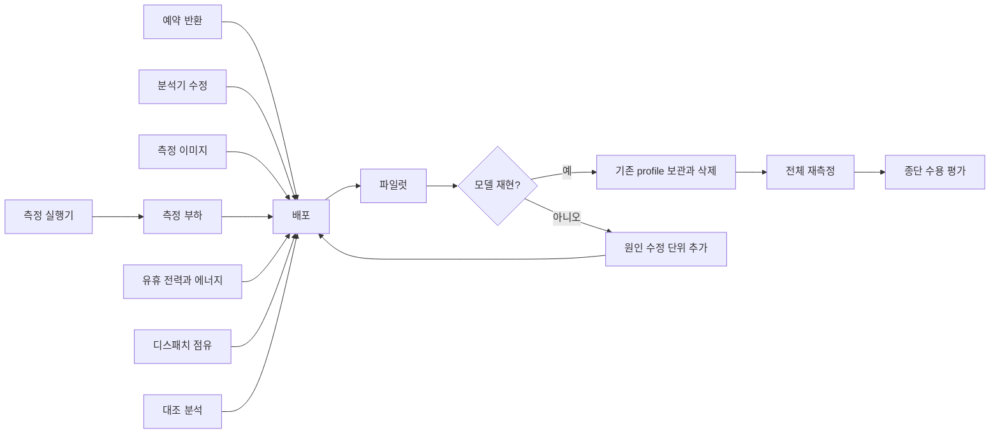

# Profile–Serving 동등성 계획

상태: 배포 후 대표 사례 파일럿 측정 대기. 분석 기준 실험의 근거:
- `ops/pools-deploy/intent/profile-spec-20261113/report.md`: serving–profile 괴리 집계. 요청 392,430건, 실행 배치 353,425개, serving profile 14개. 원자료는 `data/`.
- `ops/pools-deploy/intent/profile-spec-20261113/root/`: 단계별 분해. profile 원시 trial 111개의 `profile-raw/`, `stage-decomposition-report.txt`, `stage-comparisons.json`, `exact-input-matched-summary.jsonl`.
- `ops/pools-deploy/deployB/control-382-energy-objective-20261112/final-report.md`: 측정 요청 미승인과 분석기 실패.
- [측정 명세](../../spec/00_measurement.md), [구성 선택 명세](../../spec/04_configuration_selection.md).

## 문제 정의

스케줄러는 profile의 배치별 실행시간 분포와 에너지로 SLO, 용량과 에너지를 판단한다. 같은 조건에서 profile과 serving이 같은 능력을 보여야 한다. 분석 기준 배포에서는 다음 차이를 관측했다.

- genesis2 IC CUDA의 serving 실행시간은 profile의 1.8~3배다. jetsono PLC는 2.9배, jetson-nano PLC는 2.3배다.
- serving에 쓰인 profile 14개 전부가 측정과 다른 실행 이미지로 돌았다.
- genesis2 GPU_1500의 모델 적재 유휴 전력은 profile 118.4W, serving의 요청 없는 구간 69.4W다.
- 같은 조건의 profile과 serving 대조 단계가 없었다.

분석 기준 실험에서 측정 요청 5개가 5,350초 동안 승인되지 않았다.

## 분석 근거

### 운영점에 따른 실행시간 차이

profile 원시 trial의 전처리, 추론, 후처리와 IPC 잔차를 serving 배치 기록과 대조했다(`root/stage-decomposition-report.txt`). 아래는 중앙값 비교이며 분포 일치를 뜻하지 않는다.

| 사례 | 차이가 나는 단계와 조건 | 같은 조건으로 좁힌 결과 |
|---|---|---|
| genesis2 IC CUDA 배치 2 | 전체 배치의 추론 p50 1.2ms → 24.7~25.8ms. 실행 중 다른 요청이 들어온 배치는 추론 25.8~27.7ms, service 39.9~50.1ms | 다른 요청이 안 들어온 배치는 service p50 13.5~15.1ms, 추론 p50 1.20~1.25ms. profile 13.97ms, 1.20ms와 중앙값이 같다. 이 배치들의 추론 p95는 28.7~31.3ms로 분포는 다르다 |
| genesis2 IC CUDA 배치 1 | 전처리는 평균 초과분의 57~73%, 추론은 23~40%. 직전 유휴 간격 20~100ms 배치는 전처리 22ms | 유휴 간격 5~20ms 배치는 service p50 8.9ms. profile 7.5ms에 가깝다 |
| jetson-nano PLC CUDA 배치 1 | 직전 유휴 1초 이상인 배치 420개의 추론 35.5ms | 유휴 1ms 미만은 추론 14.67ms, service 18.7ms. profile 14.64ms, 18.1ms와 중앙값이 같다 |
| jetsono PLC 배치 1 | 전처리, 추론과 잔차 모두 차이. 다른 요청이 안 들어온 배치도 3.4ms로 profile 1.18ms와 다름 | 실행 중 유입만으로 설명되지 않는다. 유휴 간격까지 맞춘 비교는 아직 없다 |
| lattepanda IC CPU, Smol | 차이 작음: 1.01~1.07배 | |

- 실행 중 유입과 긴 실행의 관계는 양방향이다. 실행이 길면 그동안 다른 요청이 들어올 확률도 높다. 완료 기록이 없는 유입은 집계에서 빠진다. “유입이 실행을 늦춘다”는 인과는 [INFERENCE]다.
- profile의 직전 유휴 간격은 측정 도구의 속도가 정한다. 배치와 노드별 중앙값은 1~59ms, 최대는 대부분 120ms 이하다. serving은 0.1ms부터 수 초까지다(`data/latency-with-conditions.json`).
- 분석 대상 profile은 요청 하나가 끝나면 다음 요청을 보내는 방식으로 측정됐다(`runtime/ortcpu/runner.py`).
- 프로파일링 및 평가 부분집합에 같은 JPEG 36개가 있고, 같은 이미지끼리 비교해도 genesis2 배치 1은 1.83~2.03배, lattepanda IC는 1.04배다(`root/exact-input-matched-summary.jsonl`). 당시 측정 이미지 안의 데이터가 현재 로컬 사본과 같다는 전제는 [INFERENCE]다.
- [INFERENCE] 유휴 뒤 클럭과 캐시 상태, 실행 중 수신 처리의 간섭이 원인 후보다.

### 실행 이미지

분석 기준 배포의 경계:
- 측정 이미지는 조건으로 보존된다(`internal/profiling/derivation/curve_plan.go`).
- profile 선택과 노드 간 재사용 비교에서 이미지 및 runtime 버전이 제외됐다(`internal/serving/profile_selection.go`, `internal/serving/kube/catalog_reuse.go`).
- serving 준비가 측정 이미지를 선언 이미지로 덮어썼다(`internal/serving/application/profiles.go`).
- 명세는 같은 실행 경로와 버전을 요구한다.
- 분석 대상 측정 이미지의 요청 해석은 gateway가 보내는 `context.admissionPolicy`를 모르는 필드로 거절한다(HTTP 400).

### 유휴 전력

- 측정 profile 14개 중 13개의 유휴 측정은 시작 warmup 1회 뒤 2초 정착, 10초 측정이다(`data/conditions-final.json`). 정착 시간은 측정 입력이다.
- genesis2 IC CUDA의 유휴 118.4W와 serving의 요청 없는 2분 구간 69.4W, 표본 168개는 49W 다르다.
- 증분 에너지는 유휴 전력을 빼서 계산한다(`internal/profiling/derivation/derive.go`).

### 분석 기준 실험의 측정 차단 원인

- 수동 reset은 `disable-autonomy → unroute → drain → remove → release → lower-power` 순서다(`internal/serving/kube/manual_reset.go`). 앞 5단계 뒤 genesis2의 측정 최저 전력모드를 선택하지 못해 `partial`로 끝났다. Pod UID 표시 ID와 executor ID를 혼동한 반환 association 때문에 5노드 예약이 남았고 reset 인계에서 identity→Node 근거가 유실됐다(`internal/serving/kube/reservation.go`, `internal/serving/state/operation_scope.go`).
- failed-start의 수동 remove가 Pod UID 표시 ID를 executor ID로 넘겨 거절됐다. 자동 경로에는 `bindTerminatedPodRemoval`이 있었다(`internal/serving/kube/measurement_sequence.go`, `internal/serving/kube/scheduler_operations_launch.go`).
- 분석기가 유효한 빈 의존성인 `dependsOn: null`을 목록으로 가정해 실패했다(`hack/evaluation/prediction_analysis.py`).

## 근원과 해결 범위

| 근원 | 확정도 |
|---|---|
| profile 측정에 serving의 직전 유휴 간격 범위와 실행 중 유입이 없음 | 측정 조건 차이는 확정. 물리적 원인은 [INFERENCE] |
| 실행 이미지가 profile 적용 조건에서 빠져 미측정 이미지로 serving | 분석 기준 배포에서 확정 |
| profile과 serving의 유휴 전력이 다른 상태에서 측정됨 | 차이는 확정. 시점 원인은 [INFERENCE] |
| 같은 조건의 profile과 serving 대조가 없음 | 분석 기준 배포에서 확정 |
| dispatch occupancy가 배치 시작 간격에서 앞 배치의 실제 service 대신 profile 평균을 차감 | 분석 기준 배포에서 확정. 조건부 service에 `B*d`를 더하는 재생에서 오차가 생기고 음수는 0으로 잘림 |
| reset 예약 반환, 수동 remove identity와 분석기 null 처리 결함 | 분석 기준 실험에서 확정 |

## 책임과 원칙

profile을 serving과 같은 실행 경로, 이미지와 운영점에서 측정한다. 기존 소비 모델인 배치 크기와 직전 유휴 간격에 대한 조건부 실행시간 분포에 같은 조건의 표본을 제공한다.

이 모델은 실행 중 유입이나 도착률을 조건으로 쓰지 않는다. 분석 대상 Delay/excess stage의 genesis2 배치 2는 유입 여부에 따라 service 중앙값이 13.6ms와 40.1ms다. 대부분인 4,924/4,939개는 직전 유휴 1ms 미만이지만 유휴 간격 구간까지 맞춘 대조는 없다. 전체 재측정 전에 대표 사례로 파일럿을 수행하고 분리한 측정 자료를 모델이 재현하는지 확인한다. 맞지 않으면 측정 조건 또는 소비 계약을 고친 뒤 확대한다.

| 주체 | 책임 | 제한 |
|---|---|---|
| Profile 측정 | 선언한 노드, 전력모드, 실행 이미지, 모델과 배치에서 serving과 같은 실행 경로를 사용한다. 직전 유휴 간격과 실행 중 유입 범위의 표본 및 노드 전력을 측정하고 조건을 동결한다 | 스케줄러에 맞춘 가공과 다른 조건의 값 대입 금지 |
| 스케줄러 | 실제 instance 조건과 같은 profile의 분포로 SLO, 용량과 에너지를 계산한다. profile이 없으면 후보가 없다 | 다른 조건의 profile 차용과 보정 계수 금지 |
| Serving | 측정된 실행 이미지와 조건으로 실행한다 | 미측정 이미지 준비 금지 |
| 평가 | 같은 조건의 serving 실행시간 및 노드 전력을 profile과 대조한다 | 대조 결과로 profile 값 수정 금지 |

- 측정은 실행기 서버의 serving 요청 경로, 대기열, 배치 실행과 IPC를 사용한다. 측정 전용 `/profile` 경로와 요청 하나씩 보내는 방식을 제거한다.
- 실제 gateway Pod의 노드에서 네트워크 부하를 보낸다. 기존 설치 identity로 gateway 배치를 읽고 선택한 Node와 Pod 신원을 Run evidence에 동결한다. 측정 노드와 같거나 배치가 불명확하면 실패한다. 측정 노드나 edge 노드에 부하 생성 프로세스를 추가하지 않는다.
- 포화 측정, 이용률 단계, 드문 도착 단계와 유휴 정착 시간은 측정 입력이며 Run에 동결한다.
- 소비 계약인 배치별 `ServiceSamples`, 직전 유휴 간격, `EnergyPerInputJoules`, `IdleBaselineWatts`와 `d`는 파일럿이 재현성을 보이는 동안 유지한다. 부족하면 계약 변경 단위를 추가한다.
- 파일럿 확인 뒤 기존 profile을 모두 지운다. 삭제 전에 원시 evidence를 보관한다. 기존 측정 이미지의 요청 계약과 운영점이 다르므로 새 profile로 바꿔 읽는 reader를 두지 않는다([Durable Stored-Contract Compatibility](../../adr/0019-durable-stored-contract-compatibility.md)).
- 보정 계수, 허용 오차 조정값, serving 표본의 profile 혼합과 단계 비중 조정은 쓰지 않는다.

## 작업 단위

| 작업 | 변경 | 수용 기준 |
|---|---|---|
| reset 예약 반환 | 수동 remove에 `bindTerminatedPodRemoval` 적용. `ID==PodUID` 표시 ID는 executor scope에서 제외. reset 인계 때 identity→Node 근거 보존. 전력 요청을 시작하지 않았고 Pod 부재, writer 종료와 전력 non-pending이 fresh 관측으로 확인된 Node는 기존 경로로 반환. reset 결과는 `partial` 유지 | failed-start Pod UID-only 재고 → 5노드 reset → lower-power 실패 → fresh 관측 → 예약 반환 → 측정 승인 |
| 분석기의 빈 의존성 처리 | 두 의존성 읽기에서 JSON `null`을 빈 의존성으로 처리 | `null`, `[]`와 실제 의존성 체인의 결과 일치 |
| 측정 실행 이미지 조건 | 모든 reference 형식을 허용하며 측정 이미지 문자열로 준비. 선택, 재사용, operation-cost, idle과 dispatch occupancy 측정은 image 문자열 비교. digest/pin 검증과 observer image gate 없음 | 선언 변경 뒤에도 측정 이미지로 준비. 다른 image 조건을 섞지 않으며 imageID 차이로 Ready 차단 금지 |
| serving 경로의 측정 실행기 | profiling mode가 `/infer`, 대기열, 고정 배치 정책과 IPC 사용. 실행시간 분포를 쓰지 않는 고정 배치 정책은 profile bundle 없이 시작. `/profile` endpoint와 요청 형식 제거 | profile 없이 고정 배치 실행. 배치별 service, 직전 유휴 간격과 단계별 시간 기록. serving mode 검증 유지 |
| gateway 노드의 측정 부하 | gateway Node의 Job에서 `chill-server` 부명령과 gateway native client로 `/infer` 호출. Job CPU limit 없음. 드문 Poisson 도착의 무적체 최대 service로 기존 worker 수 식 계산. 포화 처리량에 설정 이용률을 곱해 Poisson 단계 생성. `scheduledAt` 뒤 FIFO admission을 기다리고 `dispatchedAt`에 native 전송. 지연은 `completedAt − scheduledAt`. offering과 drain 종료, trial/phase seed, scheduled count, issue lag와 driverGC 기록 | native admission 대기도 지연에 포함. lag, GC와 낮은 실현 도착률은 진단. 측정 노드에 부하 프로세스 없음 |
| 유휴 전력과 증분 에너지 | 마지막 drain 뒤 같은 actor와 observer를 양의 정수 `operatingPoints.postLoadDurationSeconds` 동안 유지. API→불변 Run→load plan에 입력 동결. `runtime.postLoad`의 전후 요청/추론 카운터, actor 신원, 모델 상주와 같은 구간 `metrics.samples`로 무추론 및 전력 시계열 기록. 유휴 정착 입력의 근거로 사용. 이용률 단계만으로 `(활성 J − 유휴 W × 시간) / 처리 입력 수` 계산. 예산은 최초 unknown-gap 배치를 포함한 sparse 표본 하한, 모든 단계, drain과 후행 관측을 포함하고 기존 여유 설정 재사용 | 동일 actor, 무추론과 후행 전력 raw 회귀. p99, 배치 크기 8의 sparse 2,400초가 동결 deadline 안에 포함. 단계별 전력과 후행 원시 시계열 보존 |
| 실제 앞 배치 기준 디스패치 점유 | 포화 배치 쌍의 시작 간격에서 앞 배치의 실제 service를 차감. 새 측정의 포화 단계도 같은 계산 사용 | 실제 service가 profile 평균과 달라도 `cycle = S + B*d` 성립 |
| profile과 serving의 대조 분석 | 제품 export를 추가하지 않는 `hack/evaluation` 오프라인 분석. 배치와 phase 조건별 held-out service를 training 표본과 분위수, 양측 KS 및 physical trial bootstrap CI로 대조. 요청 지연은 동결 설정이 허용하는 여러 분위수에서 기존 `EvaluateScheduler` keep 예측과 `completedAt − scheduledAt` 비교. 제한되면 SLO 분위수와 사유 보고. 고정 batch와 native slot 수를 재생하고 긴 phase는 동결 관측창의 연속 창으로 분할. 독립 loaded-idle trial로 유휴 W와 EPI를 계산하며 post-load는 정착 진단에만 사용. 측정 노드의 첫 native receive에 monotonic offering exposure를 적용해 전력창 구성. 부하 노드 UTC와 meter 시각을 차감하지 않음. nativeHTTP handler entry와 로컬 receive offset으로 실행 중 유입 분류 | 합성 회귀와 `C1_PROFILE_CLI` 통합. 지연, 전력과 service의 trial bootstrap CI 및 KS statistic CI. KS p-value는 종속 batch의 기술 통계이며 자동 배제 기준으로 사용하지 않음. 창별 결과와 경계 상태 한계 표시 |
| 대표 사례 파일럿 측정 | 배포 뒤 genesis2 IC CUDA 배치 1과 2, jetson-nano PLC CUDA, jetsono PLC, lattepanda IC CPU 측정. 독립 loaded-idle trial과 긴 post-load 진단 별도 보존. batch/phase별 service, 가능한 요청 지연 분위수, 전력과 정착을 대조 분석으로 판정 | 대조 보고와 trial bootstrap CI, quantile 제한 및 창 경계 한계 명시. 재현되지 않으면 원인과 수정 단위를 추가하고 기존 profile 삭제 및 전체 재측정 보류 |
| 짧은 측정 방식 검증 | 파일럿 원시 기록에서 짧은 방식을 잘라 기준값 재현 여부 대조. 유휴 간격과 실행 중 유입 조건별 고정 실행시간 표본, 유휴/포화 두 점의 전력 직선, 장치 종류별 한 번의 전력 안정 시간 및 중간 이용률 단계 검토. 추가 측정 없음 | 재현된 항목만 전체 재측정 방식으로 채택하고 입력값 기록. 재현되지 않은 항목은 전체 방식 유지 |
| 기존 profile 보관과 삭제 | 파일럿 통과 뒤 serving 정지, 원시 evidence 보관, 공식 측정 DELETE API로 campaign과 evidence 삭제. profile을 참조하는 serving Pod가 있으면 DELETE가 거절되므로 serving부터 정지 | 현재 catalog profile 0개, 보관 위치 기록 |
| 전체 후보 범위 재측정 | IC, PLC와 Smol의 Node, 선언 전력모드 및 batch 후보 범위 측정. profile이 필요한 dispatch occupancy와 전환 비용은 그 뒤 측정 | 후보 profile 공개 또는 실패 사유 기록 |

기존 profile 삭제부터 전체 재측정 종료까지 serving은 멈춘다. profile이 없으면 후보가 없고 gateway는 요청을 받지 않는다. 테스트베드에서 이 공백을 허용한다.

순서: 예약 반환과 분석기 처리 수정, 나머지 구현의 단일 배포, 대표 사례 파일럿, 재현성 판정, 기존 profile 보관과 삭제, 전체 재측정, 실클러스터 종단 수용 평가. 짧은 측정 방식은 파일럿 원시 기록으로 검증한다.

디스패치 점유의 공유 계산은 `internal/profiling/derivation/dispatch_occupancy.go`의 `DispatchOccupancyNanos(cycleNanos, serviceDurationNanos int64, batchSize int) (float64, bool)`이다. 호출자가 쌍 적격성을 확인한다. 앞 배치의 native `ServiceDurationNanos`가 없거나 구성원 사이 값이 충돌하면 표본에서 제외한다. profile 평균은 근거로만 보존한다.

같은 작업에서 명세의 고정 구성 프로파일링을 serving 경로, 다른 Node의 부하 및 운영점 단계 방식으로 갱신한다. 유휴 측정 정착 시간의 의미와 profile 적용 조건의 실행 이미지를 명시한다.

## 수용 기준

### 배포 전 코드

각 작업의 회귀와 전체 게이트를 통과한다.

### 대표 사례 파일럿

- 분리한 이용률 단계의 전력과 `idle + EPI × scheduledInputs / offering exposure`를 trial bootstrap CI로 대조한다. idle/EPI는 catalog와 같은 독립 loaded-idle baseline을 사용한다.
- 전력창은 측정 Node의 첫 native receive부터 monotonic offering exposure까지다. native 수신 기준 창과 load offering 사이 전달 지연 차이를 한계로 명시한다. 포화 단계도 같은 기준이며 `cycle = S + B*d`를 보고한다.
- post-load는 같은 actor의 무추론, 모델 상주와 마지막 phase 뒤 정착 시간 진단이다. idle/EPI 학습에 합치지 않는다.
- batch/phase별 service 분위수, 양측 KS와 trial bootstrap CI를 보고한다. 요청 지연은 동결 설정이 허용하는 여러 분위수로 `EvaluateScheduler`를 재생한다. 허용하지 않으면 SLO 분위수와 사유를 보고한다. 긴 phase는 동결 창의 연속 재생 결과와 경계 상태 한계를 남긴다. 제품 export를 늘리지 않는다.
- 같은 image 태그라도 `runtime.runtimeVersion`이 다른 active trial과 idle evidence는 합치지 않는다.
- 짧은 방식의 실행시간 분위수와 전력 예측이 기준값의 trial bootstrap CI 안에 드는지 항목별로 보고한다. 측정 시간 단축 비율도 남긴다.

### Serving 종단 수용 평가

- 같은 조건의 serving/profile 실행시간 비를 보고한다. genesis2 IC CUDA 배치 1과 2, jetson-nano PLC와 jetsono PLC를 포함한다.
- 판단별 노드 전력의 예측/실측 오차를 보고한다.
- 대조에서 남는 차이는 조건과 함께 보고하고 측정 조건 차이 여부를 후속 분석한다.
- 에너지, SLO와 제어 주기의 수용은 [운영 설계](scheduler-operations.md)의 실클러스터 수용 기준을 따른다.

## 범위 밖

- jetsono PLC의 유입 없는 구간 차이는 새 측정 뒤 대조에 남으면 다룬다.
- 같은 Node의 여러 모델은 명세의 단독 측정을 기본으로 한다. 대조에서 판단을 방해하면 추가 측정이나 운용 제한을 정한다.
- 분석 기준 실험의 관측 저장 형식 전환 뒤 `AppliedSnapshotUnavailable`과 128초 search Tick은 별도로 다룬다. 측정 작업의 차단 사유로 삼지 않는다.
- 대조 결과에 따른 profile 자동 배제 정책은 결과를 본 뒤 결정한다.
