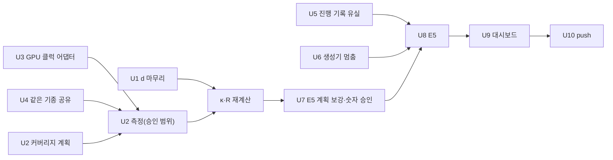

# E5 전 보완 워크플로우: spec → SRS → 구현 설계 → 구현 (2026-10-27)

이전 템플릿: `workflow-plan-20261025.md`. 같은 4단 체계와 규칙을 따른다. 정본 저장소는 `/home/genesis1/ETRI/chill`(main). 이 문서는 원안(`O/intent/workflow-plan-20261027.md`)을 옮긴 것이고, 결정은 `docs/intent/decision-log.md`에 남긴다.

입력:
- 사용자 지적(2026-10-26 밤): 전력 모드가 E5 입력에서 빠짐, genesis GPU 클럭이 `fixed`, 같은 기종 프로파일 공유 없음.
- 확인된 사실: 실행 프로파일 69개가 Node마다 모드 1개(Jetson 3대 포함). `NvidiaLockedGPUClock`는 API(`api/v1alpha1/deviceclass_types.go:52-98`)와 컨트롤러 전달(`internal/nodeactuator/controller/power_mode.go:358-376`)만 있고 호스트 어댑터가 없음(`internal/nodeactuator/`는 `jetson/`만, ADR 0015:78-81, `docs/design/profiling/plans/06-execution-support-expansion.md:329-334` 미착수). 클러스터 DeviceClass `edge-server-rtx-2080-ti-64g`는 `fixed`만. 프로파일은 Node UID에 묶임(`internal/serving/scheduler_capacity.go:239,657`, `kube/observer.go:655`, `kube/operations.go:573`).
- d 판정 기준 재설정(유휴 식별 + 유휴 ≤ 5% 설정값, 오차 범위 기록) 전달됨.
- E5 계획 커버리지 검토: 명세 평가 7행 중 "노드·서빙·제어 동작 실패" 누락, 점진 감소·다른 모델 버스트 없음, 제어요소 비교 N=2.

## 0. 공통 규칙

- 각 단계는 짧게 쓰고 독립 리뷰 1회. spec·SRS는 주제당 한 커밋. 구현은 SRS ID와 설계 절을 커밋 메시지에 적는다. 단계 생략은 "이미 spec에 있음"일 때만, 근거 줄과 함께.
- 구현은 서브에이전트 최소 커밋 + 정식 리뷰 + ponytail 리뷰. 파일 영역 하나는 담당 하나. 커밋은 경로 한정.
- 측정 조건·판정 변경은 사용자 승인. runtime 7 digest 고정. 클러스터 변경은 운영 담당 한 명이 직렬로.
- 결과·결정은 저장소 문서(decision-log, ADR, plans)가 정본. `.cache/checkpoints.md`는 원시 일지.

## 1. 주제와 단계별 할 일

### U1. d 측정 마무리 (완료 2026-10-27 06:0xZ — 새 규칙 34/34)

- **spec:** `00_measurement.md` 123-125행을 새 판정 기준으로 교체(유휴 식별이 필수, 유휴 비율 상한은 설정값 기본 5%, d는 측정값 그대로 쓰고 오차 범위 [d − 요청당 유휴, d]와 κ 오차 상한 = 유휴 비율을 기록, 유휴를 빼서 보정하지 않음). 근거 한 줄: 유휴는 d를 키우는 쪽(κ 보수적)으로만 오염.
- **SRS:** 측정 SRS(해당 ID 위치)에 판정 요구사항 1개와 수용 시나리오 2개(유휴 2% 식별됨 → Accepted + 오차 범위 기록 / 유휴 미식별 → Insufficient).
- **구현 설계:** `docs/design/serving/measurement-api.md` 판정 절.
- **구현:** `internal/serving/kube/occupancy.go` `judgeOccupancy`의 NotSaturated 조건을 설정값으로, 결과에 오차 범위 필드. 이미 Insufficient인 D05/D11/D15는 원시로 재판정(재측정 없이 가능하면). 남은 PLC → MNV GPU 5 순으로 계속. MNV CPU 8은 U2 계획 결과와 함께 결정.
- **완료 기준:** PLC κ>0 Node 수, MNV GPU 후보 연결, 판정 기준 문서·코드·결정 기록 일치.

### U2. 전력 모드 커버리지 복원 (계획 먼저)

- **spec:** `04_configuration_selection.md`에 "전력 모드는 배치·인스턴스 수와 같은 제어 대상이며, 평가는 선언된 모드 중 측정 근거가 있는 모드에서 수행한다" 확인 또는 보완. `00_measurement.md` 84행 질문("어떤 전력모드와 배치가 유리한가")과 연결.
- **SRS:** catalog/scheduler SRS에 "평가 대상 모드 집합과 모드별 필수 근거(실행 프로파일, d, 준비·제거 비용, 유휴 기준, 모드 간 전환 비용)" 요구사항과 커버리지 표 수용 기준.
- **구현 설계:** `docs/plans/`에 **커버리지 표**: Node × 선언 모드 × 모델 × 실행 방식 × 배치 × 근거 5종의 보유/누락, 대상별 예상 측정 시간, 최소안(Jetson 모드 2개씩)·중간안·전체안과 E5 일정 영향.
- **구현:** 승인된 범위만 측정. U3·U4가 결정되면 genesis 행은 그 결과를 따른다.
- **완료 기준:** 사용자가 범위를 고르고, 그 범위의 근거가 모두 Accepted로 계획기에 연결됨.

### U3. genesis GPU 클럭 전력 모드 (NVIDIA 어댑터)

- **spec:** 해당 없음(이미 "전력 모드" 일반 규칙). ADR 0015 갱신: NVIDIA 클럭 어댑터의 권한, 적용·확인, 재시작 복원, Jetson과 분리.
- **SRS:** catalog/platform SRS에 `NvidiaLockedGPUClock` 모드의 적용, 확인(read-back), 실패 시 복원 요구사항과 수용 시나리오.
- **구현 설계:** `docs/design/profiling/plans/06-execution-support-expansion.md` GPU clock 절과 P6 진입 조건을 실제 절차로: (1) 호스트에서 `nvidia-smi -lgc/-rgc`와 조회가 되는지 검사, (2) 클럭 단계 후보 2~3개(예: 기본, 중간, 낮음)와 근거, (3) 노드 에이전트 권한, (4) 재부팅·실패 복원.
- **구현:** `internal/nodeactuator/`에 NVIDIA 어댑터(Observe/Apply, Jetson 어댑터와 같은 계약), DeviceClass `edge-server-rtx-2080-ti-64g`에 클럭 모드 선언, 실제 전환 시험 1회. 클럭은 GPU 경로에만 영향이므로 측정은 CUDA 프로파일부터.
- **완료 기준:** genesis 한 대에서 모드 전환·확인·복원이 실클러스터로 증명되고, 전환 비용 1쌍 측정.

### U4. 같은 기종 프로파일 공유

- **spec:** `00_measurement.md`에 "같은 기종·같은 실행 이미지·같은 자원 할당의 측정은 다른 Node에 재사용할 수 있으며, Node마다 짧은 확인 측정으로 동등성을 확인한다" 추가. 다른 기종(계열 간) 일반화 금지는 유지.
- **SRS:** catalog SRS에 재사용 조건, 확인 측정의 판정(허용 차이는 설정값), 거절 시 독립 측정 요구사항.
- **구현 설계:** 프로파일이 Node UID에 묶인 곳(`scheduler_capacity.go:239,657`, `observer.go:655`, `operations.go:573`, `runner.go:41`, `cost_power.go:228`)의 바뀌는 계약, 확인 측정 절차, GPU UUID 같은 개체 고유값 처리.
- **구현:** 승인 후. genesis2 측정을 genesis3에 재사용하는 1건으로 실증.
- **완료 기준:** 재사용 행이 계획기에 연결되고 확인 측정 결과가 기록됨. U2의 genesis 측정량이 절반으로 줄어듦.

### U5. 관측 신뢰성: 진행 기록 유실

- **spec:** 해당 없음(기존 관측 완전성 규칙).
- **SRS:** 해당 ID에 "native 진행 기록 누락 시 원인 기록" 보완이 필요할 때만.
- **구현 설계:** 원본 Pod 로그와 서버 수집 경계 대조 절차(`history://ProgressLoss27`의 회수 대상과 판정표).
- **구현:** 다음 d 측정에서 누락이 나면 해당 Pod 원본 로그를 즉시 보존해 원인 확정 → 수정. 10만~20만 건 중 1건이지만 d와 E5 모두에 영향.
- **완료 기준:** 원인 확정(생성·전달·수집 중 어디) 또는 3회 연속 측정에서 재발 없음.

### U6. 부하 생성기 멈춤

- **spec·SRS:** 해당 없음(실험 도구). E5 계획의 집계 규칙에 "보낸 부하가 계획 trace와 어긋난 구간 표시" 한 줄.
- **구현 설계:** `hack/` 또는 load-generator 설계 문서에 원인 후보(GC, CPU 경합, 게이트웨이)와 확인 방법.
- **구현:** 원인 확인 → 가장 작은 수정. E5 전에 생성기 멈춤이 계획 trace 대비 얼마나 되는지 측정치를 남긴다.
- **완료 기준:** 50ms 넘는 발행 공백의 원인과 빈도가 보고되고, E5 결과에 보낸 부하 충실도가 표시됨.

### U7. E5 계획 보강

- **spec:** `docs/spec/README.md` 평가 7행은 그대로. 계획이 7행 모두를 덮어야 한다.
- **SRS:** scheduler SRS의 해당 AC에 실패 시나리오 수용 기준 추가.
- **구현 설계:** `docs/plans/2026-10-26-e5-evaluation.md`와 `docs/design/serving/workload-pools.md` §9 갱신:
  - **실패 시나리오 추가(15분):** 0.3R 중 인스턴스 강제 종료, Node 하나 차단 → 격리, 대체, 복구.
  - 커버리지 표(명세 7행 ↔ E5 시나리오)와 남는 한계(점진 감소 없음, 다른 모델 버스트, 반복 실행 없음) 명시.
  - 전력 모드 반영(U2 범위에 따라 E5-5 등에서 모드 변경 장면 포함).
  - 제어요소 비교 N: 명세는 "하나씩"이므로 비교하지 않는 요소와 이유를 명시.
  - 결정 대기 2개를 사용자에게: 첫 준비 구간 손실 집계, Node 끊김 구간 표시·별도 집계.
- **구현:** E5 실행 설정 파일과 preflight에 새 시나리오 반영. 도구 리허설(짧은 E5-0) 1회.
- **완료 기준:** 사용자가 E5 숫자와 계획을 승인.

### U8. E5 실행 (U1, U2 승인 범위, U5, U6, U7 뒤)

- 실행마다 preflight, 토큰 만료 검사, 전력 결측 불허. 결과는 Run ID와 원시 경로로 `docs/spec/README.md` 평가 표와 `workload-pools.md` E5 표에 기입.

### U9. 대시보드 T5/T6 (E5 뒤)

- `docs/plans/2026-10-26-dashboard-live-stage.md` 그대로. 예약 표시, 전력 모드 표시 포함.

### U10. 원격 push (사용자 결정)

## 2. 의존 관계

## 3. 실행 순서와 병렬

| 순서 | 할 일 | 병렬 |
|---|---|---|
| 1 | U1 판정 기준 반영(spec→SRS→설계→코드) → 재판정 → PLC·GPU 측정 계속 | U2 계획, U3 설계, U4 설계, U7 설계를 문서 담당 각 1명이 병렬 |
| 2 | U2 커버리지 표·U3/U4 설계를 사용자에게 한 번에 보고하고 범위 승인 | U5·U6 원인 조사(읽기 전용) |
| 3 | U3 어댑터 구현·실증, U4 구현·실증 | U1 남은 측정 |
| 4 | U2 승인 범위 측정(운영 담당 직렬) | U7 설정·preflight 반영 |
| 5 | κ·R 재계산 → U7 숫자 승인 → 도구 리허설 | |
| 6 | U8 E5 | |
| 7 | U9, U10 | |

## 4. 사용자 결정 지점

| 시점 | 결정 |
|---|---|
| 순서 1 | U1 새 판정 기준(전달됨) 최종 확인 |
| 순서 2 | U2 범위(최소/중간/전체), U3 클럭 단계, U4 재사용 허용 차이 |
| 순서 2 | U7 결정 대기 2개(첫 준비 구간, Node 끊김) |
| 순서 2 | MNV CPU 8 재측정 여부 |
| 순서 5 | E5 숫자·계획 승인 |
| 순서 7 | push 시점 |

## 5. 사용자 수정(2026-10-26 20:3xZ): 대기 없이 연속 진행

- U1 그대로. U2: 커버리지 표 작성 후 **최소안(Jetson 모드 2개씩 × 세 모델, 근거 5종)**으로 바로 측정; 중간/전체안은 표에만. U3: 호스트 검사 → 어댑터 → genesis 1대 실증 → 전환 비용까지 연속; 클럭 단계 권고 2~3개로 진행·보고. U4: 설계 → 구현 → genesis2→3 재사용 실증 연속; 허용 차이 권고값. U5·U6: 원인 → 최소 수정 연속. U7: 결정 대기 2개는 권고안 기본 적용(첫 준비 구간=전체 분모 유지+별도 표시, Node 끊김=표시+별도 집계 병기, 전체 결과 유지); 실패 시나리오·커버리지 표 반영. MNV CPU 8: U4 공유 적용 뒤 측정.
- 사용자 승인은 **E5 숫자 1회**만. 나머지 새 값은 권고값으로 진행하고 decision-log에 기록·보고. 파일 영역 겹침 금지, 클러스터 변경은 운영 담당 1명 직렬, 단계별 리뷰·ponytail 유지.

### U11. 게이트웨이 구조 개편(제어/데이터 평면 분리) — E5 뒤(G0 통과 시)

- 제안서 `O/intent/gateway-20261027/proposal.md`(근거 arch-map.md, research.md). 본질: 실행은 이미 분산, 중앙화된 것은 요청 통과·장부 + 제어 기능이 같은 프로세스. 표준 해법(Nexus, Envoy xDS, Knative): 판단은 중앙(control 1개), 전달은 분산(router N개, 같은 바이너리 모드 분리). 버전 붙은 배분표 push + 라우터 applied ACK, 모든 라우터 outstanding 0 뒤 drain, 라우터별 기록 스트림을 requestID로 병합. runtime 7 불변, 새 프레임워크 없음.
- 순서: **G0** = 현 구조 최대 부하 지점 G 확인 1회(E5 준비의 G 확인과 동일). 통과 → E5 먼저, 직후 G1(spec/SRS/설계/ADR 0029) → G2(구현; 배분표 채널은 대시보드 T5 WebSocket과 같은 메커니즘) → G3(라우터 2개 확장·전환·장시간 시험, G 재측정). 실패 → G1~G3를 E5 앞으로. E5 보고서에는 "단일 게이트웨이, 측정한 한계값"을 조건으로 명시.
