# CHILL 한눈에 보기

> 이기종 엣지 장비에서 AI 추론 서비스를 운영한다.
> **응답 시간 목표를 만족하는 배치 중 에너지가 가장 적은 배치를 자동 선택한다.**

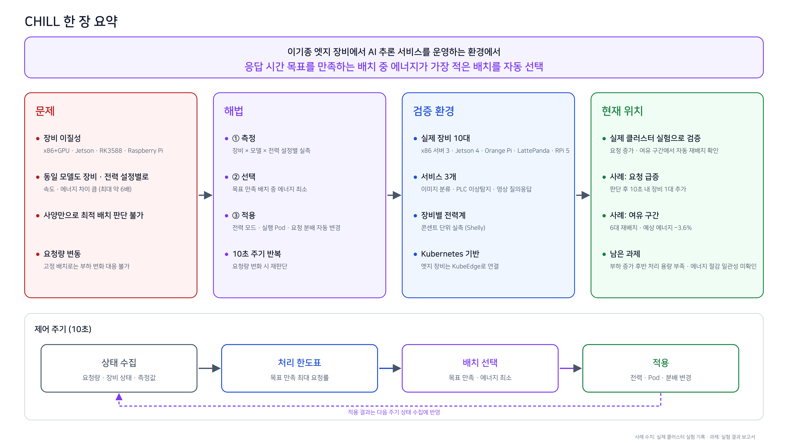

---

## 1. 왜 필요한가

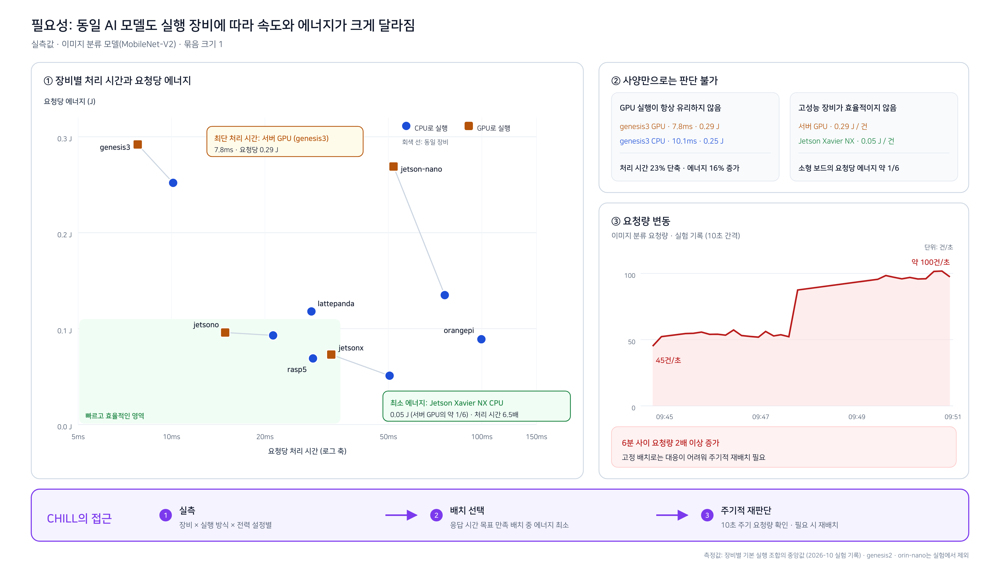

- **장비 이질성**: 서버 GPU, Jetson, Raspberry Pi, RK3588 등이 섞여 있다.
- **장비별 속도·에너지 차이**: 같은 이미지 분류 모델도 가장 빠른 서버 GPU는 7.8ms·요청당 0.29 J, 가장 효율적인 Jetson Xavier NX CPU는 50ms·0.05 J다(실측 중앙값).
- **사양만으로 판단 불가**: genesis3에서 GPU 실행은 CPU 대비 처리 시간이 23% 짧지만 에너지는 16% 많다.
- **요청량 변동**: 실험 기록에서 이미지 분류 요청량이 6분 사이 45건/초에서 약 100건/초로 늘었다. 고정 배치로는 대응이 어렵다.

## 2. CHILL이 하는 일 (세 줄 요약)

1. **잰다**: 모델을 장비마다, 전력 설정마다 실제로 돌려 보고 속도와 전력을 기록한다.
2. **고른다**: 측정 결과를 근거로 응답 시간 목표를 만족하는 배치 중 에너지가 가장 적은 배치를 고른다.
3. **운영한다**: 요청을 받아 고른 장비로 보내고, 요청량이 바뀌면 배치를 다시 판단한다.

---

## 3. 사용자는 무엇을 하나

- **운영자**: 모델을 등록하고 서비스를 만든다. 서비스마다 응답 시간 목표를 정한다. 예: "요청 99%를 100ms 이내에 응답".
- **서비스 사용자**: 서비스 이름과 입력 데이터(예: 이미지 한 장)를 보내고 결과를 받는다.
- 사용자는 어느 장비에서 처리되는지, 몇 개씩 묶여 처리되는지 몰라도 된다.

---

## 4. 전체 구성 (실제 실행 단위 기준)

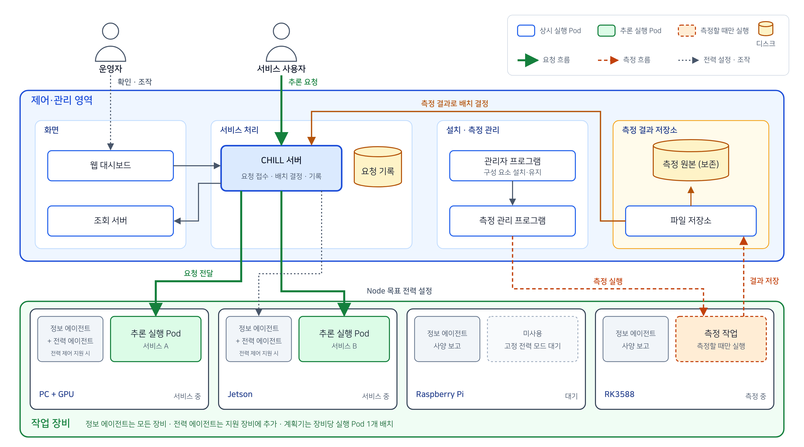

| 구성 요소 | 실제 형태 | 하는 일 |
|---|---|---|
| CHILL 서버 | Pod 1개 + 전용 디스크 | 유일한 입구. 요청 접수, 장비 배치 결정, 추론 Pod 생성·삭제, 요청 기록 |
| 추론 실행 Pod | 장비마다 최대 1개 | 모델 하나를 메모리에 올려 두고 요청을 처리 |
| 장비 에이전트 | 정보 에이전트는 장비마다 1개, 전력 조절 에이전트는 지원 장비에만 | 장비 사양을 알리고 전력 설정을 바꿈 |
| 측정 작업 | 측정할 때만 뜨는 일회성 작업 | 모델을 실제로 돌려 속도·전력 측정 |
| 측정 결과 저장소 | S3 호환 저장소 Pod + 디스크 | 측정 원본 보관 (자동 삭제 없음) |
| 관리자 프로그램 | Pod 1개 | 시스템 설치 상태 유지, 측정 진행 관리 |
| 웹 대시보드 / 조회 서버 | Pod 각 1개 | 상태 확인과 조작 화면 |

### 4-1. Kubernetes 위에서 본 구성

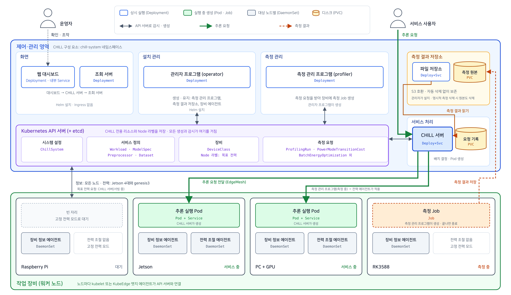

- **모든 것이 Kubernetes 리소스다**: 서비스, 모델, 장비 종류, 측정 요청을 전용 리소스로 등록한다. 구성 요소는 API 서버를 감시하다가 필요한 객체를 만든다.
- **설치는 Helm 한 번**: 관리자 프로그램, CHILL 서버, 화면을 설치한다. 나머지는 관리자 프로그램이 직접 만든다.
  - 측정 관리 프로그램
  - 측정 결과 저장소
  - 장비 에이전트
- **실행 중에 생기는 것**:
  - 추론 실행 Pod: CHILL 서버가 만든다.
  - 측정 Job: 측정 관리 프로그램이 만든다.
- **장비 에이전트 (DaemonSet)**:
  - 장비 정보 에이전트: 모든 장비에서 사양을 보고한다.
  - 전력 조절 에이전트: 전력 제어를 지원하는 장비(Jetson 4대, genesis3)에서 Node 라벨의 목표 전력을 적용한다.
- **엣지 장비 연결**: 원격 장비는 KubeEdge로 클러스터에 붙는다. 추론 요청은 EdgeMesh를 거쳐 각 Pod에 전달된다.

### 4-2. 실제 테스트베드 (2026-11-03 기준)

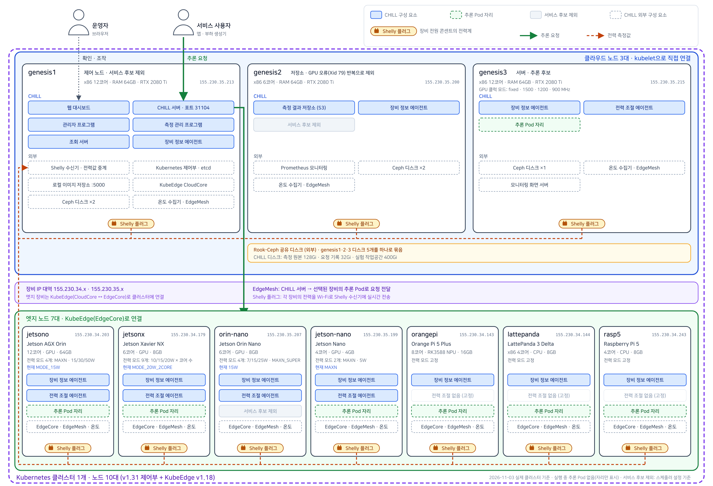

| 장비 | 하드웨어 | 연산 장치 | 전력 모드 | CHILL에서 맡는 일 |
|---|---|---|---|---|
| genesis1 | x86 12코어 · 64GB | RTX 2080 Ti | 고정 | 제어: CHILL 서버·관리·화면 (추론 후보 제외) |
| genesis2 | x86 6코어 · 64GB | RTX 2080 Ti | 고정 | 측정 결과 저장소 (GPU 오류(Xid 79) 반복으로 추론 후보 제외) |
| genesis3 | x86 12코어 · 64GB | RTX 2080 Ti | GPU 클럭 3단계 | 추론 후보 |
| jetsono | Jetson AGX Orin · 64GB | GPU | 4개 | 추론 후보 |
| jetsonx | Jetson Xavier NX · 8GB | GPU | 9개 | 추론 후보 |
| orin-nano | Jetson Orin Nano · 8GB | GPU | 4개 | 추론 후보 제외 |
| jetson-nano | Jetson Nano · 4GB | GPU | 2개 | 추론 후보 |
| orangepi | Orange Pi 5 Plus · 16GB | RK3588 NPU | 고정 | 추론 후보 |
| lattepanda | LattePanda 3 Delta · 8GB | CPU | 고정 | 추론 후보 |
| rasp5 | Raspberry Pi 5 · 8GB | CPU | 고정 | 추론 후보 |

- **클러스터 하나, 노드 10대**: 10대 모두 같은 Kubernetes 클러스터의 노드다. 연결 방식만 다르다. x86 서버 3대는 kubelet으로 직접, 엣지 장비 7대는 KubeEdge로 붙는다.
- **전력은 콘센트에서 잰다**: 모든 장비에 Shelly 스마트 플러그를 달았다. 플러그는 장비 전체의 전력을 Wi-Fi로 Shelly 수신기에 보낸다.
- **CHILL이 기대는 외부 요소**:
  - Kubernetes 제어부: 리소스 저장
  - KubeEdge와 EdgeMesh: 엣지 장비 연결과 요청 전달
  - Rook-Ceph: CHILL의 디스크
  - 로컬 이미지 저장소: CHILL 이미지 보관
  - Shelly 플러그와 수신기: 전력값 수집
  - 온도 수집기: 과열로 성능이 떨어졌는지 확인

---

## 5. 흐름 ① 측정: "실제로 재 본다"

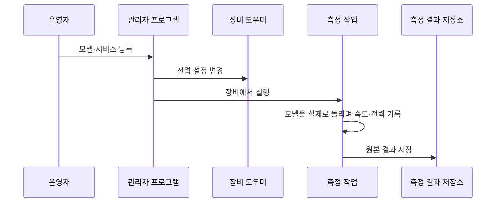

- 측정 단위는 **모델 × 장비 × 전력 설정** 조합이다.
- 한꺼번에 처리하는 요청 수를 바꿔 가며 측정한다.
- 전력 설정을 바꾸는 데 걸리는 시간과 전력도 함께 측정한다.
- 측정이 끝난 조합만 실제 서비스 배치 후보가 된다. 추측으로 채우지 않는다.

## 6. 흐름 ② 결정: "가장 아끼는 배치를 고른다"

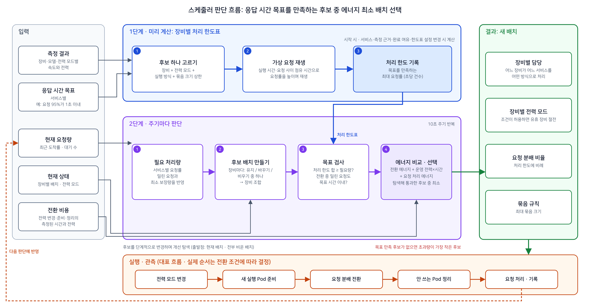

- **1단계 · 처리 한도표**: 장비·전력 모드·실행 방식 조합마다 측정된 실행 시간으로 가상 요청을 흘려 본다. 목표를 만족하는 최대 요청률을 미리 구한다.
- **2단계 · 주기 판단**: 필요 처리량을 계산한다 → 장비 조합 후보를 만든다 → 목표를 만족하는지 검사한다 → 에너지가 가장 적은 후보를 고른다.

- 입력: 측정 결과, 현재 요청량, 서비스별 응답 시간 목표, 현재 배치 상태
- 판단: 응답 시간 목표을 지키는 배치만 남기고, 그중 **전체 에너지가 가장 적은 배치**를 고른다.
- 배치를 바꾸는 데 드는 시간과 전력도 비교에 포함한다. 잦은 변경으로 오히려 손해 보는 상황을 막기 위해서다.
- 쓰지 않는 장비는 가장 낮은 전력 설정으로 내린다.
- 결과: 서비스별로 어느 장비를 쓸지, 장비별 전력 설정, 요청을 몇 개씩 묶을지

### 6-1. 입력: 무엇을 보고 판단하나

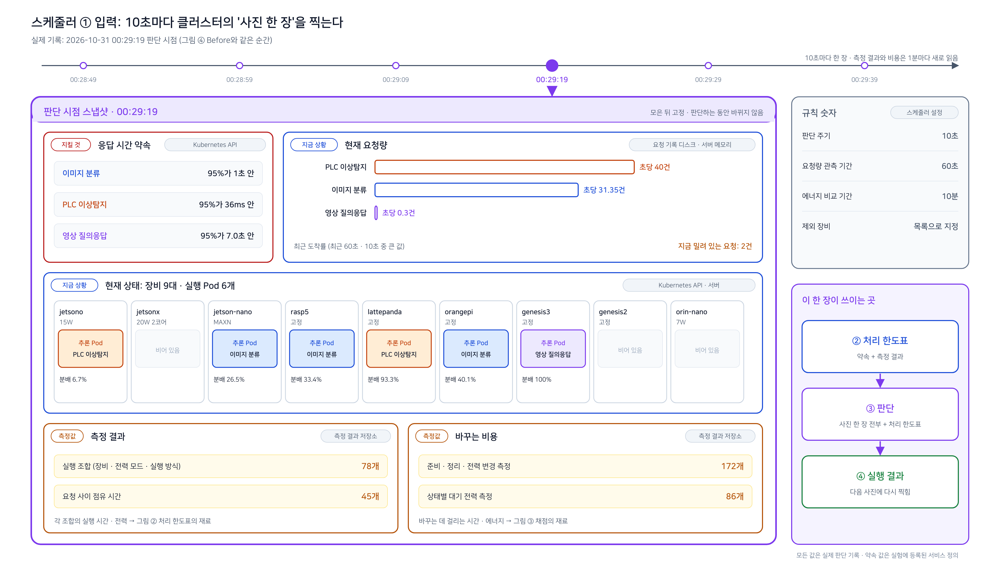

- **입력 5가지**: 지킬 것(응답 시간 목표), 지금 상황(현재 상태 · 현재 요청량), 측정값(측정 결과 · 바꾸는 비용).
- **출처는 실제 저장 위치 5곳**: Kubernetes API 서버, CHILL 서버 메모리, 요청 기록 디스크, 측정 결과 저장소, 스케줄러 설정.
- **한 시점에 고정한다**: 판단 주기(현재 10초)마다 입력을 차례로 모아 한 번에 고정한다. 판단 중에는 입력이 바뀌지 않는다.
- 측정 결과와 바꾸는 비용은 1분마다 저장소에서 다시 읽는다.

### 6-2. 1단계: 처리 한도표는 어떻게 만드나

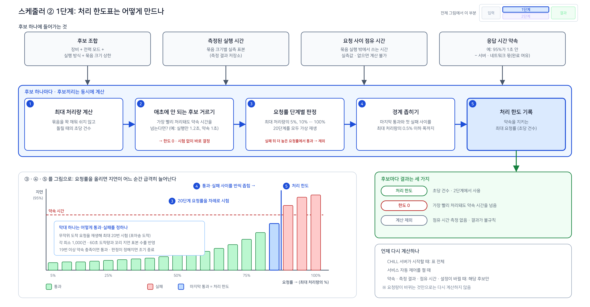

- **후보마다 하나씩**: 장비 + 전력 모드 + 실행 방식 + 묶음 크기 조합마다 계산한다. 후보끼리는 동시에 계산한다.
- **가상으로 흘려 본다**: 최대 처리량의 5%부터 100%까지 20단계로 요청률을 올린다. 단계마다 무작위 도착 시험을 20번(각 최소 1,000건) 돌려 19번 이상 목표를 만족하면 통과다.
- **경계를 좁힌다**: 마지막 통과와 첫 실패 사이를 반씩 나눠 처리 한도를 정한다.
- **요청량이 바뀌어도 다시 계산하지 않는다**: 목표, 측정 결과, 설정이 바뀔 때만 다시 계산한다.

#### 예시: Raspberry Pi 5 한 대

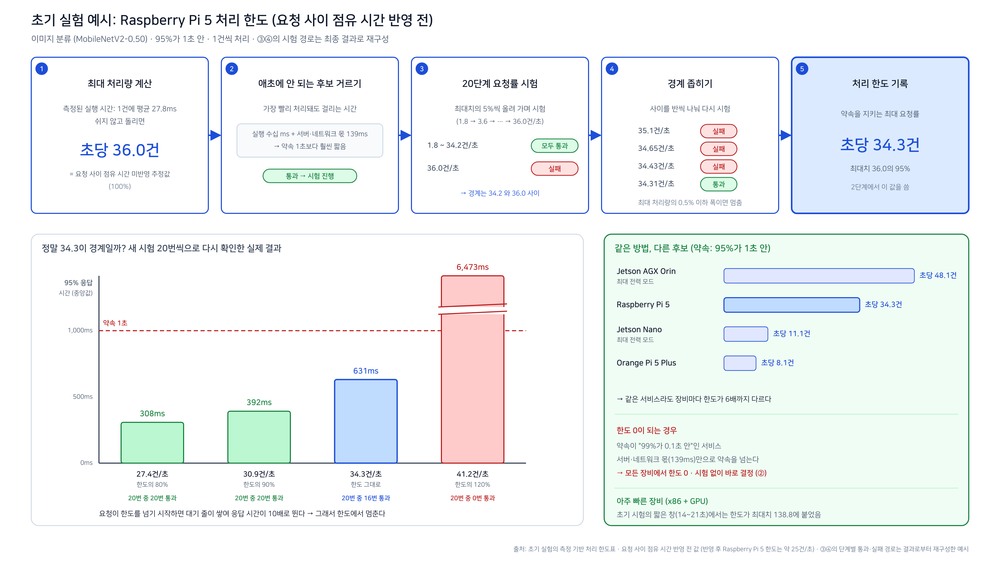

- **결과**: 최대치는 초당 36.0건이고, 목표(95%가 1초 안)을 지키는 처리 한도는 초당 34.3건이다. 초기 실험 값이며, 요청 사이 점유 시간을 반영하면 약 25건으로 낮아진다.
- **경계 확인**: 한도의 90%까지는 시험 20번 모두 통과한다. 한도의 120%에서는 응답 시간이 6.5초로 뛰고 한 번도 통과하지 못한다.
- **장비마다 다르다**: 같은 서비스라도 한도가 초당 8.1건(Orange Pi)에서 48.1건(Jetson AGX Orin)까지 다르다.

### 6-3. 2단계: 주기마다 어떻게 판단하나

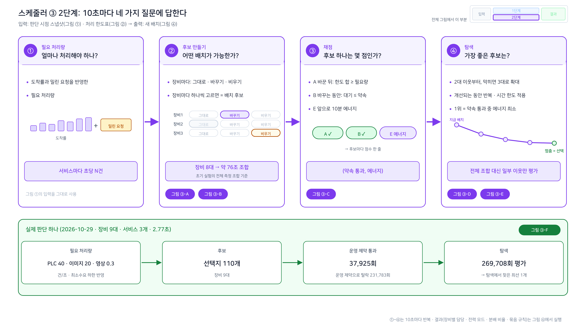

- **10초마다 네 가지 질문**: ① 얼마나 처리해야 하나(필요 처리량) → ② 어떤 배치가 가능한가(후보) → ③ 후보 하나는 몇 점인가(채점) → ④ 가장 좋은 후보는(탐색).
- **하위 그림**: ②는 ③-A·B, ③은 ③-C, ④는 ③-D·E가 펼친다. ③-F는 실제 판단 하나로 ①~④를 처음부터 끝까지 따라간다. 하위 그림 오른쪽 위의 작은 지도에 해당 위치가 표시된다.

#### ③-A 후보 만들기 (1): 장비 한 대의 선택지

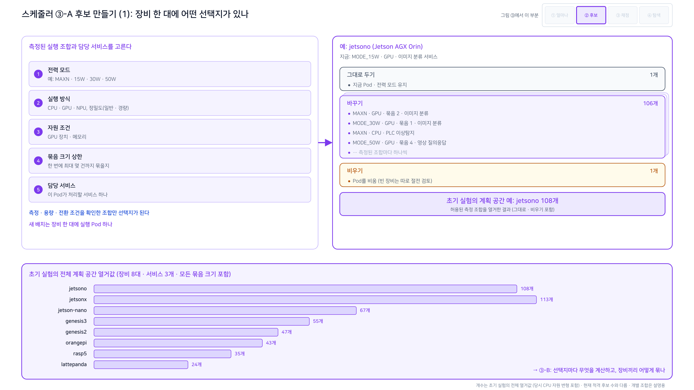

- **선택지 하나 = 다섯 가지를 정한 것**: 전력 모드, 실행 방식, 자원 할당, 묶음 크기 상한, 담당 서비스. 측정 결과가 있는 조합만 선택지가 된다.
- **장비 한 대에 실행 Pod는 1개**: 그대로 두기 1개 + 바꾸기(측정된 조합마다) + 비우기 1개.

#### ③-B 후보 만들기 (2): 선택지마다 계산하는 값과 장비 조합

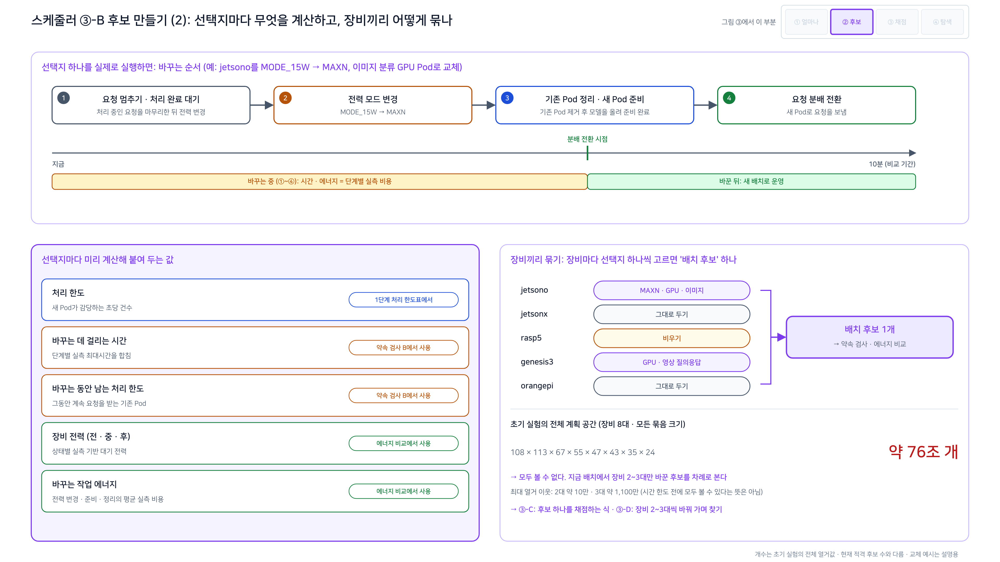

- **바꾸는 순서**: 기존 Pod 정리 → 전력 모드 변경 → 새 Pod 준비 → 요청 분배 전환.
- **미리 붙이는 값 5개**: 처리 한도, 바꾸는 시간, 바꾸는 동안 남는 한도, 장비 전력(전·중·후), 바꾸는 작업 에너지. 모두 실측값이다.
- **장비마다 하나씩 고르면 배치 후보 하나**: 장비 8대면 약 76조 개라 전부 볼 수 없다.

#### ③-C 채점: 후보 하나를 어떻게 채점하고 줄 세우나

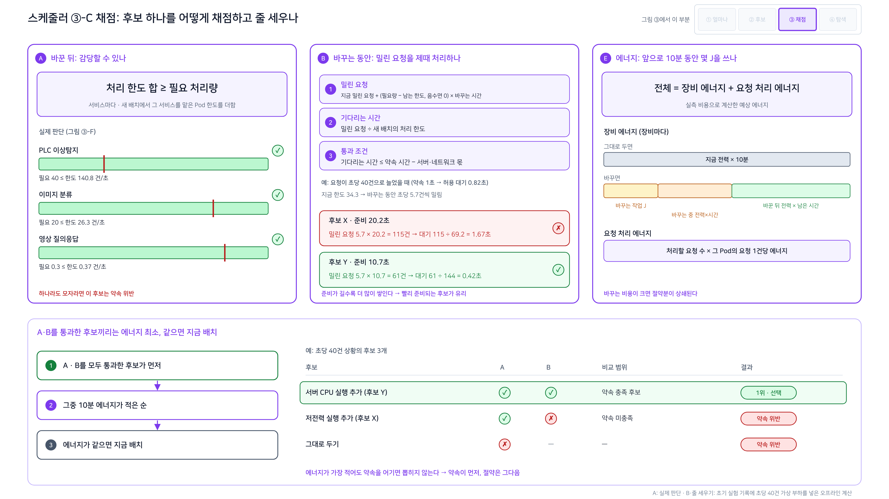

- **A. 바꾼 뒤**: 서비스마다 처리 한도 합 ≥ 필요 처리량이어야 한다.
- **B. 바꾸는 동안**: 밀린 요청 = 지금 밀린 요청 + (필요 처리량 − 남는 한도, 음수면 0) × 바꾸는 시간. 대기 = 밀린 요청 ÷ 새 한도. 대기가 목표 시간 − 서버·네트워크 몫 이하여야 한다.
- **에너지**: 실측 비용으로 계산한 앞으로 10분의 예상 에너지. 장비 에너지(바꾸는 작업 + 바꾸는 중 + 바꾼 뒤)에 요청 처리 에너지(요청 수 × 1건당 에너지)를 더한다.
- **줄 세우기**: A·B를 모두 통과한 후보가 먼저, 그중 에너지가 적은 순, 같으면 지금 배치.

#### ③-D 탐색: 한 걸음 = 장비 2대까지만 바꿔 본다

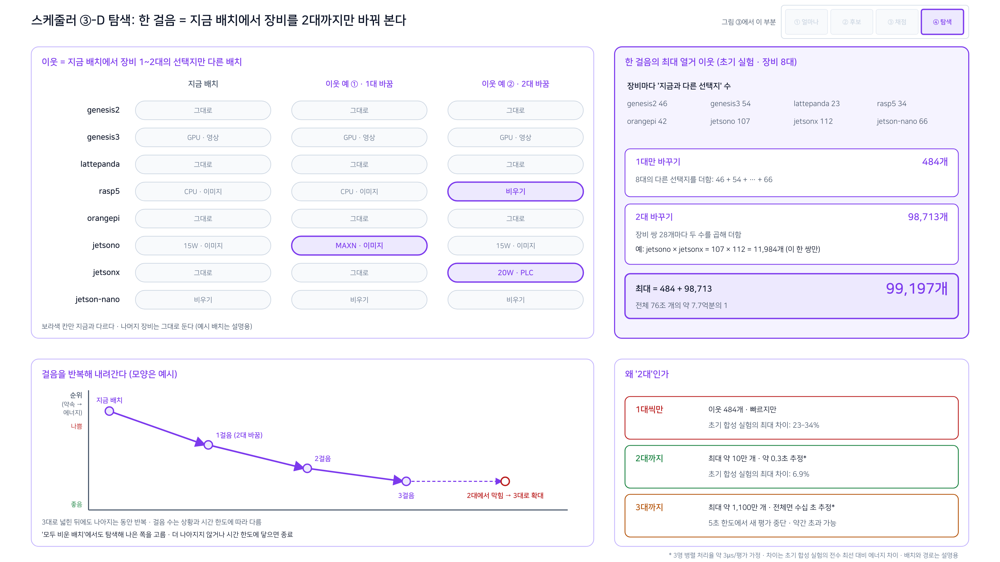

- **이웃**: 지금 배치에서 장비 1~2대의 선택지만 다른 배치다. 나머지 장비는 그대로 둔다.
- **왜 약 10만 개인가**: 1대만 바꾸는 경우 484개(장비별 다른 선택지의 합)와 2대를 바꾸는 경우 98,713개(장비 쌍 28개마다 두 수의 곱)를 더해 99,197개다.
- **한 걸음**: 이웃을 모두 평가(③-C)해 1위로 이동한다. 더 나아지지 않으면 3대까지 넓혀 나아지는 동안 반복하고, 그래도 없으면 멈춘다(또는 5초 한도).

#### ③-E 탐색: 얼마나 걸리나

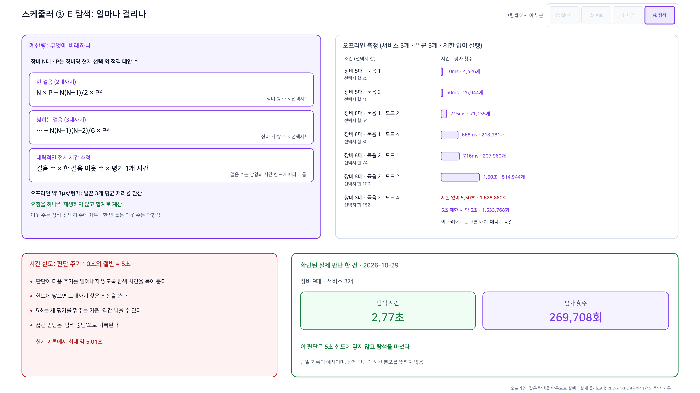

- **계산량**: 한 번 훑는 이웃 수는 장비 쌍 수 × 선택지²에 비례한다(N대, 선택지 P개면 약 N²P²/2). 요청을 하나씩 재생하지 않고 합계로 계산한다.
- **실측(오프라인)**: 장비 5대는 10~60ms, 장비 8대는 0.2~1.5초다. 가장 큰 공간은 제한 없이 5.5초, 5초 제한에서도 같은 배치를 골랐다.
- **실제 판단 하나**: 2026-10-29, 평가 269,708회, 탐색 2.77초. 5초 한도는 새 평가를 멈추는 기준이라 약간 넘을 수 있다.

#### ③-F 실제 판단 하나를 처음부터 끝까지

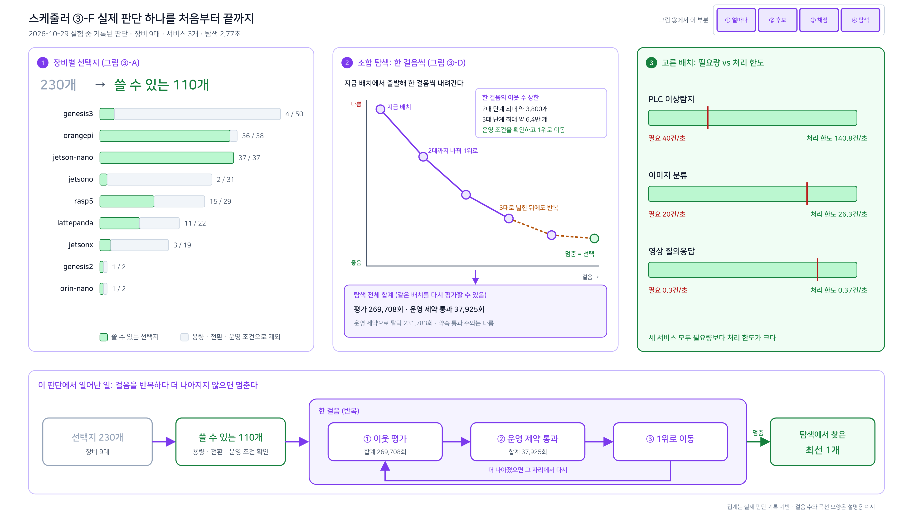

- **2026-10-29 기록(장비 9대·서비스 3개)**: 선택지 110개 → 평가 269,708회(그중 운영 제약 통과 37,925회) → 1개 선택. 탐색에 2.77초가 걸렸다.
- **결과**: 세 서비스 모두 처리 한도가 필요량보다 크다. 예: PLC는 필요 40건/초에 한도 140.8건/초다.

### 6-4. 결과와 적용: 실제 판단 1회에 따른 배치 변화

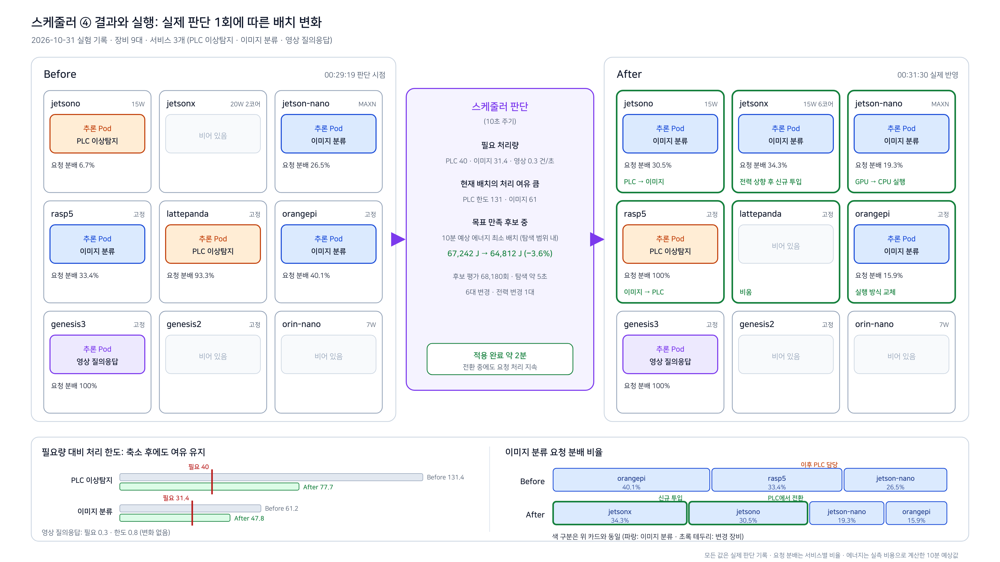

- **2026-10-31 00:29:19 판단 → 00:31:30 반영(장비 9대·서비스 3개)**: 필요 처리량 대비 처리 여유가 커서, 목표를 만족하는 후보 중 10분 예상 에너지가 가장 적은 배치로 바꿨다(67,242 J → 64,812 J, −3.6%).
- **변경 내용**: 장비 6대 변경, 그중 전력 변경 1대(jetsonx). 후보 평가 68,180회, 탐색 약 5초. 5초 한도에서 탐색을 멈췄으므로 탐색 범위 내 최소다.
- **이미지 분류 요청 분배**: orangepi·rasp5·jetson-nano에서 jetsonx(신규 투입)·jetsono(PLC에서 전환)·jetson-nano·orangepi로 바뀌었다. rasp5는 PLC 담당으로 옮겼다.

#### ④-B 요청 증가 대응: 장비 추가 투입

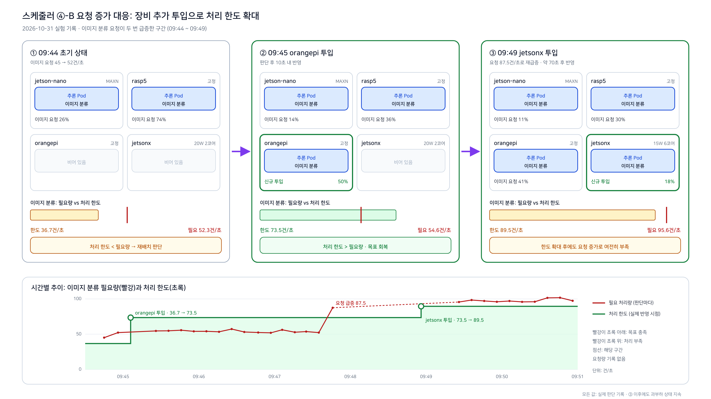

- **2026-10-31 09:44~09:51**: 이미지 분류 필요량이 처리 한도(36.7건/초)를 넘자 orangepi를 투입했고, 판단 후 10초 내 한도가 73.5건/초로 올랐다.
- 요청이 87.5건/초로 다시 늘자 jetsonx 전력을 올려 투입했다(한도 89.5건/초, 약 70초 후 반영). 필요량이 95~102건/초로 계속 늘어 과부하 상태는 남았다.

## 7. 흐름 ③ 운영: "요청을 처리한다"

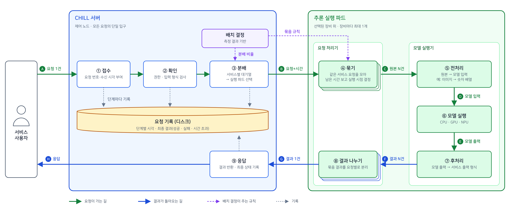

| | 구간 | 주고받는 것 |
|---|---|---|
| A | 사용자 → CHILL 서버 | 서비스 이름 + 인증 토큰 + 원본 데이터 1건 (예: 이미지 한 장) |
| B | CHILL 서버 → 추론 실행 Pod | 원본 데이터 + 요청 번호 + 응답 시간 목표 + 이미 지난 시간 |
| C | 요청 처리기 → 모델 실행기 | 같은 서비스 요청 N건을 묶은 원본 데이터 (Pod 내부 전달) |
| D | 전처리 → 모델 실행 | 모델 입력 (숫자 배열) |
| E | 모델 실행 → 후처리 | 모델 출력 |
| F | 모델 실행기 → 요청 처리기 | 요청별 결과 N건 + 단계별 소요 시간 |
| G | 추론 실행 Pod → CHILL 서버 | 요청 1건의 결과 + 처리 내역 (묶음 크기·대기·실행 시간) |
| H | CHILL 서버 → 사용자 | 결과 + 요청 번호 (실패 시 사유: 시간 초과·거절 등) |

- 요청을 묶는 일은 추론 실행 Pod가 한다. 남은 시간을 보고 몇 건을 묶을지, 언제 실행할지 정한다.
- 배치 결정은 두 가지 규칙을 준다. 서버에는 Pod별 분배 비율을, Pod에는 묶음 규칙을 준다.
- 응답 시간은 CHILL이 요청을 받은 순간부터 응답을 돌려줄 때까지로 잰다. 대기 시간도 포함한다.
- 모든 요청의 시간과 결과(성공·실패·거절)를 기록해 나중에 다시 계산할 수 있게 한다.
- 요청량이 바뀌면 흐름 ②로 돌아가 배치를 다시 판단한다.

### 7-1. 추론 실행 Pod 내부: 런타임 firstfloor

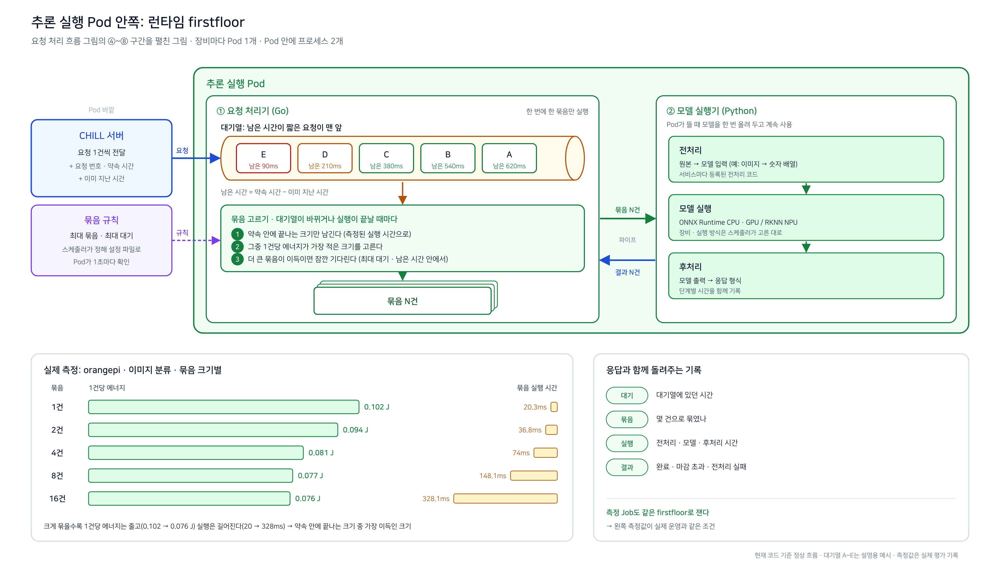

- **요청 처리기(Go)**: 남은 시간이 짧은 요청을 대기열 앞에 둔다. 목표 시간 안에 끝나는 묶음 크기 중 요청당 에너지가 가장 적은 크기를 고르고, 한 번에 한 묶음만 실행한다.
- **모델 실행기(Python)**: Pod가 시작될 때 모델을 올려 두고 전처리 → 모델 실행 → 후처리를 수행한다.
- **실측 예(orangepi·이미지 분류)**: 묶음 크기 1 → 16에서 요청당 에너지는 0.102 → 0.076 J로 줄고, 묶음 실행 시간은 20.3 → 328.1ms로 늘었다.

---

## 8. 장비 상태 (어떤 장비가 무엇을 하나)

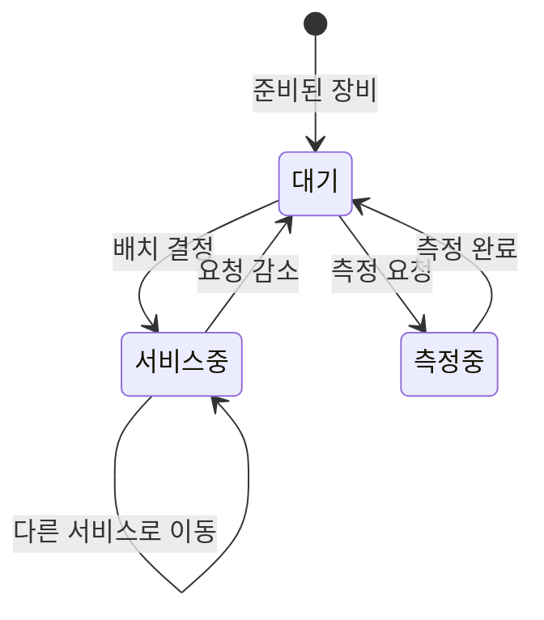

- **서비스 중**: 한 서비스를 담당한다. 장비 하나는 한 번에 한 서비스만 맡는다.
- **측정 중**: 측정만 한다. 서비스 요청은 받지 않는다.
- **대기**: 켜져 있지만 일이 없다. 가장 낮은 전력 설정으로 둔다.

---

## 9. 평가 방식과 결과

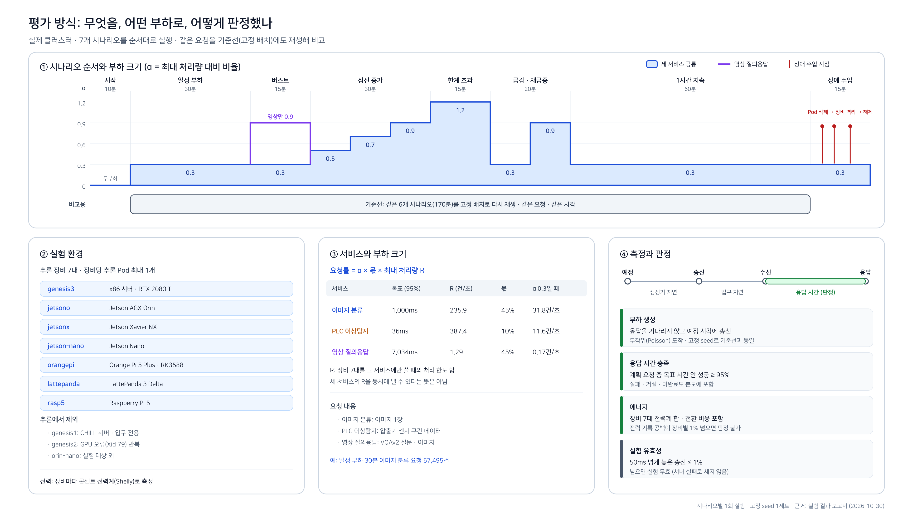

- **시나리오 순서**: 시작(무부하 10분) → 일정 부하(α 0.3, 30분) → 버스트(영상 질의응답만 0.3→0.9, 15분) → 점진 증가(0.5·0.7·0.9 각 10분) → 한계 초과(1.2, 15분) → 급감·재급증(0.3→0.9, 20분) → 1시간 지속(0.3, 60분) → 장애 주입(0.3, 15분; 3분 Pod 삭제·6분 장비 격리·10분 해제).
- **요청률**: α × 몫 × 최대 처리량 R. R은 장비 7대를 그 서비스에만 쓸 때의 처리 한도 합(이미지 분류 235.9 · PLC 387.4 · 영상 질의응답 1.29건/초), 몫은 45%·10%·45%다.
- **판정**: 응답 시간은 CHILL 수신부터 응답까지. 계획 요청 중 목표 시간 안 성공이 95% 이상이면 충족이며, 실패·거절·미완료도 분모에 넣는다. 50ms 넘게 늦은 송신이 1%를 넘으면 실험 무효다.
- **기준선**: 일정 부하~1시간 지속 6개 시나리오(170분)를 고정 배치로 같은 요청·같은 시각에 다시 재생한다.

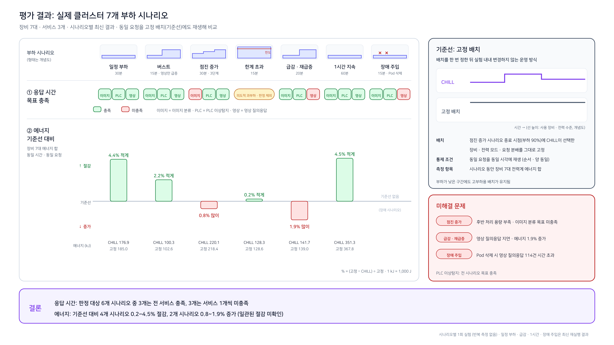

- **조건**: 장비 7대·서비스 3개, 부하 시나리오 7개(일정 부하·버스트·점진 증가·한계 초과·급감과 재급증·1시간 지속·장애 주입). 시나리오별 최신 결과만 표시한다.
- **기준선(고정 배치)**: 점진 증가 시나리오 종료 시점(부하 90%)에 CHILL이 선택한 장비·전력 모드·요청 분배를 실험 내내 고정한 운영이다. 같은 요청을 같은 시각에 재생하고, 장비 7대 전력계 에너지 합을 비교한다.
- **응답 시간**: 판정 대상 6개 시나리오 중 3개는 세 서비스 모두 목표 충족, 3개는 서비스 1개씩 미충족(점진 증가: 이미지 분류, 급감과 재급증·장애 주입: 영상 질의응답). PLC 이상탐지는 전 시나리오 충족.
- **에너지**: 기준선 대비 4개 시나리오에서 0.2~4.5% 절감, 2개 시나리오에서 0.8~1.9% 증가. 일관된 절감은 확인되지 않았다.
- **한계**: 시나리오별 1회 실험이며 반복 측정이 없다. 근거는 `docs/reports/e5-evaluation-20261030.md`.

## 10. 목표별 달성 현황

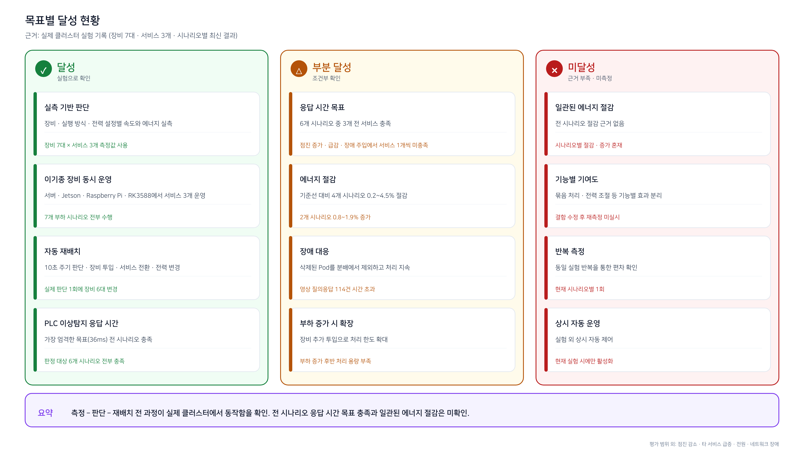

| 구분 | 항목 |
|---|---|
| 달성 | 실측 기반 판단 · 이기종 장비 동시 운영 · 자동 재배치 · PLC 이상탐지 응답 시간 목표 |
| 부분 달성 | 응답 시간 목표(6개 중 3개 시나리오) · 에너지 절감(4개 절감, 2개 증가) · 장애 대응 · 부하 증가 시 확장 |
| 미달성 | 일관된 에너지 절감 · 기능별 기여도 · 반복 측정 · 상시 자동 운영 |

## 11. 향후 계획

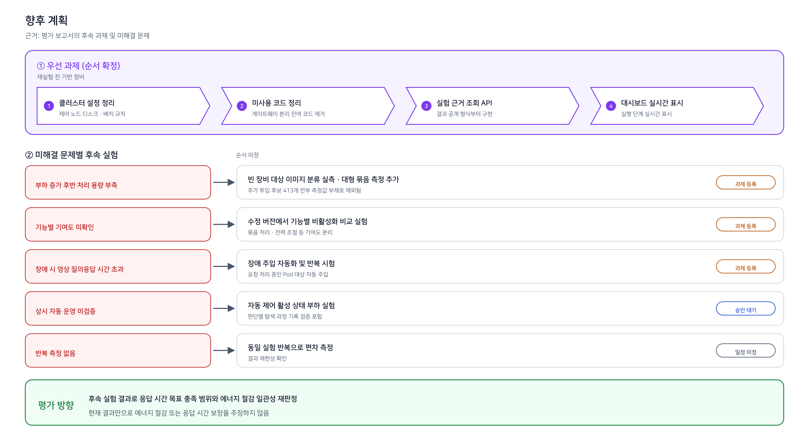

- **우선 과제(순서 확정)**: 클러스터 설정 정리 → 미사용 코드 정리 → 실험 근거 조회 API → 대시보드 실시간 표시.
- **미해결 문제별 후속 실험(순서 미정)**: 빈 장비 이미지 분류 실측, 수정 버전 기능별 비교, 장애 주입 자동화, 자동 제어 활성 상태 부하 실험, 반복 측정.

---

## 12. 핵심 원칙

- **측정이 근거다**: 사양표가 아니라 실제 장비에서 잰 값으로 결정한다.
- **목표가 먼저, 절감은 그다음**: 응답 시간 목표와 에너지를 임의 비율로 섞지 않는다. 목표를 만족하는 배치 안에서만 아낀다.
- **바꾸는 비용도 비용이다**: 배치 변경에 드는 시간과 전력도 계산에 넣는다.
- **기록을 남긴다**: 측정 원본과 요청 기록을 저장해 결과를 다시 확인할 수 있게 한다.
- **한계를 숨기지 않는다**: 급격한 요청 증가 같은 상황에서는 목표를 만족하지 못할 수 있다. 이런 경우를 따로 기록하고 실험으로 확인한다.

## 13. 한 줄 정리

> **CHILL = 실제로 재 보고, 응답 시간 목표를 만족하는 배치 중 에너지가 가장 적은 배치로 자동 운영하는 엣지 AI 추론 시스템**
