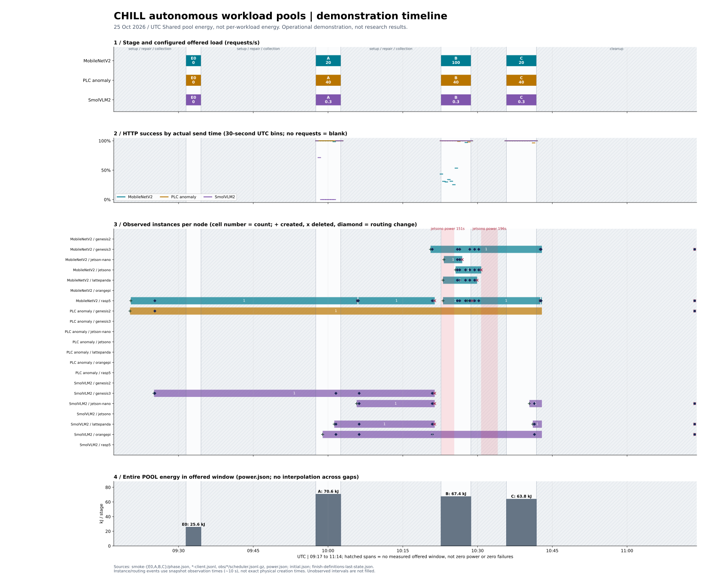

# 자율 워크로드 풀 시연 보고서

원시 근거: `/home/genesis1/.cache/chill-assets/ops/pools-deploy/campaign/v2/demo-20261025-2/` (아래 원시 파일명·재생성 명령의 기준 디렉터리).
이 보고서는 당시 기록이다. 후속 처리 상태는 [시연 비교](README.md)와 [남은 계획](../../plans/2026-10-26-remaining-roadmap.md)을 따른다.

**빈 상태에서 첫 구성을 만들고, 부하에 따라 늘리고 줄이는 흐름은 실제로 동작했다.**
**하지만 첫 구성이 느린 모델을 고르고, 확장 중 준비된 장치도 느린 전력 전환을 기다려 요청을 놓쳤다.**
**도구 고장과 긴 공백을 포함한 운영 시연이며, 연구 결과나 공정한 성능·절전 비교가 아니다.**

그림 읽기: 청록색은 MobileNetV2 이미지 분류, 황토색은 공정 이상 탐지, 보라색은 SmolVLM2 영상 질의응답이다. 요청 수와 성공률은 작업별이다. 세 번째 레인은 작업·노드별 관측 인스턴스 수이며, `+`는 생성, `×`는 삭제, ◆는 분배 변경이다. 빨간 구간은 jetsono 전력 모드 전환이다. 빗금은 단계 밖의 준비·도구 수리·수집·정리 구간으로, 요청 실패가 없었다는 뜻이 아니다. 인스턴스 이벤트는 약 10초 간격 관측 시각이라 실제 발생 시각과 차이가 날 수 있다.

## 단계별 결과

요청은 예정한 전체 요청 수, 성공률은 그중 HTTP 성공 응답 비율이다. p95는 **성공 응답만의 왕복 지연시간** 95번째 백분위수다. 기준은 설정된 지연시간 목표이며, SmolVLM2만 p99 기준이다. 성공률이 높아도 지연시간 기준을 지켰다는 뜻은 아니다.

| 단계 / UTC 부하 구간 | 작업 | 요청 / 성공 | 성공률 | p95 (ms) | 지연시간 기준 | 배치 변경¹ | 전체 풀 에너지² |
|---|---|---:|---:|---:|---|---:|---:|
| E0 / 09:31:29–09:34:29 | MobileNetV2 | 0 / 0 | — | — | p95 ≤ 1000 ms | 9 (단계 공통) | 25.578 kJ (단계 공통) |
| E0 / 09:31:29–09:34:29 | PLC anomaly | 0 / 0 | — | — | p95 ≤ 50 ms | 9 (단계 공통) | 25.578 kJ (단계 공통) |
| E0 / 09:31:29–09:34:29 | SmolVLM2 | 0 / 0 | — | — | p99 ≤ 60000 ms | 9 (단계 공통) | 25.578 kJ (단계 공통) |
| A / 09:57:33–10:02:33 | MobileNetV2 | 5,996 / 5,987 | 99.85% | 116.97 | p95 ≤ 1000 ms | 12 (단계 공통) | 70.568 kJ (단계 공통) |
| A / 09:57:33–10:02:33 | PLC anomaly | 11,812 / 11,812 | 100.00% | 10.17 | p95 ≤ 50 ms | 12 (단계 공통) | 70.568 kJ (단계 공통) |
| A / 09:57:33–10:02:33 | SmolVLM2 | 60 / 18 | 30.00% | 66227.71 | p99 ≤ 60000 ms | 12 (단계 공통) | 70.568 kJ (단계 공통) |
| B / 10:22:40–10:28:40 | MobileNetV2 | 36,112 / 23,044 | 63.81% | 1972.03 | p95 ≤ 1000 ms | 34 (단계 공통) | 67.359 kJ (단계 공통) |
| B / 10:22:40–10:28:40 | PLC anomaly | 14,125 / 14,092 | 99.77% | 13.08 | p95 ≤ 50 ms | 34 (단계 공통) | 67.359 kJ (단계 공통) |
| B / 10:22:40–10:28:40 | SmolVLM2 | 86 / 86 | 100.00% | 12859.67 | p99 ≤ 60000 ms | 34 (단계 공통) | 67.359 kJ (단계 공통) |
| C / 10:35:48–10:41:48 | MobileNetV2 | 7,168 / 7,168 | 100.00% | 64.44 | p95 ≤ 1000 ms | 16 (단계 공통) | 63.831 kJ (단계 공통) |
| C / 10:35:48–10:41:48 | PLC anomaly | 14,125 / 14,083 | 99.70% | 11.46 | p95 ≤ 50 ms | 16 (단계 공통) | 63.831 kJ (단계 공통) |
| C / 10:35:48–10:41:48 | SmolVLM2 | 86 / 86 | 100.00% | 12773.52 | p99 ≤ 60000 ms | 16 (단계 공통) | 63.831 kJ (단계 공통) |

¹ 배치 변경은 요청 묶음 크기만이 아니라 인스턴스 생성·삭제·할당 및 분배·전력 모드 변경을 합한 **단계 전체 배치(placement) 변경 횟수**다. 직전 단계 후 상태부터 현재 단계 후 상태까지 원시 스냅샷 차이를 세어, 사이 공백의 준비·축소도 다음 단계에 포함한다(E0는 그림 시작부터, A는 복구 후 상태까지). 작업별 수가 아니므로 행을 더하지 않는다.
² **에너지는 전체 POOL 값이며 워크로드별 값이 아니다.** `power.json`의 `wholePoolJoules`를 kJ로 바꿨다. 같은 단계 세 행은 같은 값을 반복하므로 합산하면 안 된다. 단계 부하 구간만 포함하며, 공백·늦은 요청 정리 에너지는 이 표에 포함하지 않았다. 특히 A의 늦은 수집·정리까지 포함하면 부하 구간과 전혀 다른 범위가 되므로 비교하지 않는다.

## 무엇이 잘 됐나

- **빈 출발 → 첫 구성:** 요청을 넣기 전 자율 제어가 공정 이상 탐지는 genesis2, 이미지 분류는 rasp5, 영상 질의응답은 genesis3에 첫 인스턴스를 만들고 분배를 연결했다. E0 부하 구간은 무부하 상태 확인이며, 실제 첫 생성은 그보다 앞선 준비 구간에 일어났다. 그림은 이를 09:17부터 보여 준다.
- **확장:** A에서 영상 질의응답용 INT8 인스턴스를 추가했고, B의 이미지 분류 100 req/s 증가에도 여러 노드의 인스턴스를 준비했다. 다만 준비가 곧 요청 분배를 뜻하지 않아, 아래 손실이 발생했다.
- **축소:** 낮은 부하로 바뀌는 C 전후에는 이미지 분류 인스턴스와 분배 대상이 줄었다. C의 이미지 분류는 전 요청 성공, p95 약 64 ms였다. 단계 사이 긴 공백에서도 축소가 일어났으므로, 순수한 100→20 req/s 연속 전환 실험으로 해석하면 안 된다.
- **출발 수정의 세 효과:** 최근 10초 요청률과 60초 평균 중 큰 값을 사용해 B 시작 5.46초 뒤 수요 41.7 req/s로 확장을 결정했고 약 15초 뒤 97.4 req/s를 반영했다. 증가 구간에는 genesis3를 유지했다. 미사용 노드 절전은 기다리지 않았지만 실제 목표 jetsono 상향은 151초가 걸렸다. 수정 전후 동일 조건 효과 크기는 측정하지 않았다. 후속 결정은 [비교 요약](README.md)을 참조한다.

## 무엇이 안 됐나

- **A의 SmolVLM2 성공률 30%:** 무부하에서 가장 싼 첫 구성인 FP32 실행을 골랐지만 실제 요청에는 너무 느렸다. INT8 실행으로 바꾸는 데 약 4분이 걸려 60개 중 18개만 성공했다. 성공한 응답도 p95 약 66초로, 설정된 p99 60초 기준보다 느렸다. 첫 INT8 분배가 생겨도 이전 FP32 분배가 곧바로 완전히 사라진 것은 아니다.
- **B의 이미지 분류 성공률 약 64%:** 긴 무부하 공백 중 축소되어 genesis3 한 대만 분배를 받는 상태에서 100 req/s가 시작됐다. rasp5·lattepanda·jetson-nano 세 대는 먼저 준비됐지만, 전체 목표에 포함된 jetsono의 전력 모드 전환(약 151초)과 준비가 끝나기 전까지 분배를 받지 못했다. 시작부터 새 분배까지 약 194초가 걸렸다. 준비된 처리 능력이 있어도 연결을 늦춰 놓친 것이다. 36,112개 중 13,068개 실패했으며, 그 실패의 99.33%는 첫 210초에 몰렸다. 대표 실패 경로는 대기열 약 1.96초와 요청 수명 2초 소진이다. 증설 자체가 시작되지 않은 문제나 사용하지 않는 노드를 절전할 때까지 기다린 문제는 아니다.

## 도구 고장 세 번과 공백

세 번의 시연 도구 고장은 모델·스케줄러 성능 실패와 구분한다: (1) 반환 결과 `null` 처리 오류, (2) 요청 생성기 종료 코드 2로 시작 장벽 통과 실패, (3) 유휴 상태 대기 194초 제한 실패. 원시·로그는 덮어쓰지 않고 보존했으며, A는 부하를 재생하지 않고 원래 종료 구간을 수집했다. 이 세 번 외에 마지막 정리에서도 분배 확인 충돌이 있었고, 재개 절차로 실제 인스턴스와 분배 선언을 반환했다.

| 단계 사이 | 부하 구간 끝 → 다음 시작 (UTC) | 공백 | 해석 |
|---|---|---:|---|
| E0 → A | 09:34:29 → 09:57:33 | 1383.388초 | 요청 정리·수집·준비와 도구 수리 포함; 연속 부하 아님 |
| A → B | 10:02:33 → 10:22:40 | 1206.313초 | 요청 정리·수집·준비와 도구 수리 포함; 연속 부하 아님 |
| B → C | 10:28:40 → 10:35:48 | 427.486초 | 요청 정리·수집·준비와 도구 수리 포함; 연속 부하 아님 |

특히 A→B 공백은 약 20분이다. 공백의 요청 실패율은 생산기가 측정하지 않았으므로 0%로 표시하지 않는다. 마지막 C 뒤 빗금은 결과 수집과 정리이며, 그 전체가 도구 고장 시간이라는 뜻도 아니다.

## 다음 할 일

1. 이미 준비된 용량부터 분배하고, 느린 전력 전환은 뒤에서 마치는 제어 수정안을 선택한다.
2. 첫 구성에서 무부하 최저 비용만 고르지 않도록 시작 조건을 정하고, 같은 조건으로 다시 시연한다.
3. 도구 수집·정리를 안정화한 뒤 공백 없는 재시연과 관측을 보존하는 화면을 준비한다. 연구 평가는 별도 승인·조건으로 진행한다.

## 출처와 재생산

- 실행: 이 폴더에서 `python3 timeline.py`. 외부 서비스·클러스터 접근 없이 보존된 파일만 읽어 `timeline.svg`와 이 보고서를 다시 만든다. Python 3와 설치된 matplotlib을 사용한다.
- 단계·부하·요청 분모: `smoke-{E0,A,B,C}/phase.json`의 단계별 추적 요청 목록과 시작·종료 시각.
- 성공·p95·30초 구간: 같은 폴더의 `*-client.jsonl`. 시작 이벤트의 벽시계/단조시계 대응으로 실제 전송 시각을 계산한다. 누락 행도 예정 요청 분모에서 빼지 않는다. 요청이 없는 구간은 빈칸이다.
- 인스턴스·분배·전력 전환: 각 단계 `obs/*/scheduler.jsonl.gz` 원시 스트림의 스냅샷·액션. 이는 `observation-raw.tar.gz`의 분할 `scheduler.N.jsonl`과 같은 보존 원시이며, 겹친 관측은 시각/액션 식별자로 중복 제거한다. 처음과 정리 완료 상태는 `initial.json`, `finish-definitions-last-state.json`에서 읽는다. 그림은 관측 사이 상태를 계단형으로 표시하며 마지막 실제 관측 이후로 연장하지 않는다.
- 단계 에너지: `smoke-{E0,A,B,C}/power.json`, 전체 풀 벽면 계측값. 그래프 높이는 단계 총에너지이며 순간 전력이 아니다.
- 원인 이력은 원시 근거 디렉터리 기준 `../../../intent/checkpoints.md` 1871·1887·1895·1901–1909행이다. 현재 처리 상태는 [비교 요약](README.md)을 참조한다.
- **이 문서는 운영 시연 보고서다. 연구 결과, 반복 실험의 통계적 결론, 작업별 에너지 또는 수정 전후의 인과적 성능 비교로 사용하지 않는다.**
