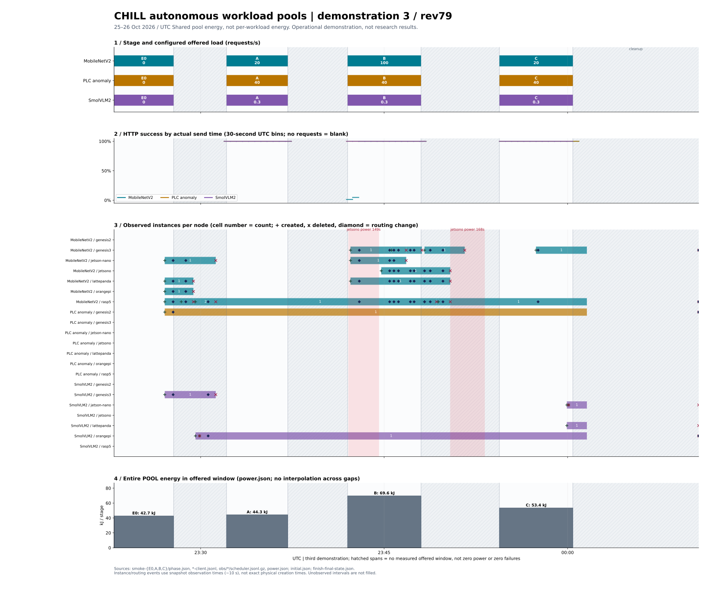

# 자율 워크로드 풀 시연 3회차 보고서

원시 근거: `/home/genesis1/.cache/chill-assets/ops/pools-deploy/campaign/v2/demo-20261026-2/` (아래 원시 파일명·재생성 명령의 기준 디렉터리).
이 보고서는 당시 기록이다. PLC 원인과 ④ 구현은 이후 완료됐으며 [비교 요약](README.md), [성능 보고서](../gateway-performance-20261026.md), [남은 계획](../../plans/2026-10-26-remaining-roadmap.md)이 현재 처리 상태다.

**빈 상태에서 약 292초 안에 세 작업의 준비·분배를 마쳤고, A와 C는 세 작업 모두 100% 성공했다.**  
**B의 MNV는 1회차 63.81% → 3회차 85.36%로 좋아졌지만, 첫 60초에 5,286개(14.64%)를 놓쳤다. PLC도 전부 성공했으나 p95 67ms로 50ms 목표를 넘었다.**  
**이 문서는 운영 시연 기록이다. 에너지는 전체 POOL 값이며, 연구 결과·작업별 에너지·수정의 인과 효과나 절전율을 뜻하지 않는다.**

그림: 청록 MNV(이미지 분류), 황토 PLC(공정 이상 탐지), 보라 Smol(영상 질의응답). 위에서 부하 → 30초 성공률 → 작업·노드별 인스턴스 수와 생성(+)/삭제(×)/분배 변경(◆) → 단계별 POOL 에너지다. 빨간 띠는 jetsono 전력 전환이다. 빗금은 단계 밖 준비·수집·정리 구간으로, 실패 0이나 전력 0이 아니다. 관측 이벤트는 약 10초 간격 스냅샷 시각이며 실제 동작 시각과 차이가 날 수 있다. UTC 자정 뒤는 10월 26일이다.

## 단계별 결과

성공률 = HTTP 성공 / 예정 요청 전체. p95는 **성공 응답의 클라이언트 왕복 지연**이며 서버 실행시간만이 아니다. MNV 목표 p95≤1000ms, PLC p95≤50ms, Smol 목표는 p99≤60000ms이므로 Smol p95만으로 목표 준수를 판정하지 않는다. E0는 요청 없이 준비 상태를 기다린 구간이다.

| 단계 / UTC 구간 | 작업 | 예정 / 성공 | 성공률 | p95 ms | 배치 변경¹ | POOL kJ² |
|---|---|---:|---:|---:|---:|---:|
| E0 / 23:22:55–23:27:47 | MNV | 0 / 0 | — | — | 20 | 42.740 |
| E0 / 23:22:55–23:27:47 | PLC | 0 / 0 | — | — | 20 | 42.740 |
| E0 / 23:22:55–23:27:47 | Smol | 0 / 0 | — | — | 20 | 42.740 |
| A / 23:32:06–23:37:07 | MNV | 5,996 / 5,996 | 100.00% | 224.30 | 26 | 44.254 |
| A / 23:32:06–23:37:07 | PLC | 11,812 / 11,812 | 100.00% | 18.91 | 26 | 44.254 |
| A / 23:32:06–23:37:07 | Smol | 60 / 60 | 100.00% | 3000.59 | 26 | 44.254 |
| B / 23:42:00–23:48:01 | MNV | 36,112 / 30,826 | 85.36% | 869.97 | 30 | 69.644 |
| B / 23:42:00–23:48:01 | PLC | 14,125 / 14,125 | 100.00% | 67.09 | 30 | 69.644 |
| B / 23:42:00–23:48:01 | Smol | 86 / 86 | 100.00% | 4131.50 | 30 | 69.644 |
| C / 23:54:25–00:00:26 | MNV | 7,168 / 7,168 | 100.00% | 232.84 | 31 | 53.432 |
| C / 23:54:25–00:00:26 | PLC | 14,125 / 14,125 | 100.00% | 22.39 | 31 | 53.432 |
| C / 23:54:25–00:00:26 | Smol | 86 / 86 | 100.00% | 3938.48 | 31 | 53.432 |

¹ 배치는 요청 묶음(batch) 크기가 아니라 placement다. 인스턴스 생성·삭제·할당·분배·노드 전력 모드 변경을 합산한다. 1회차 `timeline.py`와 같은 스냅샷 차이 집계이며, 직전 단계 후 상태부터 현재 단계 후 상태까지의 준비·공백도 다음 단계에 넣는다(E0는 E0 시작부터). 같은 단계 세 행은 같은 합계이므로 더하지 않는다.
² `power.json`의 `wholePoolJoules`를 kJ로 변환한 **전체 POOL 부하 구간 값**이다. 작업별 귀속값이 아니며 세 행을 합산하지 않는다. 준비·수집·늦은 요청 정리까지 포함한 drain-inclusive 값과 섞지 않았다. E0 길이가 1·2회차 180초, 3회차 약292초로 달라 에너지 크기의 단순 비교도 부적절하다.

## 1/2/3회차 비교

각 셀의 작업 순서는 **MNV / PLC / Smol**, p95 단위는 ms다. 배치 변경은 위의 공백 포함 공통 방식으로 재계산했다.

| 회차 / 제어 버전 | 단계 | 성공률 % (M/P/S) | p95 ms (M/P/S) | 배치 변경 | POOL kJ |
|---|---|---|---|---:|---:|
| 1회차 / rev74 · `3dff4e78` | E0 | — / — / — | — / — / — | 9 | 25.578 |
| 1회차 / rev74 · `3dff4e78` | A | 99.85 / 100 / 30 | 116.97 / 10.17 / 66227.71 | 12 | 70.568 |
| 1회차 / rev74 · `3dff4e78` | B | 63.81 / 99.77 / 100 | 1972.03 / 13.08 / 12859.67 | 34 | 67.359 |
| 1회차 / rev74 · `3dff4e78` | C | 100 / 99.70 / 100 | 64.44 / 11.46 / 12773.52 | 16 | 63.831 |
| 2회차 / rev75 · `7decd2fb` | E0 | — / — / — | — / — / — | 7 | 25.987 |
| 2회차 / rev75 · `7decd2fb` | A | 100.00 / 99.85 / 100.00 | 224.78 / 16.47 / 2921.99 | 15 | 43.969 |
| 2회차 / rev75 · `7decd2fb` | B | 0.67 / 100.00 / 100.00 | 2000.97 / 15.15 / 4007.35 | 10 | 53.389 |
| 2회차 / rev75 · `7decd2fb` | C | 100.00 / 100.00 / 100.00 | 231.88 / 14.27 / 3988.74 | 0 | 52.998 |
| 3회차 / rev79 · `1a94fe41` | E0 | — / — / — | — / — / — | 20 | 42.740 |
| 3회차 / rev79 · `1a94fe41` | A | 100.00 / 100.00 / 100.00 | 224.30 / 18.91 / 3000.59 | 26 | 44.254 |
| 3회차 / rev79 · `1a94fe41` | B | 85.36 / 100.00 / 100.00 | 869.97 / 67.09 / 4131.50 | 30 | 69.644 |
| 3회차 / rev79 · `1a94fe41` | C | 100.00 / 100.00 / 100.00 | 232.84 / 22.39 / 3938.48 | 31 | 53.432 |

**중요한 분모 차이:** 2회차 B의 위 10회는 B 전 준비·공백을 포함한 변경이다. **B 부하가 들어간 360초 안의 배치 변경은 0회**였다. 기존 기록의 “E0 6회/B 0회”와 위 공백 포함 재계산값을 같은 지표로 읽으면 안 된다. 1회차 A Smol은 0.2 req/s(60개), 2·3회차는 0.3 req/s(같은 추적 목록에서 60개)이고, 공백·시작 구성·제어 소스도 다르다. 세 회는 동일 조건 반복 실험이 아니다.

## 무엇이 달라졌나

- **최소 수요 → A Smol 100%:** 1회차는 무부하 최저 비용의 느린 FP32 첫 구성을 골랐다. 2회차부터 MNV 20 / Smol 0.3 / PLC 40 req/s를 최소 수요로 고정해 첫 구성부터 실제 부하를 감당할 후보를 고르게 했다. A Smol은 30%에서 100%로, 성공 응답 p95는 약66초에서 약3초로 바뀌었다. 이는 관측된 동반 변화이며 단독 효과 크기를 분리 측정한 것은 아니다.
- **실물·예약 장부 → B 확장 0회에서 정상 동작:** 2회차는 정책 ACK 대기를 실물 소실로 읽어 PLC의 같은 물리 슬롯에 중복 준비했고, 전역 자원 검사에서 막혀 B 동안 확장을 못 했다. 3회차는 ①Pod 실물 장부 ②작업 범위 예약 ③예약 밖 판단 지속으로 이를 바꿨다. 빈 출발 후보 비교(leximin)·정보 대기·Ready 관측·늦은 probe 수정도 함께 들어갔다. 3회차는 B 확장을 실행했고 MNV 성공률 0.67%에서 85.36%로 회복했다. “정상”은 확장 동작을 뜻하며 손실 0이나 모든 SLO 충족이 아니다.
- **전환 중 분배 → B 약64%에서 약85%:** 1회차는 먼저 준비된 용량도 jetsono의 느린 전력 전환과 전체 목표 완료를 기다렸다. 3회차는 먼저 쓸 수 있는 용량으로 분배를 이어가는 방향으로 바뀌었다. B MNV p95는 약1972ms에서 약870ms로 낮아졌다. 다만 제어 수정 여러 개와 초기 상태 차이가 함께 있어 21.55%p를 특정 수정 하나의 인과 효과로 부르지 않는다.

## 남은 것

### B의 14.64% 손실은 첫 60초에 전부 몰렸다

MNV 총 36,112개 중 30,826개 성공, 5,286개 실패다. 아래는 **B의 MNV 생산기 시작부터 실제 전송 시각 기준 30초 구간**이며 예정 추적 전체를 분모로 썼다. 누락 결과도 성공에서 제외한다. 그림의 UTC 정렬 30초 구간과 경계가 약간 다르다.

| 시작 후 초 | 예정 요청 | 성공 | 실패 | 성공률 | 전체 실패 중 비중 |
|---|---:|---:|---:|---:|---:|
| 0–30 | 3,022 | 35 | 2,987 | 1.16% | 56.51% |
| 30–60 | 2,974 | 675 | 2,299 | 22.70% | 43.49% |
| 60–90 | 2,983 | 2,983 | 0 | 100.00% | 0.00% |
| 90–120 | 3,000 | 3,000 | 0 | 100.00% | 0.00% |
| 120–150 | 2,981 | 2,981 | 0 | 100.00% | 0.00% |
| 150–180 | 3,087 | 3,087 | 0 | 100.00% | 0.00% |
| 180–210 | 2,924 | 2,924 | 0 | 100.00% | 0.00% |
| 210–240 | 3,034 | 3,034 | 0 | 100.00% | 0.00% |
| 240–270 | 3,092 | 3,092 | 0 | 100.00% | 0.00% |
| 270–300 | 3,019 | 3,019 | 0 | 100.00% | 0.00% |
| 300–330 | 2,958 | 2,958 | 0 | 100.00% | 0.00% |
| 330–360 | 3,038 | 3,038 | 0 | 100.00% | 0.00% |

따라서 손실은 6분 내내 처리 능력이 모자란 형태가 아니라 **시작 직후 증설·분배가 따라잡기 전 구간**에 집중된다. 60초 이후 300초는 전 요청이 성공했다. 다만 실패 시각의 집중만으로 준비 지연·대기열·분배 비중 각각의 기여량을 확정하지 않는다.

### PLC p95 67ms: 성공과 지연시간 목표는 다르다

PLC B는 14,125/14,125개 성공했지만 p95 67.09ms로 50ms 목표보다 17.09ms 높다. A 18.91ms, C 22.39ms보다 B에서만 높아졌다. PLC의 실제 전송 기준 30초 구간 p95는 차례로 **63.21 / 56.99 / 54.57 / 51.44 / 54.77 / 77.71 / 70.04 / 87.58 / 85.19 / 69.17 / 56.75 / 74.15ms**였다. 50ms 초과는 총 1,441개(10.20%)이고, MNV 손실이 끝난 60초 뒤에도 계속된다. 따라서 **MNV 첫60초 전환만으로 PLC 지연 전체를 설명할 수 없다.**

**원인 후보**는 (1) 높은 MNV 부하와 공유하는 입구의 대기·직렬 처리, (2) 노드/CPU/네트워크 자원 경합, (3) 재배치·분배 전환이 일부 요청에 더한 긴 꼬리다. 이 수치는 클라이언트 왕복값이므로 모델 실행시간만의 문제라고 단정할 수 없다. 후보를 확정하려면 같은 30초 구간의 PLC 꼬리 요청과 서버 대기열·실행·전송 시간을 연결해야 한다. 추가 부하나 클러스터 조회는 하지 않았다.

## 다음 할 일

1. B 첫60초의 준비 완료·분배 적용·대기열 만료를 요청별로 연결해 남은 5,286개 손실의 원인을 나눈다.
2. PLC 50ms 초과 요청을 같은 구간·노드·서버 대기시간으로 나눠 입구 병목과 실행 자원 경합을 구별한다.
3. 승인된 빠른 증설/느린 축소 정책을 문서→구현 순으로 반영한 뒤, 시작 조건과 단계 사이 공백을 통제해 다시 시연한다. 연구 평가는 별도 조건·승인으로 진행한다.

## 근거와 재생산

- `python3 timeline.py`: 1회차 스크립트의 원시 읽기·그림·배치 집계 코드를 복사해 현재 시각과 종료 상태에 맞췄다. 설치된 matplotlib과 표준 라이브러리를 사용하며 보존 파일만 읽어 `timeline.svg`, `placement-counts.json`을 만든다. 보고서는 별도 보존 문서여서 그림 재생성 시 덮어쓰지 않는다.
- 단계·준비·요청 분모: `smoke-{E0,A,B,C}/phase.json`; 성공·p95·손실 구간: 같은 폴더 `*-client.jsonl`. 전송 단조시계를 phase의 시작 시계와 연결한다.
- 그림과 배치 변경: `obs/*/scheduler.jsonl.gz`, `initial.json`, `finish-final-state.json`, 각 단계 `post-state.json`. 같은 시각의 겹친 스냅샷·같은 액션을 중복 제거하고, 관측 공백을 임의 연장하지 않는다.
- 1회차 표: [보존 보고서](demo1-20261025.md); 2·3회차 요청 지표·에너지는 원시 근거의 `publication-<시연ID>/summary.json` 및 `smoke-*/power.json`. 배치 변경은 같은 스냅샷 집계식이다.
- 제어 버전·원인 이력: 원시 근거 기준 `release.json`, `../../../intent/checkpoints.md` 1895, 1909, 1931–1963행.
- **관측만으로 원인 확정이나 연구 PASS를 주장하지 않는다. POOL 에너지는 공유 풀의 운영 관측값이다.**
